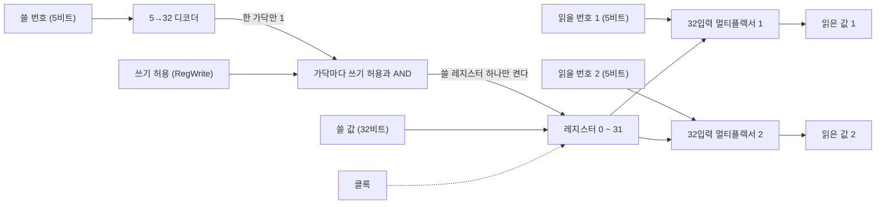



요약

프로세서가 계산에 쓰는 값들을 담아 두는 작은 서랍장이다. 서랍마다 번호가 있고, 번호를 대면 그 서랍의 값이 바로 나온다. 한 번에 서랍 둘을 들여다보고 하나에 새 값을 넣을 수 있어서, 두 값을 꺼내 계산하고 결과를 넣는 일이 한 박자에 된다. 꺼내는 것은 언제든 되지만 넣는 것은 박자가 오는 순간에만 된다. 그래서 같은 박자에 같은 서랍을 읽고 쓰면 읽히는 것은 옛값이다. 빠른 대신 한 칸에 드는 부품이 많아, 큰 메모리는 다른 방식으로 만든다.

## 예시로 보기

`add $t0, $s1, $s2`를 하려면 레지스터 두 개를 읽고 하나에 써야 한다. 플립플롭 묶음 32개에서 "이번에는 17번과 18번을 읽고 8번에 쓴다"를 명령마다 다르게 고르는 회로가 필요하다.

레지스터 4개짜리 8비트 레지스터 파일로 줄여서 본다. 처음에 R0 = 0, R1 = 7, R2 = 0, R3 = 0이다. 박자(사이클)마다 읽을 번호 둘, 쓸 번호, 쓸 값, 쓰기 허용 신호를 준다.

| 사이클 | 읽기 1 | 읽기 2 | 쓸 번호 | 쓸 값 | 쓰기 허용 | 사이클 동안 나오는 값 | 에지 뒤 R0~R3 |
|---|---|---|---|---|---|---|---|
| 1 | R1 | R2 | R2 | 25 | 1 | 7, 0 | 0, 7, 25, 0 |
| 2 | R2 | R1 | R3 | 32 | 1 | 25, 7 | 0, 7, 25, 32 |
| 3 | R3 | R2 | R1 | 99 | 0 | 32, 25 | 0, 7, 25, 32 |
| 4 | R1 | R3 | R1 | 57 | 1 | 7, 32 | 0, 57, 25, 32 |

- 사이클 1에서 R2를 읽으면서 R2에 25를 쓴다. 사이클 동안 읽히는 것은 옛값 0이다. 25는 사이클 끝의 에지에서 들어가고, 사이클 2에서 읽힌다.
- 사이클 3은 쓰기 허용이 0이라 99가 들어가지 않는다.
- 사이클 4는 R1에 $$25 + 32 = 57$$을 쓰면서 R1을 읽는다. 읽히는 것은 7이다.

검증: 위 표, 디코더가 32개 가운데 하나만 켜는 것, 32개 × 32비트 레지스터 파일을 무작위 20,000사이클 돌려 단순한 본보기와 비교(0번 레지스터는 늘 0), 카드 C2·C3 — [10_register-file_verify.py](/Hongs_Blog/studies/computer-architecture/code/10_register-file_verify/) (실제 하드웨어가 아니라 파이썬 흉내. 상승 에지 하나를 함수 호출 하나로 본다)

## 구조

**레지스터.** [D 플립플롭](/Hongs_Blog/studies/computer-architecture/latch-flip-flop/)을 여러 개 나란히 놓고 같은 클록을 준 것이다. 32개면 32비트 값 하나를 담는다[^1].

**레지스터 파일.** 레지스터 여러 개를 묶고, 번호를 대서 읽고 쓰게 만든 것이다. MIPS 프로세서의 레지스터 파일은 32비트 레지스터 32개에 읽는 곳 둘, 쓰는 곳 하나가 있다[^1].

읽는 길에는 클록이 없고 쓰는 길에만 있다[^s1].

| 선 | 너비 | 하는 일 |
|---|---|---|
| 읽을 번호 1, 2 | 5비트씩 | 읽을 레지스터를 고른다 |
| 읽은 값 1, 2 | 32비트씩 | 그 레지스터에 지금 들어 있는 값 |
| 쓸 번호 | 5비트 | 쓸 레지스터를 고른다 |
| 쓸 값 | 32비트 | 넣을 값 |
| 쓰기 허용 (RegWrite) | 1비트 | 1일 때만 에지에서 쓴다 |

**읽기.** 레지스터 32개의 출력을 [32입력 멀티플렉서](/Hongs_Blog/studies/computer-architecture/mux-decoder/)에 모두 잇고, 읽을 번호를 선택 신호로 준다. 읽는 곳이 둘이므로 멀티플렉서도 둘이다. 읽기는 아무 값도 바꾸지 않아서 번호만 주면 된다[^1].

**쓰기.** 쓸 번호를 5→32 디코더에 넣어 32가닥 가운데 하나만 켠다. 가닥마다 쓰기 허용 신호와 AND해서 레지스터의 "이번 에지에 새 값을 받아라" 입력에 잇는다. 쓸 값은 32개 모두에 이어 두지만, 켜진 하나만 에지에서 받는다[^1].

**같은 사이클에 같은 레지스터를 읽고 쓰면.** 쓰기는 에지에서 일어나므로 사이클 동안 읽히는 값은 앞 사이클까지 들어 있던 값이다. 지금 쓰고 있는 값을 바로 읽고 싶으면 회로를 더 달아야 한다[^1].

**0번 레지스터.** MIPS에서 0번 레지스터(`$zero`)는 늘 0이다. 0번에 쓰는 신호를 막아 두면 된다[^2][^s2].

## 보장하는 것과 보장하지 않는 것

**보장하는 것.** 쓰기 허용이 1인 사이클의 에지 뒤에는 쓸 번호의 레지스터가 쓸 값을 담고, 다른 레지스터는 그대로다. 쓰기 허용이 0이면 쓸 번호와 쓸 값이 무엇이든 아무것도 바뀌지 않는다. 읽은 값은 멀티플렉서의 지연 뒤에 그 레지스터의 지금 값이다.

**보장하지 않는 것.**

- 이번 사이클에 쓰는 값이 이번 사이클의 읽기에 보이지 않는다. 명령이 겹쳐 도는 프로세서에서는 이것이 문제가 되어 따로 손을 쓴다: [데이터 해저드와 전방 전달](/Hongs_Blog/studies/computer-architecture/data-hazard-forwarding/).
- 한 사이클에 둘 이상의 레지스터에 쓰지 못한다. 쓰는 곳이 하나뿐이다.

## 더 큰 기억 장치

레지스터 파일은 칸마다 플립플롭이 있고 칸 수만큼 넓은 멀티플렉서가 필요해서 작은 기억 장치에만 쓴다. 더 큰 메모리는 두 가지 칸으로 만든다[^3].

| | 정적 램 (SRAM) | 동적 램 (DRAM) |
|---|---|---|
| 비트 하나를 담는 방법 | 서로 물린 인버터 한 쌍 | 축전기에 모은 전하 |
| 비트당 트랜지스터 | 4~6개 | 1개 |
| 가만히 두면 | 전원이 있는 한 그대로 | 전하가 새서 주기적으로 읽고 다시 써야 한다 |
| 빠르기와 값 | 빠르고 비트당 비싸다 | 느리고 비트당 싸다 |

DRAM에서 새는 전하를 다시 채우는 일을 리프레시라 부른다. "동적"이라는 이름이 여기서 왔다[^3]. 이 둘이 어디에 쓰이는지는 [메모리 계층](/Hongs_Blog/studies/operating-systems/memory-hierarchy/)에 이어진다.

## 활용

- 데이터패스에서 명령의 레지스터 번호 칸이 읽을 번호와 쓸 번호에 그대로 이어진다: [데이터패스의 구성 요소](/Hongs_Blog/studies/computer-architecture/datapath-elements/). 레지스터 32개의 이름과 쓰임은 [MIPS 레지스터와 메모리 피연산자](/Hongs_Blog/studies/computer-architecture/mips-operands/)에 있다.
- 값을 쓰지 않는 명령(`sw`, `beq`)에서는 제어 장치가 쓰기 허용을 0으로 내린다. 그러지 않으면 쓸 번호 선에 걸려 있던 아무 레지스터나 망가진다.
- x86의 레지스터는 수가 적고 이름마다 쓰임이 정해진 것이 있다: [x86 레지스터](/Hongs_Blog/studies/assembly-language/x86-registers/).
- **흔한 실수.** 읽기에도 클록이 필요하다고 생각하는 것. 읽기는 조합 회로라 번호를 주면 클록과 상관없이 값이 나온다.

## 연결

- 선수: [래치와 플립플롭](/Hongs_Blog/studies/computer-architecture/latch-flip-flop/), [멀티플렉서와 디코더](/Hongs_Blog/studies/computer-architecture/mux-decoder/)
- 운영체제가 본 레지스터의 종류: [프로세서 레지스터](/Hongs_Blog/studies/operating-systems/processor-registers/)

## 확인 문제

**C1** MIPS 레지스터 파일의 입력과 출력을 너비와 함께 쓰고, 읽기와 쓰기에 각각 어떤 부품을 쓰는지 말하라.

**답:** 입력은 읽을 번호 둘(5비트씩), 쓸 번호(5비트), 쓸 값(32비트), 쓰기 허용(1비트), 클록. 출력은 읽은 값 둘(32비트씩). 읽기는 32입력 멀티플렉서 둘, 쓰기는 5→32 디코더와 쓰기 허용의 AND. 
**이유:** 레지스터가 32개라 번호가 $$\log_2 32 = 5$$비트다.

**C2** R1 = 7, R2 = 25인 레지스터 파일에서 한 사이클 동안 읽을 번호를 둘 다 R2로, 쓸 번호를 R2로, 쓸 값을 50으로, 쓰기 허용을 1로 준다. 이 사이클에 나오는 두 값과 다음 사이클에 같은 번호를 읽을 때 나오는 두 값은?

**답:** 이 사이클: 25, 25. 다음 사이클: 50, 50. 
**흔한 오답:** 이 사이클에 50이 읽힌다고 답하는 것. 쓰기는 사이클 끝의 에지에서 일어난다.

**C3** 쓰기 허용 신호가 없고 사이클마다 늘 쓴다면 `beq`처럼 레지스터에 쓸 것이 없는 명령에서 무슨 일이 생기는가?

**답:** 쓸 번호와 쓸 값 선에는 늘 무슨 값이든 걸려 있다. 그 번호의 레지스터가 그 값으로 덮여, 프로그램이 쓰지 않은 레지스터가 바뀐다. 
**이유:** 선에는 "값 없음"이 없다. 0이든 1이든 걸려 있으므로, 쓰지 말라는 뜻은 따로 신호 하나로 알려야 한다.

[^1]: Patterson & Hennessy, *Computer Organization and Design*, 부록 "The Basics of Logic Design"의 B.8절 "Memory Elements: Flip-flops, Latches, and Registers" 가운데 "Register Files" (D 플립플롭을 늘어놓은 레지스터, 읽는 곳 둘과 쓰는 곳 하나, 읽기는 멀티플렉서 한 쌍, 쓰기는 디코더, 같은 사이클에 읽고 쓰면 앞 사이클에 쓴 값이 읽힌다는 것). 절 번호는 공개된 PDF 기준이고 판에 따라 부록 문자가 다를 수 있다. https://www.doc.ic.ac.uk/~wl/teachlocal/arch/HP05/HP_AppB.pdf
[^2]: Patterson & Hennessy, *Computer Organization and Design* (MIPS Edition), 2장 "Instructions: Language of the Computer" (0번 레지스터 `$zero`는 늘 0). 책을 직접 열지 못해 장까지만 적는다.
[^3]: [^1]과 같은 부록의 B.9절 "Memory Elements: SRAMs and DRAMs" (SRAM은 인버터 한 쌍에 값을 두고 전원이 있는 한 지킨다, 비트당 트랜지스터 4~6개, DRAM은 축전기의 전하와 트랜지스터 1개, 주기적인 리프레시, SRAM이 더 빠르고 덜 촘촘하고 비트당 비싸다).
[^s1]: 4개 × 8비트 추적 표와 다이어그램 1개는 직접 만들었다. 선의 이름은 [^1]의 Verilog 예(Read1, Read2, WriteReg, WriteData, RegWrite)를 따랐고, 표는 흉내기로 확인했다.
[^s2]: 0번에 쓰는 신호를 막는다는 것은 `$zero`를 만드는 한 가지 방법으로, 검증 코드의 흉내기가 이렇게 한다. 책의 부록 회로에는 이 부분이 그려져 있지 않다.

