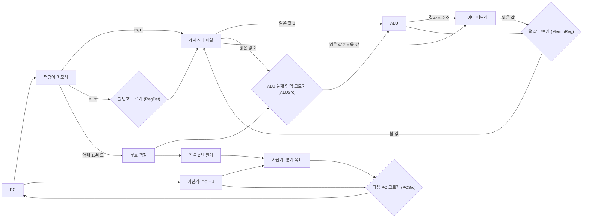


<div class="callout callout-summary" markdown="1">
<div class="callout-title callout-title--default" markdown="span">요약</div>

시계가 한 번 울리는 동안 명령어 하나를 처음부터 끝까지 끝내는 프로세서다. 물이 수도꼭지에서 나와 여러 갈래 관을 한 번에 훑고 지나가듯, 주소가 명령어를 꺼내고, 명령어가 레지스터를 읽고, 그 값이 계산기를 지나 메모리를 거쳐 다시 레지스터로 돌아온다. 구조가 단순해서 이해하기 쉽다. 대신 가장 오래 걸리는 명령어에 맞춰 시계를 느리게 잡아야 해서 실제 프로세서는 이렇게 만들지 않는다.

</div>


## 예시로 보기

명령어 여섯 개를 실행한다. 시작할 때 `$s1` = 7, `$s2` = 5, `$s3` = 100, `$t1` = 12이고, 메모리 108번지에 40이 들어 있다.

```asm
 0:       add $t0, $s1, $s2     # $t0 = 7 + 5
 4:       lw  $t2, 8($s3)       # $t2 = 메모리[100 + 8]
 8:       sw  $t0, 12($s3)      # 메모리[100 + 12] = $t0
12:       beq $t0, $t1, skip    # 같으면 skip으로
16:       sub $t3, $t2, $t0
20: skip: or  $t4, $t0, $t2
```

사이클마다 도선에 흐르는 값은 아래와 같다. 빈칸은 그 명령어가 쓰지 않는 값이다.

| 사이클 | PC | 명령어 | 레지스터에서 읽은 값 | ALU에 들어간 두 값 | ALU 결과 | 메모리 | 레지스터에 쓴 것 | 다음 PC |
|---|---|---|---|---|---|---|---|---|
| 1 | 0 | `add` | 7, 5 | 7, 5 | 12 | | `$t0` ← 12 | 4 |
| 2 | 4 | `lw` | 100 | 100, 8 | 108 | 108번지에서 40을 읽음 | `$t2` ← 40 | 8 |
| 3 | 8 | `sw` | 100, 12 | 100, 12 | 112 | 112번지에 12를 씀 | | 12 |
| 4 | 12 | `beq` | 12, 12 | 12, 12 | 0 (같다) | | | 20 |
| 5 | 20 | `or` | 12, 40 | 12, 40 | 44 | | `$t4` ← 44 | 24 |

4번째 사이클에서 ALU는 뺄셈을 한다. 결과가 0이라 두 값이 같다는 뜻이고, 다음 PC가 16이 아니라 20이 된다. 16번지의 `sub`는 실행되지 않는다.

<div class="callout callout-check" markdown="1">
<div class="callout-title" markdown="span">검증: 위 표의 모든 칸, 카드와 연습 문서의 값, 무작위 프로그램 3,000개에서 "명령어의 뜻만 따라 하는 해석기"와 결과·실행 순서가 같음 — [24_single-cycle-datapath_impl.py](/Hongs_Blog/studies/computer-architecture/code/24_single-cycle-datapath_impl/) (실제 하드웨어가 아니라 파이썬 흉내)</div>

</div>


## 부품을 잇는 법

[데이터패스의 구성 요소](/Hongs_Blog/studies/computer-architecture/datapath-elements/)의 부품을 아래처럼 잇는다[^1]. 마름모는 둘 중 하나를 고르는 멀티플렉서이고, 괄호 안은 그 선택을 정하는 제어 신호 이름이다. 신호의 값을 누가 어떻게 정하는지는 [제어 장치와 제어 신호](/Hongs_Blog/studies/computer-architecture/control-unit/)에서 다룬다.



명령어 32비트는 꺼내자마자 여러 갈래로 갈라진다. 25~21번 비트(rs)와 20~16번 비트(rt)는 레지스터 파일의 읽을 번호로 간다. 15~11번 비트(rd)는 쓸 번호 후보로 간다. 아래 16비트는 부호 확장기로 간다. 31~26번 비트(opcode)는 제어 장치로 간다([MIPS 명령어 형식](/Hongs_Blog/studies/computer-architecture/mips-instruction-formats/)).

멀티플렉서가 네 곳에 있는 까닭은 명령어마다 같은 자리에 다른 값을 넣어야 하기 때문이다.

| 고르는 곳 | 0일 때 | 1일 때 | 왜 갈리나 |
|---|---|---|---|
| 쓸 레지스터 번호 | rt (20~16번 비트) | rd (15~11번 비트) | `lw`는 rt에, R형은 rd에 쓴다 |
| ALU 둘째 입력 | 레지스터에서 읽은 값 2 | 부호 확장한 16비트 | R형·`beq`는 레지스터끼리, `lw`·`sw`는 레지스터 + 상수 |
| 레지스터에 쓸 값 | ALU 결과 | 메모리에서 읽은 값 | R형은 계산 결과를, `lw`는 메모리 값을 쓴다 |
| 다음 PC | PC + 4 | 분기 목표 | 분기 조건이 맞을 때만 다른 곳으로 간다 |

표의 0·1 배치는 공개 강의 자료의 정의를 따랐다[^2].

## 명령어마다 지나는 길

같은 회로를 명령어 종류마다 다른 길로 쓴다. 식에서 $$R[x]$$는 "레지스터 $$x$$번의 값", $$M[a]$$는 "메모리 $$a$$번지의 값", $$\leftarrow$$는 "오른쪽 값을 왼쪽에 넣는다"로 읽는다[^3].

**R형 (`add`, `sub`, `and`, `or`, `slt`).** 레지스터 둘을 읽어 ALU로 계산하고 결과를 rd에 쓴다. 데이터 메모리는 건드리지 않는다.

$$R[rd] \leftarrow R[rs] \;\text{op}\; R[rt], \qquad \text{PC} \leftarrow \text{PC} + 4$$


**`lw`.** rs의 값에 상수를 더해 주소를 만들고, 그 주소의 메모리 값을 rt에 쓴다. 다섯 부품(명령어 메모리, 레지스터 읽기, ALU, 데이터 메모리, 레지스터 쓰기)을 모두 지나는 유일한 명령어다.

$$R[rt] \leftarrow M[R[rs] + \text{부호 확장}(imm)]$$


**`sw`.** 주소는 `lw`처럼 만든다. rt의 값은 ALU를 거치지 않고 곧장 데이터 메모리의 "쓸 값" 구멍으로 간다. 레지스터에는 쓰지 않는다.

$$M[R[rs] + \text{부호 확장}(imm)] \leftarrow R[rt]$$


**`beq`.** ALU가 두 레지스터를 뺀다. 결과가 0이면 ALU의 Zero 출력이 1이 된다. 그 사이 다른 가산기가 분기 목표를 구해 둔다. Zero가 1이면 그 목표가 PC로 들어간다.

$$\text{PC} \leftarrow \begin{cases}(\text{PC}+4) + (\text{부호 확장}(imm) \ll 2) & R[rs] = R[rt]\text{일 때} \\ \text{PC}+4 & \text{아닐 때}\end{cases}$$


**`j`.** 위 그림에 멀티플렉서 하나를 더 붙인다. 명령어의 아래 26비트를 왼쪽으로 두 칸 밀어 28비트로 만들고, 그 앞에 PC + 4의 위 4비트를 붙여 32비트 주소를 만든다[^4]. 레지스터도 ALU도 쓰지 않는다.

$$\text{PC} \leftarrow \{(\text{PC}+4)\text{의 위 4비트},\; \text{주소 칸 26비트},\; 00\}$$


| 부품 | R형 | `lw` | `sw` | `beq` | `j` |
|---|---|---|---|---|---|
| 명령어 메모리 | 쓴다 | 쓴다 | 쓴다 | 쓴다 | 쓴다 |
| 레지스터 읽기 | 둘 | 하나 (rs) | 둘 | 둘 | |
| ALU | 계산 | 주소 더하기 | 주소 더하기 | 빼서 견주기 | |
| 데이터 메모리 | | 읽는다 | 쓴다 | | |
| 레지스터 쓰기 | rd에 | rt에 | | | |

## 왜 맞게 돌아가나

**주장.** 한 사이클이 끝났을 때 PC, 레지스터, 메모리는 그 명령어의 식대로 바뀌어 있다. 사이클이 충분히 길다는 조건에서다.

<details class="callout callout-proof" markdown="1">
<summary class="callout-title" markdown="span">이유 펼치기</summary>

1. **사이클의 시작.** 클록이 올라간 직후 PC, 레지스터 파일, 데이터 메모리에는 앞 명령어까지의 결과가 들어 있다. — 기억하는 부품은 클록이 올라갈 때만 바뀐다
2. **값이 퍼진다.** PC의 주소가 명령어 메모리를 지나 명령어가 되고, 명령어의 칸들이 레지스터 파일과 부호 확장기를 지나고, 그 출력이 ALU를 지나고, ALU 결과가 데이터 메모리를 지난다. 이 부품들은 계산만 하므로 입력이 정해지면 출력도 조금 뒤 정해진다. — 계산하는 부품의 성질
3. **고리가 없다.** 값이 흐르는 방향은 늘 PC → 명령어 메모리 → 레지스터 읽기 → ALU → 데이터 메모리 → 쓸 값이다. 계산하는 부품끼리 출력이 자기 입력으로 되돌아오는 길이 없다. 그래서 값은 한 번 훑고 나면 더 바뀌지 않는다. — 그림의 화살표 방향
4. **사이클의 끝.** 다음 클록이 올라가는 순간 "다음 PC"가 PC에, "쓸 값"이 레지스터 파일에(쓰기 신호가 1일 때), "쓸 값"이 데이터 메모리에(쓰기 신호가 1일 때) 들어간다. 이때 넣는 값은 2의 계산이 끝난 값이다. — 사이클이 가장 긴 길보다 길다는 조건
5. 멀티플렉서와 쓰기 신호가 명령어 종류에 맞게 정해져 있으면, 4에서 들어가는 값이 바로 위 식의 오른쪽이다. ∎

4의 조건이 깨지면(사이클이 너무 짧으면) 아직 덜 퍼진 값이 저장된다. 그 경계는 [단일 사이클의 클록 주기](/Hongs_Blog/studies/computer-architecture/single-cycle-timing/)에서 계산한다.

</details>


위 주장은 흉내기로도 확인했다. 실험으로 확인한 것이고, 회로 수준의 증명은 아니다.

### 스스로 설명해 보기

<details class="callout callout-question" markdown="1">
<summary class="callout-title" markdown="span">1. `add $t0, $t0, $t1`처럼 읽는 레지스터와 쓰는 레지스터가 같아도 값이 엉키지 않는 이유는?</summary>

읽기는 사이클 내내 옛 값을 내보내고, 쓰기는 다음 클록이 올라가는 순간에만 일어난다. 새 값이 들어갈 때는 이미 계산이 끝나 있다. 위 2와 4의 차이다.

</details>


<details class="callout callout-question" markdown="1">
<summary class="callout-title" markdown="span">2. 3에서 "고리가 없다"가 왜 필요한가?</summary>

계산하는 부품의 출력이 자기 입력으로 돌아오면 값이 한 번 훑는 것으로 끝나지 않고 계속 바뀔 수 있다. 고리는 반드시 기억하는 부품(PC, 레지스터 파일)을 지나야 클록이 "한 바퀴"를 끊어 준다.

</details>


<details class="callout callout-question" markdown="1">
<summary class="callout-title" markdown="span">3. `sw`를 실행할 때 메모리에서 읽은 값 쪽 도선에는 무엇이 흐르는가? 그래도 괜찮은 이유는?</summary>

읽기 신호가 0이라 뜻 없는 값이 흐른다. 레지스터 쓰기 신호가 0이므로 그 값은 어디에도 저장되지 않는다. 틀린 값이 흘러도 저장만 안 되면 결과는 맞다.

</details>


<details class="callout callout-question" markdown="1">
<summary class="callout-title" markdown="span">이 논증의 핵심 아이디어는?</summary>

한 사이클을 "기억하는 부품에서 나와 → 계산하는 부품만 지나 → 기억하는 부품으로 들어가는" 한 번의 흐름으로 본다. 그러면 프로세서 전체가 "지금 상태에서 다음 상태를 구하는 큰 계산 하나"가 된다.

</details>


<details class="callout callout-question" markdown="1">
<summary class="callout-title" markdown="span">이 방법을 쓸 수 있는 다른 상황은?</summary>

[5단계 파이프라인](/Hongs_Blog/studies/computer-architecture/mips-pipeline/)의 한 단계도 같은 꼴이다. 단계 사이에 레지스터를 끼워 넣어, 단계마다 "레지스터 → 계산 → 레지스터"가 되게 한다.

</details>


## 활용

- 구현: [24_single-cycle-datapath_impl.py](/Hongs_Blog/studies/computer-architecture/code/24_single-cycle-datapath_impl/). 연습: [데이터패스 추적 예제 사다리](/Hongs_Blog/studies/computer-architecture/datapath-tracing-ladder/)
- 새 명령어를 넣을 수 있는지 묻는 문제는 이 그림에서 "필요한 값이 필요한 자리까지 가는 길이 있는가"를 따지면 풀린다. 길이 있으면 제어 신호만 정하고, 없으면 멀티플렉서의 입력을 늘린다.
- 흔한 실수: `sw`에서 rt의 값이 ALU로 간다고 그리는 것. ALU의 둘째 입력은 상수이고, rt의 값은 데이터 메모리의 쓸 값으로 간다.
- 흔한 실수: `beq`의 분기 목표를 ALU가 구한다고 쓰는 것. ALU는 비교(뺄셈)에 쓰이고, 목표 주소는 따로 둔 가산기가 구한다.
- 컴파일러 과목의 [코드 생성용 MIPS 명령어](/Hongs_Blog/studies/compilers/mips-instructions/)는 표기를 단순하게 바꾼 것이라 여기의 실제 MIPS 표기와 다르다.

## 연결

- 선수: [데이터패스의 구성 요소](/Hongs_Blog/studies/computer-architecture/datapath-elements/), [MIPS 명령어 형식](/Hongs_Blog/studies/computer-architecture/mips-instruction-formats/), [MIPS 분기와 점프](/Hongs_Blog/studies/computer-architecture/mips-branch-jump/)
- 분기와 점프의 주소를 만드는 규칙: [MIPS 주소 지정 방식](/Hongs_Blog/studies/computer-architecture/mips-addressing-modes/)
- 같은 일을 "가져오기 → 실행하기"의 고리로 본 모습: [명령어 사이클](/Hongs_Blog/studies/operating-systems/instruction-cycle/)
- 이 회로를 다섯 토막으로 자르기: [5단계 파이프라인](/Hongs_Blog/studies/computer-architecture/mips-pipeline/)

## 자주 하는 오해

<div class="callout callout-misconception" markdown="1">
<div class="callout-title" markdown="span">"명령어가 쓰지 않는 부품은 그 사이클에 쉰다"</div>

틀렸다. 회로에는 "쉰다"가 없다. `add`를 실행하는 사이클에도 부호 확장기는 명령어의 아래 16비트를 늘리고, 분기용 가산기는 그 값으로 주소를 더하고, 데이터 메모리의 주소 구멍에는 ALU 결과가 들어간다. 명령어를 보고 필요한 부품만 켠다고 생각하기 쉬워서 그럴듯해 보인다. 실제로는 모든 부품이 늘 계산하고, 멀티플렉서가 그 가운데 쓸 값만 고르며, 쓰기 신호가 0인 곳에는 아무것도 저장되지 않는다. 확인하는 법: 흉내기에서 `add`를 실행할 때도 분기 목표 값이 계산되어 나오지만 다음 PC는 PC + 4다.

</div>


## 확인 문제

<details class="callout callout-question" markdown="1">
<summary class="callout-title" markdown="span">**C1** 데이터패스에서 멀티플렉서가 고르는 네 가지(`j`를 빼고)와, 각각 무엇과 무엇 사이에서 고르는지 쓰라.</summary>

**답:** ① 쓸 레지스터 번호: rt와 rd. ② ALU 둘째 입력: 레지스터에서 읽은 값 2와 부호 확장한 16비트. ③ 레지스터에 쓸 값: ALU 결과와 메모리에서 읽은 값. ④ 다음 PC: PC + 4와 분기 목표.<br>
**이유:** 넷 다 "명령어 종류에 따라 같은 자리에 다른 값이 가야 하는 곳"이다.

</details>


<details class="callout callout-question" markdown="1">
<summary class="callout-title" markdown="span">**C2** `$s3` = 100이고 메모리 96번지에 77이 있다. `lw $t5, -4($s3)`을 실행하는 사이클에서 부호 확장기의 출력(16진수), ALU 결과, `$t5`에 들어가는 값은?</summary>

**답:** 부호 확장기 `0xFFFFFFFC`, ALU 결과 96, `$t5` ← 77.<br>
**이유:** $$-4$$의 16비트 표현은 `0xFFFC`이고 위쪽을 1로 채운다. $$100 + (-4) = 96$$이 주소가 된다.<br>
**흔한 오답:** ALU 결과를 104로 쓰는 것(부호를 놓침).

</details>


<details class="callout callout-question" markdown="1">
<summary class="callout-title" markdown="span">**C3** `beq`를 실행하는 사이클에 ALU와 분기용 가산기가 각각 하는 일을 한 문장씩으로 쓰라.</summary>

**답:** ALU는 두 레지스터 값을 빼서 결과가 0인지(Zero) 알린다. 분기용 가산기는 PC + 4에 "부호 확장한 16비트를 왼쪽으로 두 칸 민 값"을 더해 갈 주소를 구한다.

</details>


<details class="callout callout-question" markdown="1">
<summary class="callout-title" markdown="span">**C4** 40번지에 `beq $t0, $t0, -3`이 있다. 다음 PC를 구하고, 그 값이 그림의 어느 부품들을 지나 PC에 들어가는지 차례로 쓰라.</summary>

**답:** 32. 명령어의 아래 16비트 → 부호 확장(`0xFFFFFFFD`) → 왼쪽 2칸 밀기($$-12$$) → 분기용 가산기($$44 - 12 = 32$$) → 다음 PC를 고르는 멀티플렉서 → PC.<br>
**이유:** 두 레지스터가 같은 레지스터라 ALU의 뺄셈 결과가 0이고 Zero가 1이어서 멀티플렉서가 분기 목표를 고른다.

</details>


<details class="callout callout-question" markdown="1">
<summary class="callout-title" markdown="span">**C5** `lw`가 다른 명령어보다 오래 걸리는 이유를 지나는 부품으로 설명하라.</summary>

**답:** `lw`만 명령어 메모리, 레지스터 읽기, ALU, 데이터 메모리, 레지스터 쓰기를 모두 차례로 지난다. R형은 데이터 메모리를, `sw`는 레지스터 쓰기를, `beq`는 둘 다를 건너뛴다.

</details>


[^1]: Patterson & Hennessy, *Computer Organization and Design* (MIPS Edition), 4장 "The Processor". 그림은 이 장의 단일 사이클 데이터패스를 보고 Mermaid로 다시 그린 것이다. 절·그림 번호는 직접 확인하지 못해 적지 않는다.
[^2]: Princeton COS/ELE 375 (Fall 2015, David August), Lecture 8 "Control", 슬라이드 8~10, 14 (PCSrc, RegDst, ALUSrc, MemtoReg가 참·거짓일 때 고르는 값), https://www.cs.princeton.edu/courses/archive/fall15/cos375/lectures/08-Control.pdf
[^3]: MIPS Reference Data (교재의 참조표, Univ. of Patras 게시본), add·lw·sw·beq·j의 동작 식, https://eclass.upatras.gr/modules/document/file.php/EE805/MIPS_Instruction_Set/MIPSReferenceData.pdf
[^4]: NYU, A. Gottlieb, Computer Architecture 2007-08 Fall, Lecture 17 (점프: 주소 칸은 워드 주소, 아래 두 비트는 0, PC + 4의 위 4비트는 그대로), https://cs.nyu.edu/~gottlieb/courses/2000s/2007-08-fall/arch/lectures/lecture-17.html. 같은 참조표의 JumpAddr = { PC+4[31:28], address, 2'b0 }

