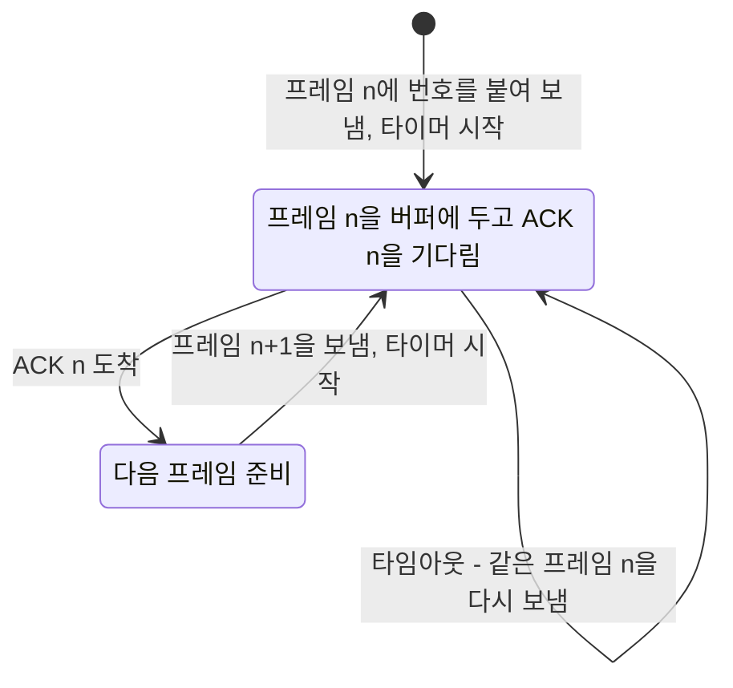
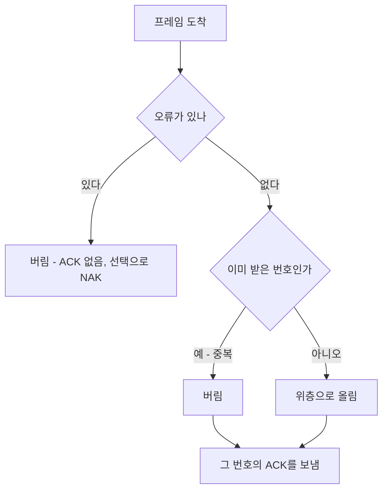



요약

보내는 쪽은 데이터 덩어리(프레임)를 보내고, 받는 쪽은 망가지지 않은 프레임을 받으면 "받았다"는 짧은 답장(ACK)을 돌려준다. 정해 둔 시간(타임아웃) 안에 ACK가 오지 않으면 보내는 쪽이 같은 프레임을 다시 보낸다. ACK만 사라져도 다시 보내게 되어 같은 프레임이 두 번 갈 수 있으므로, 프레임마다 번호(순서 번호)를 붙여 이미 받은 것을 알아보고 버린다. 양쪽은 서로의 사정을 볼 수 없어서, 상대가 보낸 메시지만 보고 정해진 규칙대로 움직여야 한다.

## 예시로 보기

링크 위에서는 프레임이 잡음에 망가지거나 통째로 사라질 수 있다. 받는 쪽은 [CRC](/Hongs_Blog/studies/computer-communication/crc/) 같은 오류 검출 코드로 망가진 프레임을 알아보고 버릴 수 있다. 하지만 버리기만 하면 그 데이터는 영영 도착하지 않는다. 보낸 쪽이 무언가를 다시 해 줘야 한다.

어려운 점은 양쪽이 서로의 사정을 볼 수 없다는 것이다. 송신자와 수신자를 동시에 보는 것은 현실에서 불가능하다. 각자 상대에게서 온 메시지로만 상대의 상태를 짐작한다. 그래서 송신자 동작과 수신자 동작을 따로 정리한다.

정지 대기에서 생길 수 있는 네 경우를 순서 번호 없이 따라가면 다음과 같다[^s1].

| 경우 | 일어난 일 | 송신자 | 수신자 | 결과 |
|---|---|---|---|---|
| (a) | 프레임과 ACK 모두 도착 | ACK를 받고 다음 프레임 | 한 번 받음 | 정상 |
| (b) | 프레임 분실 | 타임아웃 → 재전송 | 재전송된 것만 받음 | 정상 |
| (c) | ACK 분실 | 타임아웃 → 재전송 | 같은 프레임을 두 번 받음 | **중복** |
| (d) | ACK가 타임아웃보다 늦게 도착 | 타임아웃 → 재전송 | 같은 프레임을 두 번 받음 | **중복** |

그림은 표의 네 경우를 시간표로 그린 것이다. 왼쪽 위가 (a), 오른쪽 위가 (b), 왼쪽 아래가 (c), 오른쪽 아래가 (d)다. 칸마다 왼쪽 세로줄이 송신자, 오른쪽 세로줄이 수신자이고, 시간은 위에서 아래로 흐른다. 맨 왼쪽 숫자는 시각이다.

프레임이나 ACK가 반대편에 닿는 데 시간 1이 걸린다고 잡았다. 그래서 파란 프레임 화살표와 초록 ACK 화살표는 옆으로 곧게 가지 않고 한 칸 아래로 기운다. 보내고 받는 사이에 시간이 흐른다는 뜻이다. 프레임이 가고 ACK가 돌아오는 왕복에는 2가 걸린다.

송신자 줄 왼쪽의 괄호는 송신자가 건 타이머다. 실선은 타이머가 돌고 있는 동안이고, 점선은 ACK가 와서 타이머를 멈춘 뒤 남은 시간이다. (a)~(c)의 타이머는 2.5, (d)만 1.5다. 그래서 (d)만 타이머가 왕복 시간 2보다 짧다. 주황 ✕는 메시지가 그 자리에서 사라졌다는 표시이고, 수신자 쪽 주황 점은 같은 프레임을 두 번째로 받은 순간이다[^s3].

### 네 경우를 양쪽에서 따라가기

**(a) 정상.** 시각 0에 송신자가 프레임을 보내고 타이머를 2.5로 맞춘다. 이때 송신자가 아는 것은 "보냈다"뿐이다.

시각 1에 프레임이 수신자에게 닿는다. 수신자는 오류 검출 코드로 프레임이 멀쩡한지 확인하고, 데이터를 위층(받은 데이터를 쓰는 프로그램 쪽)으로 올린 뒤 ACK를 보낸다. 수신자는 이 ACK가 무사히 갈지 알 길이 없다.

시각 2에 ACK가 송신자에게 닿는다. 타이머가 2.5에 이르기 전이므로 송신자는 타이머를 멈추고 다음 프레임으로 넘어간다. 송신자가 "그 프레임이 갔다"고 확신하는 것은 이 순간이 처음이다.

**(b) 프레임 분실.** 시각 0은 (a)와 같다. 프레임은 가는 도중 ✕ 자리에서 사라진다. 잡음에 망가져 수신자가 오류 검출로 버린 경우도, NAK(아래 정의)를 쓰지 않는다면 결과가 같다.

수신자에게는 아무것도 오지 않았다. 그래서 수신자는 프레임이 출발했다는 사실조차 모른다. 모르는 프레임에는 답할 수 없으므로 ACK도 보내지 않는다.

송신자 쪽에서는 시각 2가 지나도 ACK가 오지 않는다. 시각 2.5에 타이머가 다 되자 송신자는 같은 프레임을 다시 보낸다. 다시 보낸 프레임은 시각 3.5에 닿는다. 수신자는 이것을 처음 받는 프레임으로 알고 올린 뒤 ACK를 보낸다. ACK는 시각 4.5에 송신자에게 닿는다. 수신자는 프레임을 한 번만 받았으므로 결과는 정상이다.

**(c) ACK 분실.** 시각 1까지는 (a)와 같다. 수신자는 프레임을 올리고 ACK를 보낸다. 수신자 쪽에서 보면 할 일을 다 했다.

그런데 ACK가 돌아오는 도중 ✕ 자리에서 사라진다. 송신자 쪽에서 보면 시각 2.5까지 아무것도 오지 않았다. 이것은 (b)에서 송신자가 본 것과 똑같다. 송신자는 프레임이 사라졌는지 ACK가 사라졌는지 구별할 수 없다. 그래서 (b)와 똑같이 시각 2.5에 다시 보낸다.

시각 3.5에 수신자에게 같은 프레임이 또 온다. 번호가 없으므로 수신자 눈에는 이 프레임이 새 프레임과 똑같이 생겼다. 수신자는 이것을 또 위층으로 올린다. 이 프레임이 파일의 한 조각이었다면, 받은 파일 안에 같은 조각이 두 번 들어가 파일이 망가진다.

**(d) ACK가 타임아웃보다 늦게 옴.** 이 경우에는 아무것도 사라지지 않는다. 문제는 타이머가 1.5로, 왕복 시간 2보다 짧다는 데 있다.

시각 1에 수신자가 프레임을 받아 올리고 ACK를 보낸다. ACK가 아직 오는 중인 시각 1.5에 송신자의 타이머가 다 된다. 송신자는 ACK가 오는 중인지 알 수 없으니 규칙대로 다시 보낸다.

시각 2에 처음 보낸 ACK가 도착한다. 송신자는 이것을 "보낸 프레임이 잘 갔다"는 답으로 받고 다음 프레임으로 넘어간다. 그 사이 다시 보낸 프레임은 계속 날아가 시각 2.5에 수신자에게 닿는다. 수신자는 (c)와 마찬가지로 같은 데이터를 두 번 올린다.

중복 프레임에 대한 두 번째 ACK는 시각 3.5에 송신자에게 닿는다. 다음 보낼 프레임이 있었다면 송신자는 시각 2에 이미 그것을 보낸 뒤다. 번호가 없으면 송신자는 이 ACK가 방금 보낸 다음 프레임의 답인지, 지난 프레임의 늦은 답인지 구별할 수 없다. 그래서 번호는 프레임뿐 아니라 ACK에도 붙인다.

### 네 경우에서 얻는 것

(b)와 (c)를 나란히 놓으면 핵심이 보인다. 송신자가 본 것은 두 경우 모두 "2.5까지 아무것도 안 옴"이다. 송신자는 둘을 구별할 수 없으니 언제나 다시 보낸다.

다시 보내기는 (b)에서는 꼭 필요하고, (c)와 (d)에서는 중복을 만든다. 송신자가 할 수 있는 일은 "안 오면 다시 보낸다" 하나뿐이다. 그래서 중복을 걸러 내는 일은 수신자 몫이 된다.

그런데 번호가 없으면 수신자는 다시 온 프레임이 재전송인지 새 프레임인지 알 수 없다. 프레임에 번호가 있으면 "방금 받은 0번이 또 왔다"고 알아본다.

검증: 네 경우를 순서 번호 없이/있게 시뮬레이션해 (c)·(d)의 중복이 번호로 사라짐, 한 번에 한 프레임씩 보내면 0과 1 두 번호로 충분, 카드 C2 — [53_arq_impl.py](/Hongs_Blog/studies/computer-communication/code/53_arq_impl/). 그림 1·2의 사건 시각, 프레임 3개를 보낼 때 앞 6번의 프레임 전송과 앞 6번의 ACK 전송 중 어느 것이 사라져도(4,096가지, 타임아웃 2.5와 1.5 각각) 0과 1 번호로 F0, F1, F2가 한 번씩 순서대로 올라감, 번호가 하나뿐이면 틀리는 두 예, '걸리는 시간' 절의 숫자 — [53_arq-sequence-number_plot.py](/Hongs_Blog/studies/computer-communication/code/53_arq-sequence-number_plot/). 모두 실험으로 확인한 것이고, 0과 1이면 충분한 이유의 논증은 아래 절에 있다.

## 정의

**ARQ(Automatic Repeat Request)**는 오류 검출, 응답(ACK), 타임아웃 뒤 재전송으로 오류를 복구한다. 부정 응답(NAK)은 선택 사항이다. NAK는 "프레임이 왔는데 망가졌다"고 알리는 답장이다.

**입력:** 보낼 프레임들. **출력:** 수신자가 위층으로 순서대로 한 번씩 올린 프레임들.

- **송신자:** 모든 데이터 프레임에 식별자(순서 번호)를 붙여 보낸다. 보낸 프레임의 사본을 저장 공간(버퍼)에 두고 타이머를 건다. 그 번호의 ACK가 오면 다음 프레임으로 가고, 타임아웃이 나면 같은 프레임을 다시 보낸다.
- **수신자:** 오류 없이 받은 프레임마다 ACK를 보내며, 받은 데이터의 식별자를 표시한다. 이미 받은 번호의 프레임(중복)은 버리지만 ACK는 반드시 다시 보낸다.

위는 송신자, 아래는 수신자다. 송신자는 ACK가 오지 않는 한 같은 프레임을 되풀이해 보낸다. 수신자는 오류 없는 프레임에는 중복이든 아니든 ACK로 답하고, 위층에는 처음 받은 번호만 올린다.

순서 번호는 거의 모든 프로토콜에서 메시지에 붙는다. 프레임과 ACK 모두에 붙고, 프레임 앞머리에 있는 관리용 칸(헤더)의 일부로 들어간다.

### ACK의 번호: $$n$$과 $$n + 1$$

ACK에는 $$n$$ 대신 $$n + 1$$을 쓰기도 한다. "$$n$$번까지 잘 받았고 다음은 $$n + 1$$번"이라는 뜻이다.

같은 사건에 두 방식을 적용해 보면 차이가 보인다. 수신자가 0번 프레임을 제대로 받았다고 하자.

- 받은 번호를 쓰는 방식은 "ACK 0"을 보낸다. "0번을 받았다"는 뜻이다.
- 다음 번호를 쓰는 방식은 "ACK 1"을 보낸다. "0번까지 다 받았으니 다음엔 1번을 보내라"는 뜻이다.

번호를 0과 1만 번갈아 쓴다면(아래 '번호가 0과 1이면 충분한 이유') 1 다음은 다시 0이다. 그래서 다음 번호 방식에서 1번 프레임을 받은 뒤의 ACK는 "ACK 0"이다. 두 방식은 같은 정보를 담고, 적힌 숫자만 1 차이 난다. 송신자와 수신자가 같은 방식을 쓰기로 미리 정해 두기만 하면 된다. 인터넷의 TCP는 다음 번호 방식을 쓴다[^s5].

### 중복에도 ACK를 다시 보내는 이유

중복 프레임에도 ACK를 다시 보내야 하는 이유는, 송신자가 아직 ACK를 받지 못해 재전송했을 수 있기 때문이다. ACK를 보내지 않으면 송신자는 같은 프레임을 영원히 다시 보낸다[^s1].

그림 1의 (c)에서 수신자가 시각 3.5에 온 중복을 버리기만 하고 답하지 않는다고 하자. 송신자의 두 번째 타이머는 시각 5.0에 다 되고, 송신자는 또 보낸다. 수신자는 또 버리고 또 답하지 않는다. 2.5마다 같은 프레임이 한 번씩 오갈 뿐 끝나지 않는다. 송신자는 영영 다음 프레임으로 넘어가지 못한다[^s5].

### 실행 추적

프레임 F0, F1을 보낸다. F0의 ACK가 사라진다(경우 c)[^s1].

| 순서 | 송신자 | 링크 | 수신자 |
|---|---|---|---|
| 1 | F0(번호 0) 보냄, 타이머 시작 | → | 0번 받음, 위로 올림, ACK 0 |
| 2 | | ✕ ACK 0 분실 | |
| 3 | 타임아웃 → F0(0) 다시 보냄 | → | 0번 또 옴 → 중복이라 버림, ACK 0 다시 |
| 4 | ACK 0 받음 → F1(번호 1) 보냄 | → | 1번 받음, 위로 올림, ACK 1 |

그림은 위 표를 시간표로 옮긴 것이다. 맨 왼쪽 동그라미 숫자가 표의 순서이고, 수신자 오른쪽 글은 수신자가 그 순간 한 일과 다음에 기다리는 번호다. 화살표 위의 F0 (0)은 "F0 프레임, 번호 0"이라는 뜻이다.

1에서 송신자는 F0에 번호 0을 붙여 보내고 타이머를 건다. 수신자는 처음에 0번을 기다리고 있었다. 0번이 왔으니 위로 올리고 ACK 0을 보낸다. 이제 수신자는 1번을 기다린다.

2에서 ACK 0이 ✕ 자리에서 사라진다. 수신자는 이 사실을 모르고 1번을 기다린다. 송신자도 이 사실을 모르고 ACK를 기다린다.

3에서 송신자 왼쪽의 괄호(타이머)가 끝까지 내려가 타임아웃이 난다. 송신자는 F0(0)을 다시 보낸다. 수신자는 1번을 기다리는데 0번이 왔다. 그래서 주황 글씨처럼 중복으로 보고 버린다. 다만 ACK 0은 다시 보낸다.

4에서 다시 보낸 ACK 0이 송신자에게 닿는다. 송신자는 F0이 갔다는 것을 이제야 알고, F1에 번호 1을 붙여 보낸다. 수신자는 기다리던 1번이 왔으니 올리고 ACK 1을 보낸다. 이제 다시 0번을 기다린다. 마지막으로 ACK 1이 송신자에게 닿는다.

링크 위로는 프레임이 세 번 지나갔지만, 위층이 받은 것은 F0과 F1 한 번씩이다[^s4].

### 번호가 0과 1이면 충분한 이유

번호를 0, 1, 2, 3, …으로 끝없이 늘리면 헤더에 넣을 비트도 끝없이 늘어난다. 정지 대기(한 프레임을 보내고 그 ACK를 받을 때까지 기다리는 방식)에서는 그럴 필요가 없다.

프레임 F0, F1, F2, F3에 번호를 0, 1, 0, 1로 번갈아 붙여 보자. 수신자는 "다음에 기다리는 번호" 하나만 기억한다. 처음에는 0을 기다린다.

- F0(0)이 온다. 기다리던 0이니 올리고, 이제 1을 기다린다.
- 여기서 ACK 0이 사라져 송신자가 F0(0)을 다시 보낸다. 수신자는 1을 기다리는데 0이 왔다. 중복이니 버리고 ACK 0만 다시 보낸다.
- ACK 0을 받은 송신자가 F1(1)을 보낸다. 기다리던 1이니 올리고, 이제 0을 기다린다.
- 송신자가 F2(0)를 보낸다. 기다리던 0이니 새 프레임으로 올린다. F0과 번호가 같지만 헷갈리지 않는다. F0의 사본은 F1보다 먼저 다 도착했기 때문이다.

이것이 늘 통하는 이유는 이렇다. 수신자가 $$k$$번째 프레임을 기다리는 동안 올 수 있는 프레임은 둘뿐이다. 하나는 기다리던 $$k$$번째 프레임이고, 다른 하나는 바로 앞 $$(k-1)$$번째 프레임의 재전송이다.

- 송신자는 $$(k-2)$$번째의 ACK를 받은 뒤에야 $$(k-1)$$번째를 처음 보냈고, 그 뒤로는 $$(k-2)$$번째 이전 프레임을 보내지 않는다. 링크가 순서를 바꾸지 않으므로 그 옛 프레임들은 $$(k-1)$$번째보다 먼저 모두 도착했다. 수신자는 이미 $$(k-1)$$번째를 받았으니, 옛 프레임이 더 올 일은 없다.
- 송신자는 $$k$$번째의 ACK를 받기 전에는 $$(k+1)$$번째를 보내지 않는다. 수신자가 아직 $$k$$번째를 받지 못했으니 그 ACK도 나간 적이 없다.

바로 이웃한 두 프레임은 번호가 늘 다르다. 하나가 0이면 다른 하나는 1이다. 그래서 1비트로 둘을 가를 수 있다. 이 논리는 링크가 프레임 순서를 바꾸지 않을 때 맞다. 두 노드를 선 하나로 바로 이은 링크에서는 먼저 보낸 프레임이 먼저 도착하므로 이 조건이 지켜진다[^s5].

그럼 번호를 하나만 쓰면 어떨까? 모든 프레임에 0을 붙였다고 하자. 수신자는 같은 번호가 다시 오면 어떻게 할지 둘 중 하나를 정해야 하는데, 어느 쪽도 틀린다.

- 같은 번호도 새 프레임으로 친다. 그러면 번호가 없는 것과 같다. (c)에서 F0이 두 번 올라간다.
- 같은 번호는 중복으로 친다. 그러면 아무것도 사라지지 않은 정상 전송에서도, F0 다음에 온 F1(번호 0)을 중복으로 버린다. 수신자는 중복에도 ACK를 보내므로, 송신자는 F1이 잘 간 줄 알고 F2로 넘어간다. F1은 영영 사라진다.

### 걸리는 시간과 타임아웃 (성능 분석 기초)

그림 1은 메시지를 선 하나로 그렸지만, 실제 프레임은 순간에 가지 않는다. 프레임 하나가 오가는 시간은 두 덩어리로 나뉜다.

첫째 덩어리는 프레임을 링크에 싣는 시간 $$t_{\text{frame}}$$이다. 송신자가 첫 비트부터 마지막 비트까지 선에 내보내는 데 걸린다. 프레임 크기를 전송률로 나눈다.

$$t_{\text{frame}} = \frac{\text{프레임 크기(비트)}}{\text{전송률(비트/초)}}$$

1,000바이트(8,000비트) 프레임을 10 Mbps(초당 1,000만 비트) 링크에 실으면 $$8{,}000 \div 10{,}000{,}000 = 0.0008$$초, 곧 0.8 ms다. 같은 프레임을 100 Mbps 링크에 실으면 10분의 1인 0.08 ms다.

둘째 덩어리는 신호가 건너가는 시간 $$t_{\text{prop}}$$이다. 첫 비트가 선을 타고 반대편까지 가는 데 걸린다. 거리를 신호 속도로 나눈다.

$$t_{\text{prop}} = \frac{\text{거리}}{\text{신호 속도}}$$

광케이블 안의 신호 속도는 약 $$2 \times 10^8$$ m/s다([소요시간](/Hongs_Blog/studies/computer-communication/latency/)). 1,000 km를 건너면 $$1{,}000{,}000 \div 200{,}000{,}000 = 0.005$$초, 곧 5 ms다. 같은 건물 안의 1 km 선이라면 0.005 ms(5 µs)로 1,000분의 1이다.

이제 10 Mbps, 1,000 km 광케이블 링크에서 8,000비트 프레임 하나가 오가는 과정을 시각 순서로 따라간다.

- 0 ms: 송신자가 첫 비트를 싣기 시작하고 타이머를 건다.
- 0.8 ms: 마지막 비트가 송신자를 떠난다($$t_{\text{frame}}$$).
- 5 ms: 첫 비트가 수신자에게 닿는다($$t_{\text{prop}}$$).
- 5.8 ms: 마지막 비트가 수신자에게 닿는다. 수신자는 프레임을 끝까지 받아야 CRC로 검사할 수 있으므로, 이때 검사하고 ACK를 보낸다.
- 10.8 ms: ACK가 5 ms를 건너 송신자에게 닿는다. ACK는 짧아서(64바이트면 싣는 시간이 0.05 ms) 싣는 시간을 빼고 계산했다.

정리하면 송신자가 프레임을 싣기 시작해서 ACK를 받기까지 걸리는 시간은 다음과 같다. 프레임을 한 번 싣고, 신호가 두 번(갈 때와 올 때) 건너간다.

$$t_{\text{frame}} + 2\,t_{\text{prop}} = 0.8 + 2 \times 5 = 10.8 \text{ ms}$$

그래서 타임아웃은 10.8 ms보다 길어야 한다. 짧게 잡으면 어떻게 될까? 타임아웃을 8 ms로 잡았다고 하자. 8 ms에 ACK는 아직 오는 중이다(5.8 ms에 출발해 10.8 ms에 도착). 그런데 타이머가 먼저 다 되므로 송신자는 프레임을 다시 보낸다. 그림 1의 (d)가 바로 이 상황이다.

10.8 ms에 처음 ACK가 오고, 송신자는 다음 프레임으로 넘어간다. 8 ms에 다시 보낸 사본은 $$8 + 5.8 = 13.8$$ ms에 수신자에게 닿는다. 번호가 있으면 수신자는 이것을 중복으로 버리고 ACK만 다시 보낸다. 데이터는 맞게 가지만, 다음 프레임도 똑같이 8 ms 만에 타이머가 다 된다. 결국 모든 프레임이 두 번씩 링크를 지나간다. 링크가 실어 나르는 양의 절반이 쓸데없는 사본이다.

그럼 넉넉하게 1초로 잡으면 될까? 이번에는 프레임이 정말 사라졌을 때 송신자가 1초를 멍하니 기다린다. 10.8 ms면 알 수 있는 일을 90배 넘게 오래 기다리는 셈이다. 그래서 타임아웃은 왕복 시간보다 조금 넉넉하게 잡는다. 예를 들어 이 링크라면 15 ms쯤이다. 남는 몇 ms는 수신자가 프레임을 검사하고 ACK를 만드는 시간이나 그때그때 생기는 지연을 덮는 여유다[^s5].

데이터가 오류로 망가지면 수신자가 NAK를 보내 재전송을 앞당길 수 있다. 위 링크에서 타임아웃이 15 ms라고 하자. 프레임이 망가져 도착하면 수신자는 5.8 ms에 CRC로 오류를 알아채고 NAK를 보낸다. NAK는 10.8 ms에 송신자에게 닿고, 송신자는 바로 다시 보낸다. 타임아웃을 기다렸다면 15 ms에 다시 보냈을 테니 4.2 ms를 번다.

NAK가 있어도 타이머는 필요하다. 프레임이 통째로 사라지거나 프레임의 처음과 끝 표시가 망가지면, 수신자는 프레임이 왔다는 것조차 모르므로 NAK를 보낼 수 없다. 그래서 NAK는 선택 사항이고, 보통의 ARQ는 잘 쓰지 않는다.

구간마다 걸리는 시간, 비트 수, 변수(전파 지연 등)를 익혀 두어야 한다. 위 예에서 송신자는 10.8 ms마다 프레임 하나를 보내지만, 실제로 비트를 싣는 시간은 0.8 ms뿐이다. $$0.8 \div 10.8 \approx 0.074$$, 곧 시간의 7.4%만 일하고 나머지는 ACK를 기다린다. 100초 중 7초만 일하는 셈이다. 프레임 100개(100 KB)를 보내는 데 1.08초가 걸리는데, 그중 싣는 시간은 0.08초다. 링크를 얼마나 쓰는지(사용률)의 분석은 다음 회차의 정지 대기 분석으로 이어진다[^s1].

## 활용

- 정지 대기 ARQ는 블루투스 같은 단순한 링크와 많은 프로토콜의 기본 틀이다. 여러 프레임을 한꺼번에 보내는 슬라이딩 윈도우와 TCP도 같은 ACK·타임아웃·순서 번호 위에 선다[^s1].
- 흔한 실수: 중복 프레임을 받았을 때 ACK를 보내지 않는 것. 또 타임아웃을 왕복 시간보다 짧게 잡는 것(경우 d처럼 쓸데없는 재전송이 생긴다).

## 연결

- 선수: [오류 복구와 FEC](/Hongs_Blog/studies/computer-communication/error-recovery-fec/)(재전송이라는 선택), [CRC](/Hongs_Blog/studies/computer-communication/crc/)(오류 검출)
- 시간 분석: [소요시간](/Hongs_Blog/studies/computer-communication/latency/)(전송 시간과 전파 지연), [대역폭-지연 곱](/Hongs_Blog/studies/computer-communication/bandwidth-delay-product/)
- 다음: [정지 대기 사용률](/Hongs_Blog/studies/computer-communication/stop-and-wait-utilization/)(정지 대기가 선을 얼마나 쓰나), [슬라이딩 윈도우](/Hongs_Blog/studies/computer-communication/sliding-window/)(여러 프레임을 띄워 두기)

## 확인 문제

<b>C1</b> ARQ의 네 요소를 쓰고, 송신자와 수신자의 동작을 각각 한 줄로 쓰라.

**답:** 오류 검출, ACK, 타임아웃 뒤 재전송, (선택) NAK. 송신자는 번호를 붙여 보내고 ACK가 오면 다음, 타임아웃이면 재전송. 수신자는 오류 없이 받으면 ACK를 보내고, 중복이면 버리되 ACK는 다시 보낸다.

<b>C2</b> 프레임 F0, F1, F2를 정지 대기로 보낸다. F0을 처음 보낼 때 프레임이 사라지고, F1의 ACK가 한 번 사라진다. 송신자가 보내는 프레임은 모두 몇 번인가?

**답:** 5번. F0 두 번(처음 분실, 재전송), F1 두 번(ACK 분실로 재전송, 수신자는 두 번째를 중복으로 버림), F2 한 번.

<b>C3</b> 순서 번호가 없으면 ACK 분실이 왜 문제가 되는가?

**답:** 송신자는 ACK가 오지 않아 같은 프레임을 다시 보낸다. 수신자는 다시 온 프레임이 재전송인지 새 프레임인지 구별할 수 없어 같은 데이터를 두 번 위로 넘긴다. 번호가 있으면 이미 받은 번호라 버린다.

<b>C4</b> 수신자 규칙 "중복된 데이터는 버리지만 ACK는 반드시 보낸다"가 하는 일을 한 문장으로 쓰라.

**답:** 중복 데이터가 위로 두 번 올라가는 것을 막으면서, ACK를 받지 못해 재전송하고 있는 송신자가 다음 프레임으로 넘어갈 수 있게 해 준다.

[^s1]: 구현 코드로 확인했다.
[^s3]: [53_arq-sequence-number_plot.py](/Hongs_Blog/studies/computer-communication/code/53_arq-sequence-number_plot/)가 정지 대기 ARQ를 사건 순서대로 시뮬레이션해 그렸고, 본문에 적은 사건 시각(1, 2, 2.5, 3.5, 4.5와 (d)의 1.5, 2, 2.5, 3.5)과 (c)·(d)의 중복을 같은 코드로 확인했다.
[^s4]: [53_arq-sequence-number_plot.py](/Hongs_Blog/studies/computer-communication/code/53_arq-sequence-number_plot/)로 그렸고, 실행 추적 표의 순서(ACK 0 분실, 타임아웃 뒤 재전송, 중복을 버리고 ACK 0을 다시 보냄, F1을 위로 올림)와 프레임이 세 번 지나가고 F0·F1이 한 번씩 올라가는 것을 같은 코드로 확인했다.
[^s5]: 0과 1을 번갈아 쓰는 번호와 그 조건(링크가 순서를 바꾸지 않음)은 Peterson & Davie, *Computer Networks: A Systems Approach*, 2.5절(stop-and-wait)의 내용이고, TCP가 ACK에 다음에 받을 번호를 적는 것은 같은 책 5.2절의 내용이다. 숫자와 시뮬레이션 결과는 [53_arq-sequence-number_plot.py](/Hongs_Blog/studies/computer-communication/code/53_arq-sequence-number_plot/)로 확인했다.

