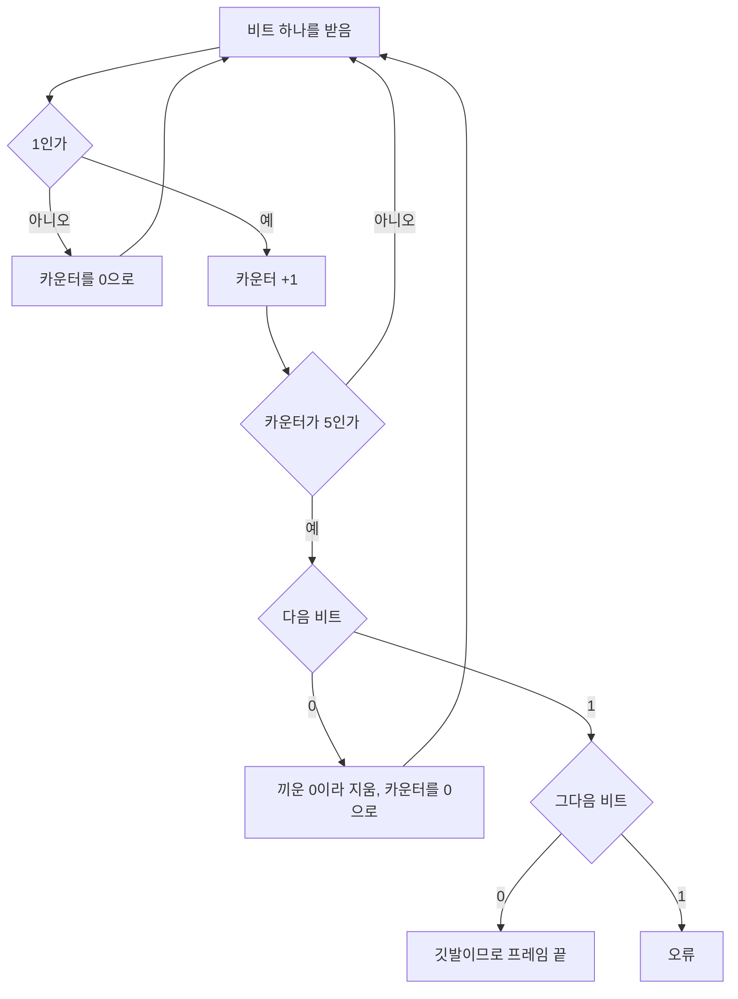



요약

데이터를 8비트 글자(바이트)가 아니라 임의의 비트 줄로 보고, 프레임의 처음과 끝에 정해 둔 비트 모양 `01111110`(깃발)을 붙인다. 본문에 같은 모양이 나오지 않도록, 보내는 쪽은 1이 다섯 개 이어지면 무조건 0을 하나 끼워 넣고, 받는 쪽은 그 0을 지운다. 그러면 데이터가 어떤 비트열이든 깃발로 오해되지 않는다. 대신 1이 많은 데이터일수록 보내는 비트가 늘어난다.

## 예시로 보기

[바이트 중심 방법](/Hongs_Blog/studies/computer-communication/byte-framing/)은 데이터를 글자(바이트)로 본다. 데이터가 바이트로 나뉘지 않는 임의의 비트열이면 쓸 수 없다. HDLC는 "데이터는 임의의 비트"라는 관점에서 시작했다.

바이트 중심 방법의 끝 표시 ETX와 확장 글자 DLE는 모두 8비트짜리 글자다. 받는 쪽은 비트를 8개씩 끊어 글자로 읽은 뒤에야 ETX인지 확인할 수 있다. 그래서 13비트처럼 8의 배수가 아닌 데이터는 마지막 5비트를 어떤 글자로 읽어야 할지 정할 수 없다[^s5].

HDLC는 High-Level Data Link Control(고수준 데이터 링크 제어)의 줄임말이다. SDLC와 PPP도 같은 방식을 쓴다. HDLC는 프레임의 앞과 뒤에 정해 둔 비트 8개 `01111110`을 붙여 경계를 표시한다. 이 비트 모양을 깃발(flag)이라 부른다. 0 하나, 1 여섯 개, 0 하나로 된 모양이다. 경주의 출발선과 결승선에 꽂는 깃발처럼 프레임의 시작과 끝을 알린다는 뜻이다[^s5].

왼쪽부터 깃발 8비트, Header 16비트, Body, CRC 16비트, 깃발 8비트다. 칸 위의 숫자가 비트 수이고, 칸의 폭도 비트 수에 맞췄다. 회색 Body 칸의 번개 모양 끊김은 본문 길이가 프레임마다 다르다는 뜻이다. 파란 두 칸이 깃발이고, 초록 칸이 오류 검사 값 CRC다. 아래 주황 괄호처럼, 비트 채우기는 두 깃발 사이의 비트 전부(Header, Body, CRC)에 한다[^s3].

받는 쪽은 흘러오는 비트에서 `01111110`을 찾아 "여기서 프레임이 시작한다", 다음 `01111110`을 찾아 "여기서 끝난다"고 판단한다. 그런데 본문에 `01111110`과 같은 비트가 우연히 들어 있으면 어떻게 되나? 받는 쪽은 본문 한가운데서 프레임이 끝났다고 오해한다. 바이트 중심 방법에서 본문의 ETX가 일으킨 문제와 똑같다[^s5].

HDLC는 이 문제를 비트 하나로 푼다. 보내는 쪽은 1이 다섯 개 이어지면 바로 뒤에 0을 하나 끼운다. 그러면 본문 안에서 1이 여섯 개 이어지는 일이 없으니, 1이 여섯 개 들어 있는 깃발 모양도 생기지 않는다.

본문 `0111111111110`(1이 11개 이어짐)을 보낸다[^s1].

| 단계 | 비트 |
|---|---|
| 본문 | `0 11111 11111 10` |
| 1이 5개 이어질 때마다 0 삽입 | `0 11111 0 11111 0 10` |
| 프레임 | `01111110` `011111011111010` `01111110` |

채운 본문 안에는 1이 여섯 개 이어지는 곳이 없으므로 깃발 모양이 생길 수 없다.

보내는 쪽은 카운터 하나로 "지금까지 1이 몇 개 이어졌나"를 센다. 1을 보내면 카운터를 1 올리고, 0을 보내면 0으로 되돌린다. 카운터가 5가 되면 0을 하나 끼우고, 끼운 0도 0이니 카운터를 0으로 되돌린다. 예시의 13비트를 이 규칙대로 따라가면 다음과 같다[^s5].

1. 1번째 비트 `0`: 0을 보냈으니 카운터는 0이다.
2. 2~6번째 비트 `1` 다섯 개: 카운터가 1, 2, 3, 4, 5로 오른다.
3. 카운터가 5가 되었으니 바로 0을 끼운다. 카운터는 0으로 돌아간다.
4. 7~11번째 비트 `1` 다섯 개: 카운터가 다시 1부터 5까지 오른다. 또 0을 끼우고 카운터를 0으로 되돌린다.
5. 12번째 비트 `1`: 카운터 1. 13번째 비트 `0`: 카운터 0. 본문이 끝났다.

본문 13비트가 15비트 `011111011111010`이 되었다. 앞뒤에 깃발 8비트씩을 붙이면 링크로 나가는 비트는 모두 31개다.

"3번째 단계에서 원래 본문의 7번째 비트도 1이었는데, 0을 끼워도 괜찮나?" 괜찮다. 끼운 0은 6번째와 7번째 비트 사이에 들어갈 뿐이고, 7번째 비트 1은 그 0 뒤로 밀려서 그대로 간다. 1의 줄이 0 하나로 끊길 뿐, 본문의 비트는 하나도 사라지지 않는다.

맨 윗줄이 본문 13비트다. 나중에 0이 끼어들 자리는 비워 두고 주황 "+0"을 적었다. 둘째 줄의 숫자는 보내는 쪽 카운터, 곧 그 비트까지 이어진 1의 수다. 카운터가 주황 5에 닿을 때마다 주황 화살표가 셋째 줄의 바로 다음 칸을 가리킨다. 그 칸이 끼운 0(주황 칸)이다. 셋째 줄이 채운 비트 15개다.

넷째 줄은 실제로 링크에 나가는 31비트다. 셋째 줄 앞뒤에 파란 깃발 `01111110`을 하나씩 붙였다. 넷째 줄에서 1이 여섯 개 이어지는 곳은 파란 깃발 안뿐이다. 본문 쪽(가운데)은 1이 다섯 개를 넘지 않는다.

다섯째 줄은 받는 쪽이 첫 깃발 다음부터 세는 카운터다. 본문 쪽에서는 보내는 쪽과 똑같이 0, 1, 2, 3, 4, 5까지 오른다. 5 다음에 0이 오면 그 0을 지운다(주황 ×). 맨 오른쪽 깃발에서도 카운터가 5까지 오르는데, 이번에는 다음 두 비트가 `10`이다. 그래서 받는 쪽은 프레임이 끝났다고 판단한다(초록 괄호)[^s4].

검증: 예시, 무작위 본문 2,000개에서 깃발이 생기지 않고 정확히 되돌림, 1이 7개면 오류, 최악의 오버헤드, 카드 C2 — [45_bit-stuffing_impl.py](/Hongs_Blog/studies/computer-communication/code/45_bit-stuffing_impl/)

## 정의

**입력:** 본문 비트열. **출력:** 깃발 사이에 넣을 비트열.

- **보내는 쪽:** 본문 중간에 1이 연속 5개 나오면 0을 하나 끼운다.
- **받는 쪽:** 1을 연속 5개 받으면 다음 비트를 본다.
  - 다음이 `0`이면 끼워 넣은 비트라 지운다.
  - 다음이 `10`이면 깃발 `01111110`이라 프레임의 끝이다.
  - 다음이 `11`이면(1이 7개 이상) 오류다.

카운터는 지금까지 이어진 1의 개수다. 0을 받으면 언제든 0으로 돌아가고, 5에 닿을 때만 뒤 비트를 보고 세 갈래로 나뉜다[^s2].

받는 쪽의 세 갈래를 짧은 비트열로 하나씩 보면 이렇다[^s5].

- **다음이 `0`: 지운다.** 본문 `0111111`(1이 여섯 개)을 보내면, 보내는 쪽은 1 다섯 개 뒤에 0을 끼워 `01111101`을 보낸다. 받는 쪽은 `0`과 `11111`을 받아 카운터가 5가 된다. 다음 비트가 `0`이니 지우고, 이어서 마지막 `1`을 받는다. 남는 것은 `0111111`, 처음 본문 그대로다.
- **다음이 `10`: 프레임 끝.** 본문 끝에 깃발 `01111110`이 오면, 받는 쪽은 깃발의 `0`과 `11111`을 받아 카운터가 5가 된다. 이 시점까지 받는 쪽은 이것이 깃발인지 모르고 여섯 비트를 본문 쪽에 담아 두었다. 다음 두 비트가 `10`인 것을 보고서야 깃발임을 알고, 담아 둔 여섯 비트 `011111`을 덜어 낸다.
- **다음이 `11`: 오류.** `01111111`처럼 1이 일곱 개 이어지면, 채운 본문일 수도 없고(1 다섯 개 뒤에는 늘 0이 있어야 한다) 깃발일 수도 없다(깃발의 1은 정확히 여섯 개다). 예를 들어 `01111101`을 보냈는데 끼운 0이 전송 중에 1로 뒤집히면 이렇게 된다. 받는 쪽은 이 프레임을 오류로 본다.

보내는 쪽이 다음 비트를 보지 않고 "무조건" 0을 끼우는 데에는 이유가 있다. 본문이 `111110`이면 1 다섯 개 뒤에 이미 0이 온다. 이때도 0을 끼워 `1111100`을 보낸다. 받는 쪽은 1 다섯 개 다음의 0을 언제나 끼운 것으로 보고 지우므로, `11111` 다음 `0`을 지운 뒤 남은 `0`을 받아 `111110`을 정확히 되돌린다. 만약 보내는 쪽이 "다음이 이미 0이니 안 끼워도 된다"며 `111110`을 그대로 보내면, 받는 쪽은 그 0을 끼운 것으로 알고 지워 `11111`만 받는다. 비트 하나를 잃는다[^s5].

문턱이 왜 하필 5인지도 깃발 모양에서 나온다. 깃발에는 1이 정확히 여섯 개 이어진다. 본문에서 1이 여섯 개 이어지는 일만 막으면 본문 어디에도 깃발 모양이 생기지 않는다. 1이 다섯 개 이어진 순간 0을 끼우면, 여섯 번째 1이 올 자리를 0이 먼저 차지한다[^s5].

"문턱을 6으로 하면 안 되나?" 1 여섯 개를 다 보낸 뒤에 0을 끼우면 이미 늦다. 본문 `0111111`을 그렇게 보내면 0 하나, 1 여섯 개, 끼운 0 하나가 이어져 `01111110`, 곧 깃발 그대로가 된다. 문턱을 4로 하면 깃발은 막지만 1이 넷만 이어져도 0이 붙어 낭비가 커진다. 그래서 5는 깃발을 막는 가장 큰 문턱이다[^s5].

## 활용

- HDLC와 그 계열(SDLC, PPP의 일부 모드)이 쓴다.
- 복잡도: 비트마다 한 번 보므로 $$O(n)$$이고, 카운터 하나로 하드웨어에서 바로 한다.
- 오버헤드: 1만 $$n$$개면 $$\frac n5$$비트가 늘어 최대 20%다. 무작위 데이터에서는 1이 다섯 번 이어질 확률이 낮아 평균은 훨씬 작다[^s1].
- 오버헤드를 숫자로 보면 이렇다. 본문이 1만 40개(바이트로 `FF` 다섯 개)면 1 다섯 개마다 0이 하나씩, $$40 \div 5 = 8$$개 끼어 48비트를 보낸다. 늘어난 비율은 $$8 \div 40 = 20\%$$다. 0을 하나 끼우려면 1이 다섯 개 있어야 하니, 본문 $$n$$비트에 끼우는 0은 많아야 $$\lfloor n/5 \rfloor$$개($$n/5$$ 이하의 가장 큰 정수)다. 그래서 20%가 최악이다[^s5].
- 무작위 비트(0과 1이 반반이고 서로 영향이 없는 비트)라면, 0을 하나 끼우기까지 평균 62비트가 지나간다. 동전을 던져 앞면이 다섯 번 연달아 나올 때까지 평균 $$2^{6} - 2 = 62$$번 던진다는 사실과 같은 계산이다. 평균 오버헤드는 $$\frac{1}{62} \approx 1.6\%$$로, 1,000비트를 보내면 0이 16개쯤 끼는 셈이다. 40만 비트 실험에서도 1.62%가 나왔다[^s5].
- 흔한 실수: 끼운 0 다음에 다시 1을 세기 시작해야 한다는 것을 잊는 것. 끼운 0이 연속을 끊으므로 카운터를 0으로 되돌린다.

## 연결

- 선수: [바이트 중심 프레이밍](/Hongs_Blog/studies/computer-communication/byte-framing/)(같은 문제를 바이트로 푼 방법)
- 비교: [프레이밍 방식 비교](/Hongs_Blog/studies/computer-communication/framing-compared/)
- 비슷한 발상(같은 값이 길게 이어지지 않게 바꾸기): [4B/5B](/Hongs_Blog/studies/computer-communication/4b5b/)

## 확인 문제

<b>C1</b> HDLC의 깃발과 보내는 쪽·받는 쪽의 비트 채우기 규칙을 쓰라.

**답:** 깃발 `01111110`. 보내는 쪽은 1이 연속 5개 나오면 0을 끼운다. 받는 쪽은 1을 5개 받으면 다음 비트가 0이면 지우고, 10이면 프레임 끝, 11이면 오류로 본다.

<b>C2</b> 본문이 깃발과 같은 `01111110`이다. 채운 뒤의 비트열은?

**답:** `011111010`. 1이 다섯 개 나온 뒤 0을 끼우고, 남은 `10`을 이어 쓴다. 1이 여섯 개 이어지지 않으므로 깃발로 오해되지 않는다.

<b>C3</b> "1이 5개 이어지면 0 하나를 끼운다"는 규칙이 하는 일을 한 문장으로 쓰라.

**답:** 본문 안에 1이 여섯 개 이어지는 일이 없게 만들어, 1이 여섯 개 들어 있는 깃발 `01111110`이 본문에서는 절대 나오지 않게 한다.

<b>C4</b> 받는 쪽이 1을 다섯 개 받은 뒤 다음 비트가 0이면 그 0을 지워도 안전한 이유는?

**답:** 보내는 쪽은 1 다섯 개 바로 뒤에 무조건 0을 끼우므로, 채운 비트열에서 1 다섯 개 바로 다음 자리는 언제나 끼운 0이다. 원래 데이터의 다음 비트(0이든 1이든)는 그 끼운 0 뒤에 온다. 그래서 그 자리를 지우면 정확히 원래 데이터가 남는다.

[^s1]: 구현 코드로 확인했다.
[^s2]: 구현 코드의 받는 쪽 동작과 같다.
[^s3]: [45_bit-stuffing_plot.py](/Hongs_Blog/studies/computer-communication/code/45_bit-stuffing_plot/)로 그렸고, 비트 수 8·16·16·8과 깃발 `01111110`을 같은 코드로 확인했다. 깃발 사이의 Header·CRC까지 채우기를 한다는 것은 Peterson & Davie, *Computer Networks: A Systems Approach*, 2.3절의 설명이다.
[^s4]: [45_bit-stuffing_plot.py](/Hongs_Blog/studies/computer-communication/code/45_bit-stuffing_plot/)로 그렸고, 본문 `0111111111110`의 카운터 0·1·2·3·4·5·1·2·3·4·5·1·0, 채운 비트 `011111011111010`(끼운 0은 7번째와 13번째 자리), 깃발을 붙인 31비트, 받는 쪽이 끼운 0 두 개를 지우고 마지막 깃발의 `10`에서 끝내 원래 본문을 되돌리는 것을 같은 코드로 확인했다.
[^s5]: 바이트 중심 방법이 8의 배수가 아닌 데이터를 다루지 못하는 이유, 깃발이라는 이름의 뜻, 보내는 쪽 카운터를 따라간 단계, 받는 쪽 세 갈래의 비트 예(`0111111` → `01111101`, 끝 깃발에서 여섯 비트를 덜어 내기, 끼운 0이 뒤집힌 `01111111`), "무조건" 끼우는 이유와 `111110` 예, 문턱이 5인 이유와 문턱 6이면 `0111111`이 깃발이 되는 예, 오버헤드 숫자 예(1 40개 → 48비트), 무작위 비트의 평균 오버헤드 $$1/62$$(앞면이 $$k$$번 연달아 나올 때까지 평균 $$2^{k+1} - 2$$번이라는 확률 계산에 $$k = 5$$를 넣은 값)와 40만 비트 실험은 [45_bit-stuffing_plot.py](/Hongs_Blog/studies/computer-communication/code/45_bit-stuffing_plot/)로 확인했다.

