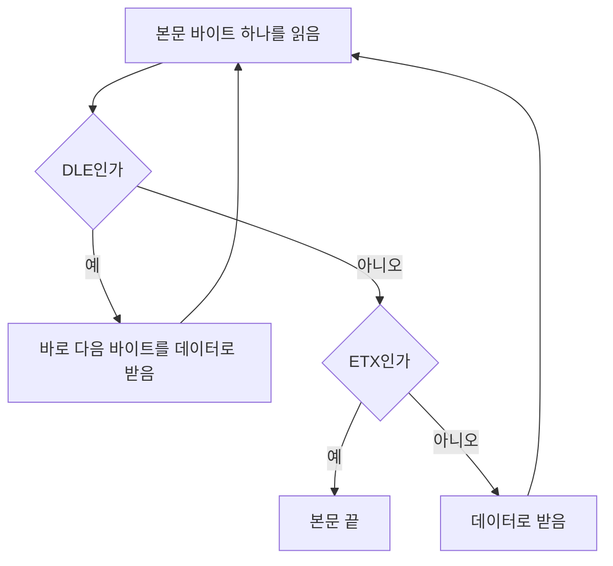



요약

링크로는 비트가 끝없이 흘러오니, 보내는 쪽이 한 덩어리(프레임)의 처음과 끝에 표시를 달아 받는 쪽이 덩어리를 잘라 낼 수 있게 한다. 바이트 중심 방법은 데이터를 8비트 글자(바이트)의 줄로 보고, 정해 둔 글자(보초)로 끝을 표시하거나 맨 앞에 길이를 적는다. 보초 방법은 본문에 같은 글자가 우연히 나오면 거기서 끊기므로, 그런 글자 앞에 "다음 글자는 그냥 데이터"라는 표시 글자를 붙여 피한다. 길이 방법은 본문을 들여다볼 필요가 없지만, 길이 칸이 전송 중에 깨지면 엉뚱한 곳에서 자른다.

## 예시로 보기

편지 여러 통을 이어 붙여 한 줄로 보낸다고 하자. 편지마다 끝에 "끝."이라고 쓰기로 약속하면, 본문에 "끝."이라는 말이 들어 있는 편지는 중간에서 잘려 버린다. 사람이라면 문맥을 보고 "이건 진짜 끝이 아니네" 하고 넘길 수도 있다. 받는 쪽 장치는 문맥을 모르고 약속한 규칙대로만 자르므로, 이 문제를 스스로 피하지 못한다[^s1].

컴퓨터는 글자 하나를 8비트, 곧 1바이트로 적는다. 바이트 하나는 16진수 두 자리로 쓰면 편하다. 예를 들어 `41`은 비트로 `0100 0001`이다. 흔히 쓰는 글자표(ASCII)에서 대문자 A는 `41`, B는 `42`, C는 `43`이다. 글자표에는 화면에 찍히지 않고 기계에게 신호만 주는 제어 글자도 있다. `03`은 ETX(End of Text, "본문 끝")라는 제어 글자다[^s4].

BISYNC는 본문이 끝나면 ETX 글자를 하나 붙인다. 본문 바이트가 `41 03 42`라고 하자. 보내는 쪽은 본문 뒤에 ETX(`03`)를 붙여 `41 03 42 03`을 보낸다. 받는 쪽은 바이트를 하나씩 읽으며 ETX를 찾는다.

1. `41`을 읽는다. ETX가 아니니 본문에 넣는다.
2. `03`을 읽는다. 보내는 쪽에게는 본문의 데이터였지만, 값이 ETX와 똑같다. 받는 쪽은 둘을 가를 방법이 없으니 여기서 본문이 끝났다고 판단한다.
3. 프레임 모양에서 ETX 다음에는 2바이트짜리 CRC(오류 검사 값)가 온다. 그래서 받는 쪽은 `42 03`을 CRC로 읽는다. 진짜 CRC가 아니니 검사가 맞지 않고, 받는 쪽은 프레임을 버린다.

결국 받는 쪽은 `41`까지만 본문으로 읽고, 그마저도 오류로 버린다[^s1].

해결책은 표시 글자를 하나 더 두는 것이다. 본문에 ETX가 나오면 보내는 쪽이 그 앞에 DLE(Data Link Escape, `10`) 글자를 하나 붙인다. DLE는 "바로 다음 글자는 보초가 아니라 그냥 데이터"라는 표시다.

그러면 "본문에 DLE가 들어 있으면 어떻게 하나?"라는 질문이 생긴다. 본문의 DLE를 그대로 두면 받는 쪽은 그것을 표시로 읽고, 다음 글자를 무조건 데이터로 넘긴다. 그래서 본문의 DLE 앞에도 같은 이유로 DLE를 하나 더 붙인다. 이렇게 ETX와 DLE 앞에 DLE를 끼우고 끝은 ETX 하나로 표시하는 방식을 이 문서에서는 '끝 ETX 방식'이라 부른다.

| 본문 | 보내는 바이트(끝 ETX 방식) |
|---|---|
| `41 ETX 42 DLE ETX 43` | `41 DLE ETX 42 DLE DLE DLE ETX 43 ETX` |

위쪽 (가)는 채우기 없이 `41 03 42`를 보낸 경우다. 상자 네 개가 보내는 바이트이고, 상자 위의 괄호는 보내는 쪽이 뜻한 것(본문 세 바이트와 끝 표시)이다. 상자 아래의 괄호는 받는 쪽이 실제로 읽은 결과다. 받는 쪽은 주황 `03`에서 멈추므로, 파란 괄호(본문으로 받음)에는 `41` 하나만 들어간다. 주황 괄호 속 `42`와 진짜 끝 ETX는 본문에서 잘려 나간다.

아래쪽 (나)는 같은 문제를 DLE로 푼 모습이다. 윗줄은 원래 본문 여섯 바이트이고, 아랫줄은 실제로 보내는 열 바이트다. 회색 화살표는 본문의 각 바이트가 보내는 줄의 어느 자리로 가는지 보여 준다. 윗줄의 빈칸(+DLE)마다 아랫줄에 주황 DLE가 하나씩 끼어든다.

왼쪽부터 보면 주황 DLE는 세 개다. 본문 두 번째 바이트 ETX 앞에 하나, 본문 네 번째 바이트 DLE 앞에 하나, 본문 다섯 번째 바이트 ETX 앞에 하나다. 맨 오른쪽 초록 ETX만 앞에 DLE가 없으니, 이것만 진짜 끝이다. 본문 6바이트가 10바이트가 되었다. 끼운 DLE 3개와 끝 표시 ETX 1개만큼 늘었다[^s3].

검증: 위 표, 채우기 없으면 잘림, 무작위 본문 2,000개를 두 방식으로 보내고 되돌리기, 길이 칸이 깨진 경우, 카드 C2 — [44_framing_impl.py](/Hongs_Blog/studies/computer-communication/code/44_framing_impl/)

## 정의

**프레이밍**은 비트의 연속을 프레임이라는 묶음으로 자르는 일이다. 받는 쪽이 프레임을 알아볼 수 있게 봉투를 씌운다. 프레임의 처음과 끝을 표시하고, 다른 정보도 적는다. 보통 컴퓨터에 달린 통신 부품인 네트워크 어댑터(NIC)가 한다. 보낼 때 어댑터는 컴퓨터(호스트)의 메모리에서 데이터와 헤더(데이터 앞에 붙는 안내 정보)를 가져와 프레임을 만든다(캡슐화). 링크에는 비트가 흐르지만 어댑터 사이에서는 프레임이 오간다.

주고받는 메시지의 형식(PDU, Protocol Data Unit)이 같은 계층끼리의 약속, 곧 "피어 사이 인터페이스"의 실체다. PDU는 "프로토콜이 한 번에 주고받는 데이터 덩어리"라는 뜻이고, 2계층에서는 프레임이 PDU다. 피어(peer)는 같은 계층에 있는 상대다. 보내는 쪽 2계층의 피어는 받는 쪽 2계층이다. 두 피어는 프레임 말고는 서로 주고받는 것이 없다. 그래서 프레임의 칸 배치가 두 피어 사이 약속의 전부다[^s4].

바이트 중심 방법의 두 프레임은 다음과 같다.

위 막대가 BISYNC, 아래 막대가 DDCMP다. 칸 위의 숫자는 그 칸의 비트 수이고, 칸의 폭도 비트 수에 맞춰 그렸다. 회색 Body 칸의 번개 모양 끊김은 본문 길이가 프레임마다 다르다는 뜻이다. BISYNC의 Header 위에는 숫자 대신 "길이 안 적힘"이 있다.

색은 칸이 하는 일을 나타낸다. 파란 칸은 미리 정해 둔 제어 글자, 주황 칸은 길이를 적는 Count, 초록 칸은 오류 검사용 CRC다. 두 막대의 차이는 끝을 아는 방법이다. 위 막대에서는 본문 뒤의 ETX가 끝을 알린다(파란 화살표). 아래 막대에서는 본문 앞의 Count가 끝 자리를 미리 알려 준다(주황 화살표)[^s5].

### 보초 방법 (BISYNC)

BISYNC는 IBM이 만든 Binary Synchronous Communication(이진 동기 통신)의 줄임말이다. 보초(sentinel)는 경계를 지키는 병사다. 미리 정해 둔 글자가 칸과 칸의 경계를 지킨다는 뜻에서 이 방법을 보초 방법이라 부른다[^s4].

그림의 위 막대를 왼쪽부터 읽으면 칸은 다음과 같다. 16진수 값과 이름의 뜻은 ASCII 글자표의 것이다[^s4].

| 칸 | 비트 | 값 | 이름의 뜻 | 하는 일 |
|---|---|---|---|---|
| SYN (두 번) | 8 + 8 | `16` | Synchronous idle, 동기 맞춤 | 받는 쪽이 이 비트 모양(`00010110`)을 찾아 어디서부터 8비트씩 끊을지 정한다 |
| SOH | 8 | `01` | Start Of Header, 헤더 시작 | 다음 바이트부터 헤더다 |
| Header | — | — | 머리말 | 프레임을 다루는 데 쓰는 정보 |
| STX | 8 | `02` | Start Of TeXt, 본문 시작 | 다음 바이트부터 본문이다 |
| Body | 정해지지 않음 | — | 본문 | 실제로 보내려는 데이터 |
| ETX | 8 | `03` | End Of TeXt, 본문 끝 | 본문이 여기서 끝난다 |
| CRC | 16 | — | Cyclic Redundancy Check, 순환 중복 검사 | 받는 쪽이 받은 데이터로 다시 계산해 비교하는 오류 검사 값 |

SYN이 필요한 까닭은 이렇다. 비트가 한 줄로 흘러오면, 받는 쪽은 어디서부터 8비트씩 끊어야 글자가 되는지 모른다. 한 비트만 어긋나게 끊어도 `41`이 전혀 다른 글자로 읽힌다. 그래서 프레임 맨 앞에 약속한 모양 SYN을 보내고, 받는 쪽은 그 모양이 나온 자리 뒤부터 8비트씩 끊는다[^s4].

본문에 ETX가 나오는 문제는 확장 문자로 푼다. 확장 문자(escape character)의 escape는 "빠져나오다"라는 뜻이다. 확장 문자 바로 뒤의 글자는 보초라는 특별한 뜻에서 빠져나와 평범한 데이터가 된다[^s4]. BISYNC는 ETX 앞에 DLE를 붙이고, IMP-IMP(초기 인터넷 ARPANET의 중계 장치 IMP끼리 쓰던 프로토콜)는 DLE 앞에 DLE를 붙인다[^s4]. 두 규칙을 함께 쓰면 받는 쪽은 "DLE 다음 글자는 그대로 데이터, 앞에 DLE가 없는 ETX는 끝"으로 읽는다[^s1].

DLE를 만나면 그 뒤 한 바이트는 무엇이든 데이터로 넘긴다. 그래서 앞에 DLE가 붙은 ETX는 끝으로 읽히지 않는다[^s2].

예시에서 보낸 바이트 `41 DLE ETX 42 DLE DLE DLE ETX 43 ETX`(뒤에 CRC 두 바이트가 이어진다)를 받는 쪽은 순서도대로 다음처럼 읽는다[^s4].

| 차례 | 읽은 바이트 | 순서도에서 간 길 | 지금까지 받은 본문 |
|---|---|---|---|
| 1 | `41` | DLE 아님, ETX 아님 → 데이터 | `41` |
| 2 | `DLE` `ETX` | DLE → 다음 바이트 `ETX`를 데이터로 | `41 ETX` |
| 3 | `42` | DLE 아님, ETX 아님 → 데이터 | `41 ETX 42` |
| 4 | `DLE` `DLE` | DLE → 다음 바이트 `DLE`를 데이터로 | `41 ETX 42 DLE` |
| 5 | `DLE` `ETX` | DLE → 다음 바이트 `ETX`를 데이터로 | `41 ETX 42 DLE ETX` |
| 6 | `43` | DLE 아님, ETX 아님 → 데이터 | `41 ETX 42 DLE ETX 43` |
| 7 | `ETX` | DLE 아님, ETX임 → 본문 끝 | (끝) |

2번째 차례에서 받는 쪽은 DLE를 보자마자 다음 바이트를 따져 보지 않고 데이터로 넘긴다. 그래서 그 ETX는 순서도의 "ETX인가" 갈림길에 아예 가지 않는다.

4번째 차례가 가장 헷갈리는 곳이다. "DLE 두 개가 붙어 있으면, 두 번째 DLE도 자기 다음 바이트를 데이터로 만들지 않나?" 그렇지 않다. 첫 번째 DLE가 두 번째 DLE를 데이터로 가져가 버리므로, 두 번째 DLE는 "DLE인가" 질문을 받을 차례가 없다. 그래서 5번째 차례는 보낸 바이트의 일곱 번째인 새 DLE에서 시작한다.

7번째 차례의 ETX 앞에는 짝이 되는 DLE가 없다. 바로 앞 6번째 차례가 `43`을 읽고 끝났기 때문이다. 그래서 이 ETX가 진짜 끝이고, 받는 쪽은 다음 두 바이트를 CRC로 읽는다. 받는 쪽은 10바이트를 7차례 만에 다 읽었고, 받은 본문은 처음 본문 여섯 바이트와 똑같다.

본문의 DLE를 채우지 않으면 무슨 일이 생기는지도 숫자로 확인할 수 있다. 본문이 `42 DLE`인데 ETX 앞에만 DLE를 붙인다고 하자. 보내는 바이트는 `42 DLE ETX`다. 받는 쪽은 `42`를 데이터로 받고, 다음 DLE를 보고 그 뒤의 ETX를 데이터로 넘긴다. 진짜 끝을 데이터로 삼켰으니, 받는 쪽은 뒤에 오는 CRC 바이트까지 본문으로 읽으며 다음 ETX를 찾아 헤맨다. 규칙대로 DLE 앞에도 DLE를 붙이면 `42 DLE DLE ETX`가 된다. 받는 쪽은 `42`와 `DLE`(DLE 짝을 하나로)를 받은 뒤, 혼자 남은 ETX에서 정확히 끝낸다[^s4].

같은 생각을 다른 짝으로 쓸 수도 있다. 끝을 `DLE ETX` 두 글자로 표시하고, 본문의 DLE만 두 번 쓴다. 이것이 BISYNC의 투명 모드다. 본문에 `DLE ETX`가 있으면 `DLE DLE ETX`가 되어 받는 쪽이 "DLE 하나 + ETX"로 되돌린다. 두 방식 모두 검증 코드에서 무작위 본문을 정확히 되돌렸다[^s1].

투명(transparent)은 본문에 어떤 바이트가 있든 프레이밍 규칙이 그 바이트를 그대로 통과시킨다는 뜻이다. 받는 쪽 규칙은 이렇다. DLE를 만나면 다음 바이트를 본다. 다음이 DLE면 DLE 하나를 데이터로 받고, 다음이 ETX면 프레임의 끝이다. DLE가 아닌 바이트는 ETX까지 포함해 모두 그냥 데이터다[^s4].

같은 본문 `41 ETX 42 DLE ETX 43`을 이 방식으로 보내면 아홉 바이트 `41 ETX 42 DLE DLE ETX 43 DLE ETX`가 된다.

윗줄이 본문, 아랫줄이 보내는 바이트다. 주황 DLE는 본문의 DLE 앞에 하나 끼운 것이고, 끼운 것은 이것 하나뿐이다. 끝 ETX 방식과 달리 본문의 ETX 두 개 앞에는 아무것도 끼우지 않는다(파란 화살표가 가리키는 ETX). 맨 끝의 초록 두 칸 `DLE ETX`가 끝 표시다.

받는 쪽은 이 아홉 바이트를 다음 차례로 읽는다.

1. `41`: DLE가 아니니 데이터.
2. `ETX`: DLE가 아니니 데이터. 이 방식에서는 ETX 혼자로는 끝이 아니다.
3. `42`: 데이터.
4. `DLE` 다음이 `DLE`: DLE 하나를 데이터로 받는다. 두 바이트를 한 번에 읽는다.
5. `ETX`: DLE가 아니니 데이터.
6. `43`: 데이터.
7. `DLE` 다음이 `ETX`: 프레임의 끝.

5번째 차례가 가장 걱정되는 자리다. 본문에는 `DLE ETX`가 그대로 들어 있었다. 보내는 쪽이 그 DLE를 두 번 썼기 때문에, 4번째 차례가 DLE 두 개를 한 묶음으로 가져갔다. 그래서 5번째 차례의 ETX 앞에는 짝이 되는 DLE가 남아 있지 않다.

같은 본문에 끝 ETX 방식은 4바이트(끼운 DLE 3개와 끝 ETX 1개)를 더했고, 투명 모드는 3바이트(끼운 DLE 1개와 끝 표시 2바이트)를 더했다. 투명 모드는 본문의 ETX에 손대지 않으니, ETX가 많은 본문일수록 더 짧다[^s4].

### 바이트 수 방법 (DDCMP)

DDCMP는 DEC가 만든 Digital Data Communications Message Protocol의 줄임말이다[^s4]. 본문 앞에 바이트 수(Count)를 적어 끝을 따로 표시하지 않는다. 받는 쪽은 Count만큼 읽고 자른다.

그림의 아래 막대를 왼쪽부터 읽으면 칸은 다음과 같다.

- SYN 두 개(각 8비트): BISYNC와 같이 바이트 경계를 맞춘다.
- Class(8비트): 프레임의 종류를 적는다[확인필요].
- Count(14비트): 본문이 몇 바이트인지 적는다. 비트 14개로 만들 수 있는 0/1 조합은 $$2^{14} = 16{,}384$$가지이고 0부터 세니, Count에는 0부터 $$2^{14} - 1 = 16{,}383$$까지 적을 수 있다. 본문은 최대 16,383바이트, 약 16 KB다.
- Header(42비트): 그 밖의 제어 정보.
- Body: 본문. 길이는 Count가 정한다.
- CRC(16비트): 오류 검사 값.

받는 쪽은 Count를 읽은 뒤 Header를 지나, 정확히 Count 바이트만큼을 본문으로 받고, 그다음 2바이트를 CRC로 받는다. 본문 안을 들여다보지 않으니, 본문에 `03`이나 `10`이 있어도 상관없다. 예를 들어 보초 방법을 망가뜨린 본문 `41 03 42`도 Count에 3을 적어 그대로 보내면 된다. 채우기가 필요 없다[^s4].

문제는 Count 칸이 전송 중에 깨지는 경우다(프레이밍 오류). 그러면 엉뚱한 곳에서 자르지만, 끝의 CRC가 맞지 않아 오류로 드러난다.

본문 다섯 바이트 `41 42 43 44 45`를 예로 든다. Count에는 5를 14비트로 적은 `00000000000101`이 들어간다. 보내는 쪽은 본문으로 CRC를 계산해 끝에 붙인다. 이 예의 CRC는 `50 2B`다(계산 방법은 [CRC](/Hongs_Blog/studies/computer-communication/crc/)에서 다룬다). 전송 중에 Count의 마지막 두 비트가 뒤집혀 `00000000000011`, 곧 3이 되었다고 하자[^s7].

윗줄이 보낸 프레임, 아랫줄이 받은 프레임이다. 두 줄의 바이트는 주황 Count 칸 하나만 다르다. 윗줄 위의 괄호는 보내는 쪽의 뜻이다. 본문 다섯 바이트, CRC 두 바이트, 그리고 바로 이어지는 다음 프레임의 SYN이다. 아랫줄 아래의 괄호는 받는 쪽이 Count 3을 믿고 자른 결과다. 그림 맨 아래 두 줄이 받는 쪽의 CRC 검사다[^s7].

받는 쪽은 다음 차례로 움직인다.

1. Count를 3으로 읽고, Header 다음의 `41 42 43`만 본문으로 받는다.
2. 그다음 두 바이트 `44 45`를 CRC로 읽는다. 사실 이것은 본문의 뒷부분이다.
3. 받은 본문 `41 42 43`으로 CRC를 다시 계산한다. 결과는 `45 21`이다.
4. CRC 자리에서 읽은 `44 45`와 다시 계산한 `45 21`이 다르다. 그래서 이 프레임에 오류가 있다고 판단하고 버린다.
5. 진짜 CRC `50 2B`를 다음 프레임의 첫 바이트로 읽는다. SYN이 아니니, 다음 SYN이 나올 때까지 바이트를 버리며 기다린다.

5번째 차례 때문에 Count가 깨지면 이 프레임만이 아니라 다음 프레임의 시작 자리도 흔들린다. Count가 반대로 커지면 뒤 프레임들까지 본문으로 삼킨다. 세 방법이 끝 표시가 깨졌을 때 어떻게 다른지는 [프레이밍 방식 비교](/Hongs_Blog/studies/computer-communication/framing-compared/)에서 다룬다.

"CRC가 이런 잘못을 놓칠 수도 있지 않나?" 놓칠 수는 있지만 드물다. CRC는 데이터 전체에서 계산한 16비트 값이고, 16비트 값은 65,536가지다. 엉뚱한 본문으로 다시 계산한 값이 엉뚱한 두 바이트와 우연히 맞으려면 그 가운데 하나가 딱 맞아야 한다. 대략 6만 5천 번에 한 번 꼴이다[^s7].

## 활용

- PPP(인터넷 접속용 점대점 프로토콜)도 보초 방법과 확장 문자를 쓴다.
- 흔한 실수: 확장 문자 앞에도 확장 문자가 필요하다는 것을 잊는 것. 본문의 DLE를 그대로 두면 받는 쪽이 그 다음 글자를 데이터로 오해한다.
- 오버헤드: 본문이 ETX와 DLE로만 되어 있으면 보초 방법은 본문 길이가 두 배가 된다. 바이트 수 방법은 늘 Count 칸 하나만 더한다.
- 오버헤드를 숫자로 보면 이렇다. 본문이 DLE 10개면 끝 ETX 방식은 DLE 10개를 더 끼우고 끝 ETX를 붙여 21바이트를 보낸다. 무작위 바이트라면 한 바이트가 ETX나 DLE일 확률이 $$\frac{2}{256}$$이다. 128바이트에 한 번꼴이니, 평균으로는 약 0.8%만 는다[^s4].

## 연결

- 선수: [4B/5B](/Hongs_Blog/studies/computer-communication/4b5b/)(비트를 보내는 1계층), [캡슐화](/Hongs_Blog/studies/computer-communication/encapsulation/)(PDU, 헤더 붙이기)
- 비트 단위로 하는 방법: [비트 채우기](/Hongs_Blog/studies/computer-communication/bit-stuffing/)
- 세 방법 비교: [프레이밍 방식 비교](/Hongs_Blog/studies/computer-communication/framing-compared/)

## 확인 문제

<b>C1</b> BISYNC 프레임의 칸을 순서대로 쓰고, 본문에 ETX가 나올 때의 해결책을 쓰라.

**답:** SYN, SYN, SOH, Header, STX, Body, ETX, CRC. 본문의 ETX 앞에 DLE를 붙이고, 본문의 DLE 앞에도 DLE를 붙인다. 받는 쪽은 DLE 다음 글자를 데이터로 읽고, 앞에 DLE가 없는 ETX를 끝으로 본다.

<b>C2</b> 본문이 `DLE ETX` 두 바이트다. 끝 ETX 방식(본문의 ETX와 DLE 앞에 DLE를 끼우고, 끝은 ETX 하나)으로 보내는 바이트열을 쓰라.

**답:** `DLE DLE DLE ETX ETX`. 본문의 DLE 앞에 DLE, 본문의 ETX 앞에 DLE, 마지막에 진짜 끝 ETX.

<b>C3</b> 바이트 수 방법에서 Count가 깨지면 받는 쪽은 어떻게 알아채는가?

**답:** Count대로 자르면 본문과 CRC의 경계가 틀어져, 받은 데이터로 계산한 CRC가 프레임의 CRC와 맞지 않는다. 그래서 오류로 검출된다. 다만 다음 프레임의 시작도 잃으므로 다시 동기를 맞춰야 한다.

[^s1]: 구현 코드로 확인했다.
[^s2]: 구현 코드의 되돌리기와 같은 순서다.
[^s3]: [44_byte-framing_plot.py](/Hongs_Blog/studies/computer-communication/code/44_byte-framing_plot/)로 그렸고, 채우기 없이 보내면 `41`까지만 본문이 되는 것, 본문 `41 ETX 42 DLE ETX 43`이 `41 DLE ETX 42 DLE DLE DLE ETX 43 ETX`가 되고 끼운 DLE가 보낸 줄의 2·5·7번째 자리에 오는 것을 같은 코드로 확인했다.
[^s4]: 16진수와 ASCII 글자 값(A = `41`, SYN = `16`, SOH = `01`, STX = `02`, ETX = `03`, DLE = `10`)과 제어 글자 이름의 뜻은 ASCII 표준의 것이다. BISYNC(IBM)·DDCMP(DEC)·IMP(ARPANET)라는 이름의 풀이, 보초와 확장 문자라는 이름의 뜻, SYN으로 바이트 경계를 맞추는 일, PDU와 피어의 풀이는 Peterson & Davie, *Computer Networks: A Systems Approach*, 2.3절의 설명을 따랐다. 받는 쪽 차례 표, 본문 `42 DLE` 예, 투명 모드의 받는 규칙과 차례, 두 방식의 늘어난 바이트 비교, Count의 최댓값 16,383, 바이트 수 방법에 `41 03 42`를 보내는 예, 무작위 바이트의 평균 오버헤드 $$2/256 \approx 0.8\%$$(20만 바이트 실험)는 [44_byte-framing_plot.py](/Hongs_Blog/studies/computer-communication/code/44_byte-framing_plot/)로 확인했다.
[^s5]: [44_byte-framing_plot.py](/Hongs_Blog/studies/computer-communication/code/44_byte-framing_plot/)로 그렸고, 비트 수 BISYNC 8·8·8·8·8·16, DDCMP 8·8·8·14·42·16을 같은 코드로 확인했다.
[^s7]: CRC 값은 계산을 짧게 하려고 본문 바이트만 넣어 CRC-16(다항식 $$x^{16} + x^{15} + x^2 + 1$$, 비트 순서를 뒤집는 CRC-16/ARC 방식)으로 구했다. 본문 `41 42 43 44 45`의 CRC `50 2B`, 다시 계산한 `41 42 43`의 CRC `45 21`, CRC 자리로 읽힌 `44 45`가 서로 다른 것을 [44_byte-framing_plot.py](/Hongs_Blog/studies/computer-communication/code/44_byte-framing_plot/)로 확인했다.

