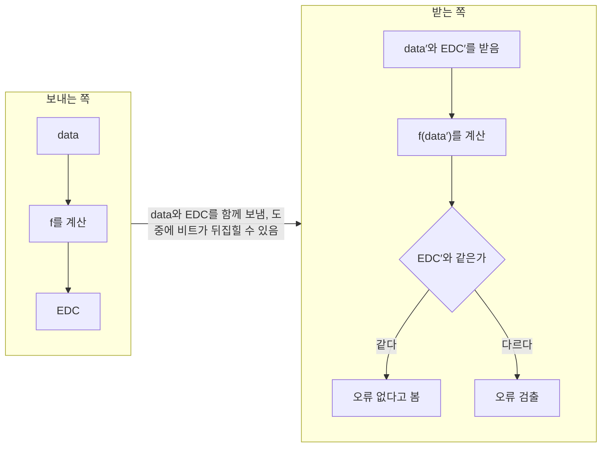



요약

전송 중에 비트가 뒤집혔는지 받는 쪽이 알려면, 보내는 쪽이 데이터로 계산한 짧은 값을 함께 보내야 한다. 받는 쪽은 받은 데이터로 같은 계산을 다시 해 보고, 따라온 값과 다르면 오류라고 본다. 이 덧붙인 값이 오류 검출 코드이고, 짧고 빨리 계산되면서 오류를 많이 잡아야 한다. 하지만 데이터와 코드가 함께 바뀌어 다시 맞아떨어지면 놓치므로, 어떤 코드도 모든 오류를 잡지는 못한다.

## 예시로 보기

선을 지나는 동안 잡음 때문에 0이 1로, 1이 0으로 바뀔 수 있다. 받는 쪽에 `1011001`이 도착했다고 하자. 받는 쪽은 이것이 보낸 그대로인지, 한 비트가 바뀐 것인지 알 수 없다. 7비트로 만들 수 있는 128가지 모양이 모두 멀쩡한 데이터일 수 있기 때문이다.

데이터만 보내면 받는 쪽은 그 데이터가 맞는지 판단할 근거가 없다. 그래서 보내는 쪽이 검산에 쓸 정보를 덧붙여 보낸다.

### 패리티 비트 하나 붙이기

가장 단순한 코드는 비트 하나다. 보내는 쪽은 데이터의 1을 센 뒤, 덧붙일 비트까지 합쳐 1의 개수가 짝수가 되도록 그 비트를 정한다. 이 비트를 패리티 비트라 하고, 짝수로 맞추는 규칙을 짝수 패리티라 부른다. 패리티(parity)는 "짝인지 홀인지"라는 뜻이다.

`1011001`의 1을 왼쪽부터 센다. 첫째 비트에서 1개, 셋째 비트에서 2개, 넷째 비트에서 3개, 일곱째 비트에서 4개다. 둘째, 다섯째, 여섯째 비트는 0이라 세지 않는다. 1이 4개로 이미 짝수이므로 0을 붙인다. 보내는 8비트는 `10110010`이다[^s1].

1이 홀수 개면 어떻게 할까? 1을 붙인다. `1011000`은 1이 3개다. 뒤에 1을 붙인 `10110001`은 1이 4개가 되어 짝수로 맞는다[^s4].

1을 세는 대신 비트를 차례로 XOR해도 같은 패리티 비트가 나온다. XOR($$\oplus$$로 쓴다)은 두 비트가 같으면 0, 다르면 1을 내는 계산이다. 0에서 시작해 1을 만날 때마다 값이 0과 1 사이를 한 번씩 오간다. 그래서 1이 짝수 개면 0으로, 홀수 개면 1로 끝난다. `1011001`이면 $$1 \oplus 0 \oplus 1 \oplus 1 \oplus 0 \oplus 0 \oplus 1 = 0$$이다[^s4].

받는 쪽은 도착한 8비트의 1을 다시 센다. 짝수면 오류가 없다고 보고, 홀수면 오류라고 본다.

### 뒤집힌 비트가 몇 개냐에 따라

비트 하나가 0에서 1로 바뀌면 1의 개수가 하나 는다. 1에서 0으로 바뀌면 하나 준다. 어느 쪽이든 개수가 딱 1만큼 변하므로, 짝수였던 개수는 홀수가 된다. 비트가 하나 더 바뀌면 개수가 다시 1만큼 변해 짝수로 돌아온다. 곧 비트가 하나 뒤집힐 때마다 짝과 홀이 한 번씩 바뀐다[^s4].

그림은 위에서 아래로 읽는다. 맨 위 줄은 데이터 7비트이고, 오른쪽에 1이 4개라 패리티가 0이라고 적었다. 둘째 줄은 파란 칸에 패리티 0을 붙여 보낸 8비트다.

점선 아래 세 줄은 도중에 비트가 뒤집혀 도착한 8비트이고, 주황 칸이 뒤집힌 비트다. 주황 칸 아래의 +1, -1은 그 비트 때문에 1의 개수가 얼마나 변했는지다. 0이 1이 되면 +1, 1이 0이 되면 -1이다.

오른쪽 식은 원래 개수 4에 그 변화를 차례로 더한 값이다. 1비트 줄은 4 + 1 = 5개(홀수)라 검출한다. 2비트 줄은 -1과 +1이 서로 지워져 4개(짝수)가 되어 놓친다. 3비트 줄은 4 + 1 - 1 - 1 = 3개(홀수)라 다시 검출한다[^s3].

규칙으로 정리하면 이렇다. 뒤집힌 비트가 홀수 개(1, 3, 5, …)면 1의 개수가 홀수가 되어 늘 잡는다. 짝수 개(2, 4, 6, …)면 짝수로 돌아와 늘 놓친다.

2비트 줄처럼 개수가 그대로인 경우만 놓치는 것이 아니다. 0 두 개가 함께 1이 되면 1이 4개에서 6개로 는다. 개수는 바뀌었지만 여전히 짝수라 받는 쪽은 알아채지 못한다.

패리티 비트 자신이 뒤집히면? 패리티 비트도 같은 선을 지나는 8비트 중 하나다. 그 비트가 뒤집혀도 1의 개수가 1만큼 변하므로 같은 규칙으로 잡는다. 이때 데이터 7비트는 멀쩡하다. 하지만 받는 쪽은 어느 비트가 틀렸는지 모르므로 그냥 오류로 본다[^s4].

### 나머지로 확인하기

1의 개수를 세는 대신 나눗셈의 나머지로 확인할 수도 있다. 두 사람이 수 11을 미리 정해 둔다. 보내는 쪽은 331 뒤에 한 자리를 붙여 11로 나누어떨어지게 만든다. $$3311 = 11 \times 301$$이므로 1을 붙여 3311을 보낸다.

받는 쪽은 받은 수를 11로 나눠 본다. 3310이나 2311이 오면 나머지가 0이 아니므로 오류를 잡는다. 2211이 오면 $$2211 = 11 \times 201$$로 나누어떨어져 놓친다. 이 생각을 10진수 대신 비트와 XOR로 옮긴 것이 [CRC](/Hongs_Blog/studies/computer-communication/crc/)다.

검증: 패리티의 1~4비트 오류 전수, 10진 CRC 비유(3311, 2211), 카드 C2 — [47_error-detection_verify.py](/Hongs_Blog/studies/computer-communication/code/47_error-detection_verify/)

## 정의

**오류 검출 코드(EDC)**는 데이터 안에 오류가 있는지 없는지를 알아내려고 덧붙이는 데이터다. EDC는 Error Detecting Code의 머리글자다.

보내는 쪽은 데이터에 정해진 계산 $$f$$를 해서 EDC를 만든다. 받는 쪽은 도착한 데이터와 EDC를 $$\mathrm{data}'$$, $$\mathrm{EDC}'$$로 쓴다. 작은따옴표는 도중에 바뀌었을 수 있다는 표시다.

- **만들기(보내는 쪽):** $$\mathrm{EDC} \leftarrow f(\mathrm{data})$$. 화살표는 오른쪽 계산 결과를 왼쪽에 넣는다는 뜻이다.
- **점검(받는 쪽):** 받은 $$\mathrm{data}'$$, $$\mathrm{EDC}'$$로 $$\mathrm{EDC}' = f(\mathrm{data}')$$인지 본다.

짝수 패리티에 대입해 보면 $$f$$는 "1의 개수가 홀수면 1, 짝수면 0"이다. 보내는 쪽은 $$f(1011001) = 0$$을 붙인다. 받는 쪽은 받은 7비트로 $$f$$를 다시 계산해 받은 패리티 비트와 같은지 본다. 두 값이 같다는 것은 8비트 전체의 1이 짝수라는 것과 같은 말이다[^s4].

받는 쪽은 보내는 쪽과 똑같은 f를 다시 계산해 비교만 한다. "같다"는 오류가 없다는 증명이 아니다. 이 코드로 찾을 수 있는 오류가 없다는 뜻일 뿐이다.

좋은 코드의 조건은 셋이다.

- **공간:** $$\mathrm{EDC} \ll \mathrm{data}$$. $$\ll$$는 "훨씬 작다"는 기호다. 오류가 없으면 덧붙인 만큼 그대로 손해다.
- **시간:** $$f$$의 계산이 빨라야 한다.
- **효율:** 오류 검출율이 높아야 한다.

공간 조건을 수로 보면 차이가 크다. 패리티는 7비트마다 1비트를 붙이므로 보내는 비트의 1/8, 곧 12.5%가 검산용이다. CRC-32는 1,500바이트(12,000비트) 프레임에 32비트를 붙이므로 약 0.27%다. 훨씬 많은 오류를 잡으면서도 차지하는 몫은 패리티의 50분의 1에 가깝다[^s4].

시간 조건이 중요한 이유는 이 계산을 프레임마다, 보내는 쪽과 받는 쪽에서 한 번씩 하기 때문이다. 계산이 전송보다 느리면 계산이 끝나기를 기다리느라 전송이 늦어진다.

효율 조건의 오류 검출율은 일어난 오류 가운데 코드가 잡아낸 비율이다. 오류 100번 중 99번을 잡으면 검출율 99%다. 짝수 패리티의 검출율은 오류가 몇 비트짜리로 오느냐에 달려 있다. 홀수 개짜리는 100%, 짝수 개짜리는 0%다[^s4].

### 모든 오류를 잡지 못하는 이유

EDC는 오류를 완벽하게 잡을 수 없다. 이유는 길이 차이에 있다. 7비트 데이터는 128가지인데 패리티 비트 값은 0과 1, 두 가지뿐이다. 그래서 데이터 64가지가 한 패리티 값을 나눠 갖는다.

오류가 데이터를 "패리티 값이 같은 다른 데이터"로 바꾸면, 받는 쪽 계산이 따라온 값과 맞아떨어져 놓친다. 일반적으로 데이터가 $$d$$비트, EDC가 $$r$$비트($$r < d$$)면 데이터 $$2^d$$가지가 EDC 값 $$2^r$$가지를 나눠 갖는다. EDC 값 하나마다 평균 $$2^{d-r}$$가지 데이터가 몰린다. $$d = 7$$, $$r = 1$$을 넣으면 $$2^6 = 64$$가지다[^s4].

공간 조건 때문에 EDC를 데이터보다 짧게 만드는 순간, 놓치는 오류도 함께 생긴다. 좋은 코드는 놓치는 오류가 실제로 잘 일어나지 않는 모양이 되도록 $$f$$를 고른 코드다.

오류를 놓치면(미검출 오류) 시스템은 틀린 데이터를 맞다고 믿고 그대로 쓴다. 이것을 무결성(integrity)을 잃는다고 말한다. 무결성은 데이터가 처음 그대로 온전하다는 뜻이다. 그래서 검출율이 매우 높은 코드를 쓰고, 여러 계층에서 중복해서 검사한다.

## 활용

- 2계층은 CRC, 3·4계층(IP, TCP)은 [인터넷 체크섬](/Hongs_Blog/studies/computer-communication/internet-checksum/)으로 다시 검사한다. 한 계층에서 놓친 오류를 다른 계층에서 잡는 "중복 검사"의 예다[^s1].
- 흔한 실수: "패리티가 맞으면 오류가 없다"고 읽는 것. 정확히는 "홀수 개 비트 오류는 없다"는 뜻이다. 비트 두 개가 함께 뒤집혔을 가능성은 그대로 남는다.

## 연결

- 선수: [바이트 중심 프레이밍](/Hongs_Blog/studies/computer-communication/byte-framing/)(프레임의 CRC 칸), [나눗셈과 합동](/Hongs_Blog/studies/discrete-math/modular-arithmetic/)(나머지로 확인하기)
- 구체적인 코드: [2차원 패리티](/Hongs_Blog/studies/computer-communication/two-dimensional-parity/), [인터넷 체크섬](/Hongs_Blog/studies/computer-communication/internet-checksum/), [CRC](/Hongs_Blog/studies/computer-communication/crc/)

## 확인 문제

<b>C1</b> 오류 검출 코드를 만드는 쪽과 점검하는 쪽이 각각 하는 일, 좋은 코드의 세 조건을 쓰라.

**답:** 보내는 쪽은 $$\mathrm{EDC} = f(\mathrm{data})$$를 계산해 붙인다. 받는 쪽은 받은 데이터로 $$f$$를 다시 계산해 받은 EDC와 같은지 본다. 조건은 짧을 것(공간), 빨리 계산될 것(시간), 검출율이 높을 것(효율).

<b>C2</b> 10진수로 "젯수 7로 나누어떨어지게 끝자리 하나를 붙이는" 코드를 쓴다. 데이터 52 뒤에 붙일 자리는?

**답:** 520~529 중 7의 배수는 525다. 5를 붙여 525를 보낸다. (위에서 331에 1을 붙여 3311을 만든 것과 같은 생각이다.)

<b>C3</b> 짝수 패리티로 보낸 `10110010`에서 오류가 났는데도 받는 쪽이 알아채지 못하는 예를 들라.

**답:** 첫 두 비트가 뒤집힌 `01110010`. 1의 개수가 여전히 4개(짝수)라 패리티가 맞는다. 짝수 개 비트 오류는 패리티 하나로 잡을 수 없다.

[^s1]: 검증 코드로 확인했다.
[^s3]: [47_error-detecting-code_plot.py](/Hongs_Blog/studies/computer-communication/code/47_error-detecting-code_plot/)로 그렸고, 보낸 열 `10110010`, 받은 열 `10111010`(1이 5개, 검출), `10010110`(4개, 놓침), `11100000`(3개, 검출)을 같은 코드로 확인했다. 2비트 줄은 카드 C3의 답과 다른 자리(셋째, 여섯째 비트)를 뒤집었다.
[^s4]: [47_error-detecting-code_plot.py](/Hongs_Blog/studies/computer-communication/code/47_error-detecting-code_plot/)와 검증 코드로 확인했다.

