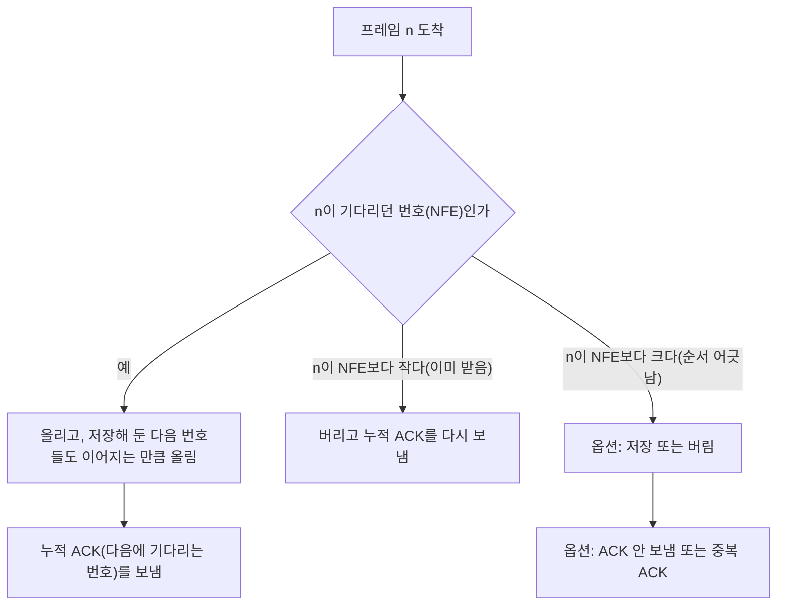



요약

연달아 보낸 프레임 중 하나가 사라지면, 사라진 그 프레임으로 되돌아가 거기서부터 다시 출발한다. 그래서 그 뒤에 보낸 프레임도 다시 보낸다. 받는 쪽은 "여기까지 빠짐없이 받았고, 다음은 몇 번"이라는 답장 하나만 보내면 되어 단순하다. 대신 이미 잘 도착한 프레임까지 다시 보내 선을 낭비한다. 받는 쪽이 순서가 어긋난 프레임을 버리든 저장하든, 보내는 쪽이 언제 다시 보내든 데이터는 빠짐없이 복구된다.

## 예시로 보기

[슬라이딩 윈도우](/Hongs_Blog/studies/computer-communication/sliding-window/)에서는 확인을 기다리는 프레임이 여러 개라, 그중 어느 것에서든 오류가 날 수 있다. 그래서 모든 프레임이 각자 다시 보낼 준비(버퍼 + 타임아웃)를 하고 있어야 한다. 오류를 처리하는 정책은 둘이다. Go-Back-N은 오류가 난 지점부터 다시 새로 출발하고, Selective Repeat은 오류가 난 프레임만 다시 보낸다.

Go-Back-N에서 ACK는 "~까지 잘 받았다"는 뜻의 **누적 ACK**다. 여기서는 데이터 $$n$$을 받으면 ACK $$n+1$$을 보낸다. "$$n$$까지 잘 받았고, 다음은 $$n+1$$번"이다.

창 크기 4로 F0~F5를 보내는데 F2가 처음 보낼 때 사라진다. 싣는 시간 1 ms, 전파 시간 3 ms, 타임아웃 9 ms다. 받는 쪽은 기다리던 번호가 아닌 프레임(순서가 어긋난 프레임)을 버리고 ACK도 보내지 않는다. 보내는 쪽은 타이머가 끝나면 그 프레임부터 보낸 것을 모두 다시 보낸다[^s1].

| 시각(ms) | 보내는 쪽 | 받는 쪽 |
|---|---|---|
| 0~3 | F0, F1, F2, F3을 이어 보냄(창 4가 다 참). F2는 가는 길에 사라짐 | |
| 4 | | F0 받음 → 위층으로 올림, ACK 1 |
| 5 | | F1 받음 → 올림, ACK 2 |
| 7 | ACK 1 → F0 지움, 창이 열려 F4 보냄 | F3 받음 → 기다리는 것은 F2라 버림, ACK 없음 |
| 8 | ACK 2 → F1 지움, F5 보냄 | |
| 11 | F2의 타이머 끝 → F2부터 다시: F2(11), F3(12), F4(13), F5(14) | F4 받음 → 버림 |
| 12 | | F5 받음 → 버림 |
| 15~18 | | F2, F3, F4, F5를 차례로 받아 올림, ACK 3, 4, 5, 6 |
| 18~21 | ACK 3, 4, 5, 6 → 21 ms에 모두 확인 | |

그림은 위 표를 시간표로 그린 것이다. 파란 띠가 프레임, 초록 화살표가 ACK이고, F2의 첫 전송은 가운데 ✕ 자리에서 사라진다. 송신 줄 왼쪽의 세로선은 프레임마다 건 타이머다. 보라 실선은 끝까지 가서 끝난(타임아웃) 타이머, 점선은 ACK가 와서 풀렸거나 새로 걸린 타이머다[^s2].

7 ms의 받는 쪽을 보자. F3이 왔지만 받는 쪽은 F2를 기다리는 중이다. F3은 순서가 어긋난 프레임이라 버린다. 11 ms에 F2의 타이머가 끝나면 보내는 쪽은 F2로 되돌아가 F2, F3, F4, F5를 다시 싣는다. 이 네 개 중 F3, F4, F5는 한 번 도착했던 프레임이다. 그래서 같은 데이터가 선을 두 번 지나간다. 오류가 없었다면 15 ms에 끝났을 일이 21 ms 걸렸다[^s1].

## 정의

**입력:** 보낼 프레임들, 창 크기 $$N$$. **출력:** 받는 쪽 위층에 순서대로 한 번씩 올라간 프레임들.

- **보내는 쪽.** 확인을 기다리는 프레임 하나하나를 재전송 버퍼에 두고 타임아웃을 건다. ACK가 오면 타임아웃과 버퍼를 풀고, 타임아웃이 나면 다시 보낸다. 버퍼와 창을 함께 관리한다. 누적 ACK $$a$$가 오면 $$a$$보다 작은 번호를 모두 확인된 것으로 친다.
- **받는 쪽.** 기다리던 번호가 오면 위층으로 올리고 누적 ACK를 보낸다. 기다리는 번호(NFE)보다 작은 번호, 곧 이미 받은 번호가 오면 버리고 ACK를 다시 보낸다.

"오류가 난 N번부터 다시 출발한다"는 말이 N번 뒤의 프레임을 언제나 한꺼번에 몰아서 다시 보낸다는 뜻은 아니다[^s3]. 언제 다시 보낼지는 아래 옵션으로 정한다.

ACK를 언제 보낼지도 받는 쪽이 고른다. ACK 1을 보내지 않고 미루다가 F1까지 받은 뒤 ACK 2만 보내도 된다. 누적 ACK 2가 "1까지 다 받았다"를 말하므로 ACK 1이 하던 일까지 한다.

### 구현 옵션

여러 프레임을 띄우면 순서가 어긋난 프레임이 생긴다. 그 처리를 어떻게 할지 고를 것이 셋 있다.

- 받는 쪽 1: 순서가 어긋난 프레임을 저장할까, 버릴까?
- 받는 쪽 2: 순서가 어긋난 프레임에 ACK를 보낼까? 보낸다면 누적 ACK 규칙을 지켜 지금까지의 번호를 한 번 더 보낸다(중복 ACK).
- 보내는 쪽: 확인 안 된 프레임을 한꺼번에 다시 보낼까, 각자의 타이머가 끝날 때 다시 보낼까?

어떤 선택도 된다. 보내는 쪽이 Go-Back-N이기 때문이다. 어느 쪽을 고르든 결국 Go-Back-N이고, 오류는 타임아웃 값과 상관없이 복구된다. 받는 쪽 두 선택의 네 조합은 다음과 같다.

| 순서가 어긋난 프레임을 | 그때 ACK를 | 다른 이름 |
|---|---|---|
| 저장 안 함(버림) | 안 보냄 | 정지 대기의 받는 쪽과 같음 |
| 저장함 | 안 보냄 | 여기서 주로 다루는 방식 |
| 저장 안 함 | 보냄(중복 ACK) | |
| 저장함 | 보냄(중복 ACK) | |

보내는 쪽은 어느 경우에나 똑같이 움직인다. 확인을 기다리는 프레임마다 재전송 버퍼에 두고 타임아웃을 걸고, 타임아웃으로 오류를 알면 다시 보낸다. 확인 안 된 프레임을 모두 다시 보내든 해당 프레임만 보내든 시기만 다를 뿐 동작은 같다. 받는 쪽과 보내는 쪽의 창 크기가 같을 필요도 없다. 여기서 주로 다루는 Go-Back-N은 순서가 어긋난 프레임을 저장하되 ACK는 따로 보내지 않고, 각자의 타이머가 끝날 때 다시 보낸다. 인터넷 TCP의 기본 Go-Back-N에 바탕을 둔 방식이다.

위 예(창 4, F2 분실)에 여덟 가지 조합을 모두 넣어 보았다[^s4].

| 받는 쪽: 어긋난 프레임 | 받는 쪽: 그때 ACK | 보내는 쪽: 다시 보내는 때 | 보낸 프레임 | 보낸 ACK | 모두 확인 |
|---|---|---|---|---|---|
| 버림 | 안 보냄 | 각자 타이머 | 10 | 6 | 24 ms |
| 버림 | 안 보냄 | 한꺼번에 | 10 | 6 | 21 ms |
| 버림 | 중복 ACK | 각자 타이머 | 10 | 9 | 24 ms |
| 버림 | 중복 ACK | 한꺼번에 | 10 | 9 | 21 ms |
| 저장 | 안 보냄 | 각자 타이머(주로 다루는 방식) | 10 | 6 | 18 ms |
| 저장 | 안 보냄 | 한꺼번에 | 10 | 6 | 18 ms |
| 저장 | 중복 ACK | 각자 타이머 | 10 | 9 | 18 ms |
| 저장 | 중복 ACK | 한꺼번에 | 10 | 9 | 18 ms |

여덟 조합 모두 F0~F5를 순서대로 한 번씩 올렸다. 보낸 프레임은 모두 10번이다. 받는 쪽이 저장해도 누적 ACK로는 "F3~F5를 받았다"는 소식이 가지 않아, 보내는 쪽은 결국 F2~F5를 다시 보낸다. 저장해서 얻는 것은 시간이다. 다시 온 F2 하나로 빈틈이 메워져 F2~F5가 한꺼번에 올라가니 18 ms에 끝난다. 버리면 다시 보낸 F3~F5가 도착해야 하니 21~24 ms가 걸린다.

받는 쪽이 프레임을 받았을 때의 흐름이다. 옵션이 들어가는 곳은 순서가 어긋난 경우 한 곳뿐이다[^s5].

### 정확성

[증명 스케치] 받는 쪽이 지키는 사실 두 가지와 보내는 쪽이 지키는 사실 하나로 보인다[^s5].

1. *받는 쪽 불변식.* 위층에 올라간 프레임은 언제나 정확히 F0, F1, …, F(NFE−1)이다.
   - 초기화: 처음에는 NFE = 0이고 올라간 것이 없다.
   - 유지: 받는 쪽은 NFE번 프레임과, 저장해 두었다가 그 뒤로 빈틈없이 이어지는 프레임만 올리고 그만큼 NFE를 늘린다. 순서가 어긋난 프레임은 올리지 않고, NFE보다 작은 번호는 버린다. 그래서 순서가 바뀌거나 같은 것이 두 번 올라가는 일이 없다.
2. *ACK는 사실만 말한다.* 받는 쪽이 보내는 누적 ACK의 값은 보내는 순간의 NFE다. NFE는 줄지 않으므로, ACK $$a$$가 말하는 "$$a$$보다 작은 번호는 다 받았다"는 언제나 참이다.
3. *보내는 쪽은 확인된 것만 지운다.* 보내는 쪽은 ACK $$a$$를 받았을 때 $$a$$보다 작은 번호의 사본만 지운다. 2 때문에 그 프레임들은 이미 위층에 올라갔다. 그래서 아직 안 간 프레임의 사본을 지우는 일이 없다.

끝나는 것은 다음 논리다. 링크가 무한히 망가지지는 않는다고, 곧 같은 프레임을 계속 보내면 언젠가 도착하고 ACK도 언젠가 도착한다고 가정한다. 확인 안 된 프레임 중 가장 앞의 것은 타이머가 끝날 때마다 다시 보내지므로 언젠가 받는 쪽에 닿는다. 그러면 받는 쪽은 그 프레임을 올리거나(처음이면) 이미 받은 것으로 보고, 어느 쪽이든 ACK를 보낸다. 그 ACK가 닿으면 확인된 범위가 앞으로 나아간다. 이것이 되풀이되어 모든 프레임이 확인된다. 이미 받은 번호에 ACK를 다시 보내는 규칙이 여기서 필요하다. 이 규칙이 없으면 마지막 ACK가 사라졌을 때 보내는 쪽은 같은 프레임을 영원히 다시 보낸다[^s5].

옵션은 "순서가 어긋난 프레임을 저장하는가, 그때 무엇을 보내는가, 언제 다시 보내는가"만 바꾼다. 위 세 사실은 어느 옵션에서도 그대로다. 그래서 어떤 조합으로 구현해도 서로 연동되고 오류가 복구된다.

검증: 위 예의 사건 시각과 표(10번 전송, 21 ms), 여덟 조합의 보낸 프레임·ACK 수와 끝나는 시각, 카드 C2 — [57_go-back-n_impl.py](/Hongs_Blog/studies/computer-communication/code/57_go-back-n_impl/)와 [57_go-back-n_plot.py](/Hongs_Blog/studies/computer-communication/code/57_go-back-n_plot/). 무작위 손실(프레임 오류·분실, ACK 분실, 타임아웃을 왕복보다 짧게 잡은 경우 포함) 3,000가지에서 여덟 조합 모두 순서대로 한 번씩 올림 — [57_go-back-n_impl.py](/Hongs_Blog/studies/computer-communication/code/57_go-back-n_impl/). 정확성은 위의 증명 스케치이고, 시험은 그 실험적 확인이다.

### 비용

- **다시 보내는 양.** 프레임 하나가 사라지면 그 뒤로 이미 보낸 것까지 최대 창 크기 $$N$$개를 다시 보낸다. 창이 크고 왕복이 긴 링크일수록 낭비가 크다.
- **기억 공간.** 보내는 쪽은 창 크기만큼 사본을 둔다. 받는 쪽은 버리는 방식이면 저장 공간이 필요 없고, 저장하는 방식이면 받는 쪽 창 크기만큼 필요하다. 받는 쪽 버퍼는 성능을 높이는 선택 사항이다.
- **ACK.** 누적 ACK 하나가 앞의 ACK들이 사라진 것까지 메운다. ACK 3이 사라져도 ACK 4가 오면 F2와 F3이 함께 확인된다.

## 스스로 설명해 보기

1. "순서가 어긋난 F3을 받은 쪽이 저장해도, 보내는 쪽은 F3을 다시 보낸다"
   

근거

   누적 ACK는 "F2 앞까지 받았다"(ACK 2)밖에 말할 수 없다. F3을 받았다는 소식을 실을 방법이 없으니, 보내는 쪽 F3의 타이머는 그대로 끝난다.
   

2. "ACK 6 하나로 F2~F5가 모두 확인된다"
   

근거

   누적 ACK 6은 "5까지 빠짐없이 받았다"는 뜻이다. 보내는 쪽은 6보다 작은 번호의 사본을 모두 지운다.
   

3. "받는 쪽 옵션이 달라도 서로 연동된다"
   

근거

   어느 옵션에서도 받는 쪽은 순서대로만 올리고, ACK는 언제나 그때의 NFE다. 보내는 쪽은 ACK가 말한 것만 믿고 나머지는 타이머로 다시 보내니, 받는 쪽 안에서 무엇을 했는지 알 필요가 없다.
   

- 핵심 아이디어는?
  

답

  받는 쪽은 "어디까지 빠짐없이 받았나" 하나만 알리고, 보내는 쪽은 그 뒤를 모두 다시 보낸다. 서로가 아는 것을 최소로 줄여 구현을 단순하게 한다.
  

- 같은 생각을 쓰는 다른 곳은?
  

답

  인터넷 TCP의 기본 재전송(누적 ACK). 파일을 받다가 끊기면 "여기까지 받았다"는 위치부터 다시 받는 이어받기도 같은 생각이다.
  

## 활용

- 여기서 다루는 Go-Back-N은 TCP의 기본 Go-Back-N에 바탕을 둔다. 링크 계층 HDLC의 거부(REJ) 방식도 "이 번호부터 다시 보내라"는 Go-Back-N이다[^s6].
- 구현: [57_go-back-n_impl.py](/Hongs_Blog/studies/computer-communication/code/57_go-back-n_impl/)(옵션별 사건 시뮬레이터), 변수와 사건별 동작은 [슬라이딩 윈도우 세부 알고리즘](/Hongs_Blog/studies/computer-communication/sliding-window-algorithm/)
- 흔한 실수: ACK 4를 받고 F4까지 지우는 것(누적 ACK 4는 3까지다). 받는 쪽이 저장하니 Selective Repeat이라고 부르는 것. 이미 받은 번호가 왔을 때 ACK를 보내지 않는 것.

## 연결

- 선수: [슬라이딩 윈도우](/Hongs_Blog/studies/computer-communication/sliding-window/), [ARQ와 순서 번호](/Hongs_Blog/studies/computer-communication/arq-sequence-number/)
- 특수한 경우: 창 크기가 1이면 [정지 대기](/Hongs_Blog/studies/computer-communication/arq-sequence-number/)다.
- 헷갈리는 개념: [Selective Repeat](/Hongs_Blog/studies/computer-communication/selective-repeat/), 비교는 [Go-Back-N과 Selective Repeat 비교](/Hongs_Blog/studies/computer-communication/gbn-sr-compared/)
- 세부 알고리즘: [슬라이딩 윈도우 세부 알고리즘](/Hongs_Blog/studies/computer-communication/sliding-window-algorithm/)

## 자주 하는 오해

"Go-Back-N은 오류가 나면 그 뒤로 보낸 것을 언제나 한꺼번에 몰아서 다시 보낸다"

틀렸다. 이름이 "N으로 되돌아간다"라서 그렇게 들린다. 실제로는 오류가 난 N번부터 다시 출발한다는 뜻일 뿐이고, 다시 보내는 시기는 구현이 고른다. 여기서 다루는 방식은 각자의 타이머가 끝날 때 하나씩 다시 보낸다. 위 예에서 각자 타이머로 하면 F2(11 ms), F3(12 ms), F4(16 ms), F5(17 ms)에 다시 보내고, 한꺼번에 하면 11~14 ms에 이어 보낸다. 어느 쪽이든 Go-Back-N이고 오류는 복구된다.

"누적 ACK n은 n번을 받았다는 뜻이다"

여기서 쓰는 약속에서는 틀렸다. 누적 ACK $$n$$은 "$$n-1$$까지 빠짐없이 받았고 다음은 $$n$$"이다. 받은 번호를 적는 방식도 널리 쓰여서 헷갈린다. F0~F2를 받은 쪽은 ACK 3을 보내고, ACK 3을 받은 쪽은 F0~F2만 지운다. 어느 방식인지 답안에 먼저 밝힌다.

## 확인 문제

<b>C1</b> 여기서 쓰는 누적 ACK 규칙을 쓰고, 보내는 쪽이 ACK 4를 받았을 때 버퍼에서 지우는 프레임을 쓰라.

**답:** 데이터 $$n$$까지 빠짐없이 받으면 ACK $$n+1$$을 보낸다("$$n$$까지 잘 받았고, 다음은 $$n+1$$"). ACK 4를 받으면 F3 이하(F0~F3 중 아직 남은 것)를 지운다. 
**흔한 오답:** F4까지 지운다. ACK 4는 F4를 받았다는 뜻이 아니다.

<b>C2</b> 창 크기 4로 F0~F3을 보냈는데 F1만 사라졌다(나머지와 ACK는 무사). 받는 쪽은 어긋난 프레임을 버리고 ACK도 안 보낸다. 받는 쪽이 처음 보내는 ACK와, 보내는 쪽이 다시 보내는 프레임은?

**답:** 처음 ACK는 F0을 받고 보내는 ACK 1이다. F2, F3은 버려지고 ACK가 없다. 보내는 쪽은 F1의 타이머가 끝나면 F1, F2, F3을 다시 보낸다. 
**덧붙임:** 받는 쪽이 F2, F3을 저장하는 방식이어도 다시 보내는 프레임은 F1, F2, F3으로 같다. 저장하면 다시 온 F1 하나로 F1~F3이 한꺼번에 올라가 더 빨리 끝날 뿐이다.

<b>C3</b> 받는 쪽이 어긋난 프레임을 저장하든 버리든, 중복 ACK를 보내든 말든 Go-Back-N이 서로 연동되는 이유는?

**답:** 어느 옵션에서도 받는 쪽은 순서대로만 위층에 올리고, ACK에는 언제나 "여기까지 빠짐없이 받았다"는 참인 값만 적는다. 보내는 쪽은 그 값보다 작은 것만 지우고, 나머지는 타이머로 다시 보낸다. 옵션은 다시 보내는 시기와 끝나는 시각만 바꾼다.

<b>C4</b> Go-Back-N이 하는 일을 한 문장으로 쓰라.

**답:** 받는 쪽이 "어디까지 빠짐없이 받았는지"만 알리면, 보내는 쪽은 그 다음 프레임부터 그 뒤에 보낸 것까지 다시 보내 오류를 복구한다.

[^s1]: 싣는 시간 1 ms, 전파 시간 3 ms, 타임아웃 9 ms를 정해 [57_go-back-n_plot.py](/Hongs_Blog/studies/computer-communication/code/57_go-back-n_plot/)의 사건 시뮬레이터로 사건 시각을 계산했고, 표의 시각은 그 결과다. 오류가 없을 때 15 ms에 끝나는 것도 같은 시뮬레이터로 확인했다.
[^s2]: [57_go-back-n_plot.py](/Hongs_Blog/studies/computer-communication/code/57_go-back-n_plot/)가 시뮬레이터의 사건 순서대로 그렸다.
[^s3]: 로드맵의 '확인할 것'에 올렸다.
[^s4]: [57_go-back-n_impl.py](/Hongs_Blog/studies/computer-communication/code/57_go-back-n_impl/)의 `table()`이 계산했다.
[^s5]: 무작위 시험으로 확인했다(실험이며 증명은 아니다).
[^s6]: HDLC의 REJ가 Go-Back-N이라는 것은 Stallings, *Data and Computer Communications*의 데이터 링크 제어 프로토콜 장(HDLC)의 내용이다. 파일 이어받기의 비유는 덧붙인 것이다.

