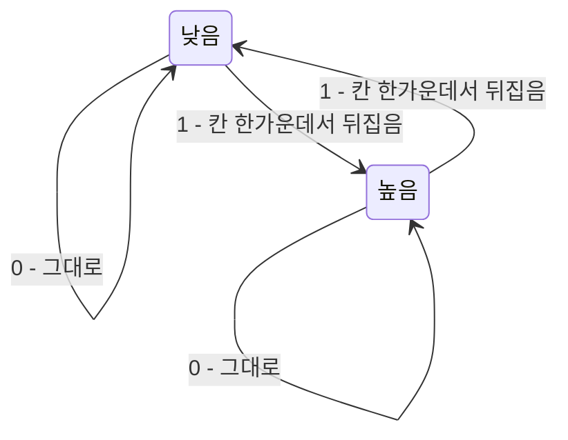


<div class="callout callout-summary" markdown="1">
<div class="callout-title callout-title--default" markdown="span">요약</div>

1은 높게, 0은 낮게 보내는 NRZ는 같은 값이 이어지면 신호가 평평해져 받는 쪽이 박자를 잃는다. NRZI는 1이 올 때마다 신호를 뒤집어서, 1이 아무리 이어져도 신호가 계속 바뀐다. 다만 0이 이어지면 여전히 평평하다. 맨체스터는 모든 비트의 한가운데서 반드시 신호를 바꿔 어떤 비트열에서도 박자를 잃지 않는다. 대신 신호를 두 배로 자주 바꿔야 해서, 같은 선으로 데이터는 절반만 보낸다(효율 50%).

</div>


## 예시로 보기

[NRZ](/Hongs_Blog/studies/computer-communication/nrz-clock-recovery/)의 문제는 "신호가 바뀌지 않는 구간"이다. 받는 쪽은 신호가 바뀌는 순간에만 박자를 맞출 수 있다. 그렇다면 비트를 높이로 나타내지 말고 "바뀌었는가"로 나타내면 된다. 두 방법 모두 비트 칸 하나를 앞 절반과 뒤 절반으로 나눠, 그 사이(한가운데)에서 바꾼다.

비트를 "바뀌었는가"로 나타내면 무엇이 좋아지나? 1이 올 때마다 반드시 신호가 바뀌니, 1이 아무리 길게 이어져도 받는 쪽은 칸마다 박자 단서를 얻는다. 맨체스터는 한 걸음 더 가서 0일 때도 바꾼다. 그래서 어떤 비트열이 와도 칸마다 단서가 있다.

### 비트열 하나를 네 줄로

비트열 `0010111101000010`을 NRZ, 클럭, 맨체스터, NRZI 네 방식으로 그린다.


그림은 위에서부터 NRZ, 클럭, 맨체스터, NRZI 네 줄이다. 점선은 칸 경계이고, 칸 가운데의 옅은 실선은 칸의 한가운데다. 맨 위 비트 16개가 칸마다 하나씩 들어간다.

- **NRZ 줄**은 1인 칸에서 높고 0인 칸에서 낮다. 칸 안에서는 바뀌지 않는다.
- **클럭 줄**은 비트와 상관없이 칸마다 같은 모양이다. 앞 절반은 낮고 뒤 절반은 높아서, 모든 칸의 한가운데에서 올라간다.
- **맨체스터 줄**은 모든 칸의 한가운데 안내선에서 반드시 바뀐다. 0인 칸에서는 올라가고, 1인 칸에서는 내려간다. 칸 경계에서도 가끔 바뀌는데(예: 1·2번째 칸 사이), 같은 비트가 두 번 이어질 때다. 0이 두 번 오면 앞 칸은 높게 끝나고 다음 칸은 낮게 시작하므로, 경계에서 한 번 내려가야 한다. 1이 두 번 오면 반대로 경계에서 올라간다.
- **NRZI 줄**은 1인 칸에서만 한가운데서 뒤집힌다. 1이 네 개 이어지는 5~8번째 칸에서는 칸마다 뒤집혀 계속 바뀐다. 하지만 0이 네 개 이어지는 11~14번째 칸에서는 한 번도 바뀌지 않는다. 칠한 곳이 그 구간이다. 10번째 칸(1)의 한가운데에서 내려간 뒤, 15번째 칸(1)의 한가운데에서 올라갈 때까지 5칸 폭 동안 평평하다.

### 칸마다 규칙을 적용하면

앞쪽 여섯 칸에 규칙을 적용하면 아래 표와 같다. NRZI는 처음 높이를 낮음으로 잡는다. NRZI는 "지금 높이"를 하나 들고 다니면서, 칸의 앞 절반에는 지금 높이를 그대로 쓰고, 비트가 1이면 한가운데서 뒤집어 뒤 절반에 쓴다.

| 칸 | 비트 | NRZI 앞 절반 (들고 온 높이) | NRZI 뒤 절반 | 맨체스터 (앞, 뒤) |
|---|---|---|---|---|
| 1 | 0 | 낮음 | 낮음 (그대로) | (낮음, 높음) 올라감 |
| 2 | 0 | 낮음 | 낮음 (그대로) | (낮음, 높음) 올라감 |
| 3 | 1 | 낮음 | 높음 (뒤집음) | (높음, 낮음) 내려감 |
| 4 | 0 | 높음 | 높음 (그대로) | (낮음, 높음) 올라감 |
| 5 | 1 | 높음 | 낮음 (뒤집음) | (높음, 낮음) 내려감 |
| 6 | 1 | 낮음 | 높음 (뒤집음) | (높음, 낮음) 내려감 |

4번째 칸은 비트가 0인데 NRZI 신호는 높다. 3번째 칸에서 뒤집혀 높아진 높이를 그대로 들고 왔기 때문이다. 그래서 NRZI에서 높이만 보고 0인지 1인지 말할 수 없다. 보는 것은 "칸 안에서 바뀌었는가"뿐이다.

맨체스터는 들고 다니는 높이가 없다. 칸마다 비트 하나만 보고 모양을 정한다. 3번째 칸(1)은 높게 시작하는데, 2번째 칸이 높게 끝났으니 그 경계에서는 바뀌지 않는다. 4번째 칸(0)은 낮게 시작하는데, 3번째 칸이 낮게 끝났으니 이 경계에서도 바뀌지 않는다. 서로 다른 비트가 이어지면 경계는 조용하고, 같은 비트가 이어질 때만 경계에서도 바뀐다.

### 맨체스터 = NRZ ⊕ 클럭

맨체스터 신호는 NRZ 신호와 클럭 신호의 배타적 논리합(XOR)이다. XOR(기호 $$\oplus$$)는 두 값이 다르면 1, 같으면 0을 내는 계산이다. 반 칸마다 NRZ 높이와 클럭 높이를 XOR하면 맨체스터 높이가 나온다(낮음 = 0, 높음 = 1).

- **1번째 칸(비트 0):** NRZ는 (0, 0), 클럭은 (0, 1)이다. 앞 절반은 $$0 \oplus 0 = 0$$, 뒤 절반은 $$0 \oplus 1 = 1$$이다. 결과 (0, 1)은 낮음에서 높음, 즉 올라감이다.
- **3번째 칸(비트 1):** NRZ는 (1, 1), 클럭은 (0, 1)이다. 앞 절반은 $$1 \oplus 0 = 1$$, 뒤 절반은 $$1 \oplus 1 = 0$$이다. 결과 (1, 0)은 내려감이다.

"0은 올라감, 1은 내려감"이라는 규칙을 따로 외울 필요가 없다. 클럭이 칸마다 올라가니, 데이터가 0이면 클럭 그대로(올라감), 데이터가 1이면 클럭을 뒤집은 것(내려감)이 된다. 그림에서 NRZ 줄과 클럭 줄을 반 칸마다 비교해 보면, 둘이 같은 곳에서 맨체스터가 낮고 다른 곳에서 높다.

### 거꾸로 읽기

받는 쪽은 신호에서 비트를 되찾는다. 그림 맨 아래 NRZI 줄의 4번째 칸은 한가운데서 바뀌지 않았으니 0이다. 5번째 칸은 한가운데서 내려갔으니 1이다. 높이(높음인지 낮음인지)는 보지 않는다. 맨체스터 줄의 4번째 칸은 앞 절반이 낮으니 0이고, 5번째 칸은 앞 절반이 높으니 1이다. 맨체스터의 앞 절반은 클럭이 0인 자리라서, 앞 절반 높이가 곧 데이터다.

<div class="callout callout-check" markdown="1">
<div class="callout-title" markdown="span">검증: 위 네 줄이 규칙대로 계산한 값과 같음, 1~10비트 모든 열에서 복호 일치, 받은 맨체스터 ⊕ 데이터 = 클럭 — [41_nrzi-manchester_impl.py](/Hongs_Blog/studies/computer-communication/code/41_nrzi-manchester_impl/)</div>

</div>


## 정의

두 방식의 규칙은 다음과 같다.

- **NRZI**(Non-return to Zero Inverted): 1을 보낼 때는 지금 신호에서 한가운데서 뒤집는다(중간 전이, mid-transition). 0을 보낼 때는 지금 신호를 그대로 둔다. 이어지는 1의 문제를 푼다.
- **맨체스터**(Manchester): 0은 올라가는 전이, 1은 내려가는 전이다. NRZ로 나타낸 데이터와 클럭을 배타적 논리합(XOR)한 것이다. 효율이 50%라는 문제가 있다.



NRZI는 지금 높이 하나만 기억한다. 1이 오면 반대 상태로 넘어가고, 0이 오면 제자리에 머문다. 0이 이어지면 제자리 화살표만 돌아서 신호가 평평해진다.

XOR에는 다음 세 성질이 있다. 말로 하면, 0과 XOR하면 그대로이고, 1과 XOR하면 뒤집히고, 자기 자신과 XOR하면 0이 된다.

$$X \oplus 0 = X, \qquad X \oplus 1 = X', \qquad X \oplus X = 0$$


($$X$$는 0 또는 1인 값이고, $$X'$$는 $$X$$를 뒤집은 값이다.) $$X = 1$$을 넣으면 $$1 \oplus 0 = 1$$, $$1 \oplus 1 = 0 = 1'$$이다. $$X = 0$$을 넣으면 $$0 \oplus 0 = 0$$, $$0 \oplus 1 = 1 = 0'$$이다. 셋째 성질은 $$1 \oplus 1 = 0$$과 $$0 \oplus 0 = 0$$, 두 경우 모두 맞다.

이 성질로 맨체스터 신호의 뜻을 다시 읽을 수 있다. 비트 $$i$$에서 보내는 쪽의 클럭을 $$\mathit{Clock}^S_i$$(위 첨자 $$S$$는 보내는 쪽), 데이터를 $$\mathit{Data}_i$$, 맨체스터 신호를 $$M_i$$라 하면

$$M_i = \mathit{Data}_i \oplus \mathit{Clock}^S_i$$


받는 쪽은 받은 신호 $$M'_i$$에서 먼저 $$\mathit{Data}_i$$를 알아낸다. 전송 중 오류가 없다면($$M'_i = M_i$$), 받은 신호에 데이터를 한 번 더 XOR해서 보내는 쪽의 클럭을 꺼낸다.

$$M'_i \oplus \mathit{Data}_i = (\mathit{Data}_i \oplus \mathit{Clock}^S_i) \oplus \mathit{Data}_i = \mathit{Clock}^S_i$$


가운데 식에서 $$\mathit{Data}_i$$가 두 번 들어가 $$X \oplus X = 0$$으로 지워지고, $$0 \oplus \mathit{Clock}^S_i = \mathit{Clock}^S_i$$만 남는다. 위 비트열의 칸 두 개로 반 칸마다 확인하면 다음과 같다.

- **3번째 칸(비트 1):** 받은 맨체스터는 (1, 0)이고, 데이터를 반 칸 두 개로 펼치면 (1, 1)이다. XOR하면 $$(1 \oplus 1, 0 \oplus 1) = (0, 1)$$이다.
- **1번째 칸(비트 0):** 받은 맨체스터는 (0, 1), 데이터는 (0, 0)이다. XOR하면 $$(0 \oplus 0, 1 \oplus 0) = (0, 1)$$이다.

데이터가 1이든 0이든 결과는 (0, 1), 즉 앞 절반 낮고 뒤 절반 높은 클럭 한 칸이다.

받는 쪽은 보내는 쪽의 클럭을 손에 넣었으므로 박자를 맞출 수 있다. 맨체스터 코드는 데이터에 클럭을 얹어서 같이 보내는 것이다. 넓게 보면, 박자 정보를 따로 보내지 않고 데이터 신호 안에 함께 싣는 방식(in-band signaling)이다.

### 입출력과 의사코드

입력은 비트열 $$b_1 b_2 \cdots b_n$$, 출력은 반 칸 단위의 높이 $$2n$$개(0은 낮음, 1은 높음)다. 클럭은 칸마다 앞 절반 0, 뒤 절반 1이다[^s1].

```
NRZI(b, 처음 높이 h):          맨체스터(b):
  for i = 1..n:                   for i = 1..n:
    앞 절반 ← h                      앞 절반 ← b_i ⊕ 0 = b_i
    if b_i = 1: h ← 1 - h            뒤 절반 ← b_i ⊕ 1 = 1 - b_i
    뒤 절반 ← h
```

되돌리기(디코딩)는 더 간단하다. NRZI는 "칸의 앞 절반과 뒤 절반이 다르면 1, 같으면 0"이다. 맨체스터는 "앞 절반의 높이가 곧 데이터"다. 앞 절반의 클럭이 0이라 $$b_i \oplus 0 = b_i$$이기 때문이다[^s1].

두 규칙 모두 칸 하나 안의 반 칸 두 개만 본다. 그래서 받는 쪽은 앞 칸을 잘못 읽었더라도 다음 칸은 따로 제대로 읽을 수 있다. NRZI의 처음 높이를 몰라도 되는 것도 이 때문이다.

### 실행 추적

비트열 `10110`, NRZI의 처음 높이는 낮음(0)이다[^s1].

| 칸 | 비트 | NRZI: 앞 절반 | 1이면 뒤집기 | NRZI: 뒤 절반 | 맨체스터 (앞, 뒤) |
|---|---|---|---|---|---|
| 1 | 1 | 0 | 0 → 1 | 1 | (1, 0) 내려감 |
| 2 | 0 | 1 | 그대로 | 1 | (0, 1) 올라감 |
| 3 | 1 | 1 | 1 → 0 | 0 | (1, 0) 내려감 |
| 4 | 1 | 0 | 0 → 1 | 1 | (1, 0) 내려감 |
| 5 | 0 | 1 | 그대로 | 1 | (0, 1) 올라감 |

표의 두 줄을 문장으로 풀면 다음과 같다. 3번째 칸은 비트 1이다. NRZI는 2번째 칸이 높게 끝났으니 앞 절반이 1(높음)이고, 1이라 한가운데서 뒤집어 뒤 절반이 0(낮음)이 된다. 맨체스터는 앞 칸과 상관없이 1이니 (1, 0), 내려감이다. 5번째 칸은 비트 0이다. NRZI는 4번째 칸이 높게 끝났으니 (1, 1) 그대로다. 맨체스터는 0이니 (0, 1), 올라감이다.


그림의 위 줄이 NRZI, 아래 줄이 맨체스터다. 파형 아래의 작은 숫자가 반 칸 값이고, 표의 앞 절반·뒤 절반 칸과 같다. 주황 점은 칸 한가운데에서 신호가 바뀐 곳이다.

NRZI 줄에는 주황 점이 1·3·4번째 칸에만 있다. 이 셋이 비트 1인 칸이다. 2·5번째 칸(비트 0)에는 "그대로"라고 적었고, 반 칸 값도 (1, 1)로 같다. NRZI는 칸 경계에서는 한 번도 바뀌지 않는다. 뒤 절반의 높이를 다음 칸 앞 절반이 그대로 들고 가기 때문이다.

맨체스터 줄에는 주황 점이 다섯 칸 모두에 있다. 화살표는 바뀌는 방향이다. 1인 칸은 내려가고($$\downarrow$$), 0인 칸은 올라간다($$\uparrow$$). 빈 점 하나는 3·4번째 칸 경계에 있다. 3번째 칸(1)이 낮게 끝났는데 4번째 칸(1)이 높게 시작해야 해서 경계에서 올라간 것이다. 이 경계 전이는 데이터를 싣지 않는다. 받는 쪽은 한가운데의 전이만 읽는다.

이 그림을 거꾸로 읽으면 원래 비트가 돌아온다. NRZI는 주황 점이 있는 칸이 1이니 1, 0, 1, 1, 0이다. 맨체스터는 앞 절반 값이 1, 0, 1, 1, 0이다. 둘 다 `10110`이다.

### 정확성

NRZI 디코딩이 맞다는 것은 다음 불변식으로 보인다[^s1].

> 칸 $$i$$를 처리한 뒤의 높이 $$h$$는 (처음 높이) $$\oplus$$ (지금까지 나온 1의 개수를 2로 나눈 나머지)다.


- **초기화:** 아무 칸도 처리하지 않았을 때 1의 개수는 0이므로 $$h$$는 처음 높이다.
- **유지:** $$b_i = 1$$이면 $$h$$를 뒤집고 1의 개수도 하나 는다. 둘의 짝홀이 함께 바뀌므로 식은 계속 맞다. $$b_i = 0$$이면 둘 다 그대로다.
- **종료:** 칸마다 앞 절반은 처리 전 $$h$$, 뒤 절반은 처리 후 $$h$$다. 둘이 다른 것은 정확히 $$b_i = 1$$일 때다. 그래서 디코딩 규칙이 원래 비트를 되돌린다. 처음 높이가 무엇이든 상관없다.

작은 수로 확인한다. `10110`에는 1이 세 개 있다. 3을 2로 나눈 나머지는 1이므로, 다섯 칸을 처리한 뒤의 높이는 (처음 높이 0) $$\oplus$$ 1 = 1, 즉 높음이다. 그림 2의 NRZI 줄도 높게 끝난다. 처음 높이를 높음(1)으로 바꾸면 끝 높이는 $$1 \oplus 1 = 0$$이 되어 모든 반 칸이 뒤집히지만, 칸마다 "바뀌었는가"는 그대로다.

맨체스터 디코딩은 앞 절반 $$= b_i \oplus 0 = b_i$$라는 한 줄로 맞다.

### 복잡도

두 방법 모두 비트마다 일을 한 번씩 하므로 시간은 $$O(n)$$이다($$n$$은 비트 수). 신호는 반 칸 $$2n$$개다.

### 효율이 50%인 이유

맨체스터는 칸마다 반드시 한 번 바뀌고, 칸 경계에서도 바뀔 수 있다. 그래서 신호가 바뀌는 빠르기는 NRZ의 최대 두 배다. 같은 선이 감당하는 신호 변화 속도로 보내는 데이터는 절반이 되므로 효율이 50%다.

선은 신호를 무한히 빨리 바꾸지 못한다. 높음과 낮음을 오가는 데 시간이 걸리고, 너무 짧은 조각은 받는 쪽에서 뭉개져 보인다. 그래서 선의 실력은 "1초에 신호를 몇 번까지 바꿀 수 있나", 다르게 말하면 "가장 짧은 조각이 얼마나 짧아도 되나"로 정해진다. 두 방식이 신호를 가장 자주 바꾸는 경우를 세어 보면 차이가 보인다.


위 줄은 NRZ가 가장 자주 바뀌는 비트열 `01010101`이다. 이웃한 비트가 모두 달라서 칸 경계 7곳에서 모두 바뀐다. 8비트에 변화 7번, 비트 하나에 많아야 한 번이다. 가장 짧은 조각은 1비트 폭이다.

아래 줄은 맨체스터가 가장 자주 바뀌는 비트열 `00000000`이다. 0이니 칸마다 한가운데서 올라가야 한다(8번). 그러려면 칸마다 낮게 시작해야 하는데, 앞 칸은 높게 끝났다. 그래서 칸 경계 7곳에서도 모두 내려간다. 8비트에 변화 15번, 비트 하나에 거의 두 번이다. 가장 짧은 조각은 반 비트 폭이다. `11111111`도 방향만 반대로 똑같다.

이제 선이 가장 짧게는 1 µs 조각까지 버틴다고 하자. NRZ는 비트 하나가 1 µs여도 되니 1초에 100만 비트를 보낸다. 맨체스터는 반 비트 조각이 1 µs 이상이어야 하니 비트 하나가 2 µs가 되고, 1초에 50만 비트만 보낸다. 같은 선에서 데이터가 절반이니 효율 50%다.

## 증명

맨체스터 신호에서 받는 쪽이 클럭을 꺼낼 수 있다는 것을 XOR의 성질로 보인다. 전략은 "같은 값을 두 번 XOR하면 사라진다"이다.

<details markdown="1"><summary markdown="span">증명 펼치기</summary>


1. 보내는 쪽은 $$M_i = \mathit{Data}_i \oplus \mathit{Clock}^S_i$$를 보낸다. — 맨체스터의 정의
2. 전송 중 오류가 없으면 $$M'_i = M_i$$다. — 가정
3. 받는 쪽은 $$M'_i$$의 앞 절반에서 $$\mathit{Data}_i$$를 읽는다. 앞 절반의 클럭은 0이므로 앞 절반 $$= \mathit{Data}_i \oplus 0 = \mathit{Data}_i$$다. — $$X \oplus 0 = X$$
4. $$M'_i \oplus \mathit{Data}_i = (\mathit{Data}_i \oplus \mathit{Clock}^S_i) \oplus \mathit{Data}_i$$. — 2단계
5. XOR는 순서를 바꾸고 묶음을 바꿔도 값이 같으므로 $$= (\mathit{Data}_i \oplus \mathit{Data}_i) \oplus \mathit{Clock}^S_i = 0 \oplus \mathit{Clock}^S_i = \mathit{Clock}^S_i$$. — 교환·결합 법칙, $$X \oplus X = 0$$, $$X \oplus 0 = X$$ ∎

</details>

### 스스로 설명해 보기

1. 3단계에서 앞 절반을 읽는 이유
   <details class="inline-fold" markdown="1"><summary markdown="span">근거</summary>
   클럭의 앞 절반이 0이라서, 앞 절반 높이가 데이터와 같다. 뒤 절반을 읽으면 뒤집힌 데이터가 나온다.
   </details>
2. 5단계의 $$X \oplus X = 0$$
   <details class="inline-fold" markdown="1"><summary markdown="span">근거</summary>
   데이터가 두 번 들어가 서로 지워진다. 그래서 데이터가 무엇이든 클럭만 남는다.
   </details>
3. 2단계의 가정이 깨지면
   <details class="inline-fold" markdown="1"><summary markdown="span">근거</summary>
   받은 신호가 틀리면 꺼낸 클럭도 그 자리에서 틀린다. 다만 맨체스터는 칸마다 반드시 바뀌어야 하므로, 한가운데서 바뀌지 않은 칸은 오류로 알아챌 수 있다.
   </details>
- 이 증명의 핵심 아이디어는?
  <details class="inline-fold" markdown="1"><summary markdown="span">답</summary>
  XOR는 자기 자신의 역연산이다. 같은 값으로 한 번 더 XOR하면 원래대로 돌아간다. 그래서 데이터를 알면 클럭을, 클럭을 알면 데이터를 꺼낼 수 있다.
  </details>
- 이 방법을 쓸 수 있는 다른 상황은?
  <details class="inline-fold" markdown="1"><summary markdown="span">답</summary>
  XOR 암호(평문 ⊕ 키 = 암호문, 암호문 ⊕ 키 = 평문), RAID의 패리티 디스크(나머지 디스크와 XOR해서 잃은 디스크를 되살림), 두 변수를 임시 변수 없이 맞바꾸는 XOR 교환.
  </details>

## 활용

- 구현: [41_nrzi-manchester_impl.py](/Hongs_Blog/studies/computer-communication/code/41_nrzi-manchester_impl/)에 인코딩, 디코딩, 클럭 꺼내기가 있다.
- 맨체스터는 초기 10 Mbps 이더넷(10BASE-T 등)이 쓴다. 칸마다 바뀌어서 박자는 확실하지만, 10 Mbps를 보내려고 신호를 최대 20 M번 바꾼다.
- NRZI는 USB가 쓴다. USB는 1이 아니라 0에서 뒤집는다. 그래서 1이 이어지면 평평해지는데, 1이 여섯 개 이어지면 0을 하나 끼워 넣어 신호를 억지로 바꾼다(비트 스터핑).
- NRZI의 남은 약점(0이 이어지는 경우)은 [4B/5B](/Hongs_Blog/studies/computer-communication/4b5b/)가 데이터를 미리 바꿔서 막는다.
- 흔한 실수: NRZI에서 "1은 높음"으로 그리는 것. NRZI의 1은 높이가 아니라 "한가운데서 뒤집힘"이다. 같은 비트열이라도 처음 높이에 따라 그림이 반대가 된다.

## 연결

- 선수: [NRZ와 클럭 복구](/Hongs_Blog/studies/computer-communication/nrz-clock-recovery/)
- XOR의 정의와 성질: 이산수학 [명제와 논리 연산](/Hongs_Blog/studies/discrete-math/propositional-logic/)
- 맨체스터의 효율 문제를 푸는 방법: [4B/5B](/Hongs_Blog/studies/computer-communication/4b5b/)
- 네 방식 비교: [인코딩 방식 비교](/Hongs_Blog/studies/computer-communication/contrast--line-coding/)
- 연습: [인코딩 예제 사다리](/Hongs_Blog/studies/computer-communication/line-coding-ladder/)

## 자주 하는 오해

<div class="callout callout-misconception" markdown="1">
<div class="callout-title" markdown="span">"NRZI가 클럭을 복구할 수 있는 것은 비트 칸의 한가운데서 신호를 읽기 때문이다"</div>

아니다. 한가운데서 읽는 것은 NRZ도 똑같다. NRZI가 다른 점은 1마다 신호가 바뀐다는 것이다. 받는 쪽은 신호가 바뀌는 순간을 보고 "지금이 칸의 한가운데"라고 박자를 다시 맞춘다. 그럴듯해 보이는 이유는 NRZI의 전이가 마침 칸의 한가운데서 일어나서 "한가운데"라는 말이 두 번 나오기 때문이다. 확인하는 법: 0만 이어지는 비트열을 NRZI로 그려 보면 신호가 평평하다. 이때는 한가운데서 읽어도 박자를 맞출 수 없다.

</div>


<div class="callout callout-misconception" markdown="1">
<div class="callout-title" markdown="span">"맨체스터는 클럭을 따로 보내니까 선이 두 가닥 필요하다"</div>

아니다. 맨체스터는 클럭과 데이터를 XOR해서 신호 하나로 만든다. 선은 하나다. 효율이 떨어지는 것은 선이 늘어서가 아니라, 같은 선에서 신호를 두 배로 자주 바꿔야 해서다.

</div>


## 확인 문제

<details markdown="1"><summary markdown="span"><b>C1</b> NRZI와 맨체스터가 0과 1을 각각 어떻게 나타내는지 쓰라.</summary>


**답:** NRZI: 1이면 비트 한가운데서 지금 신호를 뒤집고, 0이면 그대로 둔다. 맨체스터: 0은 한가운데서 올라가고(낮음 → 높음), 1은 내려간다(높음 → 낮음). 맨체스터는 NRZ 데이터와 클럭의 XOR이다.<br>
**흔한 오답:** 맨체스터의 0과 1을 반대로 쓰는 것. 클럭이 앞 절반 0, 뒤 절반 1이므로 0 ⊕ 클럭 = (0, 1), 즉 올라감이다.

</details>

<details markdown="1"><summary markdown="span"><b>C2</b> NRZI는 0이 이어질 때 박자를 잃지만 맨체스터는 잃지 않는다. 그 이유를 두 방법의 규칙으로 설명하라. 그 대가로 맨체스터가 잃는 것은?</summary>


**답:** NRZI는 1에서만 신호가 바뀌므로 0이 이어지면 신호가 평평하다. 맨체스터는 비트가 0이든 1이든 한가운데서 반드시 바뀌므로 칸마다 박자 단서가 있다. 대가는 효율이다. 칸마다 신호가 바뀌어 신호 변화가 최대 두 배로 잦아지므로, 같은 선으로 데이터를 절반만 보낸다(50%).

</details>

<details markdown="1"><summary markdown="span"><b>C3</b> 비트열 `11110000`을 맨체스터와 NRZI(처음 낮음)로 그리라. 칸 하나에 반 칸 두 개, 낮음 `_`, 높음 `‾`.</summary>


**답:**
- 맨체스터: `‾_ ‾_ ‾_ ‾_ _‾ _‾ _‾ _‾`
- NRZI: `_‾ ‾_ _‾ ‾_ __ __ __ __`

NRZI는 앞의 1 네 개에서 계속 바뀌다가 뒤의 0 네 개에서 평평해진다. 맨체스터는 끝까지 칸마다 바뀐다.

</details>

<details markdown="1"><summary markdown="span"><b>C4</b> 받는 쪽이 계산하는 $$M'_i \oplus \mathit{Data}_i$$가 하는 일을 한 문장으로 쓰라.</summary>


**답:** 받은 신호에서 데이터를 지워 내고 보내는 쪽의 클럭만 남겨, 받는 쪽이 그 클럭에 박자를 맞추게 한다.

</details>

<details markdown="1"><summary markdown="span"><b>C5</b> NRZI를 디코딩할 때 받는 쪽은 신호의 처음 높이를 몰라도 된다. 이유를 대라.</summary>


**답:** 디코딩 규칙은 "한 칸의 앞 절반과 뒤 절반이 다른가"만 본다. 처음 높이를 반대로 바꾸면 모든 반 칸의 높이가 함께 뒤집히지만, 같은 칸 안의 두 값이 다른지 같은지는 그대로다.

</details>

[^s1]: 구현 코드의 자체 테스트로 확인했다.

