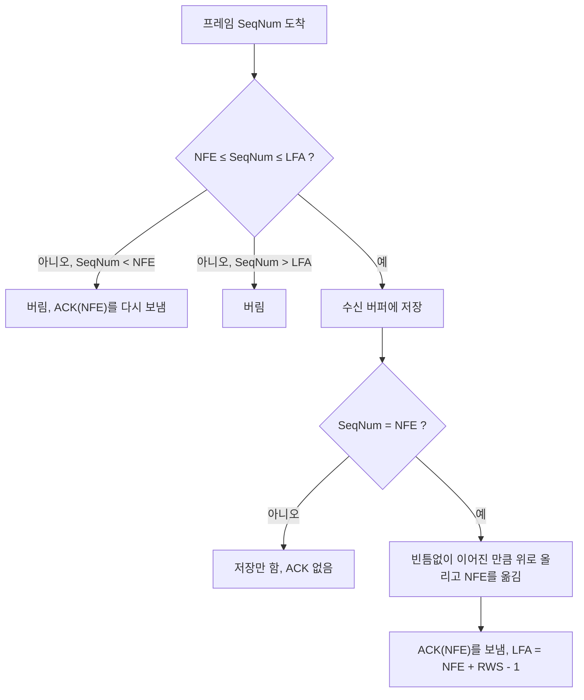



요약

보내는 쪽은 숫자 세 개(한 번에 띄울 수 있는 개수, 마지막으로 받은 답장의 번호, 마지막으로 보낸 번호)만 기억하고, 받는 쪽도 세 개(받을 수 있는 개수, 다음에 기다리는 번호, 받아들일 수 있는 마지막 번호)만 기억한다. 일은 정해진 순서대로 흘러가지 않는다. 위층의 전송 요청, 답장 도착, 타이머 끝, 프레임 도착 같은 사건이 올 때마다 정해진 동작을 한다. 두 쪽은 서로를 볼 수 없으므로, 상대를 속을 모르는 상자로 여기고 자기 숫자와 받은 메시지만으로 움직인다.

## 예시로 보기

오류 제어 전까지(인코딩, 프레이밍, 오류 검출)는 네트워크 어댑터(NIC) 하드웨어가 했다. 오류 제어는 소프트웨어로 만드는 첫 프로토콜이다. 송신과 수신 양쪽을 한 그림에 보는 것은 설명할 때뿐이다. 실제로는 송신과 수신이 각자 따로 돌아간다. 동작 하나하나는 복잡하지 않지만, 동작들이 순서대로 일어나지 않는 동시·분산 프로그램이라 설계가 꼭 필요하다. 언제 어떤 사건이 일어나는지 알아야 한다.

보통의 프로그램은 위에서 아래로 차례로 실행된다. 이 프로그램은 다르다. 상대는 속을 볼 수 없는 상자이고, 동작은 순서가 아니라 사건(인터럽트)이 오는 때에 시작된다. 그래서 각 쪽이 기억할 숫자(상태 변수)와, 사건마다 할 동작을 정해 둔다.

창 크기 4로 F0~F5를 보내는데 F2가 처음 보낼 때 사라지는 [Go-Back-N](/Hongs_Blog/studies/computer-communication/go-back-n/)의 예(싣는 시간 1 ms, 전파 시간 3 ms, 타임아웃 9 ms)를 이 숫자들로 따라간다. 받는 쪽은 순서가 어긋난 프레임을 저장하되 ACK는 따로 보내지 않는다.

그림의 각 줄은 한 순간이다. 왼쪽이 보내는 쪽, 오른쪽이 받는 쪽이고, 노란 테두리가 창이다. 아래 화살표가 변수가 가리키는 번호다[^s1].

- **8 ms 직후.** 보내는 쪽은 ACK 2를 받아 LAR = 2이고, F5까지 보내 LFS = 5다. 파란 칸 2~5의 4개가 확인을 기다린다. $$5 - 2 + 1 = 4$$라 창이 꽉 찼다. 받는 쪽은 F0, F1을 올려 NFE = 2(F2를 기다림)이고, 순서가 어긋난 F3을 저장해 두었다(초록). 받아들일 수 있는 마지막 번호 LFA = $$2 + 4 - 1 = 5$$다.
- **12 ms 직후.** F2와 F3의 타이머가 끝나 다시 보냈다. 보내는 쪽 숫자는 그대로다. 다시 보내도 LFS는 늘지 않는다. 받는 쪽은 F4, F5도 저장해 F2 자리만 비었다.
- **15 ms 직후.** 다시 보낸 F2가 닿자 빈틈이 메워져 F2~F5를 한꺼번에 올린다. NFE가 2에서 6으로 뛰고, 창도 6~9로 옮긴다. 누적 ACK 6을 보낸다. 보내는 쪽은 아직 이 ACK를 받지 못해 숫자가 그대로다.
- **18 ms.** ACK 6이 닿아 LAR = 6이 된다. LFS = 5보다 커져 $$5 - 6 + 1 = 0$$, 확인을 기다리는 프레임이 없다.

## 정의

여기서는 다음 약속을 따른다. 데이터 $$n$$까지 받으면 ACK $$n+1$$을 보낸다(누적 ACK). 순서 번호(SeqNum)는 각 프레임에 붙는 번호이고, 확인을 기다리는 프레임 하나하나의 이름표(ID)다.

### 보내는 쪽

보내는 쪽은 상태 변수 세 개를 유지한다.

- **SWS**(send window size, 송신 창 크기): 한 번에 확인을 기다릴 수 있는 프레임의 최대 개수.
- **LAR**(last acknowledgment received): 마지막으로 받은 ACK에 적힌 번호. 누적 ACK가 다음 번호를 적으므로, LAR은 아직 확인 안 된 첫 프레임의 번호다. 처음에는 0이다.
- **LFS**(last frame sent): 마지막으로 보낸 프레임의 번호. 처음에는 −1이다(아직 아무것도 안 보냄).

확인을 기다리는 프레임은 LAR, LAR+1, …, LFS로 $$\text{LFS} - \text{LAR} + 1$$개다. 이 개수가 창 크기를 넘지 않게 한다.

송신 쪽 항등식

$$\text{LFS} - \text{LAR} + 1 \le \text{SWS}$$

위 예의 8 ms 직후는 $$5 - 2 + 1 = 4 \le 4$$로 꽉 찬 상태다.

보내는 쪽은 사건 세 가지에 다음과 같이 움직인다.

1. **위층에서 전송 요청이 오면:** ① LFS를 1 늘리고(늘릴 수 없으면, 곧 항등식이 깨지면 기다린다) ② 타임아웃을 건 뒤 ③ 프레임을 보낸다.
2. **ACK가 오면:** ① LAR을 ACK 번호까지 늘리며 ② 그 프레임들의 타임아웃을 풀고 버퍼에서 사본을 지운다 ③ 그만큼 창이 열려 기다리던 전송을 한다.
3. **타임아웃이 걸리면:** ① 타임아웃을 다시 건 뒤 ② 버퍼의 사본을 다시 보낸다.

SWS만큼의 프레임은 버퍼에 둔다. 다시 보낼 때 필요하다.

프레임을 "보낸다"는 것은 누구에게 보낸다는 뜻일까? 받는 쪽 프로그램에 바로 넣는 것이 아니다. 자기 아래 계층(링크를 맡은 NIC 쪽)에 넘긴다. 받는 쪽 같은 계층과의 대화는 아래 계층을 거쳐서만 이루어진다([계층화](/Hongs_Blog/studies/computer-communication/layering/), [프로토콜](/Hongs_Blog/studies/computer-communication/protocol/)).

### 받는 쪽

받는 쪽도 상태 변수 세 개를 유지한다. 이것은 순서가 어긋난 프레임을 저장하는 Go-Back-N이다.

- **RWS**(receive window size, 수신 창 크기): 한 번에 받아 둘 수 있는 프레임의 최대 개수.
- **NFE**(next frame expected): 다음에 받기를 기다리는 번호. 처음에는 0이다.
- **LFA**(last frame acceptable): 받아들일 수 있는 마지막 번호. $$\text{LFA} = \text{NFE} + \text{RWS} - 1$$이다.

수신 쪽 항등식

$$\text{LFA} - \text{NFE} + 1 \le \text{RWS}$$

NFE부터 LFA까지가 수신 창이다. 위 예의 8 ms 직후는 $$5 - 2 + 1 = 4 \le 4$$다.

순서 번호가 SeqNum인 프레임이 오면 받는 쪽은 다음과 같이 한다.

- $$\text{NFE} \le \text{SeqNum} \le \text{LFA}$$이면 받아들인다.
  - 순서가 어긋난 프레임(SeqNum > NFE)이면 저장만 한다.
  - SeqNum = NFE면 중간에 빈 곳 없이 채워지는 끝 지점의 다음으로 NFE를 옮긴다. 빈 곳 없이 채워진 데이터는 위 계층으로 올린다.
- SeqNum < NFE이거나 SeqNum > LFA이면 버린다. SeqNum < NFE면 ACK를 보내야 한다.
- 누적 ACK를 NFE 값으로 보낸다.

### 실행 추적

위 예를 [구현 코드](/Hongs_Blog/studies/computer-communication/code/60_sliding-window-algorithm_impl/)로 돌린 결과다. 같은 시각의 사건은 위에서부터 처리했다[^s3].

| 시각(ms) | 사건 | 동작 | LAR | LFS | NFE | LFA | 저장 |
|---|---|---|---|---|---|---|---|
| 0 | 위층 요청 6개 | F0~F3 보냄(창이 다 참), F4·F5는 기다림 | 0 | 3 | 0 | 3 | |
| 4 | F0 도착 | 올림, ACK 1 | 0 | 3 | 1 | 4 | |
| 5 | F1 도착 | 올림, ACK 2 | 0 | 3 | 2 | 5 | |
| 7 | F3 도착 | 순서 어긋남, 저장만 | 0 | 3 | 2 | 5 | 3 |
| 7 | ACK 1 도착 | F0 지움, F4 보냄 | 1 | 4 | 2 | 5 | 3 |
| 8 | ACK 2 도착 | F1 지움, F5 보냄 | 2 | 5 | 2 | 5 | 3 |
| 11 | F2 타임아웃 | F2 다시 보냄 | 2 | 5 | 2 | 5 | 3 |
| 11 | F4 도착 | 저장만 | 2 | 5 | 2 | 5 | 3, 4 |
| 12 | F3 타임아웃 | F3 다시 보냄 | 2 | 5 | 2 | 5 | 3, 4 |
| 12 | F5 도착 | 저장만 | 2 | 5 | 2 | 5 | 3, 4, 5 |
| 15 | F2 도착 | F2~F5 올림, ACK 6 | 2 | 5 | 6 | 9 | |
| 16 | F4 타임아웃 | F4 다시 보냄 | 2 | 5 | 6 | 9 | |
| 16 | F3(다시) 도착 | 이미 받음, 버리고 ACK 6 | 2 | 5 | 6 | 9 | |
| 17 | F5 타임아웃 | F5 다시 보냄 | 2 | 5 | 6 | 9 | |
| 18 | ACK 6 도착 | F2~F5 지움, 모두 확인 | 6 | 5 | 6 | 9 | |

18 ms 뒤로는 다시 보낸 F4, F5가 닿아 받는 쪽이 버리고 ACK 6을 다시 보내고, 보내는 쪽은 이미 받은 번호라 무시한다.

### 정확성

두 항등식은 모든 사건 뒤에도 맞다.

- *초기화.* 처음에는 LAR = 0, LFS = −1이라 $$-1 - 0 + 1 = 0 \le \text{SWS}$$다. 받는 쪽은 LFA = NFE + RWS − 1로 정의되어 등호로 맞다.
- *유지(보내는 쪽).* LFS를 늘리는 것은 사건 1뿐이고, 늘린 뒤에도 항등식이 맞을 때만 늘린다. LAR이 커지면 좌변은 줄기만 한다. 타임아웃은 두 변수를 바꾸지 않는다.
- *유지(받는 쪽).* NFE가 움직이면 LFA도 함께 움직여 둘의 차이가 그대로다. 저장하는 프레임은 언제나 NFE와 LFA 사이에 있다.

데이터가 순서대로 한 번씩 올라가는 것과 끝내 모두 확인되는 것은 [Go-Back-N](/Hongs_Blog/studies/computer-communication/go-back-n/)의 정확성 논증과 같다. 거기서 "이미 받은 번호(SeqNum < NFE)에 ACK를 다시 보낸다"는 규칙이 꼭 필요했다.

검증: 위 실행 추적 표와 그림의 네 순간, 모든 사건 뒤의 두 항등식, 무작위 손실(프레임·ACK 분실, 짧은 타임아웃 포함) 3,000가지에서 위층이 D0, D1, …을 순서대로 한 번씩 받음, 이미 받은 번호에 ACK를 보내지 않으면 마지막 ACK가 사라졌을 때 200 ms 동안 수십 번 다시 보내며 끝나지 않음 — [60_sliding-window-algorithm_impl.py](/Hongs_Blog/studies/computer-communication/code/60_sliding-window-algorithm_impl/), [60_sliding-window-algorithm_plot.py](/Hongs_Blog/studies/computer-communication/code/60_sliding-window-algorithm_plot/). 항등식은 위 논증으로 보였고, 나머지는 실험으로 확인했다.

### 비용

- **기억 공간.** 보내는 쪽은 SWS개, 받는 쪽은 RWS개의 프레임 칸이 필요하다. 상태 변수는 양쪽 세 개씩뿐이다.
- **사건 하나의 일.** 대부분 몇 번의 덧셈과 비교다. 다만 받는 쪽이 빈틈을 메운 순간에는 이어진 프레임을 한꺼번에 올려서 최대 RWS개를 처리하고, 보내는 쪽이 누적 ACK를 받은 순간에는 최대 SWS개의 타이머와 사본을 푼다.

## 스스로 설명해 보기

1. "확인을 기다리는 프레임은 $$\text{LFS} - \text{LAR} + 1$$개다"
   

근거

   LAR은 마지막 누적 ACK의 번호라 LAR 앞은 모두 확인되었고 LAR부터는 아직이다. 보낸 것은 LFS까지다. LAR부터 LFS까지 양 끝을 포함해 세면 $$\text{LFS} - \text{LAR} + 1$$개다.
   

2. "ACK 6을 받은 보내는 쪽은 F2~F5의 타이머를 한꺼번에 푼다"
   

근거

   누적 ACK 6은 "5까지 빠짐없이 받았다"는 뜻이다. LAR을 2에서 6까지 늘리며 지나가는 번호 2, 3, 4, 5의 타임아웃과 사본을 푼다.
   

3. "15 ms에 NFE가 2에서 6으로 뛴다"
   

근거

   F2가 와서 NFE 자리가 채워졌고, 저장해 둔 3, 4, 5가 빈틈없이 이어진다. 끝 지점 5의 다음인 6으로 NFE를 옮기고 F2~F5를 올린다.
   

- 핵심 아이디어는?
  

답

  각 쪽의 상태를 숫자 몇 개로 줄이고, 그 숫자로 지켜야 할 항등식을 정한 뒤, 사건마다 항등식이 깨지지 않게 숫자를 바꾼다.
  

- 같은 방법을 쓸 수 있는 다른 상황은?
  

답

  운영체제의 생산자-소비자 버퍼(채운 칸과 빈칸을 가리키는 두 위치), 인터럽트로 움직이는 장치 드라이버처럼, 사건이 언제 올지 모르는 프로그램 전반.
  

## 활용

- 이 알고리즘은 NIC가 프레임 하나하나를 보내고 받는 일 바로 위에서, 노드 안의 소프트웨어로 돈다.
- 답안에 동작을 그릴 때는 무엇을 버퍼에 두는지, 타임아웃이 언제 걸리고 풀리는지, 보내는 쪽과 받는 쪽 중 어느 쪽 이야기인지, 번호가 무엇을 가리키는지를 밝힌다. 연습: [슬라이딩 윈도우 동작 점검 연습](/Hongs_Blog/studies/computer-communication/sliding-window-check/)
- 흔한 실수: LAR을 "마지막으로 확인된 프레임 번호"로 읽어 개수를 하나 틀리는 것(아래 오해). 다시 보낼 때 LFS를 늘리는 것(LFS는 새 프레임을 보낼 때만 는다). 이미 받은 번호에 ACK를 보내지 않는 것.

## 연결

- 선수: [Go-Back-N](/Hongs_Blog/studies/computer-communication/go-back-n/)(이 알고리즘이 구현하는 정책), [슬라이딩 윈도우](/Hongs_Blog/studies/computer-communication/sliding-window/)
- 관련: [계층화](/Hongs_Blog/studies/computer-communication/layering/), [프로토콜](/Hongs_Blog/studies/computer-communication/protocol/)(위층·아래층과 맞닿는 곳)
- 연습: [슬라이딩 윈도우 동작 점검 연습](/Hongs_Blog/studies/computer-communication/sliding-window-check/)

## 자주 하는 오해

"LAR은 마지막으로 확인된 프레임의 번호다"

여기서 쓰는 약속에서는 틀렸다. 이름이 "마지막으로 받은 ACK"라서, 받은 번호를 적는 ACK에 익숙하면 그렇게 읽기 쉽다. 여기서 쓰는 ACK는 다음 번호를 적으므로, ACK 3을 받으면 LAR = 3이고 확인된 것은 2까지다. 그래서 확인을 기다리는 개수가 $$\text{LFS} - \text{LAR} + 1$$이다. 받은 번호를 적는 약속(Peterson & Davie의 교재)이라면 LAR = 2가 되어 개수는 $$\text{LFS} - \text{LAR}$$이고, 항등식도 $$\text{LFS} - \text{LAR} \le \text{SWS}$$로 바뀐다. 두 약속을 섞으면 하나씩 어긋난다. 답안에는 어느 약속인지 먼저 적는다[^s5].

"보내는 쪽은 F0을 보내고, F1을 보내고, … 차례로 실행되는 프로그램이다"

틀렸다. 그림은 시간 순서로 그리니 그렇게 보인다. 실제로 보내는 쪽 프로그램은 사건을 기다리다가, 위층 요청·ACK 도착·타임아웃 중 하나가 오면 그에 맞는 동작만 하고 다시 기다린다. 위 추적 표의 7 ms처럼 같은 순간에 받는 쪽과 보내는 쪽에서 서로 다른 사건이 동시에 일어난다.

## 확인 문제

<b>C1</b> 보내는 쪽과 받는 쪽의 상태 변수를 각각 쓰고, 두 항등식을 쓰라.

**답:** 보내는 쪽 SWS, LAR, LFS, 항등식 $$\text{LFS} - \text{LAR} + 1 \le \text{SWS}$$. 받는 쪽 RWS, NFE, LFA, 항등식 $$\text{LFA} - \text{NFE} + 1 \le \text{RWS}$$.

<b>C2</b> SWS = RWS = 3. 지금 보내는 쪽은 LAR = 2, LFS = 4이고, 받는 쪽은 NFE = 3이며 F4를 저장해 두었다. 이때 F3이 도착한다. 받는 쪽의 NFE, LFA, 올리는 프레임, 보내는 ACK는? 그 ACK를 받은 보내는 쪽의 LAR과, 새로 보낼 수 있는 프레임 수는?

**답:** 받는 쪽은 F3, F4를 올리고 NFE = 5, LFA = 7, ACK 5를 보낸다. 보내는 쪽은 LAR = 5가 되어 확인을 기다리는 프레임이 $$4 - 5 + 1 = 0$$개라, 새로 3개(F5, F6, F7)를 보낼 수 있다. 
**흔한 오답:** NFE = 4. 저장해 둔 F4까지 이어지는 것을 빼먹은 것이다.

<b>C3</b> 받는 쪽은 SeqNum < NFE인 프레임을 버리면서도 왜 ACK를 보내야 하나?

**답:** 그 프레임이 다시 왔다는 것은 보내는 쪽이 그 ACK를 받지 못했다는 뜻일 수 있다. ACK를 다시 보내지 않으면 보내는 쪽은 그 프레임을 영원히 다시 보내고 창이 앞으로 가지 못한다. 
**확인:** 구현 코드에서 이 규칙을 빼고 마지막 ACK를 지우면 200 ms 동안 끝나지 않았다.

<b>C4</b> 받는 쪽이 프레임을 받았을 때 하는 일을 한 문장으로 쓰라.

**답:** 창 안이면 저장하고, 기다리던 번호면 빈틈없이 이어진 만큼 올리며 NFE를 옮긴 뒤 누적 ACK를 보내고, 이미 받은 번호면 버리고 ACK를 다시 보내고, 창 밖이면 버린다.

<b>C5</b> 송신 쪽 항등식에 "+1"이 붙는 이유를, 여기서 쓰는 ACK 약속으로 설명하라.

**답:** 누적 ACK가 다음 번호를 적으므로 LAR은 아직 확인 안 된 첫 프레임이다. 확인을 기다리는 프레임은 LAR부터 LFS까지 양 끝을 포함하므로 $$\text{LFS} - \text{LAR} + 1$$개다. 예: LAR = 2, LFS = 5면 2, 3, 4, 5의 4개다.

[^s1]: [60_sliding-window-algorithm_plot.py](/Hongs_Blog/studies/computer-communication/code/60_sliding-window-algorithm_plot/)가 사건 시뮬레이터의 상태 기록에서 네 순간의 변수 값을 읽어 그렸고, 각 값을 같은 코드로 확인했다.
[^s3]: [60_sliding-window-algorithm_impl.py](/Hongs_Blog/studies/computer-communication/code/60_sliding-window-algorithm_impl/)가 출력한 값이고, 같은 코드가 표의 주요 줄을 검사한다.
[^s5]: Peterson & Davie, *Computer Networks: A Systems Approach*, 2.5.2절의 슬라이딩 윈도우는 ACK에 받은 마지막 번호를 적고 항등식을 LFS − LAR ≤ SWS로 쓴다. 여기서는 ACK에 다음 번호를 적고 LAR을 그 번호로 두어 LFS − LAR + 1 ≤ SWS로 쓴다.

