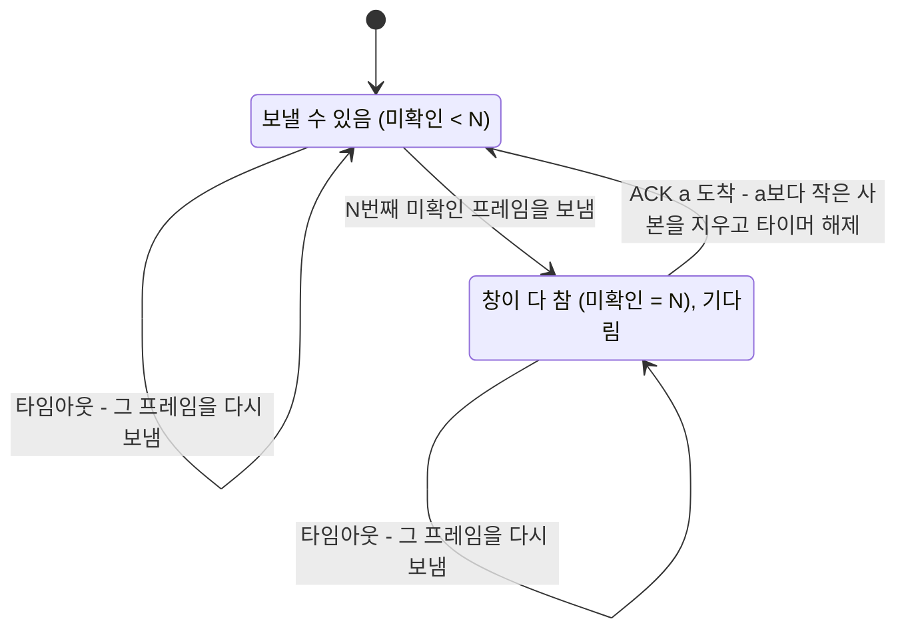



요약

정지 대기는 답장(ACK)을 기다리는 동안 선을 놀린다. 슬라이딩 윈도우는 답장을 받기 전에도 정해 둔 개수까지 프레임을 연달아 보내, 그 빈 시간을 다른 프레임으로 채운다. 대신 선 위에 떠 있는 여러 프레임 중 어느 것이든 사라질 수 있으므로, 프레임마다 번호를 붙이고 사본과 타이머를 따로 두어 하나하나 다시 보낼 준비를 한다. 그래서 핵심은 많이 쌓아 두는 것이 아니라, 오류를 빠르게 복구하는 약속이다.

## 예시로 보기

[정지 대기 사용률](/Hongs_Blog/studies/computer-communication/stop-and-wait-utilization/)의 예에서 1.5 Mbps, 왕복 45 ms 링크로 1 KB 프레임을 보내면 사용률이 10.8%였다. 송신 쪽은 5.46 ms 일하고 45 ms를 논다. 그 45 ms 동안 다음 프레임들을 미리 보내 두면 어떨까? 8~10개쯤 연달아 보낼 수 있다면 선이 쉬지 않는다.

이것이 슬라이딩 윈도우의 생각이다. 송신 쪽이 ACK를 받기 전에 여러 프레임을 보내 선(파이프)을 꽉 채운다. ACK를 받지 않은 상태로 보낸 프레임을 **미확인 프레임**(outstanding frame)이라 부른다. 미확인 프레임은 여러 개로 늘어나지만, 그 수에는 상한이 있다. 이 상한이 **창 크기**(window size)다.

창 크기가 1이면 한 번에 하나만 확인을 기다리니 정지 대기와 같다. 정지 대기는 창 크기가 1인 슬라이딩 윈도우다.

### 창이 미끄러지는 모습

창 크기 7, 순서 번호가 0~7을 돌아가며 쓰는 링크에서 A가 B에게 보낸다. ACK에는 "여기까지 빠짐없이 받았고, 다음은 몇 번"이라는 다음 번호를 적는다. 데이터 $$n$$까지 받았으면 ACK $$n+1$$이다. 이런 ACK를 **누적 ACK**(cumulative ACK)라 부른다.

그림의 각 줄은 한 순간의 A와 B다. 칸 안 숫자는 순서 번호이고, 7 다음에 0으로 돌아간다. 노란 칸이 **창**이다. A에게는 지금 더 보낼 수 있는 번호, B에게는 지금 더 받을 수 있는 번호다. 파란 칸은 A가 보냈지만 아직 확인받지 못한 프레임이다. 회색 칸은 ACK로 확인이 끝난 번호다[^s1].

- ① 처음에는 A도 B도 0~6의 7칸이 창이다.
- ② A가 F0, F1, F2를 보낸다. A의 창은 3~6의 4칸으로 줄고, 0~2는 파란 칸이 된다. 보냈다고 사본을 버리지 않는다. 사라지면 다시 보내야 하므로 버퍼(저장 공간)에 그대로 둔다.
- ③ B가 F0, F1, F2를 받는다. B도 아직 ACK를 보내기 전이라, 더 받을 수 있는 칸을 3~6의 4칸으로 줄여 센다(초록 칸).
- ④ B가 ACK 3을 보낸다. "2까지 다 받았고 다음은 3"이라는 뜻이다. B의 창은 3~1(3, 4, 5, 6, 7, 0, 1)의 7칸으로 늘어난다. A는 ACK 3을 받고 0~2가 잘 갔다고 판단해 버퍼에서 지운다. A의 창도 3~1의 7칸으로 되돌아간다.
- ⑤ A가 F3~F6을 보낸다. 창은 7, 0, 1의 3칸이 남고, 버퍼에는 3~6의 4개가 있다.
- ⑥ B가 F3을 받아 ACK 4를 보내고 A가 받는다. A는 3을 지워 버퍼에 4~6의 3개가 남고, 창은 7, 0, 1, 2의 4칸이다. B의 창은 4~2의 7칸이다.

어느 줄에서나 A의 "버퍼에 둔 개수 + 창 칸 수"는 7이다. ②는 3 + 4, ⑤는 4 + 3, ⑥은 3 + 4다. 창이 오른쪽으로 미끄러지며(sliding) 번호를 따라가서 이런 이름이 붙었다[^s1].

### 창과 버퍼는 다르다

그림의 노란 칸은 버퍼가 아니다. 둘은 반대로 움직인다.

- **창**은 앞으로 보낼 수 있는 범위다. 보내면 줄고, ACK가 오면 늘어난다.
- **버퍼**는 이미 보낸 프레임의 사본을 보관하는 곳이다. 보내면 늘고, ACK가 오면 줄어든다.

②에서 F0~F2를 보낸 순간 창은 4칸으로 줄었지만, 버퍼에는 F0~F2의 사본 3개가 생겼다. 창은 "보낼 범위"이고, 버퍼는 보낸 것을 아직 들고 있는 것이다.

## 정의

**슬라이딩 윈도우**는 ACK를 기다리지 않고 여러 프레임을 보내는 오류 제어 방법이다. 송신 쪽은 미확인 프레임이 창 크기 $$N$$개보다 적은 동안 다음 프레임을 보낸다. 미확인 프레임 하나하나는 모두 오류 제어 대상이라 [ARQ](/Hongs_Blog/studies/computer-communication/arq-sequence-number/)를 따로 한다. 번호를 붙이고, 사본을 버퍼에 두고, 타이머를 걸고, ACK가 오면 지우고, 타임아웃이 나면 다시 보낸다.

ACK $$n$$의 뜻은 양쪽이 미리 하나로 정해 두고 끝까지 같은 뜻으로 쓴다. 여기서는 데이터 $$n$$을 받으면 ACK $$n+1$$을 보내는 누적 ACK를 쓴다. "$$n$$까지 잘 받았고 다음은 $$n+1$$"이다. 이 뜻이 오류를 복구하는 약속의 핵심이다.

창 크기의 약속

기호로 쓰면, ACK에 적힌 번호 중 지금까지 받은 가장 큰 값을 $$a$$, 지금까지 보낸 가장 큰 번호를 $$s$$라 할 때

$$\underbrace{s - a + 1}_{\text{미확인 프레임 수}} \le N$$

- $$N$$: 창 크기(송신 창 크기, SWS)
- $$a$$: 누적 ACK 번호. $$a$$보다 작은 번호는 모두 확인되었고, $$a$$번부터는 아직 확인 전이다.
- 미확인 프레임은 $$a, a+1, \dots, s$$로 $$s - a + 1$$개다. 이 개수에 창에 남은 칸 수를 더하면 $$N$$이다.

그림 ⑥에 넣어 보면, 마지막 ACK가 4이고 마지막으로 보낸 것이 6이라 미확인 프레임은 $$6 - 4 + 1 = 3$$개다. 창에 남은 칸은 $$7 - 3 = 4$$칸(7, 0, 1, 2)이다. 이 식은 [슬라이딩 윈도우 세부 알고리즘](/Hongs_Blog/studies/computer-communication/sliding-window-algorithm/)의 변수 LAR, LFS로 다시 쓴다.

송신 쪽은 창에 빈칸이 있는 동안 보내고, 창이 다 차면 ACK를 기다린다. 어느 상태에서든 타임아웃이 나면 그 프레임을 다시 보낸다.

### 보장하는 것과 보장하지 않는 것

- **보장하는 것.** 각 프레임이 따로 ARQ를 하므로, 프레임이나 ACK가 사라져도 언젠가 다시 보내져 수신 쪽 위층에는 데이터가 순서대로 한 번씩 올라간다. 무엇을 어떻게 다시 보낼지는 오류 처리 정책([Go-Back-N](/Hongs_Blog/studies/computer-communication/go-back-n/), [Selective Repeat](/Hongs_Blog/studies/computer-communication/selective-repeat/))이 정한다[^s3].
- **보장하지 않는 것.** 언제 도착할지는 보장하지 않는다. 재전송이 있으면 늦어진다. 사용률 100%도 창이 충분히 커야만 나온다([슬라이딩 윈도우 사용률](/Hongs_Blog/studies/computer-communication/sliding-window-utilization/)). 번호가 0~7을 돌아가며 쓰이므로, 창을 번호 개수에 비해 너무 크게 잡으면 옛 프레임과 새 프레임을 헷갈릴 수 있다. 번호 칸을 몇 비트로 할지는 따로 따진다[^s3].

### 실패 시나리오

미확인 프레임이 여러 개라서, 그중 어느 프레임에서든 오류가 날 수 있다. 그래서 모든 프레임이 각자 다시 보낼 준비(버퍼 + 타임아웃)를 하고 있어야 한다. F0~F3을 보냈는데 F1만 사라졌다고 하자. 수신 쪽은 F0을 받아 ACK 1을 보내고, F2와 F3은 받았지만 F1이 비어 있다. 이때 송신 쪽이 고를 길은 둘이다.

- F1부터 다시 출발해 F2, F3도 다시 보낸다(Go-Back-N).
- 오류가 난 F1만 다시 보낸다(Selective Repeat).

## 스스로 설명해 보기

1. "버퍼에 둔 개수 + 창 칸 수 = 창 크기"
   

근거

   창 크기는 미확인 프레임 수의 상한이다. 보낸 프레임은 확인될 때까지 버퍼에 있고(미확인 프레임 수), 남은 상한이 앞으로 보낼 수 있는 칸이다.
   

2. "ACK 3을 받은 A는 F0~F2를 버퍼에서 지운다"
   

근거

   누적 ACK 3은 "2까지 빠짐없이 받았다"는 뜻이다. 2까지는 다시 보낼 일이 없으니 사본이 필요 없다.
   

3. "정지 대기는 창 크기 1인 슬라이딩 윈도우다"
   

근거

   창이 1이면 미확인 프레임이 하나뿐이라, 프레임 하나를 보내고 그 ACK가 와야 다음을 보낸다. 정지 대기의 규칙과 같다.
   

- 핵심 아이디어는?
  

답

  ACK를 기다리는 시간에 다음 프레임들을 미리 보내 선을 채우고, 그 프레임들을 각자 ARQ로 지킨다.
  

- 같은 생각을 쓰는 다른 곳은?
  

답

  인터넷의 TCP도 창을 두고 ACK를 기다리지 않고 여러 조각을 보낸다. CPU의 명령어 파이프라인도 앞 명령이 끝나기 전에 다음 명령을 시작해 빈 시간을 채운다.
  

## 활용

- 링크 계층의 HDLC와 인터넷의 TCP가 이 구조를 쓴다. 여러 프레임을 띄워 두고 번호와 ACK로 오류를 복구한다[^s4].
- 오류 제어는 네트워크 어댑터(NIC) 하드웨어가 아니라 노드 안의 소프트웨어로 처리한다. 다시 보낼 사본을 버퍼에 두고 타이머를 관리해야 하기 때문이다.
- 흔한 실수: 창과 버퍼를 같은 것으로 보는 것. ACK 3을 받고 F3까지 지우는 것(누적 ACK 3은 2까지만 확인이다).

## 연결

- 선수: [정지 대기 사용률](/Hongs_Blog/studies/computer-communication/stop-and-wait-utilization/)(왜 필요한가), [ARQ와 순서 번호](/Hongs_Blog/studies/computer-communication/arq-sequence-number/)(프레임마다 하는 일)
- 관련: [대역폭-지연 곱](/Hongs_Blog/studies/computer-communication/bandwidth-delay-product/)(채워야 할 파이프의 부피)
- 다음: [슬라이딩 윈도우 사용률](/Hongs_Blog/studies/computer-communication/sliding-window-utilization/), 오류 처리 정책 [Go-Back-N](/Hongs_Blog/studies/computer-communication/go-back-n/)과 [Selective Repeat](/Hongs_Blog/studies/computer-communication/selective-repeat/), [슬라이딩 윈도우 세부 알고리즘](/Hongs_Blog/studies/computer-communication/sliding-window-algorithm/)

## 자주 하는 오해

"그림의 창(노란 칸)은 프레임을 저장해 두는 버퍼다"

틀렸다. 칸이 일렬로 늘어서 저장 공간처럼 보여서 그럴듯하다. 창은 더 보낼 수 있는(받는 쪽은 더 받을 수 있는) 번호의 범위이고, 버퍼는 보냈지만 확인받지 못한 사본을 보관하는 곳이다. F0~F2를 보내면 창은 7칸에서 4칸으로 줄지만 버퍼는 0개에서 3개로 는다. 둘이 반대로 움직이는 것을 보면 다른 것임을 알 수 있다.

"슬라이딩 윈도우는 버퍼를 늘려 성능을 높이는 기법이다"

틀렸다. 버퍼가 커지는 것은 결과이고 목적이 아니다. 슬라이딩 윈도우는 오류 제어 프로토콜이다. 여러 프레임을 띄워도 각각을 ARQ로 지키는 것이 핵심이고, 버퍼는 여러 프레임을 다루려고 덧붙인 것이다. 그래서 ACK $$n$$의 뜻을 정확히 정하는 것이 버퍼 크기보다 중요하다.

## 확인 문제

<b>C1</b> 미확인 프레임(outstanding frame)과 창 크기(window size)가 무엇인지 쓰고, 정지 대기와의 관계를 한 줄로 쓰라.

**답:** 미확인 프레임은 ACK를 받지 않은 상태로 보낸 프레임이고, 창 크기는 미확인 프레임 수의 상한이다. 정지 대기는 창 크기가 1인 슬라이딩 윈도우다.

<b>C2</b> 창과 버퍼를 구별해야 하는 이유를, F0~F2를 보낸 직후의 두 값으로 설명하라(창 크기 7).

**답:** 창은 더 보낼 수 있는 범위라 7칸에서 4칸으로 줄고, 버퍼는 다시 보낼 사본이라 0개에서 3개로 는다. 
**이유:** 둘은 반대로 움직이고 하는 일이 다르다. 창이 다 차면 보내기를 멈추고, 버퍼의 사본은 ACK가 올 때까지 재전송에 쓴다. 둘을 섞으면 "보낸 프레임을 지워도 된다"는 실수를 한다.

<b>C3</b> 창 크기 5, 순서 번호 0~7. A가 F0~F3을 보낸 뒤 ACK 2를 받았다. 이때 A의 버퍼에 있는 프레임과 창(더 보낼 수 있는 번호)은?

**답:** 버퍼에는 F2, F3(2개), 창은 4, 5, 6(3칸). 
**풀이:** 누적 ACK 2는 "1까지 받았고 다음은 2"라서 F0, F1을 지운다. 미확인 프레임은 F2, F3의 2개이고, 창 크기 5에서 2를 뺀 3칸이 남는다. 다음에 보낼 번호는 4부터다. 
**흔한 오답:** F2까지 지우고 버퍼에 F3만 남긴다. ACK 2를 "2를 받았다"로 읽은 것이다.

<b>C4</b> 송신 쪽이 ACK 3을 받았다. ACK가 "다음 번호"를 적는 방식(여기서 쓰는 방식)일 때와 "받은 번호"를 적는 누적 방식일 때, 버퍼에서 지우는 프레임은 각각?

**답:** 다음 번호 방식이면 F0~F2, 받은 번호 방식이면 F0~F3. 
**이유:** 같은 숫자 3이 앞 방식에서는 "2까지 받았다", 뒤 방식에서는 "3까지 받았다"를 뜻한다. 그래서 양쪽이 ACK $$n$$의 뜻을 미리 하나로 정해 두어야 한다.

[^s1]: [55_sliding-window_plot.py](/Hongs_Blog/studies/computer-communication/code/55_sliding-window_plot/)가 사건 목록에서 칸의 색을 계산해 그렸고, 단계마다의 칸 수를 같은 코드로 확인했다.
[^s3]: 순서대로 한 번씩 올라간다는 것은 [57_go-back-n_impl.py](/Hongs_Blog/studies/computer-communication/code/57_go-back-n_impl/)와 [58_selective-repeat_impl.py](/Hongs_Blog/studies/computer-communication/code/58_selective-repeat_impl/)의 무작위 손실 시험(각 3,000가지)으로 확인했다(증명이 아니라 실험이다).
[^s4]: HDLC가 순서 번호와 창으로 오류를 복구하는 것은 Stallings, *Data and Computer Communications*의 데이터 링크 제어 프로토콜 장의 내용이고, TCP의 창은 Peterson & Davie, *Computer Networks: A Systems Approach*, 5.2절의 내용이다.

