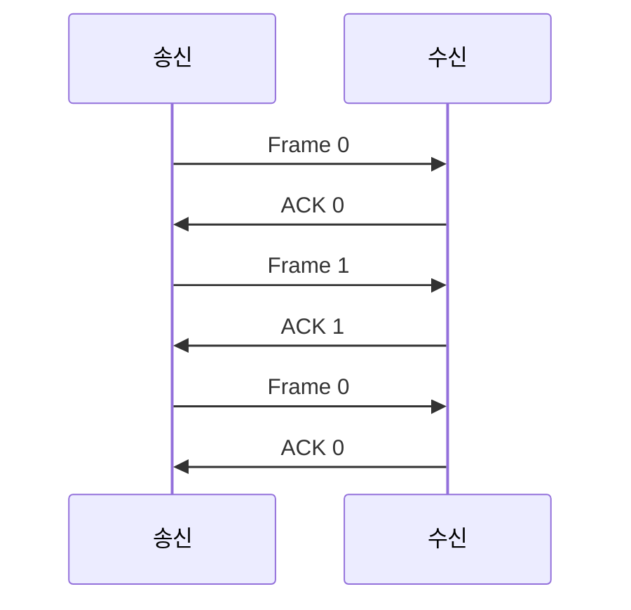



요약

정지 대기는 데이터 덩어리(프레임) 하나를 보내고, 받는 쪽의 "받았다"는 답장(ACK)이 올 때까지 아무것도 보내지 않고 기다리는 방식이다. 그래서 선이 실제로 일하는 시간의 비율(사용률)은 "프레임을 선에 싣는 시간 ÷ (싣는 시간 + 신호가 갔다 오는 시간)"이다. 프레임이 짧을수록, 선이 길수록, 선이 빠를수록 대부분의 시간을 답장을 기다리며 논다. 이 값은 오류가 없고 보낼 데이터가 늘 있다고 가정한 최대치다.

## 예시로 보기

1.5 Mbps(초당 150만 비트) 링크라고 해서 데이터가 초당 150만 비트씩 가는 것은 아니다. 정지 대기에서는 ACK를 기다리는 동안 선이 논다. 얼마나 노는지 숫자로 알아야 프레임 크기를 정하거나 다른 방식을 고를 수 있다.

예를 하나 잡는다. 전송률 1.5 Mbps, 신호가 갔다 오는 데(왕복) 45 ms가 걸리는 링크로 1 KB(1,024바이트 = 8,192비트) 프레임을 정지 대기로 보낸다. 계산은 시간을 따라가며 하나씩 한다(세부 시간 진행).

1. *가정 세우기.* 최대 성능을 보려는 것이니 셋을 가정한다. 오류가 없다. 보낼 데이터가 끊이지 않고 늘 있다. 타임아웃은 적당히 길어서 쓸데없는 재전송이 없다.
2. *싣는 시간.* 프레임의 비트를 선에 다 내보내는 시간은 $$8{,}192 \div 1{,}500{,}000 = 0.00546$$초, 곧 5.46 ms다. 신호가 한 방향으로 건너가는 시간은 왕복의 절반인 22.5 ms다.
3. *ACK를 보내는 순간.* 수신 쪽은 프레임의 마지막 비트까지 받아야 오류 검사를 할 수 있다. 그래서 ACK는 마지막 비트가 닿는 순간에 보낸다. 첫 비트는 22.5 ms에 닿고, 마지막 비트는 그보다 싣는 시간만큼 늦은 $$5.46 + 22.5 = 27.96$$ ms에 닿는다.
4. *반복 구간 찾기.* ACK는 다시 22.5 ms를 건너 $$27.96 + 22.5 = 50.46$$ ms에 송신 쪽에 닿는다. 송신 쪽은 그때 바로 다음 프레임을 싣기 시작한다. 오류가 없으니 그 뒤로는 50.46 ms짜리 구간이 똑같이 되풀이된다. 끝없이 따라갈 필요 없이 한 구간만 보면 된다.
5. *사용률.* 한 구간 50.46 ms 가운데 선에 비트를 싣는 시간은 5.46 ms뿐이다. 사용률은 $$5.46 \div 50.46 \approx 0.108$$, 곧 10.8%다. 100초 중 11초만 일하는 셈이다.

그림은 위 다섯 단계를 시간표로 그린 것이다. 왼쪽 세로줄이 송신 쪽, 오른쪽 세로줄이 수신 쪽이고, 시간은 위에서 아래로 흐른다. 파란 띠 F0의 두께(위아래 폭)가 싣는 시간 5.46 ms이고, 띠가 아래로 기운 정도가 전파 시간 22.5 ms다.

띠의 오른쪽 끝을 보면 위 모서리가 22.5 ms(첫 비트 도착), 아래 모서리가 27.96 ms(마지막 비트 도착)다. 초록 화살표 ACK 1은 아래 모서리에서 출발한다. 송신 쪽 왼편의 막대는 한 구간을 둘로 나눈다. 파란 부분이 일하는 5.46 ms, 점 무늬가 노는 45 ms다. 보라 괄호가 되풀이되는 반복 구간이고, 두 번째 구간이 첫 번째와 똑같은 모양이다[^s1].

### 어림 계산과 정확한 계산

같은 링크를 "파이프"로 어림할 수도 있다. 선 위에 한꺼번에 떠 있을 수 있는 비트 수는 전송률 × 왕복 시간 $$= 1{,}500{,}000 \times 0.045 = 67{,}500$$비트, 약 8 KB다([대역폭-지연 곱](/Hongs_Blog/studies/computer-communication/bandwidth-delay-product/)). 정지 대기는 이 8 KB 파이프에 1 KB만 담으니 용량의 1/8, 12.5%만 쓴다고 어림한다.

정확한 값 10.8%는 이보다 작다. 어림 계산은 "파이프에 프레임이 몇 개 들어가나"만 셌다. 실제 한 구간에는 왕복 45 ms에 더해 프레임을 싣는 5.46 ms도 들어 있다. 프레임 몇 개 분량인지로 세면 $$67{,}500 \div 8{,}192 \approx 8.24$$개가 왕복이고, 싣는 시간이 1개 분량이라 한 구간은 9.24개 분량이다. 그래서 정확한 사용률은 $$1 \div 9.24 \approx 10.8\%$$다. 어림은 빠르게 크기를 가늠할 때 쓰고, 답은 시간 진행으로 낸다[^s2].

### 두 가지 시간 그림

시간 진행은 두 가지로 그린다.

하나는 위처럼 메시지를 가는 선 하나로 그리는 그림이다. 어떤 프레임과 어떤 ACK가 어떤 순서로 오가는지, 번호가 무엇인지가 한눈에 보인다. 하지만 선에 두께가 없어서 싣는 시간이 보이지 않고, 기울기도 실제 전파 시간과 맞지 않는다.

다른 하나는 그림 1처럼 프레임을 두께 있는 띠로 그리는 그림이다. 두께가 싣는 시간, 기울기가 전파 시간이라 시각을 읽을 수 있다. 사용률을 구하는 성능 분석에는 이 그림만 쓴다.

그럼 선 그림은 언제 쓸까? 시각이 결과를 바꾸지 않을 때다. "F2가 사라지면 수신 쪽이 어떤 ACK를 보내나"처럼 사건의 순서와 번호만 따질 때는 선 그림이 빠르고 깔끔하다. 반대로 시각이 겹쳐서 무엇이 먼저 일어나는지가 결과를 바꿀 때는 띠 그림을 써야 한다. ACK가 타이머보다 먼저 오는지, 여러 프레임이 동시에 선 위에 떠 있는지 같은 경우다.

## 정의

**사용률(링크 효율)**은 반복 구간 하나에서 송신 쪽이 선에 비트를 싣고 있는 시간의 비율이다. 효율(사용률) = 전송한 시간 ÷ 전체 시간이다. 오류가 없고, 데이터가 끊이지 않으며, 타임아웃이 적당하다는 세 가정 아래의 값이라 실제로 낼 수 있는 최대치다.

수신 쪽은 마지막 비트가 닿는 순간 ACK를 보내고, 송신 쪽은 ACK가 닿는 순간 다음 프레임을 싣는다. 그러면 한 구간은 싣는 시간 한 번과 전파 시간 두 번(프레임이 갈 때, ACK가 올 때)으로 이루어진다. 노는 시간은 전파 시간의 두 배다.

정지 대기 사용률

기호로 쓰면

$$U = \frac{t_\text{frame}}{t_\text{frame} + 2\,t_\text{prop}}, \qquad t_\text{frame} = \frac{L}{R}, \qquad t_\text{prop} = \frac{d}{v}$$

- $$U$$: 사용률(0과 1 사이의 수)
- $$t_\text{frame}$$(티 프레임): 프레임을 싣는 시간. $$L$$은 프레임의 비트 수, $$R$$은 전송률(초당 비트 수)
- $$t_\text{prop}$$(티 프롭): 한 방향 전파 시간. $$d$$는 링크 길이(m), $$v$$는 신호 속도(광케이블에서 약 $$2 \times 10^8$$ m/s)
- ACK를 싣는 시간과 수신 쪽의 처리 시간은 무시한다(ACK는 짧다).

식은 "일한 시간을 한 구간 전체로 나눈다"고 읽는다. 위 예에 넣으면 $$U = 5.46 / (5.46 + 2 \times 22.5) = 5.46 / 50.46 \approx 10.8\%$$다.

분자와 분모를 $$t_\text{frame}$$으로 나누면 비율 하나로 정리된다. $$a = t_\text{prop} / t_\text{frame}$$(전파 시간이 싣는 시간의 몇 배인가)라 두면

$$U = \frac{1}{1 + 2a}$$

이다. 위 예는 $$a = 22.5 / 5.46 \approx 4.12$$라 $$U = 1 / (1 + 8.24) \approx 10.8\%$$다. 사용률은 $$a$$ 하나로 정해지고, $$a$$가 클수록 작아진다[^s4].

$$a$$를 풀어 쓰면 $$a = \dfrac{d / v}{L / R} = \dfrac{d \cdot R}{v \cdot L}$$이다. 그래서 사용률은 프레임 크기 $$L$$이 클수록 커지고, 거리 $$d$$와 전송률 $$R$$이 클수록 작아진다. 이 관계를 "$$U \propto t_\text{frame},\ 1/t_\text{prop}$$", 곧 $$U \propto \dfrac{\text{Frame size} / \text{Bit rate}}{\text{Distance} / \text{Speed of Signal}} \propto \dfrac{\text{Frame size}}{\text{Distance} \times \text{Bit rate}}$$로 요약하기도 한다. 여기서 $$\propto$$는 "같은 방향으로 움직인다"는 뜻으로 읽어야 한다. 정말로 비례하지는 않는다(아래 '자주 하는 오해')[^s4].

전송률이 높아질수록 싣는 시간 $$t_\text{frame}$$이 줄어 $$a$$가 커진다. 선이 느리던 때는 ACK를 기다리는 시간이 전체에서 작은 몫이었지만, 대역폭이 커지면서 기다리는 시간이 대부분이 되었다. 그래서 정지 대기를 고쳐야 할 필요가 생겼다.

ACK를 싣는 시간 $$t_\text{ack}$$와 수신 쪽 처리 시간 $$t_\text{proc}$$까지 넣으면 분모가 그만큼 늘어 $$U = \dfrac{t_\text{frame}}{t_\text{frame} + t_\text{ack} + t_\text{proc} + 2\,t_\text{prop}}$$이다. 답안에는 무엇을 넣고 뺐는지 적는다[^s4].

그림은 1.5 Mbps 링크에서 프레임 크기에 따른 사용률이다. 파란 곡선이 왕복 45 ms, 초록 곡선이 왕복 4.5 ms(거리가 10분의 1)다. 파란 곡선 위의 점 1 KB가 10.8%이고, 싣는 시간이 왕복 45 ms와 같아지는 약 8.2 KB(67,500비트)에서 정확히 50%다.

곡선은 프레임이 커질수록 100%에 다가가지만 닿지는 않는다. 왕복 시간 동안의 기다림이 늘 있기 때문이다. 주황 점선은 1 KB의 10.8%에서 "두 배면 두 배"로 그은 직선이다. 크기가 커질수록 실제 곡선과 크게 벌어진다[^s1].

## 스스로 설명해 보기

1. "반복 구간 = $$t_\text{frame} + 2\,t_\text{prop}$$"
   

근거

   송신 쪽은 0에 싣기 시작해 $$t_\text{frame}$$에 마지막 비트를 내보낸다. 그 비트는 $$t_\text{prop}$$ 뒤에 닿고, 수신 쪽은 그때 ACK를 보낸다. ACK가 $$t_\text{prop}$$ 걸려 돌아오면 송신 쪽이 다음 프레임을 싣는다. 더하면 $$t_\text{frame} + t_\text{prop} + t_\text{prop}$$이다.
   

2. "한 구간의 사용률이 곧 전체의 사용률이다"
   

근거

   오류가 없고 데이터가 늘 있으며 재전송이 없다는 가정 때문에 모든 구간이 똑같다. 같은 모양이 $$k$$번 되풀이되면 일한 시간도 전체 시간도 $$k$$배가 되어 비율은 그대로다.
   

3. "$$U = 1 / (1 + 2a)$$"
   

근거

   $$U$$의 분자와 분모를 $$t_\text{frame}$$으로 나누면 분자는 1, 분모는 $$1 + 2\,t_\text{prop} / t_\text{frame} = 1 + 2a$$다.
   

- 이 분석의 핵심 아이디어는?
  

답

  끝없이 이어지는 전송에서 똑같이 되풀이되는 구간 하나를 찾고, 그 안에서 일한 시간과 전체 시간의 비를 구한다.
  

- 같은 방법을 쓸 수 있는 다른 상황은?
  

답

  여러 프레임을 연달아 보내는 슬라이딩 윈도우의 사용률([슬라이딩 윈도우 사용률](/Hongs_Blog/studies/computer-communication/sliding-window-utilization/)), CPU가 입출력을 기다리며 노는 비율처럼 "일하고 기다리기"가 되풀이되는 모든 경우.
  

## 예제

**예제 1 · 짧은 링크.** 1 Gbps(초당 10억 비트) 이더넷, 길이 100 m(신호 속도 $$2 \times 10^8$$ m/s), 1,500바이트 프레임을 정지 대기로 보낸다.

1. *싣는 시간:* $$12{,}000 \div 10^9 = 12$$ μs.
2. *전파 시간:* $$100 \div (2 \times 10^8) = 0.5$$ μs.
3. *반복 구간:* $$12 + 2 \times 0.5 = 13$$ μs.
4. *사용률:* $$12 / 13 \approx 92.3\%$$. 선이 짧으면 정지 대기도 쓸 만하다.

**예제 2 · 사용률 50%를 넘기는 프레임 크기.** 1.5 Mbps, 왕복 45 ms 링크에서 사용률을 50% 이상으로 하려면 프레임이 얼마나 커야 하나?

1. *조건 세우기:* $$t_\text{frame} / (t_\text{frame} + 45) \ge 0.5$$를 풀면 $$t_\text{frame} \ge 45$$ ms다. 싣는 시간이 왕복 시간 이상이어야 한다.
2. *크기로 바꾸기:* $$L = R \times t_\text{frame} \ge 1{,}500{,}000 \times 0.045 = 67{,}500$$비트, 약 8.4 KB(8,438바이트)다.

일반식으로 쓰면, 사용률 $$u$$(0과 1 사이) 이상을 얻으려면 $$t_\text{frame} \ge \dfrac{u}{1-u} \cdot 2\,t_\text{prop}$$이다. $$u = 0.5$$면 $$\dfrac{u}{1-u} = 1$$이라 위와 같다. $$u = 0.8$$이면 싣는 시간이 왕복 시간의 4배여야 한다.

**경계 사례.** 거리가 0에 가까우면($$t_\text{prop} \to 0$$) 사용률은 1에 다가간다. 전송률을 끝없이 올리면($$t_\text{frame} \to 0$$) 사용률은 0에 다가간다. 프레임을 끝없이 키우면 1에 다가가지만, 프레임이 길수록 그 안에 오류가 하나라도 낄 가능성이 커져 재전송이 늘어난다.

**가정을 하나씩 빼면.** 계산한 값은 위쪽 한계다.
- 오류가 있으면 재전송으로 같은 프레임을 다시 싣는 시간이 생긴다. 일한 시간 중 일부가 헛일이 되어 쓸모 있는 사용률이 떨어진다.
- 데이터가 끊기면 보낼 것이 없어 노는 시간이 더 생긴다.
- 타임아웃이 왕복 시간보다 짧으면 ACK가 오기 전에 같은 프레임을 다시 보낸다. 선은 바쁘지만 그 일의 절반이 쓸데없는 사본이다([ARQ와 순서 번호](/Hongs_Blog/studies/computer-communication/arq-sequence-number/)의 경우 (d)).

검증: 예시의 5.46 ms, 50.46 ms, 10.8%, 파이프 67,500비트(약 8.2 KB)와 어림 계산의 차이(9.24개 분량), 50%가 되는 크기, 프레임 2배·거리 10분의 1·전송률 10배일 때의 사용률, 그림 1의 사건 시각(시뮬레이션) — [54_stop-and-wait-utilization_plot.py](/Hongs_Blog/studies/computer-communication/code/54_stop-and-wait-utilization_plot/). 반복 구간의 식은 위 '스스로 설명해 보기'의 논증으로 보였고, 숫자는 실험으로 확인했다.

## 활용

- **이 기법을 알아보는 신호.** "Stop & Wait로 보낼 때 링크 사용률(효율)은?", "링크를 얼마나 쓰나", "사용률을 몇 % 이상으로 하려면 프레임 길이는?"처럼 정지 대기와 사용률이 함께 나오는 문제다. 시간 진행 그림을 그리고, 반복 구간을 찾고, 일한 시간을 나눈다.
- **실제 의미.** 위성처럼 멀거나 빠른 링크에서 정지 대기는 선을 거의 쓰지 못한다. 그래서 ACK를 기다리지 않고 여러 프레임을 연달아 보내는 [슬라이딩 윈도우](/Hongs_Blog/studies/computer-communication/sliding-window/)가 나왔다.
- **흔한 실수.** ACK를 첫 비트가 닿을 때 보낸다고 그리는 것(싣는 시간이 빠진다). 전파 시간을 한 번만 넣는 것(ACK도 건너와야 한다). 바이트와 비트를 섞는 것. 왕복 시간과 편도 시간을 섞는 것.
- 연습: [링크 사용률 예제 사다리](/Hongs_Blog/studies/computer-communication/utilization-ladder/)

## 연결

- 선수: [ARQ와 순서 번호](/Hongs_Blog/studies/computer-communication/arq-sequence-number/)(정지 대기 ARQ), [소요시간](/Hongs_Blog/studies/computer-communication/latency/)(싣는 시간과 전파 시간)
- 관련: [대역폭-지연 곱](/Hongs_Blog/studies/computer-communication/bandwidth-delay-product/)(파이프의 부피), [소요시간 분석](/Hongs_Blog/studies/computer-communication/timing-analysis/)(시간 흐름 그림)
- 다음: [슬라이딩 윈도우](/Hongs_Blog/studies/computer-communication/sliding-window/)는 노는 시간을 다른 프레임으로 채운다. 그 사용률은 [슬라이딩 윈도우 사용률](/Hongs_Blog/studies/computer-communication/sliding-window-utilization/)에서 같은 방법으로 구한다.

## 자주 하는 오해

"프레임을 두 배로 키우면 사용률도 두 배가 된다"

틀렸다. "$$U \propto t_\text{frame}$$"이라는 요약을 글자 그대로 읽으면 그럴듯하다. 실제로는 싣는 시간이 분자뿐 아니라 분모에도 들어 있어 비례하지 않는다. 1.5 Mbps, 왕복 45 ms 링크에서 1 KB면 10.8%인데, 2 KB로 키워도 $$10.92 / (10.92 + 45) \approx 19.5\%$$로 두 배(21.6%)에 못 미친다. 크기를 계속 키워도 100%를 넘지 않는다(그림 2)[^s4].

"선을 빠르게 하면 정지 대기도 빨라지니 사용률이 오른다"

틀렸다. 전송률을 올리면 프레임 하나를 싣는 시간은 줄지만, ACK를 기다리는 왕복 시간은 그대로다. 일하는 몫이 줄어 사용률은 오히려 떨어진다. 같은 1 KB 프레임을 15 Mbps로 보내면 싣는 시간이 0.546 ms라 사용률은 $$0.546 / 45.546 \approx 1.2\%$$다. 1.5 Mbps의 10.8%보다 훨씬 낮다. 한 프레임이 도착하는 시간은 줄지만, 링크의 대부분은 논다[^s4].

## 확인 문제

<b>C1</b> 정지 대기 사용률의 식을 쓰고, 이 값을 "최대 성능"으로 만드는 가정 세 가지를 쓰라.

**답:** $$U = t_\text{frame} / (t_\text{frame} + 2\,t_\text{prop})$$. 가정은 오류 없음, 데이터가 끊김 없이 계속 있음, 타임아웃은 적당히(쓸데없는 재전송 없음)다. 
**이유:** 세 가정이 있어야 모든 반복 구간이 똑같아 한 구간만 보면 된다. 하나라도 빠지면 실제 사용률은 이보다 낮다.

<b>C2</b> 반복 구간이 $$t_\text{frame} + t_\text{prop}$$이나 $$2\,t_\text{prop}$$이 아니라 $$t_\text{frame} + 2\,t_\text{prop}$$인 이유는?

**답:** 수신 쪽은 마지막 비트가 닿아야 오류를 검사하고 ACK를 보낸다. 마지막 비트는 $$t_\text{frame} + t_\text{prop}$$에 닿고, ACK가 다시 $$t_\text{prop}$$ 걸려 돌아와야 다음 프레임을 싣는다. 
**흔한 오답:** ACK를 첫 비트가 닿을 때 보낸다고 보면 $$t_\text{frame}$$이 빠져 구간을 짧게 잡고 사용률을 크게 계산한다. ACK가 돌아오는 시간을 빼면 $$t_\text{prop}$$ 하나가 빠진다.

<b>C3</b> 100 Mbps, 광케이블 20 km(신호 속도 $$2 \times 10^8$$ m/s), 1,250바이트 프레임을 정지 대기로 보낸다. 사용률은?

**답:** 약 33.3%. 
**풀이:** 싣는 시간은 $$10{,}000 \div 10^8 = 100$$ μs, 전파 시간은 $$20{,}000 \div (2 \times 10^8) = 100$$ μs다. 반복 구간은 $$100 + 2 \times 100 = 300$$ μs이고, $$U = 100 / 300 \approx 33.3\%$$다. 여기서 $$a = 1$$이라 $$1/(1 + 2) = 1/3$$으로도 바로 나온다.

<b>C4</b> "전송률을 10배로 올리면 정지 대기의 사용률도 오른다"가 틀렸음을 보이는 수치 예를 들라.

**답:** 1 KB 프레임, 왕복 45 ms 링크에서 1.5 Mbps면 싣는 시간 5.46 ms로 사용률 10.8%다. 15 Mbps로 올리면 싣는 시간이 0.546 ms로 줄어 사용률은 $$0.546 / 45.546 \approx 1.2\%$$로 떨어진다. 
**이유:** 기다리는 왕복 시간은 전송률과 상관없이 그대로이고, 일하는 몫만 줄었다.

[^s1]: [54_stop-and-wait-utilization_plot.py](/Hongs_Blog/studies/computer-communication/code/54_stop-and-wait-utilization_plot/)가 그렸고, 그림 1의 사건 시각은 같은 코드의 시뮬레이터가 창 크기 1로 계산한 것이다.
[^s2]: 1 KB를 8,192비트로 계산했다(1,000바이트로 잡으면 싣는 시간 5.33 ms, 사용률 10.6%).
[^s4]: $$U = 1/(1+2a)$$ 꼴은 Stallings, *Data and Computer Communications*의 흐름 제어 성능 분석에 나오는 식이다. 수치는 검증 코드로 확인했다.

