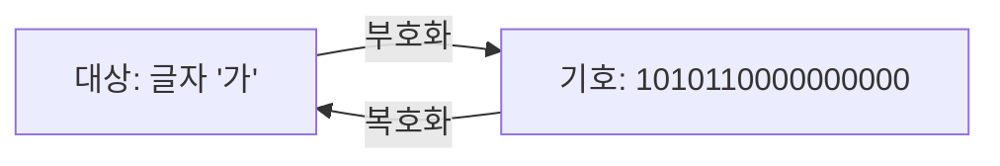



요약

어떤 대상을 가리키려고 정해 둔 기호가 부호다. 모스 부호에서 점 하나와 선 하나가 글자 A를 뜻하는 것과 같다. 대상을 기호로 바꾸는 일과 기호를 대상으로 되돌리는 일이 짝을 이루고, 한 기호가 두 대상을 가리키지 않아야 되돌릴 수 있다. 기호를 길게 쓰면 틀린 곳을 찾아낼 여유가 생기지만 그만큼 보낼 양이 늘어난다.

## 예시로 보기

컴퓨터는 0과 1만 저장한다. 글자 '가'를 저장하려면 '가'를 어떤 0과 1의 줄로 적을지 미리 약속해야 한다. 그 약속이 부호다.

부호는 컴퓨터 밖에도 많다. 슬라이드의 예는 이렇다[^1][^2].

| 대상 | 기호 | 약속 |
|---|---|---|
| 나무라는 것 | '나무'라는 낱말 | 한국어 |
| 대한항공 | KE, KAL | 항공사 부호 |
| 글자 A | 점 하나, 선 하나 | 모스 부호 |
| 글자 '가' | `1010 1100 0000 0000` | 유니코드 |

'가'의 유니코드 번호는 44032다. 2진수로 `1010110000000000`이다[^1]. 이 16비트를 받은 쪽이 "유니코드 글자 번호"라는 약속을 알면 '가'로 되돌린다. 약속을 모르고 수로 읽으면 44032가 된다([데이터와 메타데이터](/Hongs_Blog/studies/data-and-information/data-metadata/)).

대상을 기호로 바꾸는 쪽이 부호화, 기호를 대상으로 되돌리는 쪽이 복호화다[^s2].

검증: '가' = 44032 = U+AC00, UTF-8 변환 표(전 범위 표본)와 '가' → `EA B0 80`, 부호 비율 $$\frac13$$·$$\frac45$$·$$\frac47$$·1, 카드의 값 — [04_code-encoding_verify.py](/Hongs_Blog/studies/data-and-information/code/04_code-encoding_verify/)

## 정의

**부호.** 어떤 대상을 나타내려고 정한 기호다. 대상과 기호는 하나에 하나씩 짝지어진다(1:1)[^1]. 두 대상이 같은 기호를 쓰면 되돌릴 때 어느 쪽인지 알 수 없다.

**부호화와 복호화.** 대상을 기호로 바꾸는 일이 부호화(encoding), 기호를 대상으로 되돌리는 일이 복호화(decoding)다. 둘을 함께 하는 장치나 프로그램이 코덱이다. coder와 decoder의 앞 글자를 붙인 이름이다[^2].

### 문자 부호

글자마다 번호를 붙이고, 그 번호를 비트로 적는 방법을 정한 것이다[^3].

- **ASCII (ISO 646).** 영문자, 숫자, 기호 128개에 0~127을 붙였다. 7비트면 된다. 'A'는 65다.
- **유니코드 (ISO 10646).** 세계의 모든 글자에 번호를 붙인 표다. 번호를 비트로 적는 방법이 여럿이다.
    - UTF-32(UCS-4): 모든 글자를 4바이트로 적는다.
    - UTF-16(UCS-2): 기본은 2바이트다.
    - UTF-8: 글자마다 길이가 다르다. 1~4바이트를 쓴다.

UTF-8은 번호의 크기에 따라 틀을 고른다. `x` 자리에 번호의 비트를 채운다[^3].

| 글자 번호 | 1바이트째 | 2바이트째 | 3바이트째 | 4바이트째 |
|---|---|---|---|---|
| U+0000 ~ U+007F | `0xxxxxxx` | | | |
| U+0080 ~ U+07FF | `110xxxxx` | `10xxxxxx` | | |
| U+0800 ~ U+FFFF | `1110xxxx` | `10xxxxxx` | `10xxxxxx` | |
| U+10000 ~ U+10FFFF | `11110xxx` | `10xxxxxx` | `10xxxxxx` | `10xxxxxx` |

'가'(U+AC00)는 셋째 줄이다. 번호 `1010 110000 000000`을 4, 6, 6비트로 끊어 틀에 넣으면 `11101010 10110000 10000000`, 16진수로 `EA B0 80`이다[^s1]. 영문자는 ASCII와 똑같이 1바이트이고 한글은 3바이트다.

### 부호 이론의 말

부호 이론은 부호의 성질을 따지고, 어떤 쓰임에 어떤 부호가 알맞은지 연구한다. 슬라이드가 드는 쓰임은 넷이다[^4].

| 쓰임 | 하는 일 | 슬라이드의 예 |
|---|---|---|
| 오류 검출 | 전송 중 바뀐 비트를 찾아낸다 | 해밍 부호, CRC |
| 데이터 압축 | 같은 내용을 더 적은 비트로 적는다 | 엔트로피 부호, 허프만 부호 |
| 암호화 | 약속을 모르는 사람이 못 읽게 한다 | 암호 |
| 라인 코딩 | 비트를 전선의 전압 모양으로 바꾼다 | 직렬 전송 |

부호를 수학적으로 다루려고 이름을 붙인다[^5].

- **기호**(symbol): 부호에 쓰는 글자 하나. 기호를 모은 집합이 **알파벳** $$\Sigma = \{a_1, \dots, a_q\}$$(시그마)이고, $$q$$는 기호의 가짓수다. $$\Sigma = \{0, 1\}$$이면 $$q = 2$$이고 2진 부호다.
- **블록 부호** $$C$$: 길이가 $$n$$으로 같은 기호열들의 모음이다. 그 안의 기호열 하나하나가 **부호어**(codeword) $$c \in C$$다.
- **부호의 크기** $$\vert C\vert $$: 부호어의 개수다. 길이 $$n$$, 크기 $$M$$인 부호를 $$(n, M)$$ 부호라 적는다.

예: 한 비트를 세 번 되풀이해 보내는 부호는 $$C = \{000, 111\}$$이다. 길이 3, 크기 2라서 $$(3, 2)$$ 부호다[^s1].

**부호 비율.** 부호어의 칸 가운데 진짜 내용이 차지하는 몫이다. 부호어 개수의 로그를 "길이 × 알파벳 크기의 로그"로 나눈다[^6].

$$R(C) = \frac{\log \vert C\vert }{n \log \vert \Sigma\vert }$$

2진 부호에서 밑을 2로 잡으면 $$\log_2 \vert \Sigma\vert  = 1$$이라 $$R = \frac{\log_2 \vert C\vert }{n}$$이다. 분자 $$\log_2\vert C\vert $$는 부호어 $$\vert C\vert $$개를 서로 구별하는 데 드는 비트 수이고, 슬라이드는 $$\frac{\log\vert C\vert }{\log\vert \Sigma\vert }$$를 부호의 차원이라 부른다[^6]. 그래서 비율은 "내용 비트 수 ÷ 보내는 비트 수"다.

| 부호 | $$n$$ | $$\lvert C\rvert$$ | 비율 |
|---|---|---|---|
| 세 번 되풀이 $$\{000, 111\}$$ | 3 | 2 | $$\frac13$$ |
| 4비트 + 검사 비트 1개 | 5 | 16 | $$\frac45$$ |
| [해밍 부호](/Hongs_Blog/studies/data-and-information/hamming-code/) (7, 4) | 7 | 16 | $$\frac47$$ |
| 길이 $$n$$의 모든 2진 열 | $$n$$ | $$2^n$$ | 1 |

비율이 1이면 덧붙인 것이 없다. 그러면 한 비트만 바뀌어도 다른 멀쩡한 부호어가 되어 틀린 줄 모른다. 비율을 낮춰 여유를 두어야 오류를 찾거나 고칠 수 있다. 얼마나 찾고 고치는지는 [해밍 거리와 부호 거리](/Hongs_Blog/studies/data-and-information/hamming-distance/)가 정한다[^s1].

## 활용

- 웹 문서는 UTF-8로 모였다. 슬라이드의 그래프에서 UTF-8의 몫은 2006년 무렵부터 가파르게 올라 다른 방식을 모두 앞지르고, 2012년에는 절반을 넘는다[^3].
- 흔한 실수: 글자 수와 바이트 수를 같다고 보는 것. "가A"는 2글자인데 UTF-8로 4바이트다[^s1].
- 압축은 자주 나오는 대상에 짧은 기호를 주어 평균 길이를 줄인다. 얼마나 줄일 수 있는지의 한계가 [엔트로피](/Hongs_Blog/studies/probability-statistics/entropy/)다.
- 라인 코딩의 여러 방식: [인코딩 방식 비교](/Hongs_Blog/studies/computer-communication/contrast--line-coding/)

## 연결

- 선수: [데이터와 메타데이터](/Hongs_Blog/studies/data-and-information/data-metadata/)
- "하나에 하나씩"의 정확한 뜻: [함수의 성질과 집합의 크기](/Hongs_Blog/studies/discrete-math/function-properties/)(단사 함수여야 되돌릴 수 있다)
- 이어지는 개념: [해밍 거리와 부호 거리](/Hongs_Blog/studies/data-and-information/hamming-distance/)

## 확인 문제

**C1** 부호, 부호화, 복호화, 코덱을 각각 말하라.

**답:** 부호는 대상을 나타내려고 정한 기호이고 대상과 기호가 1:1이다. 부호화는 대상을 기호로 바꾸는 일, 복호화는 기호를 대상으로 되돌리는 일이다. 코덱은 둘을 함께 하는 것이다.

**C2** 길이 5인 부호어 8개로 된 2진 부호가 있다. $$(n, M)$$ 표기로 적고 부호 비율을 구하라.

**답:** $$(5, 8)$$ 부호. $$R = \frac{\log_2 8}{5} = \frac35$$. 
**이유:** 부호어 8개를 구별하는 데 3비트면 되는데 5비트를 보낸다. 나머지 2비트가 여유다.

**C3** 부호 비율이 1인 2진 부호는 왜 오류를 하나도 찾아내지 못하는가?

**답:** 비율이 1이면 $$\vert C\vert  = 2^n$$, 곧 길이 $$n$$의 모든 열이 부호어다. 어느 비트가 바뀌어도 결과가 또 다른 부호어라서, 받은 쪽은 처음부터 그 부호어를 보낸 것과 구별할 수 없다. 오류를 찾으려면 부호어가 아닌 열이 있어야 하고, 그러려면 비율이 1보다 작아야 한다.

[^1]: 자료와 정보 3회 강의 자료 「D&I_강의03-부호」, p.2 (부호의 뜻, 1:1 대응, 1010110000000000 → 가 / 44032)
[^2]: 같은 자료, p.3 (부호화·복호화·코덱, 항공사 부호, 한글 전신 부호, 모스 부호)
[^3]: 같은 자료, p.4 (문자 부호: ISO 646, ISO 10646, UTF-32·UTF-16·UTF-8, UTF-8 변환 표, 웹 페이지 인코딩 비율 그래프). 슬라이드에는 "USC-4", "USC-2"로 적혀 있고 같은 강의 3-2의 p.16에는 "UCS-2"로 적혀 있다. UCS(Universal Coded Character Set)가 맞는 이름이다.
[^4]: 같은 자료, p.5 (부호 이론과 네 가지 쓰임)
[^5]: 같은 자료, p.12 (부호의 정의: symbol, alphabet, block code, codeword, size, (n, M) code)
[^6]: 같은 자료, p.15 (부호 비율과 부호의 차원)
[^s1]: 보충 모스 부호 비유, '가'의 UTF-8 바이트, 세 번 되풀이 부호와 비율 표, 비율 1이면 오류를 못 찾는다는 설명, "가A"의 바이트 수, 카드 C2·C3은 슬라이드에 없다. 검증 코드로 확인했다. UTF-8의 틀은 RFC 3629에 있다.
[^s2]: 보충 다이어그램은 슬라이드에 없다. p.3의 "부호화 : encoding <-> 복호화 : decoding"을 그렸다.

