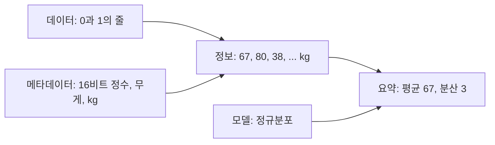


<div class="callout callout-summary" markdown="1">
<div class="callout-title callout-title--default" markdown="span">요약</div>

컴퓨터에 저장된 것은 0과 1의 줄일 뿐이고, 그 줄만 봐서는 몸무게인지 글자인지 알 수 없다. 암호문과 해독표처럼, 0과 1의 줄에 "이건 킬로그램 단위의 몸무게다"라는 설명이 붙어야 뜻을 가진 값이 된다. 그 값들이 어떤 모양으로 퍼져 있다고 볼지까지 정하면 "평균은 얼마"라는 요약이 나온다. 설명이 틀리거나 없으면 같은 0과 1에서 전혀 다른 값이 나온다.

</div>


## 예시로 보기

파일을 열었더니 이런 줄이 나온다.

```
0000 0000 0100 0011
0000 0000 0101 0000
0000 0000 0010 0110
0000 0000 0100 1011
0000 0000 0101 0010
        ⋮
```

이것만으로는 아무것도 할 수 없다. 16칸을 한 덩어리로 읽는지, 8칸씩 읽는지, 수인지 글자인지 모른다.

"16비트씩 끊어 읽는 정수이고, 단위는 kg인 몸무게다"라는 설명이 붙으면 달라진다. 줄마다 [2진수](/Hongs_Blog/studies/college-math/positional-notation/)로 읽어 67, 80, 38, 75, 82 kg이 된다[^s1]. 이제야 "두 번째 사람이 가장 무겁다"는 말을 할 수 있다.

여기서 한 걸음 더 간다. 이 몸무게들이 가운데가 볼록한 종 모양([정규분포](/Hongs_Blog/studies/probability-statistics/normal-distribution/))으로 퍼져 있다고 가정하면, 수백 줄의 자료를 평균과 분산 두 숫자로 줄일 수 있다. 아래 그림이 이 흐름이다.



메타데이터는 데이터를 값으로 바꾸는 데 쓰이고, 모델은 값들을 요약으로 바꾸는 데 쓰인다. 그림의 평균 67, 분산 3은 요약이 어떤 모양인지 보이는 예시 값이다. 위의 다섯 줄만으로 계산한 값은 아니다. 다섯 줄만 평균 내면 68.4다[^s1].

해독표를 바꾸면 같은 줄이 다른 것이 된다. 16비트 `1010110000000000`을 수로 읽으면 44032이고, 글자 번호로 읽으면 한글 '가'다.

<div class="callout callout-check" markdown="1">
<div class="callout-title" markdown="span">검증: 다섯 줄의 값 67, 80, 38, 75, 82, 같은 16비트가 44032와 '가', 카드 C3 — [01_data-metadata_verify.py](/Hongs_Blog/studies/data-and-information/code/01_data-metadata_verify/)</div>

</div>


## 네 가지 말

그림에 나온 네 낱말을 표로 정리하면 이렇다.

| 말 | 무엇인가 | 위 예에서 |
|---|---|---|
| 데이터 | 저장되거나 오간 0과 1의 줄 그 자체 | `0000 0000 0100 0011` … |
| 메타데이터 | 데이터를 어떻게 읽을지 알려 주는, 데이터에 대한 데이터 | 16비트 정수, 무게, kg |
| 정보 | 데이터를 메타데이터대로 읽어 뜻을 갖게 된 것 | 67 kg, 80 kg, … |
| 모델 | 값들이 어떤 모양으로 생겼다고 보는 가정 | 정규분포 → 평균 67, 분산 3 |

'메타(meta)'는 '~에 대한'이라는 뜻이다. 메타데이터는 데이터에 대한 데이터다.

같은 구도는 글자에도 그대로 통한다. `1010110000000000`이 데이터, "코드 변환기로 읽을지 수치 변환기로 읽을지"가 메타데이터, 그 결과인 '가'나 44032가 정보다. 0과 1의 줄을 글자로 바꾸는 약속은 [부호와 부호화](/Hongs_Blog/studies/data-and-information/code-encoding/)에서, 정수로 바꾸는 약속은 [정수의 2진 표현과 2의 보수](/Hongs_Blog/studies/data-and-information/twos-complement/)에서 다룬다.

## 활용

- **파일 확장자와 헤더.** `.png`, `.csv` 같은 확장자와 파일 앞머리의 형식 정보가 메타데이터다. 같은 바이트를 그림으로 읽을지 글로 읽을지 정한다[^s1].
- **프로그래밍 언어의 타입.** C의 `int`, `float`, `char`는 "이 메모리 칸을 이렇게 읽어라"라는 메타데이터다. 데이터의 기본형으로 흔히 int, long, float, double, char를 든다.
- **표의 열 이름과 단위.** 열 이름이 '무게'이고 단위가 kg인지 lb인지 적혀 있지 않으면 숫자를 쓸 수 없다[^s1].
- 흔한 실수: 글자가 깨져 보이는 것. 데이터는 멀쩡한데 "어느 글자표로 읽을지"라는 메타데이터가 틀린 경우다[^s1].

## 연결

- 선수: [진법과 자릿수](/Hongs_Blog/studies/college-math/positional-notation/)(0과 1의 줄을 수로 읽기)
- 이어지는 개념: [정수의 2진 표현과 2의 보수](/Hongs_Blog/studies/data-and-information/twos-complement/), [부호와 부호화](/Hongs_Blog/studies/data-and-information/code-encoding/)
- 모델의 예: [정규분포](/Hongs_Blog/studies/probability-statistics/normal-distribution/)

## 과목별 관점

**데이터베이스 설계 (2-2학기).** 데이터베이스는 메타데이터를 프로그램 안이 아니라 데이터 곁에 따로 모아 둔다. 그 자리를 카탈로그(catalog)라 부른다. 대학 데이터베이스를 예로 들면, 카탈로그에는 표가 둘 있다. 하나는 표 이름과 칸의 수를 적는다(STUDENT 4, COURSE 4, SECTION 5, GRADE_REPORT 3, PREREQUISITE 2). 다른 하나는 칸마다 이름, 자료형, 어느 표의 칸인지를 적는다(Name은 Character (30)이고 STUDENT의 칸). 이 문서의 "16비트 정수, 무게, kg"과 같은 일을 하는 설명이다.

저장된 레코드를 끊어 읽는 데 쓰는 메타데이터도 나온다. 학생 레코드 하나에서 1번째부터 30글자가 이름, 31번째부터 4글자가 학번, 35번째 1글자가 학년, 36번째부터 4글자가 전공이다. 모두 더하면 39글자다. 이 자리표가 없으면 39글자가 어디서 끊기는지 알 수 없다[^bs1].

데이터베이스에서 더 따지는 것은 메타데이터를 어디에 두느냐다. 자리표를 프로그램마다 코드에 적어 두면 레코드의 모양이 바뀔 때 프로그램을 모두 고쳐야 한다. 카탈로그 한곳에 두고 프로그램이 그것을 거쳐 읽게 하면, 모양이 바뀌어도 프로그램은 그대로다[^bs1]. 데이터베이스는 자기 구조의 설명을 함께 품고 있다. 그 덕분에 프로그램과 데이터가 서로 매이지 않는다. 레코드 끝에 생일 8글자를 붙이는 예는 [데이터베이스 방식의 네 가지 특징](/Hongs_Blog/studies/database-design/database-approach-characteristics/)에 있다.

## 확인 문제

<details class="callout callout-question" markdown="1">
<summary class="callout-title" markdown="span">**C1** 데이터, 메타데이터, 정보, 모델을 각각 한 문장으로 말하라.</summary>

**답:** 데이터는 0과 1의 줄 그 자체다. 메타데이터는 그 줄을 어떻게 읽을지 알려 주는 설명이다. 정보는 데이터를 메타데이터대로 읽어 뜻을 갖게 된 값이다. 모델은 그 값들이 어떤 모양으로 생겼는지에 대한 가정이고, 값들을 몇 개의 숫자로 요약하게 해 준다.<br>
**흔한 오답:** 정보와 데이터를 같은 것으로 쓰는 것. 읽는 법이 붙기 전에는 정보가 아니다.

</details>


<details class="callout callout-question" markdown="1">
<summary class="callout-title" markdown="span">**C2** 0과 1의 줄만 받고 메타데이터를 받지 못하면 왜 쓸 수 없는가? 예를 하나 들어라.</summary>

**답:** 같은 줄을 읽는 방법이 여럿이고, 방법마다 값이 다르기 때문이다. `1010110000000000`은 수로 읽으면 44032, 글자 번호로 읽으면 '가'다. 수로 읽더라도 단위가 kg인지 g인지 모르면 크기를 비교할 수 없다.

</details>


<details class="callout callout-question" markdown="1">
<summary class="callout-title" markdown="span">**C3** 8비트 `0100 1011`을 (a) 부호 없는 정수로 (b) ASCII 글자로 읽어라. 두 결과가 다른 까닭은?</summary>

**답:** (a) $$64 + 8 + 2 + 1 = 75$$. (b) 글자 'K'. 데이터는 같고 메타데이터(정수로 읽기, 글자표로 읽기)만 다르다[^s1].

</details>


[^s1]: 암호문 비유, 다섯 줄을 수로 읽은 값, 파일 확장자·타입·열 이름·깨진 글자의 예, 카드 C3은 보탠 것이다. 값은 검증 코드로 확인했다.
[^bs1]: 39글자와, 생일을 붙였을 때 자리 번호를 코드에 적어 둔 프로그램이 둘째 학생부터 틀리게 읽는 것은 [02_database-approach-characteristics_verify.py](/Hongs_Blog/studies/database-design/code/02_database-approach-characteristics_verify/)로 확인했다.

