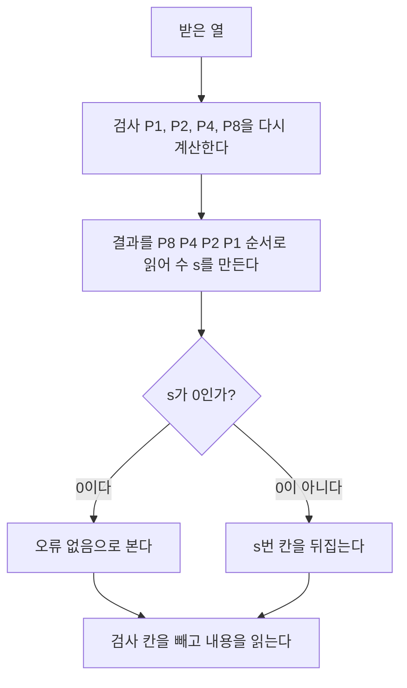


<div class="callout callout-summary" markdown="1">
<div class="callout-title callout-title--default" markdown="span">요약</div>

검사 칸 몇 개를 덧붙여, 받은 쪽이 바뀐 한 칸을 스스로 찾아 고치게 하는 부호다. 스무고개에서 "1, 3, 5, 7번 중에 있나?" 같은 예·아니오 질문 몇 개로 숨긴 번호를 맞히는 것과 같다. 검사마다 맡은 칸들이 정해져 있어서, 어느 검사가 깨졌는지를 모으면 바뀐 칸의 번호가 그대로 나온다. 단, 한 칸만 바뀌었을 때만 맞게 고치고, 두 칸이 바뀌면 틀린 것은 알지만 엉뚱한 칸을 고친다.

</div>


## 예시로 보기

[패리티 비트](/Hongs_Blog/studies/data-and-information/linear-code/) 하나는 "어딘가 틀렸다"만 알려 준다. 고치려면 어디가 틀렸는지 알아야 한다. 다시 보내 달라고 할 수 없는 상황이면 받은 쪽이 혼자 찾아야 한다.

칸에 1번부터 7번까지 번호를 붙이고 번호를 2진수로 적는다.

| 칸 번호 | 1 | 2 | 3 | 4 | 5 | 6 | 7 |
|---|---|---|---|---|---|---|---|
| 2진수 | 001 | 010 | 011 | 100 | 101 | 110 | 111 |

검사를 셋 둔다. 검사 하나가 2진수의 자리 하나를 맡는다.

- 검사 $$P_1$$: 번호의 1의 자리가 1인 칸 → 1, 3, 5, 7번
- 검사 $$P_2$$: 번호의 2의 자리가 1인 칸 → 2, 3, 6, 7번
- 검사 $$P_4$$: 번호의 4의 자리가 1인 칸 → 4, 5, 6, 7번

5번 칸이 바뀌었다고 하자. $$5 = 101_2$$이라 5번은 $$P_1$$과 $$P_4$$에 들어 있고 $$P_2$$에는 없다. 그래서 $$P_4$$는 깨지고, $$P_2$$는 멀쩡하고, $$P_1$$은 깨진다. 깨짐을 1, 멀쩡함을 0으로 $$P_4 P_2 P_1$$ 순서로 적으면 `101`, 곧 5다. 검사 결과가 바뀐 칸의 번호를 그대로 읽어 준다.

내용 4비트 `1011`을 보내 본다. 1, 2, 4번 칸은 검사 칸으로 비워 두고 내용을 3, 5, 6, 7번에 넣는다. 검사 칸은 자기가 맡은 칸들의 1의 개수가 짝수가 되게 채운다.

```
칸 번호 :  1   2   3   4   5   6   7
역할    :  P1  P2  D   P4  D   D   D
내용    :  _   _   1   _   0   1   1
P1 (1,3,5,7) : 1 + 0 + 1 = 0  ->  P1 = 0
P2 (2,3,6,7) : 1 + 1 + 1 = 1  ->  P2 = 1
P4 (4,5,6,7) : 0 + 1 + 1 = 0  ->  P4 = 0
보내는 열 :  0   1   1   0   0   1   1
```

`0110011`을 보냈는데 5번이 바뀌어 `0110111`이 왔다. 받은 쪽이 세 검사를 다시 한다.

| 검사 | 맡은 칸의 값 | 합 | 결과 |
|---|---|---|---|
| $$P_1$$ | 1, 3, 5, 7번 = 0, 1, 1, 1 | 3 (홀수) | 1 |
| $$P_2$$ | 2, 3, 6, 7번 = 1, 1, 1, 1 | 4 (짝수) | 0 |
| $$P_4$$ | 4, 5, 6, 7번 = 0, 1, 1, 1 | 3 (홀수) | 1 |

$$P_4 P_2 P_1 = 101_2 = 5$$. 5번 칸을 뒤집으면 `0110011`로 돌아온다.

<div class="callout callout-check" markdown="1">
<div class="callout-title" markdown="span">검증: 위 추적, 본문의 12비트 예(생성 `010101011110`, 5번 오류의 검사 결과 `0101`), 내용 1~11비트의 모든 경우에서 한 칸 오류의 검사 결과 = 칸 번호, (7,4)의 거리 3, 두 칸 오류의 잘못된 정정(전수), 패리티 수의 범위식, 예제의 $$G$$·$$H$$와 `1011010`, 카드의 값 — [07_hamming-code_impl.py](/Hongs_Blog/studies/data-and-information/code/07_hamming-code_impl/)</div>

</div>


## 정의

리처드 해밍이 1950년에 천공 카드 판독기의 오류를 자동으로 고치려고 만든 선형 오류 정정 부호의 한 무리다. 한 칸 오류를 고치고, 두 칸까지의 오류를 알아챈다.

### 입출력

- **부호화.** 입력: 내용 $$d$$비트. 출력: 검사 칸 $$p$$개를 끼운 $$d + p$$비트 부호어.
- **복호화.** 입력: 받은 $$d + p$$비트. 출력: 검사 결과(신드롬), 고친 부호어, 내용 $$d$$비트. 바뀐 칸이 많아야 하나일 때만 맞다.

### 검사 칸의 수와 자리

검사 $$p$$개의 결과는 $$2^p$$가지다. 그중 하나(모두 0)는 "오류 없음"에 쓰고, 나머지로 $$d + p$$개 칸을 하나씩 가리켜야 한다. 그래서 $$2^p \ge d + p + 1$$이어야 한다[^s1]. 같은 조건을 "검사 칸이 꼭 $$p$$개 필요한 내용 길이 $$d$$의 범위"로 적으면 이렇다.

$$2^{p-1} - p + 1 \le d \le 2^p - p - 1$$


$$p = 4$$를 넣으면 $$2^3 - 4 + 1 = 5 \le d \le 2^4 - 4 - 1 = 11$$이다. 내용이 5~11비트면 검사 칸이 4개 든다.

- 검사 칸은 앞에서부터 $$2^0, 2^1, 2^2, 2^3, \dots$$번째, 곧 1, 2, 4, 8, 16, …번 칸에 둔다. 자리에 따라 $$P_1, P_2, P_4, P_8, \dots$$이라 부른다.
- 내용은 나머지 칸에 차례로 넣는다.
- $$P_{2^j}$$는 칸 번호를 2진수로 적었을 때 $$2^j$$의 자리가 1인 칸들을 맡는다. 맡은 칸의 XOR(1의 개수가 홀수면 1)을 $$\oplus$$로 적는다. 12칸이면 이렇다.

$$\begin{aligned} P_1 &= D_3 \oplus D_5 \oplus D_7 \oplus D_9 \oplus D_{11} \\ P_2 &= D_3 \oplus D_6 \oplus D_7 \oplus D_{10} \oplus D_{11} \\ P_4 &= D_5 \oplus D_6 \oplus D_7 \oplus D_{12} \\ P_8 &= D_9 \oplus D_{10} \oplus D_{11} \oplus D_{12} \end{aligned}$$


$$D_i$$는 $$i$$번 칸의 내용 비트다.

### 의사코드

```
부호화(내용 d비트):
    2^p >= d + p + 1 인 가장 작은 p를 구한다
    1..d+p번 칸 중 2의 거듭제곱 번이 아닌 칸에 내용을 차례로 넣는다
    j = 0..p-1 에 대해:
        P[2^j] = (번호의 2^j 자리가 1인 다른 칸들의 XOR)
    전체 칸을 돌려준다

복호화(받은 열 r):
    s = 0
    j = 0..p-1 에 대해:
        (번호의 2^j 자리가 1인 모든 칸의 XOR)이 1이면 s에 2^j를 더한다
    s가 0이 아니면 s번 칸을 뒤집는다
    2의 거듭제곱 번이 아닌 칸을 차례로 읽어 돌려준다
```

칸 번호는 1부터 센다. 파이썬 구현은 리스트가 0부터라 `code[i - 1]`이 $$i$$번 칸이다.



받은 쪽은 검사를 다시 하고, 그 결과가 가리키는 칸 하나를 뒤집을 뿐이다.

### 실행 추적: 12비트 예

내용 8비트 `00101110`을 보낸다. $$p = 4$$라 12칸이다.

| 칸 번호 | 1 | 2 | 3 | 4 | 5 | 6 | 7 | 8 | 9 | 10 | 11 | 12 |
|---|---|---|---|---|---|---|---|---|---|---|---|---|
| 역할 | $$P_1$$ | $$P_2$$ | $$D_3$$ | $$P_4$$ | $$D_5$$ | $$D_6$$ | $$D_7$$ | $$P_8$$ | $$D_9$$ | $$D_{10}$$ | $$D_{11}$$ | $$D_{12}$$ |
| 내용 | | | 0 | | 0 | 1 | 0 | | 1 | 1 | 1 | 0 |
| 생성된 부호 | 0 | 1 | 0 | 1 | 0 | 1 | 0 | 1 | 1 | 1 | 1 | 0 |

검사 칸의 계산은 이렇다.

- $$P_1 = 0 \oplus 0 \oplus 0 \oplus 1 \oplus 1 = 0$$
- $$P_2 = 0 \oplus 1 \oplus 0 \oplus 1 \oplus 1 = 1$$
- $$P_4 = 0 \oplus 1 \oplus 0 \oplus 0 = 1$$
- \$$P_8 = 1 \oplus 1 \oplus 1 \oplus 0 = 1$$

보내는 열은 `010101011110`이다. 전송 중 한 칸이 바뀌어 `010111011110`이 왔다. 받은 쪽은 검사 칸 자신까지 넣어 다시 XOR한다.

| 검사 | 계산 | 결과 |
|---|---|---|
| $$P_1$$ (1, 3, 5, 7, 9, 11번) | $$0 \oplus 0 \oplus 1 \oplus 0 \oplus 1 \oplus 1$$ | 1 |
| $$P_2$$ (2, 3, 6, 7, 10, 11번) | $$1 \oplus 0 \oplus 1 \oplus 0 \oplus 1 \oplus 1$$ | 0 |
| $$P_4$$ (4, 5, 6, 7, 12번) | $$1 \oplus 1 \oplus 1 \oplus 0 \oplus 0$$ | 1 |
| $$P_8$$ (8, 9, 10, 11, 12번) | $$1 \oplus 1 \oplus 1 \oplus 1 \oplus 0$$ | 0 |

$$P_8 P_4 P_2 P_1 = 0101_2 = 5$$다. 모두 0이면 오류가 없고, 하나라도 1이면 오류가 있다. 5번 칸의 1을 0으로 고쳐 `010101011110`을 되찾는다. 이 수를 신드롬이라 한다.

### 정확성

**주장.** 부호어에서 많아야 한 칸이 바뀌었다면, 복호화는 원래 부호어를 돌려준다[^s1].

<details class="callout callout-proof" markdown="1">
<summary class="callout-title" markdown="span">증명 펼치기</summary>

불변식: 부호어에서는 모든 검사의 XOR이 0이다.
1. **부호어는 검사를 모두 통과한다.** $$P_{2^j}$$는 맡은 다른 칸들의 XOR로 채웠다. 그래서 자기까지 넣어 XOR하면 같은 값을 두 번 XOR한 셈이라 0이다. $$2^j$$번 칸은 번호의 $$2^j$$ 자리만 1이라 다른 검사에는 들어가지 않으므로, 검사 칸끼리 서로 영향을 주지 않는다. — XOR의 성질 $$a \oplus a = 0$$
2. **한 칸이 바뀌면 그 칸을 맡은 검사만 깨진다.** $$e$$번 칸이 뒤집히면, $$e$$번을 맡은 검사의 XOR은 0에서 1로 바뀌고 나머지 검사는 그대로다. — XOR에서 한 입력을 뒤집으면 결과가 뒤집힌다
3. **깨진 검사를 모으면 $$e$$다.** 검사 $$P_{2^j}$$가 $$e$$번을 맡는 것은 $$e$$의 2진 표기에서 $$2^j$$ 자리가 1일 때뿐이다. 그래서 신드롬 $$s = \sum_j (\text{검사 } P_{2^j}\text{의 결과}) \cdot 2^j$$는 $$e$$의 2진 표기를 그대로 다시 쓴 것이고 $$s = e$$다. — [2진 표현은 하나뿐이다](/Hongs_Blog/studies/college-math/positional-notation/)
4. **끝.** $$s = 0$$이면 바뀐 칸이 없다(칸 번호는 1부터라 0은 어느 칸도 아니다). $$s \ne 0$$이면 $$s$$번 칸을 뒤집어 원래 부호어가 된다. ∎

</details>


두 칸 $$e_1, e_2$$가 바뀌면 신드롬은 두 번호의 자리별 XOR인 $$e_1 \oplus e_2$$다. $$e_1 \ne e_2$$라 0이 아니니 오류를 알아챈다. 하지만 그 값은 $$e_1$$도 $$e_2$$도 아닌 제3의 번호라서, 고치면 세 칸이 틀린 다른 부호어가 된다[^s1].

### 스스로 설명해 보기

<details class="callout callout-question" markdown="1">
<summary class="callout-title" markdown="span">1. 증명 1번에서 "검사 칸끼리 서로 영향을 주지 않는다"가 왜 필요한가?</summary>

$$P_1$$을 채울 때 $$P_2$$가 그 재료에 들어 있다면, $$P_2$$를 채우는 순간 $$P_1$$의 값이 틀려진다. 2의 거듭제곱 번호는 2진 표기에 1이 하나뿐이라 자기 검사에만 들어간다. 그래서 검사 칸을 어떤 순서로 채워도 된다.

</details>


<details class="callout callout-question" markdown="1">
<summary class="callout-title" markdown="span">2. 증명 3번에서 신드롬이 칸 번호와 같아지는 근거는?</summary>

검사를 "번호의 $$2^j$$ 자리가 1인 칸"으로 정했기 때문이다. $$e$$번이 바뀌면 $$e$$의 2진 표기에서 1인 자리를 맡은 검사만 깨진다. 깨진 검사에 그 자리의 무게를 곱해 더하면 $$e$$를 2진수로 적은 뒤 다시 읽는 것과 같다.

</details>


<details class="callout callout-question" markdown="1">
<summary class="callout-title" markdown="span">3. 조건 $$2^p \ge d + p + 1$$의 $$+1$$은 어디서 오는가?</summary>

"오류 없음"도 검사 결과 하나를 차지하기 때문이다. $$p$$개 검사의 결과 $$2^p$$가지로 "없음" 1가지와 "몇 번 칸" $$d + p$$가지를 모두 구별해야 한다.

</details>


<details class="callout callout-question" markdown="1">
<summary class="callout-title" markdown="span">이 증명의 핵심 아이디어는?</summary>

칸 번호의 2진 자리 하나에 검사 하나를 짝지은 것이다. 그러면 깨진 검사의 무늬가 번호의 2진 표기가 되어, 번호를 "찾는" 일이 "읽는" 일로 바뀐다.

</details>


<details class="callout callout-question" markdown="1">
<summary class="callout-title" markdown="span">이 방법을 쓸 수 있는 다른 상황은?</summary>

예·아니오 질문 몇 개로 여럿 중 하나를 가려내는 모든 상황이다. 가짜 동전 하나를 저울질 몇 번으로 찾기, [이분 탐색](/Hongs_Blog/studies/algorithms/binary-search/)(질문마다 후보가 반으로 준다), 여러 시료를 섞어 한 번에 검사해 양성 하나를 찾는 묶음 검사가 같은 생각이다.

</details>


### 복잡도

부호화와 복호화 모두 검사 $$p$$개가 각각 칸의 절반쯤을 XOR한다. 전체 길이를 $$n = d + p$$라 하면 $$p \approx \lg n$$이라 $$O(n \lg n)$$번의 XOR이다. 덧붙는 칸은 $$p \approx \lg n$$개뿐이다[^s1].

## 예제

**해밍 (7,4,3) 부호의 행렬 꼴.** 블록 크기 7, 차원 4, 거리 3이다. 일반적으로 $$[n, k, d] = [2^m - 1,\ 2^m - 1 - m,\ 3]$$이고 $$m = 3$$인 경우다. 내용 4비트 $$(x_1, x_2, x_3, x_4)$$ 뒤에 검사 3비트를 붙인 체계형으로 적으면 이렇다.

$$a = x_1 + x_2 + x_4, \qquad b = x_1 + x_3 + x_4, \qquad c = x_2 + x_3 + x_4$$


$$G = \begin{pmatrix} 1&0&0&0&1&1&0 \\ 0&1&0&0&1&0&1 \\ 0&0&1&0&0&1&1 \\ 0&0&0&1&1&1&1 \end{pmatrix}, \qquad H = \begin{pmatrix} 1&1&0&1&1&0&0 \\ 1&0&1&1&0&1&0 \\ 0&1&1&1&0&0&1 \end{pmatrix}$$


1. *부호화:* 내용 $$(1, 0, 1, 1)$$에 $$G$$를 곱하면 $$(1, 0, 1, 1, 2, 3, 2)$$다.
2. *2진 덧셈으로:* 2로 나눈 나머지를 쓰면 $$(1, 0, 1, 1, 0, 1, 0)$$, 곧 `1011010`이다.
3. *$$H$$의 열:* 일곱 열이 $$(0,0,0)$$을 뺀 3비트 열 7가지 전부다. 모두 다르고 0이 아니라서, 한 칸이 바뀌면 신드롬이 그 칸의 열과 같아져 자리를 안다.

위쪽의 "1, 2, 4번 칸에 검사를 두는" 배치와 이 체계형은 칸의 순서만 다른 같은 부호다. 앞의 배치는 $$H$$의 $$i$$째 열이 $$i$$의 2진수가 되게 칸을 늘어놓은 것이라 신드롬을 곧바로 번호로 읽는다. 체계형은 내용이 앞에 모여 있어 꺼내기 쉽지만, 신드롬을 $$H$$의 열과 맞춰 봐야 한다[^s1].

**해밍 부호의 가족**.

| 검사 칸 | 전체 칸 | 내용 칸 | 이름 | 비율 |
|---|---|---|---|---|
| 2 | 3 | 1 | 해밍(3,1) (세 번 되풀이) | $$\frac13 \approx 0.333$$ |
| 3 | 7 | 4 | 해밍(7,4) | $$\frac47 \approx 0.571$$ |
| 4 | 15 | 11 | 해밍(15,11) | $$\frac{11}{15} \approx 0.733$$ |
| 5 | 31 | 26 | 해밍(31,26) | $$\frac{26}{31} \approx 0.839$$ |
| $$m$$ | $$2^m - 1$$ | $$2^m - m - 1$$ | | $$\frac{2^m - m - 1}{2^m - 1}$$ |

길어질수록 비율이 1에 다가간다. 대신 한 블록 안에서 고칠 수 있는 것은 여전히 한 칸이라, 길수록 두 칸 이상 틀릴 위험이 커진다[^s1].

**한 칸 가정이 깨지면.** `0110011`의 2번과 5번이 바뀌어 `0010111`이 왔다. 검사 결과는 $$P_4 P_2 P_1 = 111_2 = 7$$이다($$2 \oplus 5 = 010_2 \oplus 101_2 = 111_2$$). 7번 칸을 뒤집으면 `0010110`이 된다. 검사를 모두 통과하는 멀쩡한 부호어이지만, 꺼낸 내용은 `1110`으로 보낸 `1011`과 다르다[^s1].

## 활용

- 구현: [07_hamming-code_impl.py](/Hongs_Blog/studies/data-and-information/code/07_hamming-code_impl/). 연습: [해밍 부호 예제 사다리](/Hongs_Blog/studies/data-and-information/hamming-code-ladder/)
- 서버의 ECC 메모리는 해밍 부호에 전체 패리티 한 칸을 더한 부호를 쓴다. 한 칸 오류는 고치고 두 칸 오류는 고치지 않고 알리기만 한다[^s1].
- 다시 보내 달라고 하기 어려운 통신에서 받은 쪽이 고치는 방식: [오류 복구와 FEC](/Hongs_Blog/studies/computer-communication/error-recovery-fec/). 오류가 뭉쳐서 나는 선로에서는 알아채는 데 특화한 [CRC](/Hongs_Blog/studies/computer-communication/crc/)와 다시 보내기를 쓴다.
- 흔한 실수: 복호화 때 검사 칸 자신을 빼고 XOR하는 것. 받은 쪽은 검사 칸까지 넣어 XOR해야 깨졌는지가 0과 1로 나온다. 검사 칸 자신이 바뀐 경우(신드롬이 1, 2, 4, 8)도 이렇게 해야 잡힌다.
- 흔한 실수: 신드롬을 $$P_1 P_2 P_4 P_8$$ 순서로 읽는 것. $$P_8$$이 가장 높은 자리다.

## 연결

- 선수: [선형 부호와 패리티 검사 행렬](/Hongs_Blog/studies/data-and-information/linear-code/), [해밍 거리와 부호 거리](/Hongs_Blog/studies/data-and-information/hamming-distance/)(거리 3이면 1개 정정, 2개 검출)
- 칸 번호의 2진 자리를 하나씩 보는 법: [비트 연산과 비트마스크](/Hongs_Blog/studies/algorithms/bit-operations/)
- 압축 쪽의 대표 부호인 허프만 부호: [엔트로피](/Hongs_Blog/studies/probability-statistics/entropy/)

## 자주 하는 오해

<div class="callout callout-misconception" markdown="1">
<div class="callout-title" markdown="span">"해밍 부호는 두 칸이 틀려도 고친다"</div>

틀렸다. "1비트와 2비트 오류를 검출한다"는 말을 "2비트까지 고친다"로 읽기 쉽다. 하지만 거리가 3인 부호는 2개까지 알아채고 1개만 고친다. 그것도 "알아채기만 할 때"와 "고칠 때"를 동시에 할 수는 없다. 신드롬이 0이 아닐 때 받은 쪽은 한 칸이 틀린 것인지 두 칸이 틀린 것인지 구별하지 못하고, 한 칸이라 믿고 고치면 두 칸 오류에서는 세 칸이 틀린 다른 부호어가 나온다. 확인하는 법: `0110011`의 2번과 5번을 바꿔 복호화하면 내용이 `1110`으로 나온다. (7,4)의 모든 부호어와 모든 두 칸 조합에서 같은 일이 생긴다.

</div>


## 확인 문제

<details class="callout callout-question" markdown="1">
<summary class="callout-title" markdown="span">**C1** 해밍 부호에서 검사 칸은 몇 번 칸에 두고, 검사 $$P_4$$는 어느 칸들을 맡는가? (전체 12칸)</summary>

**답:** 1, 2, 4, 8번 칸. $$P_4$$는 번호의 4의 자리가 1인 4, 5, 6, 7, 12번을 맡는다.<br>
**이유:** $$12 = 1100_2$$이라 4의 자리가 1이다. 8~11번은 $$1000_2$$~$$1011_2$$이라 4의 자리가 0이다.

</details>


<details class="callout callout-question" markdown="1">
<summary class="callout-title" markdown="span">**C2** 7칸 해밍 부호로 `1010011`을 받았다. 세 검사의 결과와 신드롬, 고친 부호어, 내용 4비트를 차례로 구하라.</summary>

**답:** $$P_1$$(1, 3, 5, 7번) $$= 1 \oplus 1 \oplus 0 \oplus 1 = 1$$. $$P_2$$(2, 3, 6, 7번) $$= 0 \oplus 1 \oplus 1 \oplus 1 = 1$$. $$P_4$$(4, 5, 6, 7번) $$= 0 \oplus 0 \oplus 1 \oplus 1 = 0$$. 신드롬 $$011_2 = 3$$. 3번 칸을 뒤집어 `1000011`. 내용은 3, 5, 6, 7번 칸의 `0011`.

</details>


<details class="callout callout-question" markdown="1">
<summary class="callout-title" markdown="span">**C3** 복호화 의사코드가 하는 일을 한 문장으로 말하라.</summary>

**답:** 검사마다 맡은 칸을 다시 XOR해서 깨진 검사들의 무게를 더한 수를 만들고, 그 수가 0이 아니면 그 번호의 칸 하나를 뒤집은 뒤 내용 칸만 골라 돌려준다.

</details>


<details class="callout callout-question" markdown="1">
<summary class="callout-title" markdown="span">**C4** 내용이 20비트면 검사 칸이 몇 개 필요한가?</summary>

**답:** 5개. $$2^p \ge 20 + p + 1$$에서 $$p = 4$$면 $$16 < 25$$라 모자라고 $$p = 5$$면 $$32 \ge 26$$이다. 범위식으로도 $$2^4 - 5 + 1 = 12 \le 20 \le 2^5 - 5 - 1 = 26$$이다.

</details>


<details class="callout callout-question" markdown="1">
<summary class="callout-title" markdown="span">**C5** 한 칸 $$e$$가 바뀌었을 때 신드롬이 정확히 $$e$$가 되는 이유를, 검사를 정한 방식에서 끌어내라.</summary>

**답:** 검사 $$P_{2^j}$$는 번호의 $$2^j$$ 자리가 1인 칸만 맡는다. $$e$$번이 뒤집히면 $$e$$의 2진 표기에서 1인 자리의 검사만 0에서 1로 바뀐다. 신드롬은 깨진 검사에 $$2^j$$를 곱해 더한 수이므로 $$e$$의 2진 표기를 다시 읽은 값, 곧 $$e$$다.

</details>


<details class="callout callout-question" markdown="1">
<summary class="callout-title" markdown="span">**C6** 해밍 부호가 틀리게 고치는 예를 하나 만들어라.</summary>

**답:** `0110011`(내용 `1011`)의 2번과 5번을 바꾼 `0010111`. 신드롬이 $$2 \oplus 5 = 7$$이라 7번을 뒤집어 `0010110`이 되고 내용이 `1110`으로 나온다. 두 칸이 바뀌면 신드롬은 두 번호의 XOR이라 늘 제3의 칸을 가리킨다.

</details>


[^s1]: 구현 코드의 전수 검사로 확인했다(실험 확인이며, 증명은 위에 따로 적었다). Hamming, "Error detecting and error correcting codes"(1950)와 MacKay, *Information Theory, Inference, and Learning Algorithms*, 1.2절에 같은 내용이 있다.

