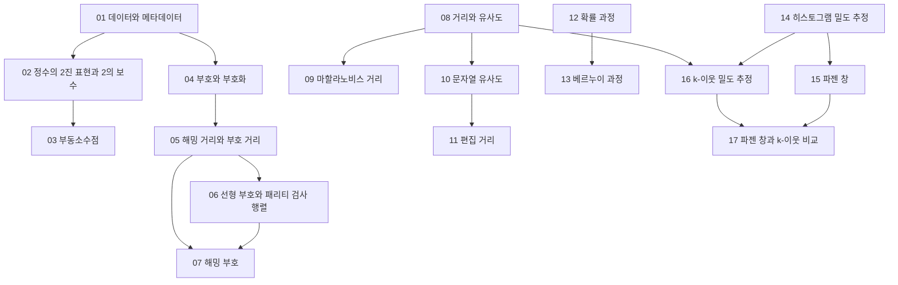


## 먼저 알아야 할 것
- [진법과 자릿수](/Hongs_Blog/studies/college-math/positional-notation/) (공학수학 대학수학): 수 체계와 진법. 이 과목에서 더 다루는 내용은 그 문서의 `과목별 관점`에 있다
- [엔트로피](/Hongs_Blog/studies/probability-statistics/entropy/) (공학수학 확률과 통계): 정보량과 엔트로피
- [내적과 노름](/Hongs_Blog/studies/linear-algebra/dot-product/) (공학수학 선형대수학), [민코프스키 거리](/Hongs_Blog/studies/data-science/minkowski-distance/), [범주형 속성의 비유사도](/Hongs_Blog/studies/data-science/categorical-dissimilarity/) (데이터 과학): 코사인 유사도, $$L_p$$ 거리, 자카드 계수
- [베르누이 시행과 이항분포](/Hongs_Blog/studies/probability-statistics/binomial/) (공학수학 확률과 통계): 이항분포 예제
- 군집화, 확률변수, 다변수 정규분포, 조건확률, 확률 분포 찾기는 새 문서 없이 데이터 과학과 공학수학 문서의 `과목별 관점`에 합쳤다. 번호 원칙으로는 먼저 배우는 이 과목이 번호를 가져야 하지만, 이미 정리된 문서의 번호를 바꾸지 않으려고 그대로 두었다.

## 데이터와 메타데이터

읽기 전에

1. 파일에 `0100 0011`만 적혀 있다. 이것이 수 67인지 글자 C인지 무엇이 정해 주나? → [데이터와 메타데이터](/Hongs_Blog/studies/data-and-information/data-metadata/)
2. 8비트로 −1을 적으려면 어떤 0과 1의 줄을 써야 덧셈이 그대로 맞을까? → [정수의 2진 표현과 2의 보수](/Hongs_Blog/studies/data-and-information/twos-complement/)
3. 컴퓨터에서 `0.1 + 0.2 == 0.3`은 참일까? → [부동소수점](/Hongs_Blog/studies/data-and-information/floating-point/)

| 번호 | 개념 | 한 줄 | 개념 코드 | 연습 |
|---|---|---|---|---|
| 01 | [데이터와 메타데이터](/Hongs_Blog/studies/data-and-information/data-metadata/) | 0과 1의 줄은 읽는 법(메타데이터)이 붙어야 뜻을 가진 값이 된다 | [verify](/Hongs_Blog/studies/data-and-information/code/01_data-metadata_verify/) | — |
| 02 | [정수의 2진 표현과 2의 보수](/Hongs_Blog/studies/data-and-information/twos-complement/) | 맨 앞 칸만 $$-2^{N-1}$$의 무게를 주어 음수를 적고, 덧셈 하나로 뺄셈까지 한다 | [verify](/Hongs_Blog/studies/data-and-information/code/02_twos-complement_verify/) | — |
| 03 | [부동소수점](/Hongs_Blog/studies/data-and-information/floating-point/) | 부호·지수·가수로 나눠 적어 범위를 넓히지만, 간격이 수가 클수록 벌어진다 | [verify](/Hongs_Blog/studies/data-and-information/code/03_floating-point_verify/) | — |

떠올려 보기: 노트를 닫고 데이터·메타데이터·정보·모델의 관계를 그림으로 그리고, 8비트 한 줄을 세 가지 방법으로 읽어 본다.

## 부호

읽기 전에

1. 한 비트를 세 번 되풀이해 보내면(`000`, `111`) 몇 칸이 바뀔 때까지 알아채고, 몇 칸까지 고칠 수 있을까? → [해밍 거리와 부호 거리](/Hongs_Blog/studies/data-and-information/hamming-distance/)
2. 내용 4비트에 검사 칸 3개만 붙여서 '몇 번 칸이 틀렸는지'까지 알아낼 수 있을까? → [해밍 부호](/Hongs_Blog/studies/data-and-information/hamming-code/)
3. 검사 칸을 많이 붙일수록 좋기만 할까? 잃는 것은 무엇인가? → [부호와 부호화](/Hongs_Blog/studies/data-and-information/code-encoding/)

| 번호 | 개념 | 한 줄 | 개념 코드 | 연습 |
|---|---|---|---|---|
| 04 | [부호와 부호화](/Hongs_Blog/studies/data-and-information/code-encoding/) | 대상과 기호의 1:1 약속. 부호 비율 $$R = \frac{\log\lvert C\rvert}{n\log\lvert\Sigma\rvert}$$로 알뜰함을 잰다 | [verify](/Hongs_Blog/studies/data-and-information/code/04_code-encoding_verify/) | — |
| 05 | [해밍 거리와 부호 거리](/Hongs_Blog/studies/data-and-information/hamming-distance/) | 부호 거리 $$d$$이면 $$d - 1$$개를 알아채고 $$\lfloor\frac{d-1}{2}\rfloor$$개를 고친다 | [verify](/Hongs_Blog/studies/data-and-information/code/05_hamming-distance_verify/) | — |
| 06 | [선형 부호와 패리티 검사 행렬](/Hongs_Blog/studies/data-and-information/linear-code/) | $$\mathbf c = \mathbf xG$$로 만들고 $$H\mathbf c = \mathbf 0$$으로 검사한다. 신드롬이 바뀐 자리를 짚는다 | [verify](/Hongs_Blog/studies/data-and-information/code/06_linear-code_verify/) | — |
| 07 | [해밍 부호](/Hongs_Blog/studies/data-and-information/hamming-code/) | 검사 칸을 1, 2, 4, 8번에 두면 깨진 검사의 무늬가 바뀐 칸의 번호다 (한 칸만 고친다) | [impl](/Hongs_Blog/studies/data-and-information/code/07_hamming-code_impl/) | [해밍 부호 예제 사다리](/Hongs_Blog/studies/data-and-information/hamming-code-ladder/) |

떠올려 보기: 노트를 닫고 부호 거리 → 검출·정정 개수 → 패리티 검사 행렬 → 해밍 부호로 이어지는 줄기를 쓰고, 7칸 해밍 부호의 세 검사가 맡는 칸을 적어 본다.

## 유사도와 거리

읽기 전에

1. '차이의 제곱'을 거리로 쓰면 무엇이 이상해질까? → [거리와 유사도](/Hongs_Blog/studies/data-and-information/distance-similarity/)
2. 원점에서 똑같이 2만큼 떨어진 두 점 가운데 하나만 '튀는 점'일 수 있을까? → [마할라노비스 거리](/Hongs_Blog/studies/data-and-information/mahalanobis-distance/)
3. `flaw`와 `lawn`은 같은 자리끼리 보면 네 글자가 모두 다르다. 그래도 닮았다고 하려면 무엇을 세야 할까? → [편집 거리](/Hongs_Blog/studies/data-and-information/edit-distance/)

| 번호 | 개념 | 한 줄 | 개념 코드 | 연습 |
|---|---|---|---|---|
| 08 | [거리와 유사도](/Hongs_Blog/studies/data-and-information/distance-similarity/) | 거리는 작을수록 가깝고 유사도는 클수록 닮았다. 척도가 되려면 네 조건을 지켜야 한다 | [verify](/Hongs_Blog/studies/data-and-information/code/08_distance-similarity_verify/) | — |
| 09 | [마할라노비스 거리](/Hongs_Blog/studies/data-and-information/mahalanobis-distance/) | 자료가 흩어진 정도로 나눠 재는 거리 $$\sqrt{(\mathbf x - \mathbf y)^\top\Sigma^{-1}(\mathbf x - \mathbf y)}$$ | [verify](/Hongs_Blog/studies/data-and-information/code/09_mahalanobis-distance_verify/) | — |
| 10 | [문자열 유사도](/Hongs_Blog/studies/data-and-information/string-similarity/) | 낱말 집합의 겹침(자카드·코사인·다이스)과 글자 손질 횟수, 두 갈래로 글의 닮음을 잰다 | [verify](/Hongs_Blog/studies/data-and-information/code/10_string-similarity_verify/) | — |
| 11 | [편집 거리](/Hongs_Blog/studies/data-and-information/edit-distance/) | 넣기·지우기·바꾸기의 가장 싼 비용을 $$O(nm)$$ 표로 구한다 | [impl](/Hongs_Blog/studies/data-and-information/code/11_edit-distance_impl/) | [편집 거리 예제 사다리](/Hongs_Blog/studies/data-and-information/edit-distance-ladder/) |

떠올려 보기: 노트를 닫고 숫자 벡터·이진 부호·문자열에 쓰는 거리와 유사도를 표로 적고, 거리의 네 조건을 쓴 뒤 `tea` → `eat`의 표를 채워 본다.

## 군집화

읽기 전에

1. 같은 사람들을 '가족 / 직원'으로도 '여자 / 남자'로도 묶을 수 있다면, 어느 쪽이 맞는 군집인가? → [군집 분석](/Hongs_Blog/studies/data-science/cluster-analysis/)
2. k-평균이 멈췄을 때 그 답이 가장 좋은 답인지 어떻게 확인하나? → [k-평균](/Hongs_Blog/studies/data-science/k-means/)

개념: 이 묶음의 내용은 데이터 과학의 [군집 분석](/Hongs_Blog/studies/data-science/cluster-analysis/), [k-평균](/Hongs_Blog/studies/data-science/k-means/), [k-메도이드](/Hongs_Blog/studies/data-science/k-medoids/) 문서의 `과목별 관점`에 합쳤다.
떠올려 보기: 노트를 닫고 k-평균의 두 단계와 PAM의 맞바꾸기를 적고, 두 방법이 갈리는 곳(대표, 쓸 수 있는 거리, 계산량)을 써 본다.

## 확률변수

읽기 전에

1. 군인의 평균 키가 180이고 강의 평균 깊이가 150이면 모두 걸어서 건널 수 있나? → [정규분포](/Hongs_Blog/studies/probability-statistics/normal-distribution/)
2. 남자 키와 여자 키가 각각 종 모양이면, 둘을 합친 전체 키도 종 모양인가? → [정규분포](/Hongs_Blog/studies/probability-statistics/normal-distribution/)

개념: 이 묶음의 내용은 [확률변수와 분포](/Hongs_Blog/studies/probability-statistics/random-variables/), [정규분포](/Hongs_Blog/studies/probability-statistics/normal-distribution/)(공학수학 확률과 통계), [정규화](/Hongs_Blog/studies/data-science/normalization/)(데이터 과학) 문서의 `과목별 관점`에 합쳤다.
떠올려 보기: 자료를 점으로 볼 때와 확률변수로 볼 때 각각 무엇을 계산하는지, 평균이 자료를 잘 대표하지 못하는 경우 두 가지를 써 본다.

## 다변수 정규분포

읽기 전에

1. 공분산 행렬의 대각선 밖 수가 0에서 0.8로 커지면 밀도가 같은 점을 이은 선은 어떻게 바뀌나? → [공분산 행렬과 다변량 정규분포](/Hongs_Blog/studies/probability-statistics/multivariate-normal/)
2. 밀도 식의 지수 안에 든 $$(\mathbf x - \boldsymbol\mu)^\top\Sigma^{-1}(\mathbf x - \boldsymbol\mu)$$는 무엇을 재는 값인가? → [공분산 행렬과 다변량 정규분포](/Hongs_Blog/studies/probability-statistics/multivariate-normal/)

개념: 이 묶음의 내용은 [공분산 행렬과 다변량 정규분포](/Hongs_Blog/studies/probability-statistics/multivariate-normal/) 문서의 `과목별 관점`에 합쳤다. 밀도 식의 지수에 든 거리는 위의 마할라노비스 거리와 이어진다.
떠올려 보기: 평균 벡터와 공분산 행렬의 칸 하나하나가 종 모양의 무엇(자리, 폭, 기울기)을 정하는지 그림으로 그려 본다.

## 조건확률

읽기 전에

1. 과일 12개 가운데 오렌지가 7개인데, 상자를 먼저 고르고 과일을 집으면 오렌지를 집을 확률이 왜 $$\frac{7}{12}$$가 아닌가? → [조건부 확률](/Hongs_Blog/studies/probability-statistics/conditional-probability/)
2. 오렌지를 집었다는 것을 알면, 그 상자가 빨강이었을 확률은 처음의 $$\frac{4}{10}$$에서 어느 쪽으로 움직이나? → [조건부 확률](/Hongs_Blog/studies/probability-statistics/conditional-probability/)

개념: 이 묶음의 내용은 [조건부 확률](/Hongs_Blog/studies/probability-statistics/conditional-probability/), [결합분포와 조건부 기댓값](/Hongs_Blog/studies/probability-statistics/joint-distributions/) 문서의 `과목별 관점`에 합쳤다.
떠올려 보기: 합 규칙과 곱 규칙을 식으로 쓰고, 과일 상자 예의 네 칸짜리 표를 직접 채워 본다.

## 랜덤 프로세스

읽기 전에

1. 확률변수 여러 개를 한꺼번에 다루는 것과 확률 과정은 무엇이 다른가? → [확률 과정](/Hongs_Blog/studies/data-and-information/random-process/)
2. '오늘은 어제에만 달려 있다'는 줄에서 오늘 값은 그저께 값과 아무 상관이 없을까? → [확률 과정](/Hongs_Blog/studies/data-and-information/random-process/)
3. 0과 1이 적힌 13칸 줄에서 '바로 이 줄이 나올 확률'과 '1이 4개일 확률'은 몇 배나 차이 날까? → [베르누이 과정](/Hongs_Blog/studies/data-and-information/bernoulli-process/)

| 번호 | 개념 | 한 줄 | 개념 코드 | 연습 |
|---|---|---|---|---|
| 12 | [확률 과정](/Hongs_Blog/studies/data-and-information/random-process/) | 운에 따라 정해지는 값을 시간 순서로 줄 세운 것, 줄 전체를 한 덩어리로 본다 | [verify](/Hongs_Blog/studies/data-and-information/code/12_random-process_verify/) | — |
| 13 | [베르누이 과정](/Hongs_Blog/studies/data-and-information/bernoulli-process/) | 칸마다 같은 확률로 서로 영향 없이 0·1을 적어 나간 줄, 처음 $$n$$칸의 1의 개수는 $$\mathrm{Bin}(n, p)$$ | [verify](/Hongs_Blog/studies/data-and-information/code/13_bernoulli-process_verify/) | — |

떠올려 보기: 노트를 닫고 확률 과정의 네 가지(시간 × 값), 대표적인 세 과정과 각각의 약속, 베르누이 과정에서 이항분포가 나오는 까닭을 써 본다.

## 확률값 찾기

읽기 전에

1. 가진 것이 자료 10개뿐일 때 '5.2라는 값이 얼마나 흔한가'를 어떻게 숫자로 답할까? → [히스토그램 밀도 추정](/Hongs_Blog/studies/data-and-information/histogram-density/)
2. 칸(창)을 아주 작게 잡으면 더 정확해질까? → [파젠 창](/Hongs_Blog/studies/data-and-information/parzen-window/)
3. 자료가 하나도 없는 자리에서 파젠 창과 k-이웃은 각각 어떤 답을 줄까? → [파젠 창과 k-이웃 비교](/Hongs_Blog/studies/data-and-information/parzen-vs-knn/)

| 번호 | 개념 | 한 줄 | 개념 코드 | 연습 |
|---|---|---|---|---|
| 14 | [히스토그램 밀도 추정](/Hongs_Blog/studies/data-and-information/histogram-density/) | 칸을 잘라 세어 흔한 정도를 어림한다, $$p(x) \approx \frac{k/n}{V}$$, 칸 폭과 경계가 문제 | [verify](/Hongs_Blog/studies/data-and-information/code/14_histogram-density_verify/) | — |
| 15 | [파젠 창](/Hongs_Blog/studies/data-and-information/parzen-window/) | 물어보는 값을 가운데 둔 정해진 크기 $$V_n$$의 창 안 표본을 센다, 창 크기가 결과를 좌우한다 | [fig1](/Hongs_Blog/assets/notes/data-and-information/15_parzen-window_fig1.svg) · [plot](/Hongs_Blog/studies/data-and-information/code/15_parzen-window_plot/) · [verify](/Hongs_Blog/studies/data-and-information/code/15_parzen-window_verify/) | — |
| 16 | [k-이웃 밀도 추정](/Hongs_Blog/studies/data-and-information/knn-density/) | 가까운 표본 $$k_n$$개가 잡힐 때까지 구역을 넓힌다, 0이 안 나오지만 넓이가 1이 아니다 | [fig1](/Hongs_Blog/assets/notes/data-and-information/16_knn-density_fig1.svg) · [plot](/Hongs_Blog/studies/data-and-information/code/16_knn-density_plot/) · [verify](/Hongs_Blog/studies/data-and-information/code/16_knn-density_verify/) | — |
| 17 | [파젠 창과 k-이웃 비교](/Hongs_Blog/studies/data-and-information/parzen-vs-knn/) | 크기를 정해 두고 개수를 세는가, 개수를 정해 두고 크기를 재는가 | — | — |

떠올려 보기: 노트를 닫고 식 $$\frac{k/n}{V}$$의 세 글자가 무엇인지, 히스토그램·파젠 창·k-이웃이 그 가운데 무엇을 미리 정하는지 써 본다.

## 확률 분포 찾기

읽기 전에

1. 분포가 종 모양이라는 것만 알 때, 자료에서 평균과 분산을 '가장 그럴듯하게' 고르는 기준은 무엇일까? → [최대가능도 추정](/Hongs_Blog/studies/probability-statistics/mle/)
2. 그렇게 구한 분산은 평균적으로 참값보다 클까, 작을까? → [표본분포와 추정량](/Hongs_Blog/studies/probability-statistics/estimators/)

개념: 이 묶음의 내용(근사와 추정, 매개변수 추정, 최대 우도 추정의 일반 원리와 예)은 [최대가능도 추정](/Hongs_Blog/studies/probability-statistics/mle/) 문서의, MLE 바이어스는 [표본분포와 추정량](/Hongs_Blog/studies/probability-statistics/estimators/) 문서의 `과목별 관점`에 합쳤다.
떠올려 보기: 노트를 닫고 우도를 곱으로 쓰는 까닭, 로그를 씌우는 까닭, 1차원 정규분포에서 나오는 두 추정식과 어느 쪽이 치우치는지를 써 본다.

## 다른 과목과의 연결
- [해밍 부호](/Hongs_Blog/studies/data-and-information/hamming-code/) ↔ [오류 검출 코드](/Hongs_Blog/studies/computer-communication/error-detecting-code/), [오류 복구와 FEC](/Hongs_Blog/studies/computer-communication/error-recovery-fec/) (4-1학기 컴퓨터 통신): 검사 비트를 붙여 오류를 알아채고 고친다
- [편집 거리](/Hongs_Blog/studies/data-and-information/edit-distance/) ↔ [동적 계획법](/Hongs_Blog/studies/algorithms/dynamic-programming/) (알고리즘): 작은 문제의 답을 표에 채워 큰 문제를 푼다
- [마할라노비스 거리](/Hongs_Blog/studies/data-and-information/mahalanobis-distance/) ↔ [공분산 행렬과 다변량 정규분포](/Hongs_Blog/studies/probability-statistics/multivariate-normal/) (공학수학): 정규분포 밀도의 지수가 이 거리의 제곱이다
- [확률 과정](/Hongs_Blog/studies/data-and-information/random-process/) ↔ [마르코프 연쇄](/Hongs_Blog/studies/probability-statistics/markov-chains/) (공학수학): 바로 앞 값에만 기대는 확률 과정
- [정수의 2진 표현과 2의 보수](/Hongs_Blog/studies/data-and-information/twos-complement/), [부동소수점](/Hongs_Blog/studies/data-and-information/floating-point/) ↔ [연산자와 오버플로](/Hongs_Blog/studies/java/java-operators/) (2-1학기 소프트웨어 프로젝트): Java 정수의 넘침과 실수 오차

## 흐름


