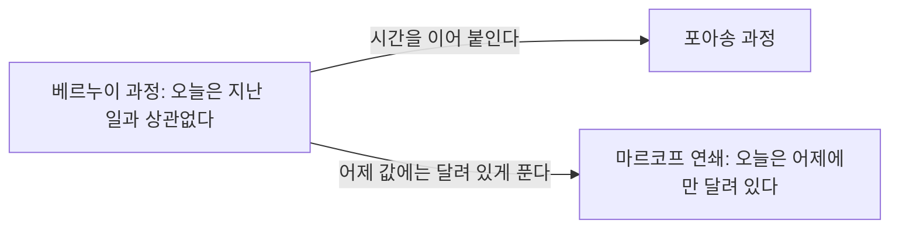



요약

날마다 적는 확진자 수나 시시각각 바뀌는 코인 가격처럼, 운에 따라 정해지는 값을 시간 순서대로 줄 세운 것이다. 값 하나하나를 따로 보지 않고 줄 전체를 한 덩어리로 보기 때문에 "오늘 값은 어제 값에 얼마나 끌려가는가", "오래 지켜보면 얼마나 자주 높은 값에 머무는가"를 물을 수 있다. 대신 줄이 끝없이 이어져 따질 경우가 한없이 많다. 그래서 "오늘은 지난 일과 상관없다"거나 "오늘은 어제에만 달려 있다"처럼 단순한 약속을 둔 몇 가지 꼴을 주로 쓴다.

## 예시로 보기

주사위를 한 번 던지는 일은 확률변수 하나로 다 적는다. 날마다 바뀌는 확진자 수는 그렇게 적을 수 없다. 날마다 값이 하나씩 필요하고, 그 날들이 끝없이 이어진다.

$$i$$일째 확진자 수를 $$X_i$$라 하면 $$X_1, X_2, X_3, \dots$$라는 줄이 생긴다[^1]. 여기서 실험을 한 번 한 결과 $$\omega$$(오메가)는 숫자 하나가 아니라 끝없이 이어지는 수열 하나다.

| 결과 | 1일 | 2일 | 3일 | … |
|---|---|---|---|---|
| $$\omega_1$$ | 100 | 150 | 130 | … |
| $$\omega_2$$ | 200 | 300 | 400 | … |

$$X_i$$는 "결과 $$\omega$$의 $$i$$번째 숫자를 읽어라"는 규칙이다. 그래서 $$X_3(\omega_1) = 130$$, $$X_2(\omega_2) = 300$$, $$X_1(\omega_2) = 200$$이다[^1].

시간이 띄엄띄엄하지 않고 이어져 있어도 똑같다. 시각 $$t$$의 비트코인 가격을 $$X(t)$$라 하면, 결과 $$\omega$$ 하나는 0부터 끝없이 이어지는 가격 곡선 한 줄이다. $$X(3.7, \omega_1) = 3409$$는 "곡선 $$\omega_1$$의 시각 3.7에서의 높이가 3409"라는 뜻이다[^1].

**한 시점씩 보면 같아도 줄로 보면 다르다.** 0과 1을 적어 나가는 줄 두 가지를 견준다[^s1].

- A: 칸마다 동전을 새로 던진다.
- B: 열 번 중 아홉 번은 바로 앞 칸의 값을 그대로 따라 적고, 한 번은 뒤집는다.

어느 칸 하나만 떼어 보면 둘 다 1이 나올 확률이 절반이다. 그런데 같은 값이 이어지는 길이는 A가 평균 2칸, B가 평균 10칸이다. 칸 하나의 분포만 알아서는 이 차이를 볼 수 없다. 줄 전체를 한꺼번에 다뤄야 보인다.

검증: 슬라이드의 세 값, 두 줄의 1의 비율 0.5와 평균 이어짐 길이 2·10(식과 모의실험 40만 칸), 카드 C3의 0.82 — [12_random-process_verify.py](/Hongs_Blog/studies/data-and-information/code/12_random-process_verify/)

## 정의

확률 과정은 시간으로(또는 순서로) 번호를 붙인 확률변수들의 줄이다[^2].

기호로 쓰면 $$\{X_t : t \in T\}$$다. $$T$$는 번호로 쓰는 시간들의 모임이고, 번호 $$t$$마다 $$X_t$$는 결과 $$\omega$$를 받아 실수 하나를 내는 확률변수 $$X_t : \Omega \to \mathbb{R}$$이다. $$\Omega$$(대문자 오메가)는 나올 수 있는 결과 $$\omega$$를 모두 모은 것(표본공간)이다.

- 번호가 $$1, 2, 3, \dots$$처럼 정수면 **이산 시간** 과정이고 $$\{X_1, X_2, X_3, \dots\}$$로 쓴다.
- 번호가 0 이상의 모든 실수면 **연속 시간** 과정이고 $$(X(t))_{t \in \mathbb{R}^+}$$로 쓴다($$\mathbb{R}^+$$는 0 이상의 실수).

시간이 이어져 있는가와 값이 이어져 있는가를 따로 따지면 네 가지가 나온다[^2].

| | 값이 이어진다 (연속 값) | 값이 띄엄띄엄하다 (이산 값) |
|---|---|---|
| 연속 시간 | (a) 비트코인 가격 | (b) 가게에 지금까지 온 손님 수[^s2] |
| 이산 시간 | (c) 날마다 정오에 잰 기온[^s2] | (d) 날마다 센 확진자 수 |

### 확률변수 여러 개와 무엇이 다른가

확률변수 $$X_1, \dots, X_n$$을 한꺼번에 다루는 일은 이미 해 봤다. 확률 과정은 두 가지가 다르다[^3].

- **줄이 끝나지 않는다.** 결과 하나가 값 $$x_1, x_2, \dots$$가 끝없이 이어진 수열이고, 표본공간은 그런 수열을 모두 모은 것이다.
- **번호를 시간으로 읽는다.** 그래서 묻는 것이 달라진다.
    - 앞뒤 값이 서로 어떻게 얽혀 있는가. 지금까지의 값으로 앞으로의 값을 얼마나 맞힐 수 있는가.
    - 오래 지켜보면 어떻게 되는가. 예: 주가가 3000보다 높은 시간은 전체의 몇 분의 몇인가.

### 대표적인 세 가지

줄이 끝없이 길면 값들이 얽히는 방식도 끝없이 많다. 그래서 얽히는 방식을 단순하게 약속한 과정을 주로 쓴다[^4].

| 이름 | 시간 | 약속 | 한마디로 |
|---|---|---|---|
| 베르누이 과정 | 이산 | $$X_i$$는 앞의 $$X_{i-1}, \dots, X_1$$과 독립이다 | 오늘은 지난 일과 상관없다 |
| 포아송 과정 | 연속 | 시각 0부터 $$t$$까지 일어난 일과 $$t$$부터 $$t + a$$까지 일어나는 일이 독립이다 | 베르누이 과정을 이어진 시간으로 옮긴 것 |
| 마르코프 연쇄 | 이산 | $$X_i$$는 바로 앞 $$X_{i-1}$$에 달려 있고, $$X_{i-1}$$을 알고 나면 그보다 앞의 값은 더 알려 주는 것이 없다 | 오늘은 어제에만 달려 있다 |

베르누이 과정이 가장 단순하고, 나머지 둘은 거기서 한 가지씩만 바꾼 것이다[^s3]. 위 예시의 A가 베르누이 과정, B가 마르코프 연쇄다.

원본 오류 의심

원문: 슬라이드 p.5는 마르코프 연쇄를 "$$X_i$$ depends on $$X_{i-1}$$, but $$\perp \{X_{i-2}, X_{i-2}, \dots, X_1\}$$"라고 적었다. / 문제점: $$X_{i-2}$$가 두 번 적혔다. 그리고 $$X_i$$는 $$X_{i-2}$$와 그냥 독립인 것이 아니다. 그저께가 어제를 정하고 어제가 오늘을 정하므로 그저께 값도 오늘 값에 영향을 준다. / 수정안: "$$X_{i-1}$$의 값을 알고 나면 $$X_i$$는 $$\{X_{i-2}, X_{i-3}, \dots, X_1\}$$과 독립이다". / 근거: 위 예시의 B에서 그저께가 1일 때 오늘이 1일 확률은 $$0.9 \times 0.9 + 0.1 \times 0.1 = 0.82$$로, 그저께를 모를 때의 0.5와 다르다. 어제가 1인 것까지 알면 그저께가 무엇이든 0.9다(12_random-process_verify.py).

## 연결

- 선수: [확률변수와 분포](/Hongs_Blog/studies/probability-statistics/random-variables/)(값 하나를 내는 규칙), [독립](/Hongs_Blog/studies/probability-statistics/independence/)
- 가장 단순한 과정을 자세히: [베르누이 과정](/Hongs_Blog/studies/data-and-information/bernoulli-process/)
- 오늘이 어제에만 달려 있는 과정: [마르코프 연쇄](/Hongs_Blog/studies/probability-statistics/markov-chains/)
- 포아송 과정에서 정해진 시간 동안 일어난 횟수의 분포: [포아송 분포](/Hongs_Blog/studies/probability-statistics/poisson/)

## 확인 문제

**C1** 다음 넷을 시간(이산·연속)과 값(이산·연속)으로 나눠라. ㉠ 1초마다 서버에 요청이 왔는지 0·1로 적은 줄 ㉡ 매 순간의 방 온도 ㉢ 달마다 잰 몸무게 ㉣ 매 순간 통화 중인 전화 회선 수

**답:** ㉠ 이산 시간·이산 값, ㉡ 연속 시간·연속 값, ㉢ 이산 시간·연속 값, ㉣ 연속 시간·이산 값. 
**이유:** 시간은 "언제 값을 적는가"로, 값은 "적는 값이 셀 수 있게 띄엄띄엄한가"로 가른다. 회선 수는 언제든 바뀔 수 있지만 값은 0, 1, 2, …뿐이다[^s2].

**C2** 확률변수 $$X_1, \dots, X_n$$ 묶음을 이미 다뤘는데 왜 확률 과정을 따로 배우는가? 다른 점 두 가지를 쓰라.

**답:** ① 줄이 끝없이 이어진다. 결과 하나가 끝없는 수열이고 표본공간은 그런 수열 전체다. ② 번호를 시간으로 읽는다. 그래서 앞뒤 값이 어떻게 얽히는가(앞날 맞히기)와 오래 지켜본 모습(주가가 3000 위에 있는 시간의 비율)을 묻는다.

**C3** "오늘은 어제에만 달려 있다"는 과정에서 오늘 값은 그저께 값과 독립인가? 열 번 중 아홉 번 앞 칸을 따라 적는 0·1 줄로 답하라.

**답:** 독립이 아니다. 그저께가 1이면 오늘이 1일 확률은 $$0.9 \times 0.9 + 0.1 \times 0.1 = 0.82$$다(둘 다 따라 적거나 둘 다 뒤집거나). 그저께를 모르면 0.5다. 
**이유:** 그저께는 어제를 거쳐 오늘에 닿는다. 맞는 말은 "어제 값을 알고 나면 그저께 값은 더 알려 주는 것이 없다"이다. 어제가 1이면 그저께가 무엇이든 오늘이 1일 확률은 0.9다[^s1].

[^1]: 자료와 정보 9회 강의 자료 「D&I_강의09-랜덤프로세스」, p.3 (이산 시간 예: 확진자 수, 연속 시간 예: 비트코인 가격)
[^2]: 같은 자료, p.2 (확률 과정의 정의, 시간과 값으로 나눈 네 가지와 그림 (a)~(d))
[^3]: 같은 자료, p.4 (확률변수 묶음과 다른 점: 끝없는 줄, 번호를 시간으로 읽기)
[^4]: 같은 자료, p.5 (베르누이 과정, 포아송 과정, 마르코프 연쇄)
[^s1]: 보충 두 줄 A·B를 견주는 예와 카드 C3은 원본에 없다. p.4의 "값들이 시계열로 어떻게 얽혀 있는가"를 숫자로 보이려고 넣었다. 같은 값이 이어지는 길이는 "뒤집힐 때까지 기다린 칸 수"라 평균이 $$\frac{1}{1 - 0.5} = 2$$와 $$\frac{1}{1 - 0.9} = 10$$이고, 검증 코드의 모의실험과 맞는다.
[^s2]: 보충 표의 (b)·(c) 칸에 넣은 예와 카드 C1의 네 상황은 원본에 없다. 원본 p.2는 네 가지의 이름과 그림만 싣는다.
[^s3]: 보충 다이어그램 1개는 원본에 없다. p.5의 "Continuous time version of BP", "One-step more general than BP/PP"를 화살표로 옮겼다.

