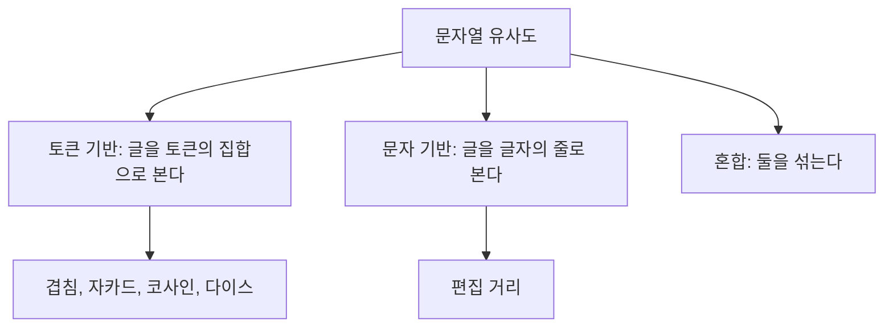



요약

두 글이 얼마나 닮았는지를 수로 적는 방법이고, 크게 두 길이 있다. 하나는 글을 낱말 주머니로 보고 두 주머니에 같이 든 낱말이 얼마나 되는지 세는 것이고, 다른 하나는 글을 글자의 줄로 보고 한쪽을 다른 쪽으로 고치려면 글자를 몇 번 손대야 하는지 세는 것이다. 낱말 주머니 방식은 빠르고 낱말 순서가 달라도 잘 맞지만, 낱말 안의 오타 하나에 그 낱말 전체를 다른 것으로 친다. 글자 방식은 오타에 강하지만 낱말 순서가 바뀌면 크게 어긋난다.

## 예시로 보기

주소록에 "중앙대학교 컴퓨터공학과"와 "중앙대 컴퓨터 공학과"가 따로 들어 있다. 사람은 같은 곳인 줄 알지만 컴퓨터가 글자를 하나하나 맞춰 보면 다르다. "같은가"가 아니라 "얼마나 닮았는가"를 물어야 한다. 슬라이드는 이것이 쓰이는 일로 데이터 정제, 맞춤법 검사, 데이터 통합, 같은 대상 찾기, 거의 같은 문서 찾기, 군집화를 든다[^1].

슬라이드의 두 글을 비교한다[^2].

- $$r$$ = "frontier computer science"
- $$s$$ = "computer science"

낱말로 끊어 주머니(집합)에 넣으면 $$r = \{\text{frontier}, \text{computer}, \text{science}\}$$, $$s = \{\text{computer}, \text{science}\}$$다. 같이 든 낱말은 2개다.

"2개가 겹친다"만으로는 닮은 정도를 알 수 없다. 낱말이 3개와 2개인 글에서 2개가 겹치는 것과, 100개씩인 글에서 2개가 겹치는 것은 다르다. 그래서 겹친 수를 글의 크기로 나눈다. 무엇으로 나누느냐에 따라 이름이 갈린다.

| 이름 | 무엇으로 나누나 | 이 예의 값 |
|---|---|---|
| 겹침 | 나누지 않는다 | 2 |
| 자카드 | 두 주머니를 합친 낱말 수 3 | $$\frac23 \approx 0.667$$ |
| 코사인 | 두 크기를 곱한 값의 제곱근 $$\sqrt{3 \cdot 2}$$ | $$\frac{2}{\sqrt6} \approx 0.816$$ |
| 다이스 | 두 크기의 평균 $$\frac{3 + 2}{2}$$ | $$\frac45 = 0.8$$ |

검증: 슬라이드 예의 네 값, 무작위 집합 3,000쌍에서 0~1 범위와 "같을 때만 1, 안 겹칠 때만 0", 자카드 ≤ 다이스 ≤ 코사인, 0/1 벡터의 코사인과 일치, 순서 바꿈과 오타의 예, 카드의 값 — [10_string-similarity_verify.py](/Hongs_Blog/studies/data-and-information/code/10_string-similarity_verify/)

## 정의

두 문자열이 얼마나 닮았는지를 수로 적는 함수를 세 갈래로 나눈다[^1].

슬라이드는 토큰 기반과 문자 기반의 식을 주고, 혼합은 이름만 든다[^s2].

### 토큰 기반

토큰(token)은 글을 끊은 조각이다. 보통 낱말이다. 글 하나를 토큰의 [집합](/Hongs_Blog/studies/discrete-math/sets/)으로 보고, 두 집합에 함께 든 토큰으로 닮은 정도를 잰다[^3]. 두 문자열의 토큰 집합을 $$r$$, $$s$$라 하면 $$r \cap s$$는 둘에 함께 든 토큰, $$\vert r\vert $$은 $$r$$의 토큰 수다.

**겹침 유사도.** 함께 든 토큰의 수다. 두 글의 크기를 보지 않아 0~1로 맞춰져 있지 않다[^3].

$$\mathrm{OLP}(r, s) = \vert r \cap s\vert $$

**0~1로 맞춘 세 유사도**[^4].

$$\mathrm{JAC}(r, s) = \frac{\vert r \cap s\vert }{\vert r \cup s\vert } = \frac{\vert r \cap s\vert }{\vert r\vert  + \vert s\vert  - \vert r \cap s\vert }$$

$$\mathrm{COS}(r, s) = \frac{\vert r \cap s\vert }{\sqrt{\vert r\vert  \cdot \vert s\vert }}, \qquad \mathrm{DICE}(r, s) = \frac{2\,\vert r \cap s\vert }{\vert r\vert  + \vert s\vert }$$

- 자카드: 함께 든 것을 "둘 중 어디에든 든 것"으로 나눈다. 분모의 둘째 꼴은 $$\vert r\vert  + \vert s\vert $$에서 두 번 센 겹친 부분을 한 번 뺀 것이다.
- 코사인: 두 크기의 곱의 제곱근(기하평균)으로 나눈다.
- 다이스: 두 크기의 평균으로 나눈다. $$\frac{\vert r \cap s\vert }{(\vert r\vert  + \vert s\vert )/2}$$를 정리한 꼴이다.

셋 모두 두 집합이 같으면 1, 하나도 안 겹치면 0이다. 그리고 늘 자카드 ≤ 다이스 ≤ 코사인이다[^s1]. 그래서 "0.8 이상이면 같은 것으로 본다" 같은 기준값은 어느 유사도를 쓰는지와 함께 정해야 한다.

토큰 코사인은 벡터의 [코사인 유사도](/Hongs_Blog/studies/linear-algebra/dot-product/)와 같은 것이다. 낱말마다 "들어 있으면 1, 없으면 0"을 적은 벡터로 바꾸면 내적이 $$\vert r \cap s\vert $$, 길이가 $$\sqrt{\vert r\vert }$$과 $$\sqrt{\vert s\vert }$$가 된다[^s1].

### 문자 기반

글 하나를 글자의 줄로 보고, 두 줄에서 서로 다른 글자를 세어 닮은 정도를 잰다[^5]. 대표가 편집 거리다. 한 문자열을 다른 문자열로 바꾸는 데 드는 한 글자짜리 고치기(넣기, 지우기, 바꾸기)의 가장 적은 횟수다. 이 횟수가 정해 둔 기준값보다 작으면 두 문자열이 비슷하다고 한다[^5]. 계산법은 [편집 거리](/Hongs_Blog/studies/data-and-information/edit-distance/)에서 다룬다.

### 두 방식이 갈리는 곳

| 상황 | 토큰 기반 (자카드) | 문자 기반 |
|---|---|---|
| "computer science" 대 "science computer" (순서 바꿈) | 1 (같은 집합) | 많이 고쳐야 한다 |
| "computer science" 대 "computer sciense" (오타 한 글자) | $$\frac13$$ | 한 글자만 고치면 된다 |

토큰 집합은 순서를 버린다. 그리고 `science`와 `sciense`를 아무 관계 없는 두 토큰으로 본다. 오타 하나로 겹침이 2에서 1로 줄고 합친 크기가 2에서 3으로 늘어 $$\frac13$$이 된다[^s1].

## 활용

- **빠르게 거르기.** 토큰 집합의 교집합은 해시 집합으로 글 길이에 비례하는 시간에 구한다: [딕셔너리와 집합](/Hongs_Blog/studies/algorithms/hash-dict-set/). 편집 거리는 두 길이의 곱만큼 걸린다. 그래서 토큰 유사도로 후보를 먼저 거르고, 남은 쌍만 편집 거리로 본다[^s1].
- 장바구니나 이진 속성에 쓰는 자카드 계수와 같은 식이다: [범주형 속성의 비유사도](/Hongs_Blog/studies/data-science/categorical-dissimilarity/)
- 흔한 실수: 같은 낱말이 여러 번 나오는 글을 집합으로 만들면 횟수가 사라진다. 횟수가 중요하면 낱말 빈도 벡터의 코사인 유사도를 쓴다[^s1].
- 흔한 실수: 겹침 유사도끼리 크기가 다른 글 쌍을 비교하는 것. 긴 글일수록 겹침이 커서 늘 이긴다.

## 연결

- 선수: [거리와 유사도](/Hongs_Blog/studies/data-and-information/distance-similarity/), [집합](/Hongs_Blog/studies/discrete-math/sets/)
- 벡터의 코사인: [내적과 노름](/Hongs_Blog/studies/linear-algebra/dot-product/)
- 이어지는 개념: [편집 거리](/Hongs_Blog/studies/data-and-information/edit-distance/)

## 확인 문제

**C1** $$r$$ = "data and information", $$s$$ = "information theory"의 겹침, 자카드, 코사인, 다이스 유사도를 구하라(토큰은 낱말).

**답:** 겹침 1. 자카드 $$\frac{1}{3 + 2 - 1} = \frac14$$. 코사인 $$\frac{1}{\sqrt6} \approx 0.408$$. 다이스 $$\frac{2}{5} = 0.4$$. 
**흔한 오답:** 자카드의 분모를 $$3 + 2 = 5$$로 두는 것. 겹친 토큰을 두 번 세었다.

**C2** 겹침 유사도를 그대로 쓰지 않고 자카드처럼 나누어 쓰는 이유는?

**답:** 겹침은 글의 크기를 보지 않기 때문이다. 토큰 2개짜리 두 글이 완전히 같아도 겹침은 2이고, 100개짜리 두 글이 98개만 같아도 겹침은 98이다. 겹침만 보면 뒤쪽이 훨씬 닮았다고 나온다. 크기로 나누어 0~1로 맞춰야 크기가 다른 쌍끼리 비교할 수 있다.

**C3** (가) 사람 이름의 오타를 잡아 같은 사람을 찾는 일 (나) 낱말 순서가 뒤섞인 상품 이름을 묶는 일. 각각 토큰 기반과 문자 기반 중 무엇이 알맞은가?

**답:** (가)는 문자 기반(편집 거리). 오타는 글자 한두 개의 차이인데 토큰 기반은 오타 난 낱말을 통째로 다른 토큰으로 본다. (나)는 토큰 기반. 집합은 순서를 보지 않아 뒤섞여도 같고, 문자 기반은 순서가 바뀌면 많이 고쳐야 한다고 나온다.

[^1]: 자료와 정보 4회 강의 자료 「D&I_강의04-2-유사도와거리」, p.7 (문자열 유사도: 쓰이는 곳 여섯 가지, 세 갈래의 유사도 함수)
[^2]: 같은 자료, p.10 (Example: $$r$$, $$s$$와 OLP = 2, JAC = 2/3, COS = 2/√6, DICE = 4/5)
[^3]: 같은 자료, p.8 (Token-based similarity, Overlap similarity, not normalized)
[^4]: 같은 자료, p.9 (Similarity Metric – Token: Jaccard, Cosine, Dice)
[^5]: 같은 자료, p.11 (Character-based Similarity, 편집 거리의 뜻과 기준값)
[^s1]: 보충 주소록 예, 나누는 수로 본 네 유사도의 비교, 자카드 ≤ 다이스 ≤ 코사인, 0/1 벡터와의 관계, 순서 바꿈과 오타의 예, 활용 절, 카드는 슬라이드에 없다. 부등식은 $$2ab \le a^2 + b^2$$에서 나오는 "기하평균 ≤ 산술평균"과 $$\vert r \cup s\vert  \ge \frac{\vert r\vert  + \vert s\vert }{2}$$로 보일 수 있고, 무작위 3,000쌍에서도 확인했다.
[^s2]: 보충 다이어그램은 슬라이드에 없다. p.7의 세 갈래와 p.8~11의 내용을 그렸다.

