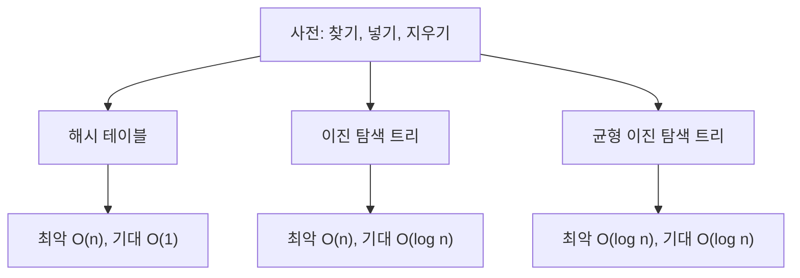



요약

자판기는 버튼과 나오는 물건만 약속하고, 속에서 캔을 어떻게 쌓아 두는지는 밖에서 알 필요가 없다. 추상 자료형은 이처럼 자료에 무엇을 할 수 있는지만 정하고, 속에서 어떻게 하는지는 정하지 않은 것이다. 그래서 속을 배열에서 다른 구조로 바꿔도 쓰는 쪽 코드는 그대로다. 다만 할 수 있는 일의 목록만 봐서는 얼마나 빠른지 알 수 없고, 빠르기는 속을 무엇으로 만들었느냐에 달려 있다.

## 예시로 보기

괄호의 짝을 맞추는 프로그램을 짠다고 하자. 접시를 쌓듯 맨 위에만 넣고 맨 위에서만 빼는 통이 필요하다. 이 통을 배열로 만들지 연결 구조로 만들지는 아직 못 정했다.

쓰는 쪽 코드가 `stack[++top] = x;`처럼 속을 직접 건드리면, 나중에 속을 바꿀 때 그런 줄을 모두 찾아 고쳐야 한다. 대신 "맨 위에 넣는다", "맨 위에서 뺀다" 같은 일의 이름만 먼저 약속해 둔다. 쓰는 쪽은 그 이름만 부른다.

스택의 약속은 이렇다[^1].

- **대상(Object).** 한쪽 끝에서만 넣고 빼는 순서 있는 목록.
- **연산(Operations).**
    - `IsEmpty`: 스택이 비었으면 참을 돌려준다.
    - `IsFull`: 남은 자리가 없으면 참을 돌려준다.
    - `Top`: 맨 위 원소를 돌려준다.
    - `Push`: 맨 위에 원소를 넣는다.
    - `Pop`: 맨 위 원소를 뺀다.

이 약속 어디에도 배열이나 포인터라는 말이 없다. 같은 약속을 지키는 속을 두 가지로 만들 수 있다.

| 연산 | 배열로 만들면 | 연결 리스트로 만들면 |
|---|---|---|
| `Push` | `top`을 하나 올리고 그 칸에 넣는다 | 새 노드를 만들어 맨 위 노드 앞에 잇는다 |
| `Pop` | `top` 칸의 값을 꺼내고 `top`을 하나 내린다 | 맨 위 노드를 떼어 내고 돌려준다 |
| `IsFull` | `top`이 마지막 칸 번호와 같은가 | 메모리가 남아 있는 한 가득 차지 않는다 |

두 가지의 코드는 [배열로 만든 스택](/Hongs_Blog/studies/data-structures/array-stack/)과 [연결 리스트로 만든 스택](/Hongs_Blog/studies/data-structures/linked-stack/)에 있다[^2]. 괄호 짝을 맞추는 코드는 어느 쪽을 써도 한 글자도 바뀌지 않는다.

## 정의

추상 자료형(abstract data type, ADT)은 자료와 연산을 "무엇인가"로만 적은 것이다. 두 가지를 적는다[^s1].

- 대상: 어떤 값들의 모음인가.
- 연산: 그 모음에 할 수 있는 일은 무엇이고, 일마다 무엇을 받아 무엇을 돌려주는가.

값을 메모리에 어떻게 놓는지와 연산을 어떤 순서로 계산하는지는 적지 않는다. 그것을 정한 것이 [자료구조](/Hongs_Blog/studies/data-structures/data-structure-definition/)다. 추상 자료형은 약속이고, 자료구조는 그 약속을 지키는 방법 하나다.

연산을 적을 때는 잘못 쓴 경우에 무슨 일이 생기는지도 적는다. 이진 트리의 추상 자료형이 그 예다. `bt`, `bt1`, `bt2`는 이진 트리, `item`은 원소 하나다[^3].

| 연산 | 하는 일 |
|---|---|
| `Create()` | 빈 이진 트리를 만든다 |
| `IsEmpty(bt)` | `bt`가 빈 이진 트리면 참, 아니면 거짓 |
| `MakeBT(bt1, item, bt2)` | 왼쪽 서브트리가 `bt1`, 오른쪽 서브트리가 `bt2`, 뿌리의 값이 `item`인 이진 트리를 돌려준다 |
| `Lchild(bt)` | `bt`가 비었으면 오류, 아니면 왼쪽 서브트리 |
| `Data(bt)` | `bt`가 비었으면 오류, 아니면 뿌리의 값 |
| `Rchild(bt)` | `bt`가 비었으면 오류, 아니면 오른쪽 서브트리 |

### 강의에 나온 추상 자료형

이 과목은 새 구조를 배울 때마다 대상과 연산부터 정한다.

| 이름 | 대상 | 연산 | 나온 곳 |
|---|---|---|---|
| 희소 행렬 | (행, 열, 값) 세 쌍의 모음. 행과 열의 짝은 겹치지 않는다 | `Create`, `Transpose`, `Add`, `Multiply` | 3주차 p.4[^4] |
| 스택 | 한쪽 끝에서만 넣고 빼는 순서 있는 목록 | `IsEmpty`, `IsFull`, `Top`, `Push`, `Pop` | 3주차 p.45[^1] |
| 큐 | 한쪽 끝에서 넣고 반대쪽 끝에서 빼는 순서 있는 목록 | `IsFullQ`, `IsEmptyQ`, `AddQ`, `DeleteQ` | 3주차 p.81[^5] |
| 순서 있는 목록 | 원소가 순서대로 놓인 목록 | 원소 넣기, 원소 빼기 | 5주차 p.6[^6] |
| 이진 트리 | 비어 있거나, 뿌리 하나와 서로 겹치지 않는 왼쪽·오른쪽 이진 트리로 된 노드의 모음 | `Create`, `IsEmpty`, `MakeBT`, `Lchild`, `Data`, `Rchild` | 6주차 p.8[^3] |
| 우선순위 큐 | 원소마다 우선순위(키)가 있는 모음 | `empty`, `size`, `push`, `top`, `pop` | 6주차 p.57~58[^7] |
| 이진 탐색 트리 | — | `IsEmpty`, `Search`, `Insert`, `Delete` | 9주차 p.4[^8] |
| 해시 테이블 | (키, 원소) 쌍의 모음. 키는 서로 다르다 | `Search`, `Delete`, `Insert` | 15주차 p.4[^9] |

아래 두 줄은 연산이 같다. 찾기, 넣기, 지우기다. 이 세 연산을 가진 추상 자료형을 사전(dictionary)이라 부른다. 이진 탐색 트리와 해시 테이블은 사전을 만드는 두 가지 방법이다[^s2].

### 같은 약속, 다른 빠르기

사전의 세 연산에 걸리는 시간은 무엇으로 만들었느냐에 따라 다르다. $$n$$은 사전에 든 원소의 수다[^10].

맨 위 한 칸이 약속이고, 가운데 줄이 그 약속을 지키는 방법이다. 쓰는 쪽 코드는 맨 위만 보고 짠다. 어느 가지를 고를지는 무엇이 빨라야 하는지에 따라 정한다[^s3].

## 활용

- **속을 바꿔 끼운다.** 처음에는 만들기 쉬운 구조로 만들고, 느린 곳이 드러나면 속만 바꾼다. 약속이 그대로면 쓰는 쪽은 고치지 않는다.
- **C에서 가르는 법.** C에는 추상 자료형을 위한 문법이 따로 없다. 구조체와, 그 구조체의 주소를 받는 함수들로 만든다. 쓰는 쪽이 구조체의 칸을 직접 건드리지 않고 함수만 부르면 약속이 지켜진다[^s3].
- **흔한 실수.** 약속에 없는 것을 믿고 쓴다. 스택을 배열로 만들었다고 해서 쓰는 쪽에서 `stack[0]`을 직접 읽으면, 속을 연결 리스트로 바꾸는 순간 그 줄이 틀린다.

## 연결

- 선수: [자료구조란](/Hongs_Blog/studies/data-structures/data-structure-definition/)
- 스택이라는 약속 자체: [스택](/Hongs_Blog/studies/algorithms/stack/)
- 자바에서는 같은 생각이 문법으로 있다. "할 수 있는 일의 목록"만 적은 것이 인터페이스이고, 클래스가 그 목록을 채운다: [인터페이스](/Hongs_Blog/studies/java/java-interface/)
- 사전을 만드는 두 방법: [이진 탐색 트리의 탐색과 삽입](/Hongs_Blog/studies/data-structures/bst-search-insert/), [해시 테이블의 홈 버킷과 충돌](/Hongs_Blog/studies/data-structures/hash-table-terms/)

## 확인 문제

**C1** 스택의 추상 자료형을 대상과 연산으로 나눠 쓰라. 연산은 다섯 가지다.

**답:** 대상은 한쪽 끝에서만 넣고 빼는 순서 있는 목록이다. 연산은 `IsEmpty`(비었는가), `IsFull`(남은 자리가 없는가), `Top`(맨 위 원소를 돌려준다), `Push`(맨 위에 넣는다), `Pop`(맨 위 원소를 뺀다)이다. 
**흔한 오답:** "배열과 `top` 변수"를 적는 것. 그것은 스택을 만드는 방법 하나이지 약속이 아니다.

**C2** 다음 가운데 추상 자료형이 정하는 것과 만드는 방법이 정하는 것을 가르라. (가) `Pop`은 가장 나중에 넣은 원소를 뺀다. (나) 원소를 `stack[0]`부터 `stack[top]`까지에 둔다. (다) 찾기가 기대 $$O(1)$$ 시간에 끝난다. (라) 큐에서는 먼저 넣은 원소가 먼저 나온다.

**답:** 추상 자료형: (가), (라). 만드는 방법: (나), (다). 
**이유:** (가)와 (라)는 연산이 무엇을 하는지를 말한다. 속을 무엇으로 만들든 지켜야 한다. (나)는 값을 메모리에 놓는 모양이고, (다)는 그 모양에서 나오는 빠르기다. 같은 사전이라도 해시 테이블로 만들면 기대 $$O(1)$$, 이진 탐색 트리로 만들면 기대 $$O(\log n)$$이다.

**C3** 해시 테이블과 이진 탐색 트리는 연산 목록이 찾기, 넣기, 지우기로 같다. 그런데 왜 하나는 기대 $$O(1)$$이고 다른 하나는 기대 $$O(\log n)$$인가? 이 사실은 "무엇을 하는가"와 "어떻게 만드는가"를 가르는 까닭을 어떻게 보여 주는가?

**답:** 연산 목록은 무엇을 하는지만 약속하고, 걸리는 시간은 값을 어떤 모양으로 놓았는지에서 나온다. 두 구조는 값을 놓는 모양이 달라서 같은 "찾기"에 드는 일의 양이 다르다. 그래서 쓰는 쪽은 약속만 보고 코드를 짜고, 빠르기가 문제가 되면 약속은 그대로 둔 채 속만 바꿀 수 있다.

[^1]: 자료구조 3회 강의 자료 「DS_Week3_Lecture_2024」, p.45 (Stacks as an Abstract data type: Object와 Standard operations)
[^2]: 자료구조 3회 강의 자료 「DS_Week3_Lecture_2024」, p.46~49 (배열 스택: `stack[0]`~`stack[top]`, `top == capacity – 1`, `stack[++top] = item`), 자료구조 5회 강의 자료 「DS_Week5_Lecture_2024」, p.27~31 (연결 스택: 값의 개수에 제한이 없다, push와 pop)
[^3]: 자료구조 6회 강의 자료 「DS_Week6_Lecture_2024」, p.8 (Abstract Data Type: 이진 트리의 정의와 연산 여섯 가지)
[^4]: 자료구조 3회 강의 자료 「DS_Week3_Lecture_2024」, p.4 (Sparse_Matrix Structure: Objects와 Functions)
[^5]: 자료구조 3회 강의 자료 「DS_Week3_Lecture_2024」, p.81 (Abstract Data Type(ADT) for Queue)
[^6]: 자료구조 5회 강의 자료 「DS_Week5_Lecture_2024」, p.6 (ADT of Linked List: An ordered list of elements, 삽입과 삭제)
[^7]: 자료구조 6회 강의 자료 「DS_Week6_Lecture_2024」, p.57~58 (Min Priority Queue, Max Priority Queue: 원소의 모음과 다섯 연산)
[^8]: 자료구조 9회 강의 자료 「DS_Week9_Lecture_BST_2024」, p.4 (Binary Search Tree: Operations. 이 쪽에는 연산 넷만 적혀 있고 대상은 적혀 있지 않다)
[^9]: 자료구조 15회 강의 자료 「DS_Week15_Lecture_2024」, p.4 (Hash Tables: 쌍의 모음, 연산 셋, 최악 O(size), 기대 O(1))
[^10]: 자료구조 9회 강의 자료 「DS_Week9_Lecture_BST_2024」, p.5 (Complexity Of Dictionary Operations: 해시 테이블, 이진 탐색 트리, 균형 이진 탐색 트리의 최악과 기대 시간)
[^s1]: 보충 자판기 비유, 괄호 짝 맞추기로 든 동기, 두 구현을 나란히 놓은 표, 추상 자료형의 일반 정의는 원본에 없다. 슬라이드는 구조마다 대상과 연산을 적을 뿐 추상 자료형이 무엇인지는 따로 정의하지 않는다. 정의는 Horowitz·Sahni·Anderson-Freed, *Fundamentals of Data Structures in C* 2판, 1.3절(대상과 연산을 적은 것을, 그것을 나타내고 계산하는 방법과 가른다)을 따랐다. 이 책이 강의 교재인지는 확인하지 못했다 [확인필요].
[^s2]: 보충 표의 "순서 있는 목록"은 슬라이드 제목이 "ADT of Linked List"다. 연결 리스트는 만드는 방법의 이름이라서 슬라이드가 적은 대상(An ordered list of elements)을 이름으로 썼다. 이진 탐색 트리와 해시 테이블을 "사전을 만드는 두 방법"으로 묶은 것은 9주차 p.5의 제목(Dictionary Operations)에서 읽었다.
[^s3]: 보충 다이어그램 1개, 활용 항목, 카드 C1~C3은 원본에 없다. 다이어그램은 9주차 p.5의 표를 그렸다.

