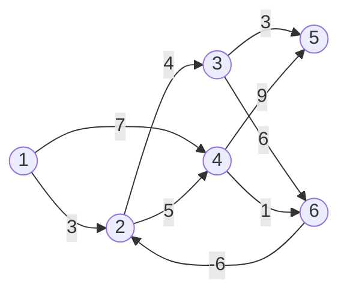


<div class="callout callout-summary" markdown="1">
<div class="callout-title callout-title--default" markdown="span">요약</div>

길마다 통행료가 붙는데 어떤 길은 돈을 돌려주기도 할 때, 출발점에서 모든 곳까지 가장 싸게 가는 값을 구한다. "길을 한 구간만 써도 될 때"의 답에서 시작해 써도 되는 구간 수를 하나씩 늘리며 표를 고쳐 가고, 구간을 장소 수보다 하나 적은 개수까지 허락하면 답이 나온다. 가까운 곳부터 하나씩 확정하는 방법보다 느리지만, 돈을 돌려주는 길이 있어도 맞다. 단, 돌 때마다 돈이 남는 고리가 있으면 "가장 싼 값"이 정해지지 않아 쓸 수 없다.

</div>


## 예시로 보기

[다익스트라](/Hongs_Blog/studies/algorithms/dijkstra/)는 "지금 가장 가까운 곳은 더 줄어들 수 없다"고 믿고 그곳을 확정한다. 이 믿음은 간선 비용이 모두 0 이상일 때만 맞다. 비용이 음수인 간선이 있으면, 멀리 돌아간 길이 나중에 음수 간선을 타고 더 싸질 수 있다.

점 6개, 방향 간선 9개로 된 그래프를 보자. 6에서 2로 가는 간선의 비용이 −6이고, 출발점은 1이다.



화살표 위의 수가 비용이다[^s2].

1에서 2로 가는 길은 바로 가는 3이 있고, 4와 6을 돌아가는 $$7 + 1 - 6 = 2$$가 있다. 돌아가는 쪽이 싸다. 다익스트라는 가장 가까운 2(거리 3)를 먼저 확정해 버려서, 나중에 6에서 온 더 싼 값 2를 받아들이지 못한다. 이 그래프에 다익스트라를 돌리면 2, 3, 5까지의 거리를 3, 7, 10이라고 답하는데 맞는 값은 2, 6, 9다.

벨만–포드는 확정을 하지 않는다. 대신 $$d(v, k)$$ = "간선을 $$k$$개까지만 써서 1에서 $$v$$로 가는 가장 짧은 길이"를 $$k = 0$$부터 차례로 구한다. 아래 표의 한 줄이 $$k$$ 하나다. $$-$$는 그런 길이 없다는 뜻(무한대)이다.

| $$k$$ | $$d(1,k)$$ | $$d(2,k)$$ | $$d(3,k)$$ | $$d(4,k)$$ | $$d(5,k)$$ | $$d(6,k)$$ | 이 줄에서 바뀐 것 |
|---|---|---|---|---|---|---|---|
| 0 | 0 | − | − | − | − | − | 출발점만 0 |
| 1 | 0 | 3 | − | 7 | − | − | 1→2, 1→4 |
| 2 | 0 | 3 | 7 | 7 | 16 | 8 | 2→3(3 + 4), 4→5(7 + 9), 4→6(7 + 1) |
| 3 | 0 | 2 | 7 | 7 | 10 | 8 | 6→2(8 − 6), 3→5(7 + 3) |
| 4 | 0 | 2 | 6 | 7 | 10 | 8 | 2→3(2 + 4) |
| 5 | 0 | 2 | 6 | 7 | 9 | 8 | 3→5(6 + 3) |

각 줄은 바로 윗줄의 값만 써서 만든다. $$k = 3$$ 줄의 $$d(2, 3) = 2$$는 윗줄의 $$d(6, 2) = 8$$에 간선 6→2의 비용 −6을 더한 것이다. 간선 3개(1→4→6→2)를 써야 닿는 값이라 $$k = 3$$에서 처음 나타난다.

길을 되짚으려고 $$p(v, k)$$ = "그 길에서 $$v$$ 바로 앞의 점"도 함께 적는다. 마지막 줄은 $$p(\cdot, 5) = (-, 6, 2, 1, 3, 4)$$다. 5에서 거꾸로 따라가면 5 ← 3 ← 2 ← 6 ← 4 ← 1이므로, 1에서 5로 가는 가장 짧은 길은 1 → 4 → 6 → 2 → 3 → 5이고 길이는 $$7 + 1 - 6 + 4 + 3 = 9$$다.

<div class="callout callout-check" markdown="1">
<div class="callout-title" markdown="span">검증: 파이썬으로 위 표의 여섯 줄과 $$p$$ 표, 길 1 4 6 2 3 5를 다시 만들었다. 음수 사이클이 없는 무작위 그래프 600개(점 2 ~ 6개, 비용 −3 ~ 9)에서 $$d(v, k)$$가 "간선 $$k$$개 이하인 모든 길을 다 따라가 본 최솟값"과 같았고, $$d(v, n-1)$$이 "같은 점을 두 번 지나지 않는 모든 길의 최솟값"과 같았다. 다익스트라가 이 그래프에서 3, 7, 10으로 틀리는 것도 확인했다 — [38_bellman-ford_verify.py](/Hongs_Blog/studies/data-structures/code/38_bellman-ford_verify/)</div>

</div>


## 정의

<div class="callout callout-definition" markdown="1">
<div class="callout-title" markdown="span">입력과 출력</div>

- **입력:** 간선마다 비용이 있는 방향 그래프와 출발점 $$s$$. 비용은 음수여도 된다. 다만 비용의 합이 0보다 작은 사이클은 없어야 한다. 점은 $$n$$개, 간선은 $$m$$개다(간선 수를 $$e$$로 적는 책도 있다).
- **출력:** 모든 점 $$v$$에 대해 $$s$$에서 $$v$$로 가는 가장 짧은 길의 길이. 길의 길이는 지나는 간선 비용의 합이다.

</div>


**비용 함수.** $$d(v, k)$$를 "$$s$$에서 $$v$$로 가는 길 가운데 간선이 $$k$$개 이하인 것의 가장 짧은 길이"라 하자. $$dist^k[v]$$로 적기도 한다.

**처음 값.** 간선을 0개 쓰면 출발점에만 있을 수 있다.

$$d(s, 0) = 0, \qquad d(v, 0) = \infty \quad (v \ne s)$$


**점화식.** $$k > 0$$일 때, $$d(v, k)$$는 다음 둘 가운데 작은 쪽이다.

$$d(v, k) = \min\Big\{\, d(v, k-1),\ \min_{(w, v) \in E}\big\{ d(w, k-1) + \text{cost}(w, v) \big\} \Big\}$$


말로 읽으면 이렇다. 간선 $$k - 1$$개 이하로 이미 올 수 있던 값을 그대로 쓰거나, $$v$$로 들어오는 간선 $$(w, v)$$마다 "$$w$$까지 간선 $$k - 1$$개 이하로 온 값 + 마지막 간선의 비용"을 구해 그중 가장 작은 것을 쓴다. $$(w, v) \in E$$는 "$$w$$에서 $$v$$로 가는 간선이 있다"는 뜻이다. 표의 $$d(5, 3) = 10$$을 예로 들면, 5로 들어오는 간선은 3→5와 4→5라서 $$\min\{16,\ 7 + 3,\ 7 + 9\} = 10$$이다.

**답.** 구하려는 것은 $$d(v, n - 1)$$이다.

### 의사코드

```
// d(*, 0)을 채운다
d(s, 0) = 0
d(v, 0) = 무한대,  v != s

// d(*, k)를 k = 1, 2, ..., n - 1 순서로 채운다
for (int k = 1; k < n; k++)
{
    d(v, k) = d(v, k-1),  1 <= v <= n        // 윗줄을 그대로 베껴 놓고
    for (각 간선 (u, v))                      // 간선마다 한 번씩
        d(v, k) = min{ d(v, k), d(u, k-1) + cost(u, v) }
}
```

안쪽 줄에서 읽는 값이 $$d(u, k-1)$$, 곧 **윗줄**의 값이라는 점이 중요하다. 같은 줄에서 방금 고친 값을 읽으면 간선을 $$k$$개보다 많이 쓴 길이 섞인다(아래 "한 줄만 쓰기").

## 증명

**주장.** 음수 사이클이 없으면, 점화식으로 구한 $$d(v, k)$$는 "간선 $$k$$개 이하인 길의 가장 짧은 길이"와 같고, $$d(v, n - 1)$$은 $$s$$에서 $$v$$로 가는 가장 짧은 길의 길이다.

$$k$$에 대한 [수학적 귀납법](/Hongs_Blog/studies/discrete-math/induction/)으로 보인다. 점화식을 끌어낸 순서를 그대로 따른다.

<details class="callout callout-proof" markdown="1">
<summary class="callout-title" markdown="span">증명 펼치기</summary>

1. **$$k = 0$$.** 간선을 하나도 안 쓰는 길은 $$s$$에 서 있는 것뿐이다. 그래서 $$d(s, 0) = 0$$이고 다른 점은 닿지 못해 $$\infty$$다. — 정의
2. **$$k > 0$$, 길이 짧은 경우.** $$s$$에서 $$v$$로 가는, 간선 $$k$$개 이하인 가장 짧은 길을 $$P$$라 하자. $$P$$의 간선이 $$k - 1$$개 이하면, $$P$$는 "간선 $$k - 1$$개 이하인 길" 가운데서도 가장 짧다. 그래서 길이가 $$d(v, k-1)$$이다. — 귀납 가정
3. **$$k > 0$$, 길이 꼭 $$k$$개인 경우.** $$P$$의 간선이 꼭 $$k$$개면, $$P$$에서 $$v$$ 바로 앞의 점을 $$w$$라 하자($$w$$가 $$s$$일 수도 있다). $$P$$의 앞부분, 곧 $$s$$에서 $$w$$까지는 간선이 $$k - 1$$개다. 이 앞부분은 "간선 $$k - 1$$개 이하로 $$s$$에서 $$w$$로 가는 길" 가운데 가장 짧아야 한다. 더 짧은 길이 있다면 앞부분을 그 길로 바꿔 $$P$$보다 짧고 간선이 $$k$$개 이하인 길이 생기는데, $$P$$가 가장 짧다는 것과 어긋난다. 그래서 $$P$$의 길이는 $$d(w, k-1) + \text{cost}(w, v)$$다. — 귀류법, 귀납 가정
4. **$$w$$를 모를 때.** 어느 $$w$$인지 모르니 $$v$$로 들어오는 간선을 모두 본다. 후보 $$d(w, k-1) + \text{cost}(w, v)$$는 저마다 실제로 있는 길(간선 $$k$$개 이하)의 길이라서, 참값보다 작을 수 없다. 참값은 2단계나 3단계에 따라 후보 가운데 들어 있다. 그래서 후보들의 최솟값이 참값이다. — 최솟값의 정의
5. **$$n - 1$$개면 된다.** 음수 사이클이 없으면, 길에서 사이클을 잘라 내도 길이가 늘지 않는다. 그래서 같은 점을 두 번 지나지 않는 가장 짧은 길이 늘 있다. 점이 $$n$$개인데 같은 점을 두 번 지나지 않으면 간선은 많아야 $$n - 1$$개다. 따라서 $$d(v, n - 1)$$이 간선 수에 제한이 없을 때의 가장 짧은 길이다. — 사이클 잘라 내기 ∎

</details>


### 스스로 설명해 보기

<details class="callout callout-question" markdown="1">
<summary class="callout-title" markdown="span">1. 3단계에서 "앞부분을 더 짧은 길로 바꾼다"가 가능하려면 무엇이 필요한가?</summary>

바꿔 넣을 길도 간선이 $$k - 1$$개 이하여야 한다. 그래야 마지막 간선 $$(w, v)$$를 붙였을 때 전체가 $$k$$개 이하로 남아 $$P$$와 견줄 수 있다. 그래서 견주는 대상이 "아무 길"이 아니라 "간선 $$k - 1$$개 이하인 길", 곧 $$d(w, k-1)$$이다.

</details>


<details class="callout callout-question" markdown="1">
<summary class="callout-title" markdown="span">2. 4단계에서 후보가 참값보다 작을 수 없는 까닭은?</summary>

후보 하나하나는 귀납 가정에 따라 실제로 있는 길($$s$$에서 $$w$$까지 간선 $$k - 1$$개 이하)에 간선 하나를 붙인 길의 길이다. 참값은 그런 길 전체의 최솟값이니, 그 가운데 하나인 후보가 더 작을 수 없다.

</details>


<details class="callout callout-question" markdown="1">
<summary class="callout-title" markdown="span">3. 5단계에서 음수 사이클이 있으면 어디가 깨지는가?</summary>

"사이클을 잘라 내도 길이가 늘지 않는다"가 깨진다. 사이클의 비용 합이 음수면 자를수록 길이가 늘고, 돌수록 줄어든다. 그러면 가장 짧은 길이 없고, 간선을 $$n - 1$$개로 막을 근거도 없다.

</details>


<details class="callout callout-question" markdown="1">
<summary class="callout-title" markdown="span">이 증명의 핵심 아이디어는?</summary>

문제에 "간선은 $$k$$개까지"라는 제한을 붙여 작은 문제부터 푼다. 제한이 $$k$$인 답은 제한이 $$k - 1$$인 답들에 간선 하나를 붙여서 만든다. 가장 짧은 길의 앞부분도 가장 짧은 길이라는 점이 이것을 받쳐 준다.

</details>


<details class="callout callout-question" markdown="1">
<summary class="callout-title" markdown="span">이 방법을 쓸 수 있는 다른 상황은?</summary>

[플로이드–워셜](/Hongs_Blog/studies/algorithms/floyd-warshall/)은 간선 수 대신 "거쳐 가도 되는 점의 번호"에 제한을 붙여 같은 식으로 푼다. 제한을 붙여 표를 채우는 방식 전체가 [동적 계획법](/Hongs_Blog/studies/algorithms/dynamic-programming/)이다.

</details>


### 복잡도

한 줄($$k$$ 하나)을 채울 때 간선을 한 번씩 본다. 줄은 $$n - 1$$개다.

| | 인접 행렬 | 인접 리스트 |
|---|---|---|
| $$d(\cdot, 0)$$ 채우기 | $$\Theta(n)$$ | $$\Theta(n)$$ |
| 줄 하나 | $$\Theta(n^2)$$: 간선을 찾느라 표 전체를 본다 | $$\Theta(m)$$ |
| 전체 | $$\Theta(n^3)$$ | $$\Theta(nm)$$ |
| 자리 | $$d(\cdot, \cdot)$$ 표에 $$\Theta(n^2)$$ | 같다 |

$$\Theta$$는 "늘 그만큼"이라는 뜻이다([점근 표기](/Hongs_Blog/studies/discrete-math/asymptotic-notation/)). 위 예제는 점 6개, 간선 9개라 간선을 $$5 \times 9 = 45$$번 본다. 표현에 따라 한 줄의 비용이 갈리는 까닭은 [연결 인접 리스트와 배열 인접 리스트](/Hongs_Blog/studies/data-structures/linked-adjacency-list/)에 있다.

## 일찍 멈추기와 한 줄만 쓰기

점화식에서 바로 보이는 것이 몇 가지 있다.

- 출발점은 늘 $$d(s, k) = 0$$이다.
- 어느 줄이 윗줄과 똑같으면, 그 아래 줄도 모두 같다. 그때 멈추면 된다. 그래도 가장 나쁠 때의 시간은 그대로 $$O(n^3)$$, $$O(nm)$$이다. 위 예제는 $$k = 5$$에서도 값이 바뀌어 끝까지 간다.
- 표 전체를 두지 않고 한 줄 $$d(\cdot)$$만 두고 제자리에서 고쳐도 된다. 점화식 대신 $$d(v) = \min\{d(v),\ \min\{d(w) + \text{cost}(w, v)\}\}$$를 쓴다. 끝나면 $$d(v) = d(v, n-1)$$이고, 자리는 $$d(\cdot)$$와 $$p(\cdot)$$에 $$O(n)$$만 든다.

제자리 판은 같은 바퀴에서 방금 고친 값을 바로 읽는다. 그래서 $$k$$바퀴 뒤의 $$d(v)$$는 $$d(v, k)$$보다 **앞서 있을 수 있다**. 맞는 범위는 다음이다[^s1].

$$d(v, n-1) \ \le\ d(v) \ \le\ d(v, k) \qquad (k\text{바퀴를 돈 뒤})$$


오른쪽은 "적어도 $$k$$줄만큼은 왔다", 왼쪽은 "참값보다 작아지지는 않는다"는 뜻이다.

"$$k$$바퀴 뒤에는 많아야 한 줄만 앞선다", 곧 $$d(v, k+1) \le d(v)$$라고 생각하기 쉽다. 이것은 틀렸다. 간선을 보는 순서가 길의 순서와 맞으면, 한 바퀴 안에서 방금 고친 값을 이어 읽으며 간선 여러 개를 한꺼번에 탄다. 그래서 $$d(v)$$는 여러 줄을 앞서 $$d(v, k+1)$$보다도 작아질 수 있다(확인 문제 C4)[^s1].


음수 사이클이 정말 없는지는 한 바퀴를 더 돌려 보면 안다. $$n - 1$$바퀴를 돈 뒤 한 바퀴를 더 돌았을 때 값이 또 줄면, 출발점에서 닿는 음수 사이클이 있다는 뜻이다[^s1].

## 활용

- **다익스트라와 견주기.** 한 출발점에서 모든 점까지의 가장 짧은 길을 구한다는 점은 같다.

| | 다익스트라 | 벨만–포드 |
|---|---|---|
| 간선 비용 | 모두 0 이상이어야 한다 | 음수여도 된다(음수 사이클은 안 된다) |
| 방식 | 가장 가까운 점을 하나씩 확정(그리디) | 간선 수 제한을 늘리며 표를 고침(동적 계획법) |
| 시간(인접 리스트) | 배열로 $$O(n^2)$$, 최소 힙으로 $$O((n + m) \log n)$$ | $$O(nm)$$ |

음수 간선이 없으면 다익스트라가 빠르다. 하나라도 있으면 다익스트라의 답을 믿을 수 없다.

- **쓰는 곳.** 이웃에게 들은 거리로 자기 표를 고치는 거리 벡터 방식의 라우팅이 이 계산을 라우터들이 나눠서 하는 것이다[^s3] [확인필요].
- **흔한 실수.** 표를 쓰는 판에서 같은 줄의 값을 읽는다. 무한대에 음수를 더해 "닿지 못하는 점"의 값이 무한대보다 작아진다(C에서는 무한대로 쓴 큰 수에 비용을 더하다 넘칠 수도 있다). 음수 사이클이 있는 그래프에 그대로 쓴다.
- 연습: [최단 경로 표 채우기 예제 사다리](/Hongs_Blog/studies/data-structures/shortest-path-ladder/)

## 연결

- 선수: [다익스트라](/Hongs_Blog/studies/algorithms/dijkstra/), [연결 인접 리스트와 배열 인접 리스트](/Hongs_Blog/studies/data-structures/linked-adjacency-list/), [수학적 귀납법](/Hongs_Blog/studies/discrete-math/induction/)
- 모든 점 쌍으로 넓힌 것: [플로이드–워셜](/Hongs_Blog/studies/algorithms/floyd-warshall/). 길을 되짚는 법은 [플로이드 알고리즘의 경로 출력](/Hongs_Blog/studies/data-structures/floyd-path-output/)
- 표를 채우는 틀: [동적 계획법](/Hongs_Blog/studies/algorithms/dynamic-programming/). $$d(v, k)$$가 상태이고, $$k$$가 커지는 순서로 채운다.
- 증명 5단계의 "사이클을 잘라 내도 된다"는 [경로와 연결성](/Hongs_Blog/studies/discrete-math/connectivity/)의 "가장 짧은 보행은 경로다"를 비용이 있는 길로 옮긴 것이다.

## 자주 하는 오해

<div class="callout callout-misconception" markdown="1">
<div class="callout-title" markdown="span">"음수 간선이 있으면 모든 간선에 같은 수를 더해 0 이상으로 만든 다음 다익스트라를 쓰면 된다"</div>

틀렸다. 같은 수를 더하면 간선을 많이 쓰는 길일수록 더 많이 비싸진다. 그래서 가장 싼 길이 다른 길로 바뀐다. 위 그래프의 모든 간선에 6을 더하면 음수가 사라진다. 그런데 1에서 2로 가는 길을 보면, 바로 가는 길은 $$3 + 6 = 9$$가 되고 4와 6을 도는 길은 $$2 + 3 \times 6 = 20$$이 된다. 바꾼 그래프에서 다익스트라는 바로 가는 길을 고르지만, 원래 그래프에서 싼 쪽은 도는 길(2 < 3)이다. 그럴듯해 보이는 까닭은 "모두 똑같이 올렸으니 순서는 그대로"라고 느끼기 때문이다. 길의 비용은 간선 수만큼 여러 번 오르므로 그대로가 아니다.

</div>


## 확인 문제

<details class="callout callout-question" markdown="1">
<summary class="callout-title" markdown="span">**C1** 점 1 ~ 4와 간선 1→2(4), 1→3(5), 3→2(−3), 2→4(2)가 있다. 출발점 1에서 $$d(v, k)$$ 표를 $$k = 0, 1, 2, 3$$까지 채우고, 4로 가는 가장 짧은 길을 쓰라.</summary>

**답:** $$k = 0$$: 0, −, −, −. $$k = 1$$: 0, 4, 5, −. $$k = 2$$: 0, 2, 5, 6. $$k = 3$$: 0, 2, 5, 4. 길은 1 → 3 → 2 → 4, 길이 $$5 - 3 + 2 = 4$$다.<br>
**이유:** $$k = 2$$에서 $$d(2, 2) = \min\{4,\ 5 - 3\} = 2$$이고 $$d(4, 2) = d(2, 1) + 2 = 6$$이다. $$d(4, 2)$$는 윗줄의 $$d(2, 1) = 4$$를 쓴다. 같은 줄의 2를 쓰면 안 된다. $$k = 3$$에서 $$d(4, 3) = d(2, 2) + 2 = 4$$다. 다익스트라는 2를 4로 확정해 버려 2와 4의 거리를 4, 6으로 틀린다.

</details>


<details class="callout callout-question" markdown="1">
<summary class="callout-title" markdown="span">**C2** 의사코드의 `d(v, k) = min{ d(v, k), d(u, k-1) + cost(u, v) }` 한 줄이 하는 일을 한 문장으로 쓰라. $$d(u, k-1)$$ 자리에 $$d(u, k)$$를 쓰면 무엇이 달라지는가?</summary>

**답:** "$$u$$까지 간선 $$k - 1$$개 이하로 온 다음 간선 $$(u, v)$$를 타는 길"이 지금까지 찾은 것보다 짧으면 $$v$$의 값을 그 길이로 줄인다. $$d(u, k)$$를 쓰면 같은 바퀴에서 방금 줄어든 값을 이어 쓰게 되어, 그 줄의 값이 "간선 $$k$$개 이하"라는 뜻을 잃는다(제자리 판이 된다).<br>
**이유:** 제자리 판도 끝나면 같은 답을 주지만, 중간 줄의 값은 $$d(v, k)$$와 다를 수 있다. 표를 채우라는 문제에서는 윗줄만 읽어야 한다.

</details>


<details class="callout callout-question" markdown="1">
<summary class="callout-title" markdown="span">**C3** 증명에서 "가장 짧은 길 $$P$$의 앞부분($$s$$에서 $$w$$까지)도, 간선 $$k - 1$$개 이하인 길 가운데 가장 짧다"는 무엇에서 나오는가?</summary>

**답:** 앞부분보다 짧고 간선이 $$k - 1$$개 이하인 길이 있다고 하자. 그 길에 간선 $$(w, v)$$를 붙이면 간선 $$k$$개 이하이면서 $$P$$보다 짧은 길이 된다. $$P$$가 가장 짧다는 것과 어긋나므로 그런 길은 없다.<br>
**이유:** 이것이 점화식에서 $$d(w, k-1)$$을 쓸 수 있는 근거다. 음수 간선이 있어도 이 논리는 그대로 통한다. 다익스트라의 "가까운 점은 더 줄지 않는다"와 달리 비용의 부호를 쓰지 않는다.

</details>


<details class="callout callout-question" markdown="1">
<summary class="callout-title" markdown="span">**C4** 한 줄만 두고 제자리에서 고치는 판에서 "$$k$$바퀴 뒤의 $$d(v)$$는 $$d(v, k)$$와 같다"가 틀리는 예를 들어라. 간선을 보는 순서를 밝혀라.</summary>

**답:** 간선 1→2, 2→3, 3→4, 4→5(비용 모두 1), 출발점 1. 이 순서대로 한 바퀴 돌면 $$d(2) = 1$$을 고친 직후 그 값을 읽어 $$d(3) = 2$$, $$d(4) = 3$$, $$d(5) = 4$$까지 한 번에 간다. $$d(5, 1) = \infty$$이므로 한 바퀴 뒤의 $$d(5) = 4$$와 다르다.<br>
**이유:** 간선을 거꾸로(4→5, 3→4, 2→3, 1→2) 보면 한 바퀴에 한 칸씩만 나아가 $$d(v, 1)$$과 같아진다. 제자리 판의 중간 값은 간선을 보는 순서에 달려 있고, 늘 맞는 것은 $$d(v, n-1) \le d(v) \le d(v, k)$$뿐이다.

</details>


[^s1]: 보탠 수치와 반례는 모두 검증 코드로 확인했다.
[^s2]: 간선의 방향은 그림의 화살촉에서 읽었다.
[^s3]: RFC 1058 (Routing Information Protocol) 2절 "Distance Vector Algorithms"가 거리 벡터 알고리즘을 벨만–포드 알고리즘이라고도 부른다고 적는다.

