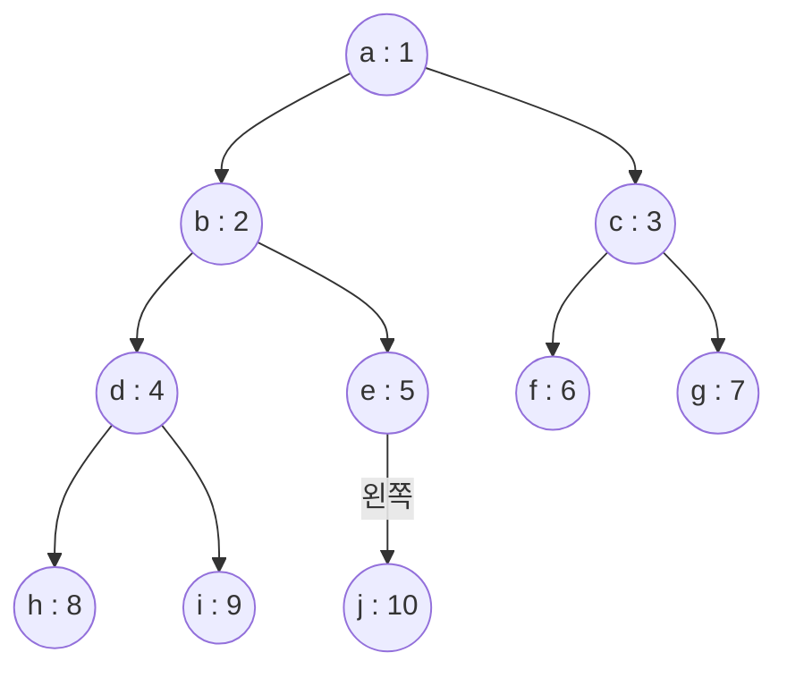
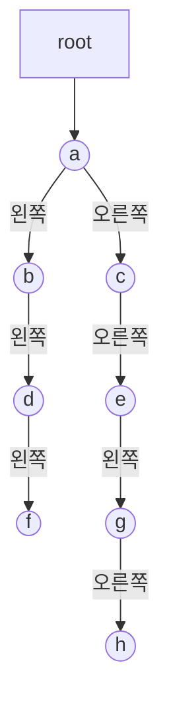


<div class="callout callout-summary" markdown="1">
<div class="callout-title callout-title--default" markdown="span">요약</div>

이진 트리를 메모리에 담는 길은 둘이다. 하나는 칸마다 번호를 정해 배열에 줄지어 넣는 것이고, 다른 하나는 칸마다 두 자식이 어디 있는지 주소를 적어 두는 것이다. 배열 쪽은 부모와 자식을 번호 계산으로 바로 찾지만, 한쪽으로 길게 늘어선 트리에서는 배열의 대부분이 빈칸이 된다. 주소를 적는 쪽은 모양이 어떻든 칸 수만큼만 메모리를 쓰지만, 칸마다 주소 둘을 더 담아야 한다.

</div>


## 예시로 보기

트리는 그림으로는 쉽게 그리지만, 메모리는 번호가 붙은 칸이 한 줄로 늘어선 것뿐이다. 그림의 선을 어떻게 적어 둘지를 정해야 한다.

**배열에 담기.** [완전 이진 트리의 번호](/Hongs_Blog/studies/data-structures/full-complete-binary-tree/)를 그대로 배열 칸 번호로 쓴다. 번호 $$i$$인 노드를 `tree[i]`에 넣는다. 0번 칸은 비워 둔다.



```
칸 번호   0   1   2   3   4   5   6   7   8   9   10
tree    [   | a | b | c | d | e | f | g | h | i | j ]
```

선은 어디에도 적지 않았다. e(5번)의 부모를 알고 싶으면 $$5 / 2 = 2$$번 칸의 b를 보고, 왼쪽 자식은 $$2 \times 5 = 10$$번 칸의 j를 본다.

**한쪽으로 치우친 트리를 배열에 담으면.** a의 오른쪽 자식이 b, b의 오른쪽 자식이 c, c의 오른쪽 자식이 d인 트리를 넣는다. 오른쪽 자식의 번호는 $$2i + 1$$이라 번호가 1, 3, 7, 15로 뛴다.

```
칸 번호   0   1   2   3   4   5   6   7   8   9   10  11  12  13  14  15
tree    [   | a | - | b | - | - | - | c | - | - | - | - | - | - | - | d ]
```

노드 4개를 담는 데 16칸을 썼다. 같은 모양으로 20개가 늘어서면 1,048,576칸이 필요하다.

**주소를 적어 담기.** 노드마다 값, 왼쪽 자식의 주소, 오른쪽 자식의 주소를 한 묶음으로 둔다. 자식이 없으면 그 자리에 `NULL`을 적는다. 예를 들면 이렇다.



노드가 8개이고 묶음도 8개다. 같은 트리를 배열에 담으면 h가 29번 칸에 놓여 30칸이 필요하다[^s1].

## 두 표현

### 배열 표현

- 번호 $$i$$인 노드는 `tree[i]`에 있다. `tree[0]`은 쓰지 않는다.
- 부모는 `tree[i / 2]`다($$i \ne 1$$). 왼쪽 자식은 `tree[2 * i]`, 오른쪽 자식은 `tree[2 * i + 1]`이다. 그 번호가 배열 끝을 넘거나 그 칸이 비어 있으면 자식이 없다.
- 좋은 점: 부모와 자식의 자리를 계산으로 바로 안다.
- 나쁜 점: 치우친 트리에서 빈칸이 많이 남는다.

노드가 $$n$$개인 이진 트리를 담는 배열의 길이는 $$n + 1$$칸에서 $$2^n$$칸 사이다. 가장 짧을 때는 완전 이진 트리다. 1번부터 $$n$$번까지 빈칸이 없고 0번 칸만 덤이다. 가장 길 때는 오른쪽으로만 내려가는 트리다. 마지막 노드의 번호가 $$2^n - 1$$이라 0번 칸까지 $$2^n$$칸이다. 왼쪽으로만 내려가면 번호가 1, 2, 4, …, $$2^{n-1}$$이라 $$2^{n-1} + 1$$칸이다[^s1].

### 연결 표현

```c
typedef struct node *treePointer;
typedef struct node {
    char data;
    treePointer leftChild, rightChild;
} node;
```

`treePointer`는 노드의 주소를 담는 [포인터](/Hongs_Blog/studies/data-structures/c-pointer/) 형이다. 노드 하나는 값 `data`와 두 자식의 주소로 이루어진다. 노드가 $$n$$개면 메모리는 $$n \times$$ (노드 하나의 크기)만큼 든다. 64비트 컴퓨터에서 이 구조체는 보통 24바이트다(글자 1바이트, 자리 맞춤용 빈 7바이트, 주소 8바이트 둘)[^s2].


`NULL`인 자식 칸은 늘 $$n + 1$$개다. 노드 $$n$$개에 자식 칸은 $$2n$$개다. 뿌리를 뺀 노드 $$n - 1$$개는 부모의 칸 하나씩이 가리키고 있다. 남는 칸이 $$2n - (n - 1) = n + 1$$개다. 위 예는 노드 8개에 `NULL`이 9개다[^s1].

### 연결 표현으로 하는 일

노드 수 세기, 높이 구하기, 복사본 만들기는 모두 "비었으면 끝, 아니면 왼쪽과 오른쪽에 같은 일을 한다"는 꼴이다.

```c
/* 노드 수: 왼쪽 개수 + 오른쪽 개수 + 자기 하나 */
int countNodes(treePointer t)
{
    if (t == NULL) return 0;
    return countNodes(t->leftChild) + countNodes(t->rightChild) + 1;
}

/* 높이(선의 수): 더 높은 쪽 부분 트리의 높이 + 1. 빈 트리는 -1 */
int height(treePointer t)
{
    if (t == NULL) return -1;
    int hl = height(t->leftChild), hr = height(t->rightChild);
    return (hl > hr ? hl : hr) + 1;
}

/* 복사본: 뿌리를 새로 만들고 두 부분 트리를 각각 복사해 붙인다 */
treePointer clone(treePointer t)
{
    if (t == NULL) return NULL;
    return makeNode(t->data, clone(t->leftChild), clone(t->rightChild));
}

/* 자식을 먼저 풀고 자기를 푼다 */
void freeTree(treePointer t)
{
    if (t == NULL) return;
    freeTree(t->leftChild);
    freeTree(t->rightChild);
    free(t);
}
```

`makeNode`는 `malloc`으로 노드 하나를 잡아 값과 두 자식 주소를 적는 함수다([동적 메모리 할당](/Hongs_Blog/studies/data-structures/dynamic-memory-allocation/)). 높이는 이 문서 모음의 표기(선의 수)로 돌려준다. 층 수로 센 높이는 여기에 1을 더한 값이고, 빈 트리에 0을 돌려주게 쓰면 된다. 위 연결 표현 예는 노드 8개, 높이 4(층 5개)다[^s3].

`freeTree`에서 `free(t)`를 맨 뒤에 두는 데는 까닭이 있다. `t`를 먼저 풀면 `t->leftChild`를 읽는 순간 이미 돌려준 메모리를 읽게 된다.

<div class="callout callout-check" markdown="1">
<div class="callout-title" markdown="span">검증: 컴파일해 실행(ASan·UBSan). 본문의 세 예(10개짜리 완전 이진 트리, 오른쪽으로 치우친 4개, 연결 표현 8개)의 배열 내용·길이·노드 수·높이·`NULL` 9개, 복사본이 원본과 메모리를 나눠 쓰지 않음, 무작위 트리 3,000개에서 연결 → 배열 → 연결이 같은 트리이고 길이가 $$n + 1$$ 이상 $$2^n$$ 이하임, 카드의 값을 확인했다. 잡은 메모리는 모두 풀었다(`leaks` 도구로 확인) — [23_binary-tree-representation_impl.c](/Hongs_Blog/studies/data-structures/code/23_binary-tree-representation_impl/)</div>

</div>


## 어느 쪽을 쓰나

| | 배열 표현 | 연결 표현 |
|---|---|---|
| 드는 칸 | (가장 큰 번호 + 1)칸. $$n + 1$$에서 $$2^n$$ 사이 | 노드 $$n$$개. 노드마다 주소 둘이 더 든다 |
| 부모 찾기 | `i / 2`로 바로 | 부모 주소를 따로 두지 않으면 뿌리에서 다시 내려와야 한다[^s3] |
| 자식 찾기 | `2 * i`, `2 * i + 1`로 바로 | 주소를 한 번 따라간다 |
| 노드를 끼우거나 떼기 | 아래 노드들의 번호가 바뀌면 값을 옮겨 적어야 한다 | 주소 몇 개만 고친다 |
| 알맞은 트리 | 늘 완전 이진 트리인 것([힙](/Hongs_Blog/studies/data-structures/max-heap/)) | 모양이 제멋대로이고 자주 바뀌는 것([이진 탐색 트리](/Hongs_Blog/studies/data-structures/bst-search-insert/)) |

[배열과 연결 리스트 비교](/Hongs_Blog/studies/data-structures/array-vs-linked-list/)와 같은 갈림이다. 자리를 계산하느냐, 자리를 적어 두느냐의 차이다.

## 연결

- 선수: [포화 이진 트리와 완전 이진 트리](/Hongs_Blog/studies/data-structures/full-complete-binary-tree/)(번호 규칙), [포인터](/Hongs_Blog/studies/data-structures/c-pointer/), [동적 메모리 할당](/Hongs_Blog/studies/data-structures/dynamic-memory-allocation/)
- 노드가 주소 하나를 갖는 경우: [단순 연결 리스트](/Hongs_Blog/studies/data-structures/singly-linked-list/). 트리 노드는 주소를 둘 갖는다.
- 연결 표현 위에서 도는 순서: [트리 순회와 이진 탐색 트리](/Hongs_Blog/studies/algorithms/tree-traversal-bst/), [레벨 순서 순회](/Hongs_Blog/studies/data-structures/level-order-traversal/)
- 배열 표현의 길이 한계가 나오는 곳: [이진 트리](/Hongs_Blog/studies/data-structures/binary-tree/)

## 확인 문제

<details class="callout callout-question" markdown="1">
<summary class="callout-title" markdown="span">**C1** a의 왼쪽 자식이 b, b의 오른쪽 자식이 c, c의 왼쪽 자식이 d인 이진 트리를 배열 표현으로 적어라. 배열은 몇 칸인가?</summary>

**답:** a는 1번, b는 $$2 \times 1 = 2$$번, c는 $$2 \times 2 + 1 = 5$$번, d는 $$2 \times 5 = 10$$번 칸이다. 0번 칸까지 11칸이고, 3·4·6·7·8·9번 칸은 빈칸이다.<br>
**이유:** 왼쪽으로 내려가면 번호가 두 배, 오른쪽으로 내려가면 두 배에 1을 더한 값이 된다. 노드는 4개인데 깊이 내려갈수록 번호가 두 배씩 뛰어 빈칸이 생긴다.

</details>


<details class="callout callout-question" markdown="1">
<summary class="callout-title" markdown="span">**C2** 본문의 연결 표현 예(a ~ h, 노드 8개)에서 `height`가 노드마다 돌려주는 값을 아래에서부터 적어라.</summary>

**답:** f는 0, d는 1, b는 2. h는 0, g는 1, e는 2, c는 3. a는 두 자식의 값 2와 3 가운데 큰 3에 1을 더한 4다.<br>
**이유:** 자식이 없는 쪽은 빈 트리라 $$-1$$을 돌려주고, 잎은 $$\max(-1, -1) + 1 = 0$$이 된다. 빈 트리를 0으로 잡으면 모든 값이 1씩 커져 층 수로 센 높이가 된다.

</details>


<details class="callout callout-question" markdown="1">
<summary class="callout-title" markdown="span">**C3** 노드가 $$n$$개인 이진 트리를 연결 표현으로 담으면 `NULL`인 자식 칸이 왜 늘 $$n + 1$$개인가?</summary>

**답:** 자식 칸은 노드마다 둘이라 모두 $$2n$$개다. 뿌리를 뺀 $$n - 1$$개의 노드는 저마다 부모의 칸 하나가 가리킨다. 그래서 주소가 든 칸이 $$n - 1$$개이고 나머지 $$2n - (n - 1) = n + 1$$개가 `NULL`이다. 트리 모양과 상관이 없다.

</details>


[^s1]: 구현 코드로 계산했다.
[^s2]: 이 문서를 확인한 컴퓨터(64비트 macOS, Apple clang)에서 `sizeof(node)`가 24였다. 컴퓨터와 컴파일러에 따라 다를 수 있다.
[^s3]: 구현 코드에서 본문의 예와 무작위 트리로 확인했다.

