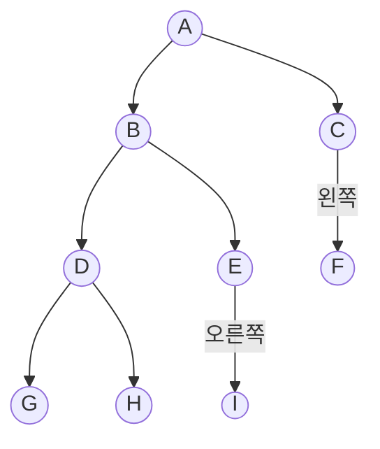


<div class="callout callout-summary" markdown="1">
<div class="callout-title callout-title--default" markdown="span">요약</div>

이진 트리는 한 칸 아래에 칸을 둘까지만 다는 가계도다. 두 자리는 "왼쪽"과 "오른쪽"으로 정해져 있어서, 자식이 하나뿐이어도 어느 쪽에 달렸는지를 따진다. 자식 자리가 둘로 정해져 있으니 컴퓨터에 담기 쉽고, 찾기와 넣기에 드는 시간은 맨 위에서 맨 아래까지 몇 층인지로 정해진다. 다만 칸 수가 같아도 한 줄로 길게 늘어설 수도 있고 층층이 꽉 찰 수도 있어서, 층수는 모양에 따라 크게 달라진다.

</div>


## 예시로 보기

회사 조직도나 폴더처럼 위아래가 있는 자료는 한 줄로 세울 수 없다. 이웃한 칸끼리 한 줄로 이어서는 "누구 밑에 누가 있는지"를 적지 못한다. 이런 모양을 트리라 부른다.

그런데 한 칸 아래에 칸이 몇 개든 달릴 수 있으면 컴퓨터에 담기가 번거롭다. 칸마다 자식 수가 달라서, 자식의 주소를 적을 자리를 몇 개 잡아야 할지 미리 알 수 없다. 자식을 둘까지만 허락하면 칸마다 자리 둘만 잡으면 된다.



동그라미 하나하나를 노드라 부른다. 맨 위의 A가 뿌리(루트)다. B와 C는 A의 자식이고, A는 둘의 부모다. 자식이 없는 G, H, I, F는 잎이다. E처럼 자식이 하나뿐이어도 그 자식이 왼쪽 자리인지 오른쪽 자리인지가 정해져 있다.

자리를 따진다는 점이 보통 트리와 다르다. 노드가 a, b 둘뿐이어도 이진 트리는 두 가지다.

```
    a            a
   /              \
  b                b
```

점 둘을 선 하나로 이은 그림으로만 보면 둘은 같다. 이진 트리로는 서로 다르다. 왼쪽 것은 b가 a의 왼쪽 자식이고, 오른쪽 것은 오른쪽 자식이다.

## 정의

<div class="callout callout-definition" markdown="1">
<div class="callout-title callout-title--default" markdown="span">정의</div>

이진 트리는 노드를 유한 개 모은 것으로, 다음 둘 가운데 하나다.
1. 비어 있다(노드가 하나도 없다).
2. 뿌리 노드 하나와, 서로 겹치는 노드가 없는 두 이진 트리로 이루어진다. 두 이진 트리를 왼쪽 부분 트리(left subtree), 오른쪽 부분 트리라 부른다.

</div>


정의 안에 "이진 트리"가 다시 나온다. 큰 트리를 뿌리와 더 작은 두 트리로 쪼개고, 작은 트리를 같은 방법으로 또 쪼개다 보면 빈 트리에 닿는다. 이런 정의를 재귀적 정의라 한다([재귀적 정의와 구조적 귀납법](/Hongs_Blog/studies/discrete-math/recursive-definitions/)).

[트리](/Hongs_Blog/studies/discrete-math/trees/) 문서의 뿌리 있는 트리와 견주면 세 가지가 다르다[^s2].

| | 뿌리 있는 트리 | 이진 트리 |
|---|---|---|
| 노드가 0개인 것 | 트리가 아니다 | 이진 트리다(빈 트리) |
| 한 노드의 자식 수 | 몇 개든 된다 | 둘까지 |
| 자식의 자리 | 따지지 않는다 | 왼쪽과 오른쪽을 구별한다 |

**같은 뜻의 다른 정의.** "뿌리 있는 트리 가운데 모든 노드의 자식이 둘 이하이고, 자식마다 '왼쪽'이나 '오른쪽' 딱지가 하나씩 붙어 있으며, 한 부모의 두 자식은 딱지가 다른 것. 여기에 빈 것을 더한다." 위 정의의 2번을 끝까지 펼치면 이 모양이 나온다. 왼쪽 부분 트리가 비어 있지 않으면 그 부분 트리의 뿌리가 '왼쪽' 딱지가 붙은 자식이다. 오른쪽도 같다[^s2].

**왜 빈 트리를 넣었나.** 빈 것도 이진 트리로 치면, 어느 노드든 부분 트리가 꼭 둘 있다(비었을 수도 있다). 그래서 트리를 다루는 함수는 "비었으면 끝, 아니면 왼쪽과 오른쪽에 같은 일을 한다"는 한 가지 꼴로 쓸 수 있다. 자식이 0개, 1개, 2개인 경우를 따로 나누지 않는다. 실제 코드는 [이진 트리의 배열 표현과 연결 표현](/Hongs_Blog/studies/data-structures/binary-tree-representation/)에 있다[^s2].

- **맞는 예.** 빈 트리. 노드 하나짜리 트리. 위 그림의 9개짜리 트리. 한쪽으로만 내려가는 트리(skewed tree).
- **아닌 예.** 자식이 셋인 노드가 있는 트리(예: 뿌리 2 아래에 4, 9, 3이 달린 트리). 부모가 둘인 칸이 있는 그림(여러 클래스를 한꺼번에 물려받는 클래스 관계).

### 할 수 있는 일

이진 트리를 [추상 자료형](/Hongs_Blog/studies/data-structures/abstract-data-type/)으로 적으면 아래와 같다. 어떻게 만드는지는 정하지 않고 무엇을 할 수 있는지만 적은 것이다.

| 연산 | 하는 일 |
|---|---|
| `Create()` | 빈 이진 트리를 만든다 |
| `IsEmpty(bt)` | 비었으면 참 |
| `MakeBT(bt1, item, bt2)` | 뿌리에 item을 두고 왼쪽에 bt1, 오른쪽에 bt2를 단 이진 트리를 만든다 |
| `Lchild(bt)` | 왼쪽 부분 트리. 비었으면 오류 |
| `Data(bt)` | 뿌리에 든 값. 비었으면 오류 |
| `Rchild(bt)` | 오른쪽 부분 트리. 비었으면 오류 |

### 층과 높이: 두 가지 세는 법

뿌리가 1층, 뿌리의 자식이 2층, 그 자식이 3층이다. 위 그림은 A가 1층, B와 C가 2층, D·E·F가 3층, G·H·I가 4층이다.

높이를 세는 법은 자료마다 다르다. 층의 수를 높이라 부르고 $$h$$로 적는 자료가 있다. 이 문서 모음은 뿌리에서 가장 먼 잎까지 내려가는 선의 수를 높이라 부른다([트리](/Hongs_Blog/studies/discrete-math/trees/)). 위 그림은 층 수로 세면 높이 4, 이 문서 모음의 표기로 높이 3이다.

아래부터는 헷갈리지 않게 층의 수를 $$L$$, 선의 수를 $$h$$로 쓴다. 늘 $$L = h + 1$$이다.

| | 이 문서 모음의 표기 $$h$$ | 층 수로 센 높이 $$L$$ |
|---|---|---|
| 세는 것 | 뿌리에서 가장 먼 잎까지의 선(간선) 수 | 층의 수 |
| 노드 하나짜리 트리 | 0 | 1 |
| 빈 트리 | $$-1$$ | 0 |
| 노드 수 $$n$$의 범위 | $$h + 1 \le n \le 2^{h+1} - 1$$ | $$L \le n \le 2^{L} - 1$$ |
| 높이의 범위 | $$\lceil \lg(n+1) \rceil - 1 \le h \le n - 1$$ | $$\lceil \lg(n+1) \rceil \le L \le n$$ |

$$\lg$$는 밑이 2인 로그이고, $$\lceil x \rceil$$는 $$x$$보다 작지 않은 가장 작은 정수(올림)다. 뿌리를 0층으로 세는 그림도 있다. 이 문서의 층 번호와 식은 뿌리를 1층으로 센다.

## 노드 수와 높이

<div class="callout callout-theorem" markdown="1">
<div class="callout-title callout-title--default" markdown="span">정리</div>

층이 $$L$$개($$L \ge 1$$)인 이진 트리의 노드 수 $$n$$은 $$L$$개 이상 $$2^L - 1$$개 이하다.

$$L \le n \le 2^L - 1$$

거꾸로, 노드가 $$n$$개($$n \ge 1$$)인 이진 트리의 층 수는 $$\lceil \lg(n+1) \rceil$$ 이상 $$n$$ 이하다.

$$\lceil \lg(n+1) \rceil \le L \le n$$

</div>


층이 4개면 노드는 4개에서 15개 사이다. 노드가 7개면 층은 3개에서 7개 사이다.

가장 적을 때는 층마다 노드가 하나씩 있는 한 줄짜리 트리다. 가장 많을 때는 층마다 들어갈 수 있는 자리가 모두 찬 트리다. 그런 트리가 [포화 이진 트리](/Hongs_Blog/studies/data-structures/full-complete-binary-tree/)다.

증명은 층별로 노드를 센다. 층마다 적어도 하나, 많아야 위층의 두 배다[^s3].

<details class="callout callout-proof" markdown="1">
<summary class="callout-title" markdown="span">증명 펼치기</summary>

1. **층마다 노드가 적어도 하나 있다.** $$k$$층($$k \ge 2$$)에 노드가 있으면 그 부모가 $$k - 1$$층에 있다. 그래서 맨 아래 $$L$$층에 노드가 있으면 $$L - 1$$층, $$L - 2$$층, …, 1층에도 있다. — 부모는 한 층 위에 있다
2. **그래서 $$n \ge L$$이다.** 층 $$L$$개에 하나씩만 세어도 $$L$$개다.
3. **$$k$$층의 노드는 많아야 $$2^{k-1}$$개다.** $$k$$에 대한 수학적 귀납법으로 보인다. 1층에는 뿌리 하나뿐이고 $$2^0 = 1$$이다. $$k$$층에 많아야 $$2^{k-1}$$개가 있다고 하자. $$k + 1$$층의 노드는 모두 $$k$$층 노드의 자식이고, 노드 하나의 자식은 둘까지다. 그래서 $$k + 1$$층에는 많아야 $$2 \times 2^{k-1} = 2^k$$개가 있다. — 이진 트리의 정의(자식 둘까지)
4. **그래서 $$n \le 2^L - 1$$이다.** 1층부터 $$L$$층까지 더하면 $$n \le 1 + 2 + 4 + \cdots + 2^{L-1} = 2^L - 1$$이다. — [등비급수](/Hongs_Blog/studies/college-math/geometric-series/)의 합
5. **거꾸로 푼다.** $$n \ge L$$에서 $$L \le n$$이다. $$n \le 2^L - 1$$에서 $$2^L \ge n + 1$$, 양쪽에 $$\lg$$를 씌우면 $$L \ge \lg(n+1)$$이다. $$L$$은 정수라서 $$L \ge \lceil \lg(n+1) \rceil$$이다. ∎

</details>


### 스스로 설명해 보기

<details class="callout callout-question" markdown="1">
<summary class="callout-title" markdown="span">1. 1단계에서 "맨 아래층에 노드가 있다"는 어디서 나오는가?</summary>

층 수 $$L$$의 뜻에서 나온다. 층이 $$L$$개라는 것은 $$L$$층에 노드가 적어도 하나 있고 그 아래에는 없다는 말이다. 그 노드에서 부모를 따라 올라가면 층마다 하나씩 만난다.

</details>


<details class="callout callout-question" markdown="1">
<summary class="callout-title" markdown="span">2. 3단계에서 2를 곱하는 근거는?</summary>

이진 트리의 정의다. 노드 하나에는 왼쪽 부분 트리와 오른쪽 부분 트리가 하나씩만 있으니 자식이 둘까지다. $$k$$층 노드가 모두 자식을 둘씩 두어도 $$k + 1$$층은 $$k$$층의 두 배다.

</details>


<details class="callout callout-question" markdown="1">
<summary class="callout-title" markdown="span">3. 5단계에서 올림 기호가 붙는 까닭은?</summary>

$$\lg(n+1)$$은 정수가 아닐 수 있고, 층 수는 정수이기 때문이다. $$n = 9$$면 $$\lg 10 \approx 3.32$$다. 층이 3개면 노드를 7개까지만 담으니 9개를 담으려면 4층이 필요하다. 3.32 이상인 가장 작은 정수가 4다.

</details>


<details class="callout callout-question" markdown="1">
<summary class="callout-title" markdown="span">이 증명의 핵심 생각은?</summary>

노드를 한꺼번에 세지 않고 층별로 나눠 센다. 한 층의 개수는 바로 위층의 개수로만 정해지니(위층의 두 배까지), 뿌리에서 한 층씩 내려가는 귀납법이 딱 맞는다.

</details>


<details class="callout callout-question" markdown="1">
<summary class="callout-title" markdown="span">같은 방법을 쓸 수 있는 다른 상황은?</summary>

자식을 셋까지 두는 트리면 층마다 세 배까지라, 층 $$L$$개에 많아야 $$1 + 3 + 9 + \cdots + 3^{L-1} = \frac{3^L - 1}{2}$$개다(4층이면 40개). [완전 이진 트리](/Hongs_Blog/studies/data-structures/full-complete-binary-tree/)에서 $$k$$층의 번호가 $$2^{k-1}$$번부터 시작한다는 것도 같은 셈에서 나온다.

</details>


<div class="callout callout-check" markdown="1">
<div class="callout-title" markdown="span">검증: 노드 0 ~ 10개인 이진 트리 모양 23,714가지를 모두 만들어 두 표기의 한계, 층마다 1개 이상 $$2^{k-1}$$개 이하, 두 끝값이 실제로 나옴, 모양의 수(노드 2개면 2가지, 3개면 5가지), 카드의 수치를 확인했다 — [21_binary-tree_verify.py](/Hongs_Blog/studies/data-structures/code/21_binary-tree_verify/)</div>

</div>


## 활용

- **높이가 곧 비용이다.** 뿌리에서 한 층씩 내려가며 일하는 연산은 층 수만큼 걸린다. [이진 탐색 트리의 탐색과 삽입](/Hongs_Blog/studies/data-structures/bst-search-insert/), [힙](/Hongs_Blog/studies/data-structures/max-heap/)의 넣기와 꺼내기가 그렇다. 위 한계는 "노드 $$n$$개로 가장 잘 만들면 약 $$\lg n$$층, 가장 못 만들면 $$n$$층"이라고 말한다. 노드 1,000개면 10층과 1,000층의 차이다.
- **"정렬된 배열만큼 빨리 찾고 연결 리스트만큼 빨리 넣는다."** 이진 트리를 이렇게 소개하기도 한다. 이 말은 값을 크기 규칙에 맞춰 넣고(이진 탐색 트리) 층 수가 $$\lg n$$ 가까이로 지켜질 때만 맞는다. 한 줄로 늘어진 트리에서는 찾기가 [연결 리스트](/Hongs_Blog/studies/data-structures/singly-linked-list/)와 같아진다.
- **담는 방법.** 배열에 담으면 한 줄짜리 트리에서 빈칸이 넘쳐 난다. 그 크기도 위 한계에서 나온다: [이진 트리의 배열 표현과 연결 표현](/Hongs_Blog/studies/data-structures/binary-tree-representation/).
- **트리가 쓰이는 곳.** 웹 문서의 구조(DOM 트리), 문장 구조를 나타내는 트리(parse tree), 클래스가 물려받는 관계가 트리다. 이 예들은 자식 수에 제한이 없는 보통 트리다.
- **흔한 실수.** 높이 식을 다른 자료에서 가져올 때 세는 법을 확인하지 않는다. "높이 $$h$$인 이진 트리의 노드는 많아야 $$2^h - 1$$개"는 층 수로 셀 때의 식이고, 선의 수로 세면 $$2^{h+1} - 1$$개다. 노드 하나짜리 트리의 높이를 그 자료가 0이라 하는지 1이라 하는지 보면 된다.

## 연결

- 선수: [트리](/Hongs_Blog/studies/discrete-math/trees/)(사이클이 없고 이어진 그래프, 높이), [재귀적 정의와 구조적 귀납법](/Hongs_Blog/studies/discrete-math/recursive-definitions/)
- 한 줄로 세우는 구조와의 차이: [선형 자료구조](/Hongs_Blog/studies/data-structures/linear-data-structure/)
- 가장 낮게 채운 모양: [포화 이진 트리와 완전 이진 트리](/Hongs_Blog/studies/data-structures/full-complete-binary-tree/)
- 모든 노드를 한 번씩 도는 순서: [트리 순회와 이진 탐색 트리](/Hongs_Blog/studies/algorithms/tree-traversal-bst/), [레벨 순서 순회](/Hongs_Blog/studies/data-structures/level-order-traversal/)
- 증명에 쓴 합: [등비급수](/Hongs_Blog/studies/college-math/geometric-series/)

## 자주 하는 오해

<div class="callout callout-misconception" markdown="1">
<div class="callout-title" markdown="span">"노드가 n개인 이진 트리의 높이는 lg n쯤이다"</div>

틀렸다. $$\lg n$$쯤은 가장 낮을 때의 값이다. 교재의 그림이 대개 고르게 퍼진 트리라서, 그리고 "트리는 로그 시간"이라는 말을 자주 들어서 그렇게 믿기 쉽다. 실제로는 한계의 양 끝이 모두 나온다. 노드 1,000개로 만든 이진 트리의 높이(선의 수)는 9부터 999까지 무엇이든 될 수 있다. 층마다 노드를 하나씩만 두면 999다. 그래서 "높이만큼 걸린다"는 연산이 빠르려면, 트리를 낮게 지키는 장치가 따로 있어야 한다. 확인하는 법: 1, 2, 3, 4, 5를 차례로 [이진 탐색 트리](/Hongs_Blog/studies/data-structures/bst-search-insert/)에 넣어 그려 본다.

</div>


## 확인 문제

<details class="callout callout-question" markdown="1">
<summary class="callout-title" markdown="span">**C1** 이진 트리의 재귀적 정의를 쓰고, 뿌리 있는 보통 트리와 다른 점 세 가지를 대라.</summary>

**답:** 이진 트리는 노드의 유한한 모임으로, 비어 있거나, 뿌리 하나와 서로 겹치지 않는 두 이진 트리(왼쪽 부분 트리, 오른쪽 부분 트리)로 이루어진다. 다른 점: 빈 것도 이진 트리다. 자식이 둘까지다. 왼쪽 자식과 오른쪽 자식을 구별한다.<br>
**이유:** 흔히 "자식이 둘 이하인 트리"까지만 쓴다. 그러면 a 아래 왼쪽에 b가 달린 것과 오른쪽에 달린 것이 같은 트리가 되어 버린다.

</details>


<details class="callout callout-question" markdown="1">
<summary class="callout-title" markdown="span">**C2** "높이 3인 이진 트리의 노드는 많아야 몇 개인가?" 층 수로 세는 표기와 이 문서 모음의 표기(선의 수)로 각각 답하라. 어떤 자료의 식이 어느 표기인지는 어떻게 가려내는가?</summary>

**답:** 층 수로 세는 표기(높이 = 층 수)로는 $$2^3 - 1 = 7$$개다. 이 문서 모음의 표기(높이 = 뿌리에서 가장 먼 잎까지의 선 수)로는 층이 4개라 $$2^4 - 1 = 15$$개다. 가려내려면 그 자료가 노드 하나짜리 트리의 높이를 1이라 하는지 0이라 하는지 본다.<br>
**이유:** 두 표기는 늘 1 차이($$L = h + 1$$)라서, 식의 지수가 $$h$$와 $$h + 1$$로 어긋난다. 지수가 하나 다르면 답은 두 배쯤 다르다.

</details>


<details class="callout callout-question" markdown="1">
<summary class="callout-title" markdown="span">**C3** 증명에서 "$$k$$층의 노드는 많아야 $$2^{k-1}$$개"를 귀납법으로 보일 때, $$k$$층에서 $$k + 1$$층으로 넘어가는 단계의 근거 두 가지는?</summary>

**답:** (1) $$k + 1$$층의 노드는 모두 $$k$$층 노드의 자식이다(부모는 한 층 위에 있다). (2) 노드 하나의 자식은 둘까지다(이진 트리의 정의). 그래서 $$k + 1$$층의 노드 수는 $$k$$층 노드 수의 두 배를 넘지 못하고, 귀납 가정 $$2^{k-1}$$에 2를 곱해 $$2^k$$가 된다.

</details>


<details class="callout callout-question" markdown="1">
<summary class="callout-title" markdown="span">**C4** 노드가 100개인 이진 트리의 층 수는 몇 개에서 몇 개 사이인가? 높이를 선의 수로 세면?</summary>

**답:** 층 수는 $$\lceil \lg 101 \rceil = 7$$개 이상 100개 이하다. $$2^6 - 1 = 63 < 100 \le 127 = 2^7 - 1$$이라 6층에는 다 못 담고 7층이면 담긴다. 선의 수로 세면 6 이상 99 이하다.<br>
**이유:** 흔한 오답은 $$\lg 100 \approx 6.64$$를 내림해 6층이라 하는 것이다. 6층짜리는 꽉 채워도 63개다.

</details>


[^s2]: 노드 둘짜리 이진 트리가 2가지, 셋짜리가 5가지인 것은 검증 코드로 세었다.
[^s3]: 3단계의 귀납법은 그 층별 개수를 풀어 쓴 것이다. 식은 검증 코드로 모든 모양(노드 10개까지)에서 확인했다.

