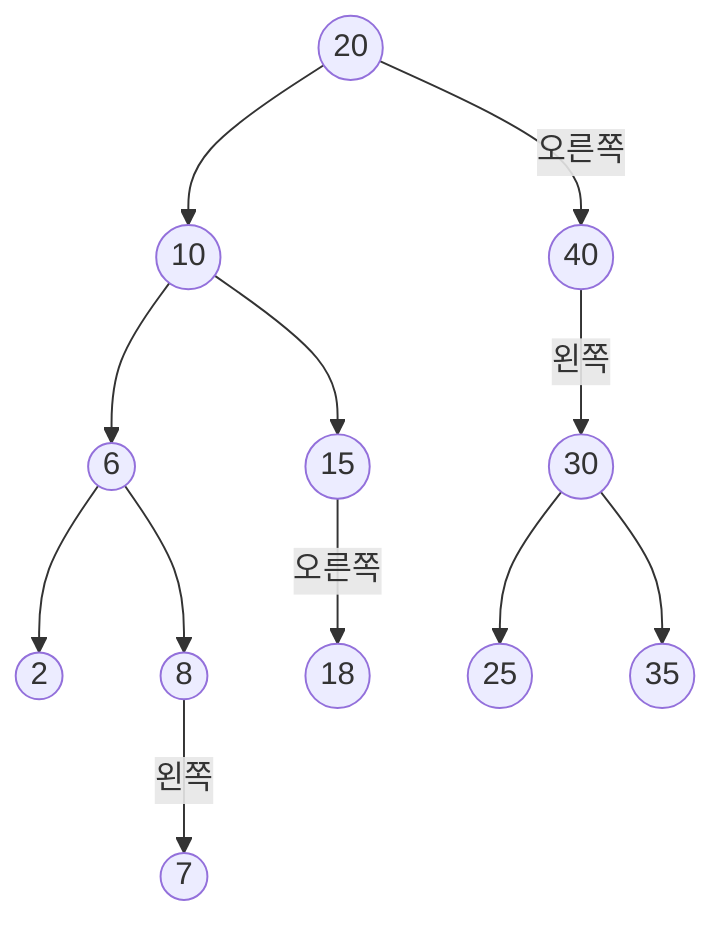


<div class="callout callout-summary" markdown="1">
<div class="callout-title callout-title--default" markdown="span">요약</div>

나무에서 값 하나를 빼되, "왼쪽은 작고 오른쪽은 크다"는 규칙이 그대로 맞게 한다. 끝에 달린 값은 그냥 떼고, 아래에 하나만 달려 있으면 그것을 빈자리에 올려 붙인다. 아래에 둘이 달려 있으면 자리는 그대로 두고, 왼쪽 아래에서 가장 큰 값을 그 자리에 옮겨 적은 뒤 그 값이 원래 있던 자리를 뗀다. 한 길만 따라 내려가므로 나무의 층 수만큼만 걸리지만, 경우를 하나라도 빠뜨리면 값이 사라지거나 순서가 깨진다.

</div>


## 예시로 보기

넣기는 늘 맨 끝 빈자리에 매달면 됐다. 지우기는 다르다. 지울 값이 나무 한가운데 있을 수 있고, 그 노드를 그냥 떼면 아래에 달린 노드들이 나무에서 떨어져 나간다. 그래서 지울 노드의 자식 수에 따라 하는 일이 달라진다.

[이진 탐색 트리의 탐색과 삽입](/Hongs_Blog/studies/data-structures/bst-search-insert/)의 나무에 18, 35, 7을 더 넣은 슬라이드의 나무다[^1].



자식이 하나뿐인 8, 15, 40에는 어느 쪽 자식인지 적었다[^s2].

이 나무에서 값을 하나씩 지워 본다. 아래 표의 줄은 모두 위 나무에서 따로 시작한 결과다[^1][^2][^3].

| 지우는 키 | 그 노드의 자식 | 하는 일 | 지운 뒤 전위 순회 |
|---|---|---|---|
| 7 | 없음(잎) | 8의 왼쪽 칸을 비운다 | 20 10 6 2 8 15 18 40 30 25 35 |
| 35 | 없음(잎) | 30의 오른쪽 칸을 비운다 | 20 10 6 2 8 7 15 18 40 30 25 |
| 40 | 하나(왼쪽 30) | 20의 오른쪽 칸이 30을 가리키게 한다 | 20 10 6 2 8 7 15 18 30 25 35 |
| 15 | 하나(오른쪽 18) | 10의 오른쪽 칸이 18을 가리키게 한다 | 20 10 6 2 8 7 18 40 30 25 35 |
| 10 | 둘(6, 15) | 왼쪽에서 가장 큰 8을 10 자리에 적고, 옛 8 노드를 뗀다 | 20 8 6 2 7 15 18 40 30 25 35 |
| 20 | 둘(10, 40) | 왼쪽에서 가장 큰 18을 뿌리에 적고, 옛 18 노드를 뗀다 | 18 10 6 2 8 7 15 40 30 25 35 |
| 99 | (나무에 없다) | 아무것도 바꾸지 않는다 | 그대로 |

전위 순회는 "자기 → 왼쪽 → 오른쪽" 순서로 읽은 것이라 나무의 모양을 그대로 보여 준다.

10을 지울 때를 보자. 10 자리에 올 값은 왼쪽 아래의 값(2, 6, 7, 8)보다는 크고, 오른쪽 아래의 값(15, 18)보다는 작아야 한다. 왼쪽 아래에서 가장 큰 8이 딱 그런 값이다. 8을 올려 적으면 남은 2, 6, 7은 모두 8보다 작고, 15와 18은 원래 10보다 컸으니 8보다도 크다. 옛 8 노드에는 왼쪽 자식 7만 달려 있어서, "자식이 하나"인 경우처럼 7을 6의 오른쪽에 올려 붙이면 끝난다.

<div class="callout callout-check" markdown="1">
<div class="callout-title" markdown="span">검증: 컴파일해 실행(ASan·UBSan). 위 표의 일곱 줄, 들르는 노드 수가 높이 + 1 이하인 것, 무작위 넣기·지우기·찾기 3,000묶음에서 연산마다 규칙이 맞고 중위 순회가 정렬된 집합 모형과 같은 것, 자식 둘 삭제 2,119번 모두에서 대신 올린 노드에 오른쪽 자식이 없던 것, malloc 횟수 = free 횟수를 확인했다 — [32_bst-delete_impl.c](/Hongs_Blog/studies/data-structures/code/32_bst-delete_impl/)</div>

</div>


## 정의

<div class="callout callout-definition" markdown="1">
<div class="callout-title" markdown="span">입력과 출력</div>

- **입력:** 이진 탐색 트리의 뿌리와 지울 키 $$x$$.
- **출력:** 키 $$x$$가 있었으면 그 키만 빠진 이진 탐색 트리. 없었으면 그대로인 나무.

</div>


지울 노드가 어떤 노드인지에 따라 네 경우로 나뉜다[^4].

| 경우 | 지울 노드 | 하는 일 |
|---|---|---|
| 1 | 그런 키가 없다 | 아무것도 하지 않는다 |
| 2 | 잎(자식 0개) | 부모가 이 노드를 가리키던 칸을 비운다 |
| 3 | 자식 1개 | 부모가 이 노드를 가리키던 칸에 그 자식을 잇는다 |
| 4 | 자식 2개 | 왼쪽 부분 트리에서 가장 큰 키를 이 노드에 옮겨 적고, 그 키가 있던 노드를 경우 2나 3으로 지운다 |

슬라이드는 자식 수를 차수(degree)라 부른다. "차수 1인 노드"가 경우 3이다. 경우 4에서는 왼쪽에서 가장 큰 키 대신 오른쪽 부분 트리에서 가장 작은 키를 써도 된다[^2].

### 코드

슬라이드에는 그림만 있고 코드가 없다. 네 경우를 그대로 옮기면 다음과 같다[^s1].

```c
/* 지웠으면 1, 그런 키가 없으면 0 */
int deleteNode(treePointer *root, int x)
{
    treePointer *link = root;
    while (*link && (*link)->key != x)              /* 찾으며 내려간다 */
        link = (x < (*link)->key) ? &(*link)->leftChild : &(*link)->rightChild;
    if (*link == NULL) return 0;                    /* 경우 1: 그런 키가 없다 */

    treePointer p = *link;                          /* 지울 노드 */
    if (p->leftChild && p->rightChild) {            /* 경우 4: 자식이 둘 */
        treePointer *maxLink = &p->leftChild;       /* 왼쪽 부분 트리에서 */
        while ((*maxLink)->rightChild)              /* 오른쪽으로 끝까지 = 가장 큰 키 */
            maxLink = &(*maxLink)->rightChild;
        p->key = (*maxLink)->key;                   /* 그 키를 올려 적는다 */
        link = maxLink;                             /* 이제 그 노드를 지운다 */
        p = *link;
    }
    /* 경우 2, 3: p의 자식은 없거나 하나다 */
    *link = p->leftChild ? p->leftChild : p->rightChild;
    free(p);
    return 1;
}
```

`link`는 "지울 노드를 가리키고 있는 칸"의 주소다. 그 칸은 부모의 `leftChild`일 수도, `rightChild`일 수도, 부른 쪽의 뿌리 변수일 수도 있다. 칸의 주소를 들고 다니면 "부모의 어느 쪽 자식이었나"와 "뿌리를 지우는 중인가"를 따로 가를 필요가 없다. `*link = …` 한 줄이 그 칸에 새 주소를 적는다([포인터](/Hongs_Blog/studies/data-structures/c-pointer/)의 이중 포인터).

40을 지울 때의 모습이다.

```
지우기 전                              지운 뒤
  20                                    20
    \  <- link는 이 칸(20의 rightChild)     \
     40  <- p                              30
    /                                     /  \
  30                                    25    35
 /  \
25    35

*link = p->leftChild;   20의 rightChild 칸에 30의 주소를 적는다
free(p);                40이 쓰던 메모리를 푼다
```

10을 지울 때는 한 번 더 내려간다.

| 단계 | 한 일 | `link`가 가리키는 칸 | 나무의 변화 |
|---|---|---|---|
| 찾기 | 20 → 10 | 20의 `leftChild` | 없음 |
| 경우 가르기 | 10의 자식은 6과 15, 둘이다 | | |
| 가장 큰 키 찾기 | 6 → 8. 8의 오른쪽이 비어 멈춘다 | `maxLink` = 6의 `rightChild` | 없음 |
| 올려 적기 | `p->key = 8` | | 10이 있던 노드의 키가 8이 된다 |
| 옛 8 노드 떼기 | `*link = ` 옛 8의 왼쪽 자식 7 | 6의 `rightChild` | 6의 오른쪽이 7이 된다 |
| 풀기 | `free(p)` | | 옛 8 노드가 사라진다 |

들른 노드는 20, 10, 6, 8의 넷이다.

## 증명

**주장.** 키가 모두 다른 이진 탐색 트리에 `deleteNode`를 부르면, 끝난 뒤의 나무도 이진 탐색 트리이고 든 키는 처음 키에서 $$x$$만 뺀 것이다.

증명은 경우를 나눠서 한다. 핵심은 경우 4에서 "가장 큰 키의 노드에는 오른쪽 자식이 없다"는 것이다[^3][^s1].

<details class="callout callout-proof" markdown="1">
<summary class="callout-title" markdown="span">증명 펼치기</summary>

이진 탐색 트리의 규칙은 "어느 노드 $$a$$를 잡아도 $$a$$의 왼쪽 부분 트리의 키는 모두 $$a$$보다 작고, 오른쪽 부분 트리의 키는 모두 $$a$$보다 크다"이다.
1. **경우 1.** 찾기가 빈자리에 닿으면 아무것도 바꾸지 않는다. 주장이 그대로 맞다. — 코드의 `return 0`
2. **경우 2(잎).** 잎을 떼면 다른 모든 노드의 부분 트리에서 키가 하나 빠지거나 그대로다. "모두 더 작다", "모두 더 크다"는 키가 빠져도 깨지지 않는다. — 규칙은 '모든 키'에 대한 조건
3. **경우 3(자식 하나).** 지울 노드를 $$p$$, 그 하나뿐인 부분 트리를 $$S$$라 하자. $$S$$ 안의 노드들은 서로의 위치가 바뀌지 않는다. $$p$$의 조상 $$a$$를 보면, $$S$$의 키들은 처음부터 $$p$$와 함께 $$a$$의 같은 쪽 부분 트리에 있었다. $$S$$를 $$p$$ 자리에 올려도 여전히 $$a$$의 그쪽에 있다. — 부분 트리의 부분 트리
4. **경우 4, 고른 노드의 모양.** $$p$$의 왼쪽 부분 트리에서 가장 큰 키를 $$m$$이라 하자. $$m$$의 노드에 오른쪽 자식이 있다면 그 키는 $$m$$보다 크고, 그 자식도 $$p$$의 왼쪽 부분 트리 안에 있다. $$m$$이 가장 크다는 것과 어긋난다. 그래서 $$m$$의 노드는 오른쪽 자식이 없다. 곧 잎이거나 왼쪽 자식 하나만 가진다. — 귀류법
5. **경우 4, 올려 적은 뒤.** $$p$$의 키를 $$m$$으로 바꾼다. $$p$$의 왼쪽 부분 트리에 남는 키는 모두 $$m$$보다 작다($$m$$이 가장 컸고 키는 모두 다르다). $$p$$의 오른쪽 부분 트리의 키는 모두 옛 키보다 크고, 옛 키는 $$m$$보다 크다($$m$$은 $$p$$의 왼쪽에 있었다). 그래서 모두 $$m$$보다 크다. $$p$$의 조상에게는 $$m$$이 처음부터 $$p$$와 같은 쪽에 있던 키다. — 최댓값의 정의, 부등호 잇기
6. **경우 4, 옛 노드 떼기.** 이제 $$m$$이 원래 있던 노드를 지운다. 4단계에 따라 그 노드는 자식이 0개나 1개라서 2단계나 3단계가 그대로 통한다. 든 키는 처음 키에서 $$x$$만 빠졌다. ∎

</details>


### 스스로 설명해 보기

<details class="callout callout-question" markdown="1">
<summary class="callout-title" markdown="span">1. 4단계에서 "그 자식도 $$p$$의 왼쪽 부분 트리 안에 있다"가 왜 필요한가?</summary>

$$m$$은 나무 전체가 아니라 $$p$$의 왼쪽 부분 트리 안에서 가장 큰 키다. 오른쪽 자식이 그 부분 트리 밖에 있다면 $$m$$보다 커도 어긋나지 않는다. 자식은 늘 부모와 같은 부분 트리에 들어 있어서 모순이 나온다.

</details>


<details class="callout callout-question" markdown="1">
<summary class="callout-title" markdown="span">2. 5단계에서 "옛 키는 $$m$$보다 크다"는 어디서 나오는가?</summary>

$$m$$은 $$p$$의 왼쪽 부분 트리에 있던 키다. 지우기 전의 나무가 이진 탐색 트리였으니, $$p$$의 왼쪽 부분 트리의 키는 모두 $$p$$의 옛 키보다 작다.

</details>


<details class="callout callout-question" markdown="1">
<summary class="callout-title" markdown="span">3. 3단계는 왜 자식이 둘일 때는 통하지 않는가?</summary>

자식이 둘이면 올려 붙일 부분 트리가 둘인데 부모의 칸은 하나다. 한쪽만 올리면 다른 쪽이 떨어져 나간다. 그래서 경우 4는 노드를 떼지 않고 키만 바꾼다.

</details>


<details class="callout callout-question" markdown="1">
<summary class="callout-title" markdown="span">이 증명의 핵심 아이디어는?</summary>

지우기 어려운 자리(자식 둘)의 문제를 지우기 쉬운 자리(자식이 하나 이하)의 문제로 바꾼다. 크기 순서에서 $$x$$ 바로 앞의 키 $$m$$은 늘 지우기 쉬운 자리에 있고, $$x$$ 자리에 들어가도 순서를 깨지 않는다.

</details>


<details class="callout callout-question" markdown="1">
<summary class="callout-title" markdown="span">이 방법을 쓸 수 있는 다른 상황은?</summary>

오른쪽 부분 트리에서 가장 작은 키($$x$$ 바로 다음 키)로 바꿔도 같은 논리가 통한다. 그 노드에는 왼쪽 자식이 없다. [힙](/Hongs_Blog/studies/data-structures/max-heap/)에서 뿌리를 꺼낼 때 맨 끝 원소를 뿌리로 옮기는 것도 같은 생각이다. 떼기 쉬운 자리의 것을 옮겨 와 구멍을 메운다.

</details>


### 복잡도

찾으며 내려가는 길과 가장 큰 키를 찾으며 내려가는 길은 이어진 한 줄이다. 뿌리에서 아래로만 가고 되돌아가지 않는다. 그래서 들르는 노드는 많아야 높이 + 1개이고, 지우기는 $$O(\text{높이})$$다[^3]. 높이는 뿌리에서 가장 먼 잎까지의 간선 수이고(강의는 층 수로 세어 1이 크다), 노드가 $$n$$개면 $$\lfloor \lg n \rfloor$$에서 $$n - 1$$ 사이다. 가장 나쁠 때는 $$O(n)$$이다. 위 나무(높이 4)에서 키를 하나씩 지워 보면 어느 키든 노드 5개 이하만 들른다.

## 활용

- 구현: [32_bst-delete_impl.c](/Hongs_Blog/studies/data-structures/code/32_bst-delete_impl/). 연습: [이진 탐색 트리 삽입·삭제 예제 사다리](/Hongs_Blog/studies/data-structures/bst-ladder/)
- **왼쪽에서 고르나, 오른쪽에서 고르나.** 둘 다 옳은 나무를 만들지만 모양은 다르다. 위 나무에서 10을 지우면 왼쪽 판은 8이, 오른쪽 판은 15가 올라온다. 20을 지우면 18과 25다. 시험에서는 문제나 수업이 정한 쪽을 따른다. 이 강의는 왼쪽에서 가장 큰 키를 쓴다[^2].
- **메모리.** 떼어 낸 노드는 그 자리에서 `free`한다. 경우 4에서 푸는 것은 지우려던 노드가 아니라 키를 내준 노드다. 지우려던 노드는 키만 바뀐 채 남는다([동적 메모리 할당](/Hongs_Blog/studies/data-structures/dynamic-memory-allocation/)).
- **흔한 실수.** 뿌리를 지울 때 뿌리 변수를 고치지 않는다. 자식이 하나일 때 왼쪽만 본다(40은 왼쪽, 15는 오른쪽 자식이 올라온다). 경우 4에서 키만 올려 적고 옛 노드를 지우지 않아 같은 키가 둘이 된다. 옛 노드의 왼쪽 자식을 버린다(8의 자식 7).
- [단순 연결 리스트](/Hongs_Blog/studies/data-structures/singly-linked-list/)에서 노드를 지울 때도 "앞 노드의 link 칸에 다음 노드를 잇고 푼다"였다. 경우 3이 같은 일이다. 나무에서는 그 칸이 부모의 두 칸 가운데 하나일 뿐이다.

## 연결

- 선수: [이진 탐색 트리의 탐색과 삽입](/Hongs_Blog/studies/data-structures/bst-search-insert/), [포인터](/Hongs_Blog/studies/data-structures/c-pointer/), [동적 메모리 할당](/Hongs_Blog/studies/data-structures/dynamic-memory-allocation/)
- 이어지는 개념: [색인 이진 탐색 트리](/Hongs_Blog/studies/data-structures/indexed-bst/). 지울 때 내려가는 길 위의 "왼쪽 노드 수"도 함께 고친다.
- 왼쪽에서 가장 큰 키는 중위 순회에서 $$x$$ 바로 앞에 나오는 키다. 세 가지 순회는 [트리 순회와 이진 탐색 트리](/Hongs_Blog/studies/algorithms/tree-traversal-bst/)에 있다.
- 증명 4단계의 방법: 반대를 가정해 어긋남을 끌어내는 귀류법([추론 규칙과 증명 방법](/Hongs_Blog/studies/discrete-math/proof-methods/))

## 자주 하는 오해

<div class="callout callout-misconception" markdown="1">
<div class="callout-title" markdown="span">"자식이 둘인 노드를 지울 때도, 왼쪽 자식을 그 자리에 올려 붙이면 된다"</div>

틀렸다. 자식이 하나일 때 통하던 방법을 그대로 쓴 것이다. 위 나무에서 10을 지우면서 왼쪽 자식 6을 10 자리에 올리면, 10의 오른쪽에 달려 있던 15와 18을 달 곳이 없다. 6의 오른쪽 칸에는 이미 8이 있기 때문이다. 그대로 두면 15와 18은 나무에서 떨어져 나가 찾을 수 없고, 풀 수도 없는 메모리가 된다. 실제로 돌려 보면 11개가 남아야 할 나무에 9개만 남는다. 그럴듯해 보이는 까닭은 6이 10보다 작아 "왼쪽은 작다"가 맞아 보이기 때문이다. 하지만 올라올 값은 오른쪽 부분 트리를 그대로 받을 수 있어야 한다. 왼쪽에서 가장 큰 키의 노드를 고르는 것은 그 값이 왼쪽 나머지보다 크고, 그 노드의 오른쪽이 비어 있어 떼기 쉽기 때문이다.

</div>


## 확인 문제

<details class="callout callout-question" markdown="1">
<summary class="callout-title" markdown="span">**C1** 빈 나무에 20, 10, 40, 6, 15, 30, 2, 8, 25, 18, 35, 7을 넣었다. 여기서 10을 지울 때 (가) 들르는 노드, (나) 값이 바뀌는 포인터 칸, (다) 지운 뒤의 전위 순회를 쓰라. 왼쪽에서 가장 큰 키를 쓴다.</summary>

**답:** (가) 20, 10, 6, 8. (나) 6의 오른쪽 칸이 옛 8 노드에서 7 노드로 바뀐다. 10이 있던 노드는 키만 8로 바뀌고 포인터는 그대로다. (다) 20 8 6 2 7 15 18 40 30 25 35.<br>
**이유:** 10의 왼쪽 부분 트리에서 오른쪽으로 끝까지 가면 8이다. 옛 8 노드는 왼쪽 자식 7 하나만 있어서 "자식 하나"의 방법으로 뗀다.

</details>


<details class="callout callout-question" markdown="1">
<summary class="callout-title" markdown="span">**C2** `*link = p->leftChild ? p->leftChild : p->rightChild;` 한 줄이 하는 일을 한 문장으로 쓰라. 이 줄이 경우 2와 경우 3을 한꺼번에 다루는 까닭도 밝혀라.</summary>

**답:** 지울 노드를 가리키던 칸에, 그 노드의 하나뿐인 자식의 주소(자식이 없으면 `NULL`)를 적어 노드를 나무에서 떼어 낸다.<br>
**이유:** 왼쪽 자식이 있으면 그것을, 없으면 오른쪽 자식을 고른다. 둘 다 없으면 오른쪽 자식 칸의 값인 `NULL`이 적힌다. 그래서 잎(칸을 비운다)과 자식 하나(자식을 올린다)가 같은 한 줄로 끝난다.

</details>


<details class="callout callout-question" markdown="1">
<summary class="callout-title" markdown="span">**C3** 증명에서 "왼쪽 부분 트리에서 가장 큰 키의 노드는 잎이거나 자식이 하나다"는 무엇에서 나오는가?</summary>

**답:** 그 노드에 오른쪽 자식이 있다면, 그 자식의 키는 더 크면서 같은 부분 트리 안에 있다. 가장 큰 키라는 것과 어긋나므로 오른쪽 자식은 없다. 남는 것은 왼쪽 자식 하나이거나 자식 없음이다.<br>
**이유:** 이 사실 덕분에 경우 4가 경우 2나 3으로 넘어간다. 이것이 빠지면 "옛 노드를 지운다"가 다시 자식 둘인 경우에 걸려 끝나지 않을 수 있다.

</details>


<details class="callout callout-question" markdown="1">
<summary class="callout-title" markdown="span">**C4** C1의 나무(10을 지우기 전)에서 20을 지운다. 왼쪽에서 가장 큰 키를 쓸 때와 오른쪽에서 가장 작은 키를 쓸 때, 각각 뿌리에 올라오는 키와 떼어 내는 노드를 쓰라.</summary>

**답:** 왼쪽 판은 18이 뿌리에 올라오고, 15의 오른쪽에 있던 옛 18 노드(잎)를 뗀다. 오른쪽 판은 25가 올라오고, 30의 왼쪽에 있던 옛 25 노드(잎)를 뗀다.<br>
**이유:** 왼쪽 부분 트리에서 오른쪽으로 끝까지 가면 10 → 15 → 18, 오른쪽 부분 트리에서 왼쪽으로 끝까지 가면 40 → 30 → 25다. 두 결과 모두 중위 순회가 2 6 7 8 10 15 … 로 커지기만 한다.

</details>


[^1]: 자료구조 9회 강의 자료 「DS_Week9_Lecture_BST_2024」, p.12~14 (잎 7·35 지우기, 차수 1인 40·15 지우기의 그림)
[^2]: 같은 자료, p.15~17 (차수 2인 10·20 지우기. "Replace with largest key in left subtree (or smallest in right subtree).")
[^3]: 같은 자료, p.16 ("Largest key must be in a leaf or degree 1 node."), p.18 ("Complexity is O(height).")
[^4]: 같은 자료, p.11 (지우기의 네 경우)
[^s1]: <span class="fn-tag" title="수업 자료에 없고 따로 보탠 내용">보충</span> 삭제 코드, `link` 설명과 두 추적 그림, 정확성 증명 여섯 단계, 스스로 설명해 보기, 99를 지우는 줄, 오른쪽 판의 결과(15, 25), 흔한 실수 목록, 오해 항목, 카드 넷은 원본에 없다. 슬라이드는 네 경우의 이름과 그림, "가장 큰 키는 잎이나 차수 1인 노드에 있다"는 한 줄, O(높이)만 준다. 코드와 수치는 구현 파일에서 모두 돌려 확인했다.
[^s2]: <span class="fn-tag" title="수업 자료에 없고 따로 보탠 내용">보충</span> 다이어그램은 슬라이드 p.12의 그림을 옮겨 그린 것이다.

