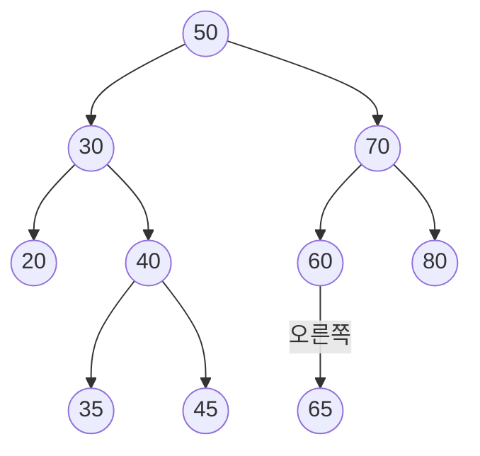


사용 개념: [이진 탐색 트리의 탐색과 삽입](/Hongs_Blog/studies/data-structures/bst-search-insert/), [이진 탐색 트리의 삭제](/Hongs_Blog/studies/data-structures/bst-delete/)의 네 경우.

"이 순서로 넣고 이 키를 지운 뒤의 나무를 그려라"는 문제는 같은 하위목표의 되풀이다. 넣기는 ① 내려가기(작으면 왼쪽, 크면 오른쪽) ② 빈자리에 매달기다. 지우기는 ① 찾기 ② 경우 가르기(자식이 0개, 1개, 2개) ③ 고치기 ④ 확인(중위 순회가 커지기만 하는가)이다. 자식이 둘이면 이 문서 모음에서는 **왼쪽 부분 트리에서 가장 큰 키**를 올린다.

나무는 `노드(왼쪽, 오른쪽)` 꼴로 적는다. `−`는 빈자리이고, 자식이 없는 노드는 괄호 없이 적는다. 답을 맞춰 볼 때는 전위 순회(자기 → 왼쪽 → 오른쪽)를 쓴다. 전위 순회와 "이진 탐색 트리다"라는 사실을 함께 알면 모양이 하나로 정해지기 때문이다[^s1].

## 문제 1 · 완전한 풀이

빈 나무에 20, 10, 40, 6, 15, 30, 2, 8, 25, 18, 35, 7을 차례로 넣고, 10을 지운다.

**넣기.**

1. *내려가기와 매달기:* 20은 뿌리가 된다. 10은 20보다 작아 왼쪽, 40은 커서 오른쪽에 달린다.
2. 6은 20 → 10으로 내려가 10의 왼쪽, 15는 10의 오른쪽, 30은 20 → 40으로 내려가 40의 왼쪽에 달린다.
3. 2는 6의 왼쪽, 8은 6의 오른쪽, 25는 30의 왼쪽에 달린다.
4. 18은 20 → 10 → 15로 내려가 15의 오른쪽, 35는 20 → 40 → 30으로 내려가 30의 오른쪽, 7은 20 → 10 → 6 → 8로 내려가 8의 왼쪽에 달린다.

넣은 뒤의 나무는 20(10(6(2, 8(7, −)), 15(−, 18)), 40(30(25, 35), −))이고 전위 순회는 20 10 6 2 8 7 15 18 40 30 25 35다.

**10 지우기.**

1. *찾기:* 20 → 10.
2. *경우 가르기:* 10의 자식은 6과 15, 둘이다.
3. *고치기:* 10의 왼쪽 부분 트리에서 오른쪽으로 끝까지 간다. 6 → 8. 8의 오른쪽이 비었으니 8이 가장 큰 키다. 10이 있던 노드의 키를 8로 고친다. 옛 8 노드는 왼쪽 자식 7 하나만 가졌으므로, 6의 오른쪽 칸에 7을 잇고 옛 8 노드를 뗀다.
4. *확인:* 나무는 20(8(6(2, 7), 15(−, 18)), 40(30(25, 35), −)), 전위 순회는 20 8 6 2 7 15 18 40 30 25 35다. 중위 순회는 2 6 7 8 15 18 20 25 30 35 40으로 커지기만 한다.

검증 — [32_bst-delete_impl.c](/Hongs_Blog/studies/data-structures/code/32_bst-delete_impl/), [32_bst-ladder_p4.c](/Hongs_Blog/studies/data-structures/code/32_bst-ladder_p4/)

## 문제 2 · 마지막 하위목표만 빈칸

빈 나무에 50, 30, 70, 20, 40, 60, 80, 35, 45, 65를 차례로 넣으면 아래 나무가 된다. 여기서 뿌리 50을 지운다.

1. *찾기:* 뿌리가 50이다.
2. *경우 가르기:* 자식이 30과 70, 둘이다.
3. *고치기:* 왼쪽 부분 트리에서 오른쪽으로 끝까지 간다. 30 → 40 → 45. 45는 잎이다. 뿌리의 키를 45로 고치고 옛 45 노드를 뗀다.
4. *확인:* 지운 뒤의 전위 순회와, 값이 바뀐 포인터 칸은? ______

답

전위 순회는 45 30 20 40 35 70 60 65 80이다. 바뀐 포인터 칸은 40의 오른쪽 칸 하나다(옛 45 노드를 가리키다가 비게 된다). 뿌리 노드는 키만 50에서 45로 바뀌고 두 자식 포인터는 그대로다. 중위 순회는 20 30 35 40 45 60 65 70 80으로 커지기만 한다. 지우는 동안 들른 노드는 50, 30, 40, 45의 넷이다.

## 문제 3 · 하위목표 절반이 빈칸

문제 2의 나무(50을 지우기 전)에서 30을 지우고, 이어서 60을 지운다.

**30 지우기.**

1. *찾기:* 50 → 30.
2. *경우 가르기:* ______
3. *고치기:* 왼쪽 부분 트리에서 가장 큰 키를 30 자리에 적고, 그 키가 있던 노드를 뗀다.
4. *확인:* ______

**60 지우기.**

1. *찾기:* 50 → 70 → 60.
2. *경우 가르기:* 자식이 오른쪽의 65 하나다.
3. *고치기:* ______
4. *확인:* 전위 순회는 50 20 40 35 45 70 65 80이다.

답

**30.** 2. 자식이 20과 40, 둘이다. 3. 왼쪽 부분 트리는 20 하나뿐이라 가장 큰 키가 20이다. 30이 있던 노드의 키를 20으로 고치고, 옛 20 노드(잎)를 뗀다. 4. 나무는 50(20(−, 40(35, 45)), 70(60(−, 65), 80))이고 전위 순회는 50 20 40 35 45 70 60 65 80이다. 새 20의 왼쪽은 비고 오른쪽은 40 그대로다. 
**60.** 3. 70의 왼쪽 칸에 65를 잇고 60 노드를 뗀다. 자식이 하나일 때는 키를 옮기지 않고 그 자식을 올려 붙인다.

검증 — [32_bst-ladder_p4.c](/Hongs_Blog/studies/data-structures/code/32_bst-ladder_p4/)

## 문제 4 · 독립 문제

빈 나무에 8, 3, 10, 1, 6, 14, 4, 7, 13을 차례로 넣는다. (가) 넣은 뒤의 나무와 높이(뿌리에서 가장 먼 잎까지의 간선 수)를 쓰라. (나) 3을 지우고 이어서 8을 지운 뒤의 전위 순회와 높이를 쓰라. (다) 같은 두 번의 지우기를 "오른쪽 부분 트리에서 가장 작은 키"로 하면 전위 순회가 어떻게 되는가? 두 결과 가운데 틀린 것이 있는가?

답

(가) 8(3(1, 6(4, 7)), 10(−, 14(13, −))). 전위 순회 8 3 1 6 4 7 10 14 13, 높이 3. 강의처럼 층 수로 세면 4다. 
(나) 3의 왼쪽 부분 트리는 1 하나라 1이 올라온다: 8(1(−, 6(4, 7)), 10(−, 14(13, −))). 이어서 8을 지운다. 왼쪽 부분 트리에서 오른쪽으로 끝까지 가면 1 → 6 → 7이고 7은 잎이다. 7이 뿌리에 올라오고 6의 오른쪽이 빈다. 나무는 7(1(−, 6(4, −)), 10(−, 14(13, −))), 전위 순회는 7 1 6 4 10 14 13, 높이는 그대로 3이다. 8을 지울 때 들른 노드는 8, 1, 6, 7의 넷이다. 
(다) 3을 지울 때 오른쪽 부분 트리 6(4, 7)에서 가장 작은 4가 올라온다. 8을 지울 때는 오른쪽 부분 트리의 가장 작은 키가 10이다(10에는 왼쪽 자식이 없다). 10이 뿌리에 올라오고, 옛 10 노드의 오른쪽 자식 14가 그 자리로 올라 붙는다. 나무는 10(4(1, 6(−, 7)), 14(13, −)), 전위 순회는 10 4 1 6 7 14 13이다. 둘 다 틀리지 않았다. 두 나무 모두 중위 순회가 1 4 6 7 10 13 14로 같고 커지기만 한다. 모양만 다르다.

검증 — [32_bst-ladder_p4.c](/Hongs_Blog/studies/data-structures/code/32_bst-ladder_p4/)

[^s1]: 모든 답은 문제 코드로 확인했다.

