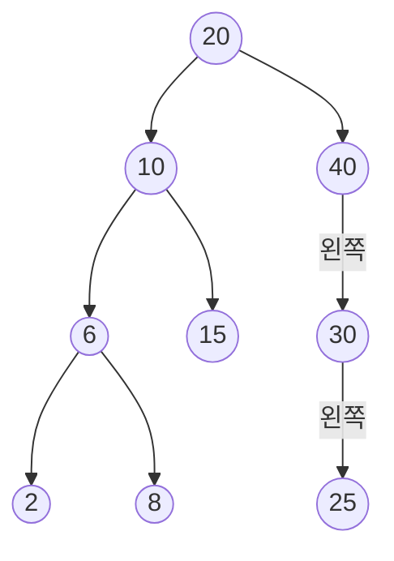


<div class="callout callout-summary" markdown="1">
<div class="callout-title callout-title--default" markdown="span">요약</div>

갈림길마다 "찾는 값이 여기 값보다 작으면 왼쪽, 크면 오른쪽"으로만 내려가는 나무다. 찾기는 뿌리에서 한 길만 따라 내려가면 끝나고, 넣기는 그렇게 내려가다 길이 끊긴 빈자리에 새 값을 매다는 일이다. 그래서 두 일 모두 나무의 층 수만큼만 걸린다. 다만 값이 크기 순서대로 들어오면 나무가 한 줄로 늘어져, 처음부터 끝까지 다 보는 것과 같아진다.

</div>


## 예시로 보기

정렬해 둔 배열에서는 가운데를 보고 반을 버리는 식으로 빨리 찾는다([이분 탐색](/Hongs_Blog/studies/algorithms/binary-search/)). 그런데 가운데에 값 하나를 끼우려면 뒤의 값을 모두 한 칸씩 밀어야 한다. 연결 리스트는 포인터만 바꿔 끼우지만, 찾을 때는 앞에서부터 하나씩 본다([배열과 연결 리스트 비교](/Hongs_Blog/studies/data-structures/array-vs-linked-list/)). "반씩 버리며 찾기"와 "포인터만 바꿔 끼우기"를 함께 얻으려고 만든 것이 이 나무다[^s1].

빈 나무에 20, 10, 40, 6, 15, 30, 2, 8, 25를 차례로 넣으면 아래 나무가 된다.



자식이 둘이면 왼쪽 자식을 왼쪽에 그렸다. 자식이 하나뿐인 40과 30에는 어느 쪽 자식인지 적었다.

어느 노드를 잡아도, 그 왼쪽 아래에 달린 값은 모두 더 작고 오른쪽 아래에 달린 값은 모두 더 크다. 20의 왼쪽 아래(10, 6, 15, 2, 8)는 모두 20보다 작고, 오른쪽 아래(40, 30, 25)는 모두 20보다 크다. 그래서 값을 찾을 때 한쪽은 통째로 안 봐도 된다.

**8 찾기와 28 찾기.** 뿌리에서 시작해 지금 노드의 키와 견준다.

| 찾는 값 | 들르는 노드 | 견준 결과 | 끝 |
|---|---|---|---|
| 8 | 20 → 10 → 6 → 8 | 8 < 20 왼쪽, 8 < 10 왼쪽, 8 > 6 오른쪽, 같다 | 노드 4개를 보고 찾았다 |
| 28 | 20 → 40 → 30 → 25 | 28 > 20 오른쪽, 28 < 40 왼쪽, 28 < 30 왼쪽, 28 > 25 오른쪽 | 25의 오른쪽이 비어 있다. 없다 |

**35, 7, 18 넣기.** 넣기는 찾기와 같은 길을 내려간다. 길이 끊긴 자리가 새 노드의 자리다.

| 넣는 값 | 내려간 길 | 붙는 자리 |
|---|---|---|
| 35 | 20 → 40 → 30 | 30의 오른쪽 |
| 7 | 20 → 10 → 6 → 8 | 8의 왼쪽 |
| 18 | 20 → 10 → 15 | 15의 오른쪽 |

28을 찾다가 멈춘 자리(25의 오른쪽)가 바로 28을 넣을 자리다. 찾기가 실패한 곳과 넣을 곳이 같다는 것이 넣기 코드의 뼈대다.

<div class="callout callout-check" markdown="1">
<div class="callout-title" markdown="span">검증: 컴파일해 실행(ASan·UBSan). 예시 나무의 모양과 위 두 표, 찾기·넣기가 들르는 노드 수가 높이 + 1 이하인 것, 무작위 연산 3,000묶음에서 중위 순회가 정렬된 집합 모형과 같은 것, malloc 횟수 = free 횟수를 확인했다 — [30_bst-search-insert_impl.c](/Hongs_Blog/studies/data-structures/code/30_bst-search-insert_impl/)</div>

</div>


## 정의

이진 탐색 트리는 다음 넷을 지키는 [이진 트리](/Hongs_Blog/studies/data-structures/binary-tree/)다.

1. 노드마다 (키, 값) 쌍을 하나 가진다.
2. 키는 모두 다르다.
3. 어느 노드 $$x$$를 잡아도, $$x$$의 왼쪽 부분 트리에 든 키는 모두 $$x$$의 키보다 작다.
4. 어느 노드 $$x$$를 잡아도, $$x$$의 오른쪽 부분 트리에 든 키는 모두 $$x$$의 키보다 크다.

기호로 쓰면, 노드 $$x$$의 키를 $$\text{key}(x)$$, 왼쪽·오른쪽 부분 트리의 노드 집합을 $$L(x)$$, $$R(x)$$라 할 때 모든 노드 $$x$$에 대해

$$\forall y \in L(x):\ \text{key}(y) < \text{key}(x), \qquad \forall z \in R(x):\ \text{key}(z) > \text{key}(x).$$


$$\forall$$은 "모든"으로 읽는다. 조건이 바로 아래 자식 하나가 아니라 부분 트리 **전체**에 걸려 있다는 점이 중요하다(아래 오해).

연산은 넷이다: 비었는지 묻기 `IsEmpty()`, 찾기 `Search(key)`, 넣기 `Insert(key, value)`, 지우기 `Delete(key)`. 이 넷을 가진 것을 사전이라 부르고, 무엇을 하는지만 정한 이런 목록이 [추상 자료형](/Hongs_Blog/studies/data-structures/abstract-data-type/)이다. 지우기는 [이진 탐색 트리의 삭제](/Hongs_Blog/studies/data-structures/bst-delete/)에서 다룬다.

**같은 키를 어떻게 다루나.** 자료마다 정의가 다르다.

| 자료 | 같은 키 | 오른쪽 부분 트리의 조건 | 이미 있는 키를 또 넣으면 |
|---|---|---|---|
| 이 문서 | 없다. 키는 모두 다르다 | 모두 더 **크다** | 아무 일도 하지 않는다 |
| [트리 순회와 이진 탐색 트리](/Hongs_Blog/studies/algorithms/tree-traversal-bst/) | 있어도 된다 | **크거나 같다** | 오른쪽으로 내려가 노드가 하나 더 생긴다 |

이 문서와 코드는 첫 줄의 정의를 쓴다. 두 정의에서 달라지는 것은 중위 순회 결과다. 이 문서 쪽은 늘 커지기만 하고, 알고리즘 문서 쪽은 같은 값이 나란히 나올 수 있다.

## 코드

노드는 키 하나와 두 자식을 가리키는 포인터로 만든다([이진 트리의 배열 표현과 연결 표현](/Hongs_Blog/studies/data-structures/binary-tree-representation/)).

```c
typedef struct node *treePointer;
typedef struct node {
    int key;
    treePointer leftChild, rightChild;
} node;
```

**찾기: 재귀 판과 반복 판.** 둘은 같은 길을 내려간다.

```c
treePointer search(treePointer t, int x)          /* 재귀 판 */
{
    if (t == NULL) return NULL;            /* 빈자리에 닿았다: 없다 */
    if (x == t->key) return t;             /* 찾았다 */
    if (x < t->key) return search(t->leftChild, x);
    return search(t->rightChild, x);
}

treePointer iterSearch(treePointer t, int x)      /* 반복 판 */
{
    while (t) {
        if (x == t->key) return t;
        if (x < t->key) t = t->leftChild;
        else t = t->rightChild;
    }
    return NULL;
}
```


**넣기.** 먼저 넣을 자리의 부모를 찾는다. `modifiedSearch`는 찾기와 똑같이 내려가되, 마지막으로 들른 노드를 기억해 돌려준다. 키가 이미 있거나 나무가 비었으면 `NULL`을 돌려준다.

```c
treePointer modifiedSearch(treePointer t, int x)
{
    treePointer last = NULL;
    while (t) {
        if (x == t->key) return NULL;          /* 이미 있다 */
        last = t;                              /* 마지막으로 들른 노드 */
        t = (x < t->key) ? t->leftChild : t->rightChild;
    }
    return last;
}

int insertNode(treePointer *root, int x)       /* 넣었으면 1, 이미 있으면 0 */
{
    treePointer temp = modifiedSearch(*root, x);
    if (temp == NULL && *root != NULL) return 0;   /* 이미 있다 */
    treePointer ptr = malloc(sizeof(*ptr));        /* 노드 하나 크기 */
    if (ptr == NULL) { fprintf(stderr, "메모리가 모자란다\n"); exit(1); }
    ptr->key = x;
    ptr->leftChild = ptr->rightChild = NULL;
    if (*root == NULL) *root = ptr;                /* 빈 트리: 새 노드가 뿌리 */
    else if (x < temp->key) temp->leftChild = ptr;
    else temp->rightChild = ptr;
    return 1;
}
```

`root`가 포인터의 주소(`treePointer *`)인 까닭은 빈 나무에 첫 노드를 넣을 때 부른 쪽의 뿌리 변수 자체를 바꿔야 해서다([포인터 인자와 값 전달](/Hongs_Blog/studies/data-structures/pointer-parameters/)). 다 쓴 나무는 노드마다 `free`로 풀어 준다([동적 메모리 할당](/Hongs_Blog/studies/data-structures/dynamic-memory-allocation/)).


## 넣기가 높이만큼만 걸리는 까닭

넣기의 복잡도는 $$O(\text{높이})$$다. 넣기가 하는 일이 둘뿐이기 때문이다.

1. **자리 찾기.** `modifiedSearch`는 뿌리에서 한 층에 노드 하나씩만 들르며 내려간다. 옆으로 가거나 되돌아가지 않는다. 그래서 들르는 노드는 많아야 "높이 + 1"개다.
2. **매달기.** 새 노드를 만들어 부모의 포인터 한 칸에 적는다. 나무 크기와 상관없이 몇 줄이면 끝난다.

여기서 높이는 뿌리에서 가장 먼 잎까지의 간선 수다. 층 수로 세는 자료에서는 1이 더 크다(노드 하나짜리 나무가 이 문서 모음의 표기로는 0, 층 수로는 1). 위 그림의 나무는 높이 3이고, 찾기든 넣기든 노드를 4개까지만 본다.

그러면 높이는 얼마나 되나. 노드가 $$n$$개일 때 높이 $$h$$는 넣는 순서에 따라 달라진다[^s1].

$$\lfloor \lg n \rfloor \le h \le n - 1$$


$$\lfloor\ \rfloor$$는 소수점 아래를 버린다는 표시이고, $$\lg$$는 밑이 2인 [로그](/Hongs_Blog/studies/college-math/logarithm/)다. 왼쪽은 층마다 꽉 채웠을 때, 오른쪽은 한 줄로 늘어졌을 때다([이진 트리](/Hongs_Blog/studies/data-structures/binary-tree/)의 노드 수 한계를 뒤집은 식이다).

- 1, 2, …, 1,000을 이 순서로 넣으면 새 값이 늘 가장 커서 오른쪽으로만 내려간다. 높이가 999가 되고, 1,000을 찾으려면 노드 1,000개를 다 본다. 넣는 동안 들른 노드를 모두 더하면 $$0 + 1 + \dots + 999 = 499{,}500$$개다.
- 1부터 1,023까지를 가운데 값(512)부터 넣으면 높이가 9다. 어떤 값이든 10개만 보면 찾는다.

그래서 찾기를 $$O(\text{높이}) = O(n)$$이라고 적기도 한다. 높이가 가장 나쁠 때 $$n - 1$$이라는 뜻이다. $$O$$는 "많아야 그 정도로 자란다"는 표기다([점근 표기](/Hongs_Blog/studies/discrete-math/asymptotic-notation/)).

## 활용

- **사전 연산의 비용.** $$n$$은 들어 있는 원소 수다.

| 자료구조 | 가장 나쁠 때 | 기대되는 값 |
|---|---|---|
| 해시 테이블 | $$O(n)$$ | $$O(1)$$ |
| 이진 탐색 트리 | $$O(n)$$ | $$O(\log n)$$ |
| 균형 이진 탐색 트리 | $$O(\log n)$$ | $$O(\log n)$$ |

이진 탐색 트리의 "기대되는 값"은 키가 뒤섞인 순서로 들어올 때의 평균이다[^s1]. 높이가 늘 $$\log n$$ 근처에 머물도록 넣을 때마다 모양을 고치는 나무가 균형 이진 탐색 트리다. 이 문서 모음에서는 그 만드는 법을 다루지 않는다. 해시 테이블은 [해시 테이블의 홈 버킷과 충돌](/Hongs_Blog/studies/data-structures/hash-table-terms/)부터 다룬다.

- **크기 순으로 모두 읽기.** 중위 순회(왼쪽 → 자기 → 오른쪽)를 하면 키가 작은 것부터 나온다. 노드마다 한 번씩 들르므로 $$O(n)$$이다. `Ascend()` 연산이 이것이다. 해시 테이블은 이 일을 못 한다.
- **쓰는 곳.** C++ 표준 라이브러리의 `std::map`과 `std::set`은 보통 균형 이진 탐색 트리로 만든다[^s1]. 키를 크기 순서로 훑거나 "어떤 값 이상인 가장 작은 키"를 물을 일이 있을 때 고른다.
- **흔한 실수.** 노드를 잡을 때 `malloc(sizeof(포인터))`처럼 포인터 크기만큼만 잡는다. 포인터는 8바이트인데 노드는 키 하나와 포인터 둘로 24바이트라, `ptr->leftChild`에 쓰는 순간 잡은 곳 밖을 건드린다. 매개변수 이름이 `node`인 함수 안에서 `sizeof(node)`라고 쓰면 구조체가 아니라 그 매개변수(포인터)의 크기가 나와 이 실수가 생긴다. `malloc(sizeof(*ptr))`로 쓰면 이름과 상관없이 노드 하나 크기가 나온다[^s3]. 빈 나무일 때 뿌리를 바꾸지 않는다. 이미 정렬된 자료를 그대로 넣어 한 줄짜리 나무를 만든다.
- 연습: [이진 탐색 트리 삽입·삭제 예제 사다리](/Hongs_Blog/studies/data-structures/bst-ladder/), [트리와 힙 문제 풀이](/Hongs_Blog/studies/data-structures/week9-inclass/)

## 연결

- 선수: [이진 트리](/Hongs_Blog/studies/data-structures/binary-tree/), [이진 트리의 배열 표현과 연결 표현](/Hongs_Blog/studies/data-structures/binary-tree-representation/), [포인터 인자와 값 전달](/Hongs_Blog/studies/data-structures/pointer-parameters/)
- 이어지는 개념: [이진 탐색 트리의 삭제](/Hongs_Blog/studies/data-structures/bst-delete/), [색인 이진 탐색 트리](/Hongs_Blog/studies/data-structures/indexed-bst/)
- 헷갈리는 개념: [최대 힙과 이진 탐색 트리 비교](/Hongs_Blog/studies/data-structures/heap-vs-bst/). 힙은 "부모가 자식보다 크다"만 지키고 왼쪽·오른쪽은 가리지 않는다.
- 같은 생각의 다른 모습: [이분 탐색](/Hongs_Blog/studies/algorithms/binary-search/)은 정렬된 배열에서 가운데를 보고 반을 버린다. 이진 탐색 트리는 그 "가운데"를 노드로, "왼쪽 반"과 "오른쪽 반"을 두 부분 트리로 굳혀 둔 것이다. 파이썬으로 쓴 판과 세 가지 순회는 [트리 순회와 이진 탐색 트리](/Hongs_Blog/studies/algorithms/tree-traversal-bst/)에 있다.

## 자주 하는 오해

<div class="callout callout-misconception" markdown="1">
<div class="callout-title" markdown="span">"노드마다 왼쪽 자식이 더 작고 오른쪽 자식이 더 크면 이진 탐색 트리다"</div>

틀렸다. 조건은 바로 아래 자식 둘이 아니라 부분 트리 전체에 걸려 있다. 10의 왼쪽 자식이 5이고, 5의 오른쪽 자식이 15인 나무를 보자. 10과 5, 5와 15만 보면 모두 규칙에 맞는다. 그런데 15는 10의 왼쪽 부분 트리에 있으면서 10보다 크다. 이 나무에서 15를 찾으면 10에서 오른쪽으로 가서 빈자리를 만나고 "없다"고 답한다. 그럴듯해 보이는 까닭은 그림에서 부모와 자식만 눈에 들어오기 때문이다. 옳게 확인하려면 위에서 내려오며 "이 자리에 올 수 있는 키의 범위"를 좁혀 간다. 뿌리의 왼쪽으로 내려가면 위쪽 끝이 뿌리의 키로, 오른쪽으로 내려가면 아래쪽 끝이 뿌리의 키로 바뀐다. 15는 "10보다 작아야 하는 자리"에 놓여 있어 걸린다.

</div>


범위를 넘기며 확인할 때는 처음 범위를 잡는 법도 조심한다. 양 끝을 `-32768`과 `32767`처럼 정해 둔 수로 넘기면, 키가 `int`라서 그 밖의 값도 들어와 틀린다. 10의 오른쪽 자식이 40000인 올바른 나무를 "아니다"라고 판정한다. 처음에는 "끝이 없다"를 따로 나타내야 한다. 범위의 끝을 포인터로 넘기고 `NULL`이면 그쪽 끝이 없다고 보면 된다. 풀이 전체는 [트리와 힙 문제 풀이](/Hongs_Blog/studies/data-structures/week9-inclass/)에 있다.


## 확인 문제

<details class="callout callout-question" markdown="1">
<summary class="callout-title" markdown="span">**C1** 빈 이진 탐색 트리에 20, 10, 40, 6, 15, 30, 2, 8, 25를 넣은 나무에서 (가) 15를 찾을 때 들르는 노드, (나) 28을 넣을 때 `modifiedSearch`가 돌려주는 노드와 28이 붙는 자리를 쓰라.</summary>

**답:** (가) 20 → 10 → 15, 세 노드. (나) 20 → 40 → 30 → 25로 내려가 25의 오른쪽이 비어 있으므로 25를 돌려준다. 28 > 25라서 25의 오른쪽 자식이 된다.<br>
**이유:** 넣기는 찾기와 같은 길을 가고, 찾기가 실패한 빈자리가 곧 넣을 자리다.

</details>


<details class="callout callout-question" markdown="1">
<summary class="callout-title" markdown="span">**C2** `modifiedSearch`가 하는 일을 한 문장으로 쓰라. `NULL`을 돌려주는 두 경우도 밝혀라.</summary>

**답:** 찾기와 같은 길을 내려가 "새 키를 매달 부모 노드"를 돌려준다. 키가 이미 있을 때와 나무가 비어 있을 때는 `NULL`을 돌려준다.<br>
**이유:** `insertNode`는 이 둘을 `*root`가 `NULL`인지로 가른다. 나무가 비었으면 새 노드를 뿌리로 삼고, 비지 않았는데 `NULL`이면 이미 있는 키라 넣지 않는다.

</details>


<details class="callout callout-question" markdown="1">
<summary class="callout-title" markdown="span">**C3** 넣기 한 번이 $$O(\text{높이})$$인 까닭을 쓰고, 노드 $$n$$개에서 그 높이가 가장 커지는 입력을 하나 들어라.</summary>

**답:** 자리 찾기는 뿌리에서 한 층에 노드 하나씩만 들러 많아야 높이 + 1개를 보고, 매달기는 포인터 한 칸만 바꾼다. 1, 2, …, $$n$$처럼 커지는(또는 작아지는) 순서로 넣으면 한 줄이 되어 높이가 $$n - 1$$이다.<br>
**이유:** 높이는 $$\lfloor \lg n \rfloor$$에서 $$n - 1$$ 사이다. 그래서 가장 나쁠 때는 $$O(n)$$, 층이 고르게 차면 $$O(\log n)$$이다.

</details>


<details class="callout callout-question" markdown="1">
<summary class="callout-title" markdown="span">**C4** 이미 20이 든 나무에 20을 또 넣는다. 이 문서의 정의와 [트리 순회와 이진 탐색 트리](/Hongs_Blog/studies/algorithms/tree-traversal-bst/)의 정의에서 각각 어떻게 되는가? 중위 순회 결과는 어떻게 다른가?</summary>

**답:** 이 문서의 정의는 키가 모두 달라야 하므로 넣지 않는다(`insertNode`가 0을 돌려준다). 알고리즘 문서의 정의는 오른쪽 부분 트리가 "크거나 같다"이므로 오른쪽으로 내려가 20이 하나 더 생긴다. 중위 순회는 앞쪽이 늘 커지기만 하고, 뒤쪽은 20이 두 번 나란히 나온다.<br>
**이유:** 정의가 "더 크다"인지 "크거나 같다"인지에 따라 같은 키가 갈 방향이 정해진다. 답을 쓸 때는 그 자료가 쓰는 정의를 따른다.

</details>


[^s1]: 수치와 반례는 구현 코드로 확인했다.
[^s3]: 문법만 고치고 그 줄을 둔 채 ASan으로 돌리면 `heap-buffer-overflow`(8바이트 영역에 쓰기)가 난다.

