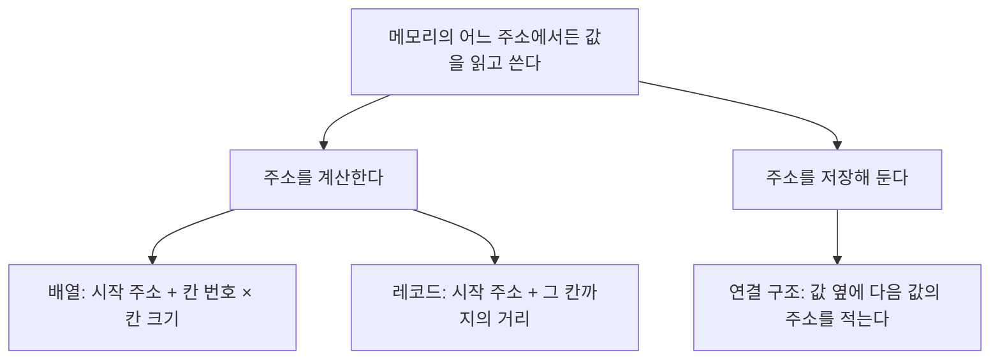


<div class="callout callout-summary" markdown="1">
<div class="callout-title callout-title--default" markdown="span">요약</div>

책을 책장에 꽂는 방법이 여럿이듯, 값을 컴퓨터 메모리에 놓는 방법도 여럿이다. 번호 순으로 빈틈없이 꽂으면 37번 책을 곧장 뽑지만, 가운데에 새 책을 끼우려면 뒤의 책을 모두 밀어야 한다. 책마다 "다음 책은 저기 있다"는 쪽지를 끼워 두면 아무 데나 꽂아도 되고 끼우기도 쉽지만, 37번 책을 찾으려면 첫 책부터 쪽지를 따라가야 한다. 자료구조는 값을 놓는 모양과 그 모양에서 값을 넣고 찾고 빼는 방법을 함께 정한 것이고, 어떤 일을 자주 하느냐에 따라 알맞은 모양이 달라진다.

</div>


## 예시로 보기

값이 하나면 변수 하나로 끝난다. 값이 많아지면 "세 번째 값은 어디 있지?"에 답할 방법이 있어야 한다. 그 방법은 크게 둘이다.

메모리는 번호가 붙은 칸이 한 줄로 늘어선 것이다. 이 번호를 주소라고 부른다. 값 다섯 개 a, b, c, d, e를 두 가지로 놓아 본다[^s1].

**나란히 놓기.** 100번지부터 4바이트짜리 칸에 차례로 넣는다.

```
주소    100    104    108    112    116
      [  a ] [  b ] [  c ] [  d ] [  e ]
```

세 번째 값 c는 앞에 두 칸이 있으니 $$100 + 2 \times 4 = 108$$번지에 있다. 곱셈과 덧셈 한 번으로 자리를 안다.

**흩어 놓고 다음 자리를 적어 두기.** 값을 아무 빈자리에나 넣고, 값 옆에 다음 값이 있는 주소를 함께 적는다.

```
주소      200         208         216          224         232
      [ c | 224 ] [ a | 232 ] [ e | 없음 ] [ d | 216 ] [ b | 200 ]
        값  다음

처음 = 208
```

208번지에서 시작해 적힌 주소를 따라가면 a → b → c → d → e 순서가 된다. 세 번째 값 c를 찾으려면 208 → 232 → 200으로 두 번 따라가야 한다. 대신 a와 b 사이에 새 값을 끼울 때는 아무 빈자리에 넣고 적힌 주소 두 개만 고치면 된다.

<div class="callout callout-check" markdown="1">
<div class="callout-title" markdown="span">검증: 100번지 배열의 2번 칸이 108번지인 것과 레코드 칸의 위치를 C로 컴파일해 실행(ASan·UBSan)해 확인했다 — [05_array-pointer_impl.c](/Hongs_Blog/studies/data-structures/code/05_array-pointer_impl/)</div>

</div>


## 정의

자료구조는 값을 다루기 좋게 짜 놓고, 관리하고, 저장하는 틀이다. 목적은 값을 빠르게 읽고 고치는 것이다.

자료구조에 든 것은 셋으로 나뉜다.

| 든 것 | 예시에서 |
|---|---|
| 값들의 모음 | a, b, c, d, e |
| 값들 사이의 관계 | "a 다음은 b"라는 순서 |
| 값에 쓸 수 있는 연산 | k번째 값 찾기, 사이에 끼우기, 빼기 |

값만 모아 둔 것은 자료구조가 아니다. 관계를 어떻게 적어 두는지, 그 위에서 어떤 연산을 하는지까지 정해야 자료구조다.

흔히 드는 예는 다음 다섯이다[^s2].

- 배열(array)
- 연결 리스트(linked list)
- 레코드(record): 종류가 다른 값 몇 개를 한 덩어리로 묶은 것이다. C에서는 `struct`로 만든다.
- 공용체(union): 같은 자리를 여러 타입 가운데 하나로 골라 쓰는 것이다. C에서는 `union`으로 만든다.
- 객체(object): 값과 그 값을 다루는 함수를 함께 묶은 것이다.

### 만드는 두 가지 길

컴퓨터는 메모리의 어느 자리에서든 값을 가져오고 넣을 수 있다. 자료구조는 모두 이 능력 위에 서 있다. 원하는 값의 주소를 어떻게 알아내느냐에 따라 길이 둘로 갈린다.



- **주소를 계산하는 구조.** 배열과 레코드다. 산술 연산으로 주소를 구한다. 배열은 예시의 "나란히 놓기"다. 레코드도 같다. 연·월·일을 `int` 셋으로 묶은 레코드가 200번지에서 시작하면 일은 앞의 두 칸을 지난 $$200 + 8 = 208$$번지에 있다[^s2].
- **주소를 저장하는 구조.** 연결 구조다. 구조 안에 다른 값의 주소를 넣어 둔다. 예시의 "흩어 놓기"가 이것이다. 주소를 담는 변수가 [포인터](/Hongs_Blog/studies/data-structures/c-pointer/)다.

두 갈래는 주소가 나오는 곳이 다르다. 왼쪽은 식에서 나오고, 오른쪽은 메모리에 적어 둔 값에서 나온다.

자료구조를 만든다는 것은 보통 함수 한 묶음을 쓰는 일이다. 그 구조를 하나 새로 만드는 함수와, 만들어진 구조를 다루는 함수들이다. 예시의 "k번째 값 찾기", "사이에 끼우기"가 각각 함수 하나가 된다.

## 활용

- 두 길은 잘하는 일이 다르다. 주소를 계산하는 쪽은 k번째 값을 곧장 찾지만 가운데에 끼우고 빼기가 느리다. 주소를 저장하는 쪽은 반대다. 둘을 나란히 놓은 비교는 [배열과 연결 리스트 비교](/Hongs_Blog/studies/data-structures/array-vs-linked-list/)에 있다.
- "빠르다"와 "느리다"는 일을 몇 번 하는지 세어서 말한다: [연산 횟수와 단계 수 세기](/Hongs_Blog/studies/data-structures/operation-step-count/)
- 무엇을 할 수 있는지만 먼저 정하고, 어떤 모양으로 만들지는 나중에 고를 수도 있다: [추상 자료형](/Hongs_Blog/studies/data-structures/abstract-data-type/)

## 연결

- 주소를 계산하는 구조: [배열과 포인터](/Hongs_Blog/studies/data-structures/array-pointer/), [행 우선 배치와 열 우선 배치](/Hongs_Blog/studies/data-structures/row-major-mapping/)
- 주소를 저장하는 구조: [단순 연결 리스트](/Hongs_Blog/studies/data-structures/singly-linked-list/)
- 한 줄로 늘어선 구조와 그렇지 않은 구조: [선형 자료구조](/Hongs_Blog/studies/data-structures/linear-data-structure/)

## 확인 문제

<details class="callout callout-question" markdown="1">
<summary class="callout-title" markdown="span">**C1** 자료구조를 이루는 세 가지는 무엇인가? 값 다섯 개 a, b, c, d, e를 순서대로 담는 경우로 하나씩 예를 들라.</summary>

**답:** 값들의 모음(a, b, c, d, e), 값들 사이의 관계("a 다음은 b"라는 순서), 값에 쓸 수 있는 연산(k번째 찾기, 끼우기, 빼기).<br>
**흔한 오답:** "값을 모아 둔 것"만 쓰는 것. 관계와 연산이 빠지면 값 모음일 뿐이다.

</details>


<details class="callout callout-question" markdown="1">
<summary class="callout-title" markdown="span">**C2** 다음을 "주소를 계산해서 찾는 것"과 "저장해 둔 주소를 따라가는 것"으로 가르라. (가) `int` 배열의 7번 칸 읽기 (나) 연·월·일 레코드에서 일 읽기 (다) 연결 리스트에서 다음 값으로 가기</summary>

**답:** 계산: (가), (나). 따라가기: (다).<br>
**이유:** (가)는 시작 주소에 7 × 칸 크기를 더한다. (나)는 시작 주소에 일까지의 거리를 더한다. 둘 다 산술 한 번이다. (다)는 지금 값 옆에 적힌 주소를 읽어야 다음 자리를 안다.

</details>


<details class="callout callout-question" markdown="1">
<summary class="callout-title" markdown="span">**C3** 나란히 놓은 구조에서 k번째 값의 주소를 계산 한 번으로 구할 수 있으려면 무엇이 지켜져야 하는가? 그 조건 때문에 불편해지는 일은 무엇인가?</summary>

**답:** 칸의 크기가 모두 같고 칸들이 빈틈없이 이어져 있어야 한다. 그래서 가운데에 값을 끼우거나 빼면 뒤의 값을 모두 한 칸씩 옮겨야 한다.<br>
**이유:** "시작 + k × 칸 크기"는 앞의 k칸이 모두 같은 크기로 붙어 있을 때만 맞는다. 사이에 빈칸을 두거나 순서를 어기면 식이 틀린 자리를 가리킨다.

</details>


[^s1]: 주소 계산은 05번 문서의 구현 코드로 확인했다.
[^s2]: 풀이는 C의 `struct`와 `union`의 뜻(Kernighan·Ritchie, *The C Programming Language* 2판, 6장)을 따랐다.

