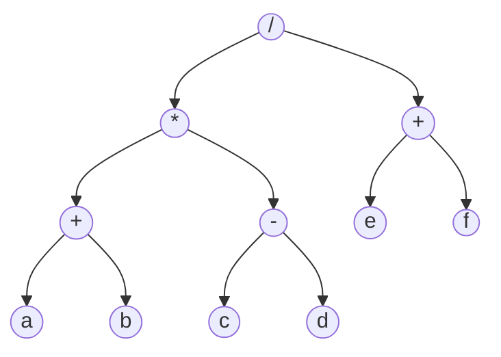


<div class="callout callout-summary" markdown="1">
<div class="callout-title callout-title--default" markdown="span">요약</div>

계산식을 트리로 그리면, 더하기나 곱하기 같은 기호는 가지가 갈라지는 칸에 놓이고 숫자나 변수는 맨 끝 칸에 놓인다. 어느 계산을 먼저 하는지가 트리의 모양에 그대로 담겨서 괄호가 필요 없다. 이 트리를 세 가지 순서로 읽으면 같은 식을 적는 세 가지 방법이 나온다. 다만 우리가 늘 쓰는 "기호를 두 값 사이에 두는" 방법만은, 괄호를 치거나 곱셈을 덧셈보다 먼저 한다는 약속이 있어야 원래 식으로 되돌아간다.

</div>


## 예시로 보기

`x = A / B - C`를 계산하려면 어느 것을 먼저 할지 정해야 한다. $$A = 6$$, $$B = 3$$, $$C = 2$$일 때 두 가지로 읽을 수 있다.

```
   (A / B) - C = 0           A / (B - C) = 6

         -                         /
        / \                       / \
       /   C                     A   -
      / \                           / \
     A   B                         B   C
```

글자를 왼쪽에서 오른쪽으로 읽으면 둘 다 `A / B - C`다. 그런데 값은 0과 6으로 다르다. 한 줄로 적은 식에는 "무엇을 먼저 하는가"가 빠져 있고, 트리에는 그것이 모양으로 들어 있다. 아래쪽에 있는 계산이 먼저다.

한 줄로 적은 식에서 빠진 정보는 두 가지 약속으로 채운다.

- 연산마다 우선순위를 정하고, 우선순위가 높은 것을 먼저 계산한다.
- 우선순위가 같으면 왼쪽 것부터 계산한다. 값 앞에 붙는 연산(부호 `-`, `!` 등)은 오른쪽 것부터 계산한다.

`/`의 우선순위가 `-`보다 높으니 `A / B - C`는 왼쪽 트리, 곧 0으로 읽는다.

## 수식 트리와 세 표기

**수식 트리**는 식 하나를 나타내는 이진 트리다. 잎에는 계산에 쓰이는 값(피연산자)을, 잎이 아닌 노드에는 연산 기호(연산자)를 둔다. 연산자 노드의 왼쪽 부분 트리가 그 연산의 왼쪽 식이고, 오른쪽 부분 트리가 오른쪽 식이다[^s1].

아래 수식 트리는 $$\dfrac{(a + b) \times (c - d)}{e + f}$$를 나타낸다.



이 트리를 세 가지 순서로 순회하면 세 가지 표기가 나온다([트리 순회와 이진 탐색 트리](/Hongs_Blog/studies/algorithms/tree-traversal-bst/)).

| 순회 | 읽은 결과 | 표기 이름 | 연산자의 자리 |
|---|---|---|---|
| 전위 (뿌리 → 왼쪽 → 오른쪽) | `/ * + a b - c d + e f` | 전위 표기(prefix) | 두 값 앞 |
| 중위 (왼쪽 → 뿌리 → 오른쪽) | `a + b * c - d / e + f` | 중위 표기(infix). 괄호를 쳐야 같은 식이다 | 두 값 사이 |
| 후위 (왼쪽 → 오른쪽 → 뿌리) | `a b + c d - * e f + /` | 후위 표기(postfix) | 두 값 뒤 |

세 결과에서 a, b, c, d, e, f의 차례는 같다. 연산자의 자리만 다르다.

중위 순회 결과를 괄호 없이 그대로 적으면 다른 식이 된다. `a + b * c - d / e + f`를 우선순위 약속대로 읽으면 $$a + (b \times c) - (d / e) + f$$다. $$a = 8, b = 4, c = 6, d = 3, e = 2, f = 4$$를 넣으면 트리의 값은 $$(12 \times 3) / 6 = 6$$인데, 괄호 없는 줄의 값은 $$8 + 24 - 1.5 + 4 = 34.5$$다. 그래서 중위 표기로 같은 식을 적으려면 순회하면서 부분 트리마다 괄호로 싼다. 그러면 `(((a+b)*(c-d))/(e+f))`가 된다. 꼭 필요한 괄호만 남기면 `(a + b) * (c - d) / (e + f)`다. 무작위 식 1,000개 가운데 602개에서 괄호 없는 중위 표기가 트리와 다른 값을 냈다[^s1].


전위 표기와 후위 표기에는 괄호가 필요 없다. 후위 표기에서 연산자는 "바로 앞에 완성된 식 둘"에 쓰인다. `a b + c d - *`에서 `*` 앞에 완성된 식은 `a b +`와 `c d -`뿐이라 다르게 읽을 길이 없다[^s1].

**꼭 필요한 괄호만 치는 규칙.** 연산자 노드의 왼쪽 자식이 우선순위가 더 낮은 연산자면 왼쪽 식을 괄호로 싼다. 오른쪽 자식이 우선순위가 낮거나 같은 연산자면 오른쪽 식을 괄호로 싼다. 오른쪽에서 "같은" 경우까지 싸는 까닭은 뺄셈과 나눗셈 때문이다. $$9 - (5 - 2) = 6$$이고 $$9 - 5 - 2 = 2$$다[^s1].

### 우선순위 표

숫자가 클수록 먼저 계산한다.

| 기호 | 연산 | 우선순위 | 같은 순위끼리 |
|---|---|---|---|
| `( )` `[ ]` `->` `.` | 함수 호출, 배열 원소, 구조체·공용체의 멤버 | 17 | 왼쪽부터 |
| `--` `++` (값 뒤에 붙는 것) | 감소, 증가 | 16 | 왼쪽부터 |
| `--` `++` (값 앞에 붙는 것), `!`, 부호 `-` `+` | 감소·증가, 논리 부정, 부호 | 15 | 오른쪽부터 |
| `(type)` | 형 변환 | 14 | 오른쪽부터 |
| `*` `/` `%` | 곱셈, 나눗셈, 나머지 | 13 | 왼쪽부터 |
| `+` `-` | 덧셈, 뺄셈 | 12 | 왼쪽부터 |

## 예제

### 식을 후위 표기로 바꾸기

`a * (b + c) - d / e`를 후위 표기로 바꾼다.

1. *마지막에 하는 연산을 찾는다.* 괄호 밖에서 우선순위가 가장 낮은 것은 `-`다. 이것이 뿌리다.
2. *왼쪽 식과 오른쪽 식을 같은 방법으로 쪼갠다.* 왼쪽 `a * (b + c)`의 뿌리는 `*`이고, 그 오른쪽 자식이 `+`(자식 b, c)다. 오른쪽 `d / e`의 뿌리는 `/`다.
3. *후위 순회한다.* `a b c + * d e / -`.

전위 순회하면 `- * a + b c / d e`다[^s2].

### 후위 표기를 계산하기

후위 표기는 [스택](/Hongs_Blog/studies/data-structures/array-stack/) 하나로 왼쪽부터 한 번 읽으며 계산한다. 값을 만나면 스택에 넣는다. 연산자를 만나면 스택에서 둘을 꺼내 계산하고 결과를 다시 넣는다. 먼저 꺼낸 것이 오른쪽 값이다[^s2].

`a b + c d - * e f + /`에 $$a = 8, b = 4, c = 6, d = 3, e = 2, f = 4$$를 넣는다.

| 읽은 것 | 스택 (바닥 → 꼭대기) |
|---|---|
| a | 8 |
| b | 8, 4 |
| + | 12 |
| c | 12, 6 |
| d | 12, 6, 3 |
| - | 12, 3 |
| * | 36 |
| e | 36, 2 |
| f | 36, 2, 4 |
| + | 36, 6 |
| / | 6 |

끝났을 때 스택에 하나 남은 값이 답이다. 트리로 보면 "두 자식의 값이 나온 뒤에 자기 연산을 한다"는 후위 순회의 차례 그대로다.

<div class="callout callout-check" markdown="1">
<div class="callout-title" markdown="span">검증: 예시의 0과 6, 위 수식 트리의 세 표기, 괄호 없는 중위 표기의 값 34.5, 위 스택 표, 예제와 카드의 답을 확인했다. 무작위 수식 트리 1,000개에서 트리로 계산한 값, 전위 표기로 계산한 값, 후위 표기로 계산한 값, 괄호를 친 중위 표기를 우선순위 표대로 계산한 값이 분수로 정확히 같았다 — [25_expression-tree_verify.py](/Hongs_Blog/studies/data-structures/code/25_expression-tree_verify/)</div>

</div>


## 활용

- **이 기법을 떠올리는 신호.** 한 줄로 적은 식에서 계산 순서를 따져야 한다. 괄호 없이 식을 적거나 기계가 왼쪽부터 한 번만 읽으며 계산하게 해야 한다.
- **컴파일러.** 컴파일러는 프로그램의 식을 트리로 바꾼 뒤 후위 순서로 돌며 코드를 만든다: [추상 구문 트리](/Hongs_Blog/studies/compilers/abstract-syntax-tree/). `A / B - C`처럼 트리가 둘 나올 수 있는 문법을 우선순위 약속으로 하나로 정하는 일은 [모호한 문법](/Hongs_Blog/studies/compilers/ambiguous-grammar/)에서 다룬다.
- **전위·후위 표기는 한 줄만으로 트리가 정해진다.** 보통의 이진 트리는 순회 결과 하나로는 모양을 알 수 없다([순회 결과로 이진 트리 되살리기](/Hongs_Blog/studies/data-structures/tree-from-traversals/)). 수식 트리는 연산자 노드의 자식이 꼭 둘이고 값은 꼭 잎이라는 것을 미리 알기 때문에, 전위 표기 한 줄로 트리가 하나로 정해진다[^s1].
- **흔한 실수.** 중위 순회 결과를 괄호 없이 적는다. 후위 표기를 계산할 때 꺼낸 두 값의 좌우를 바꾼다. `a b -`는 $$a - b$$다. 먼저 꺼낸 b가 오른쪽이다.

## 연결

- 선수: [이진 트리](/Hongs_Blog/studies/data-structures/binary-tree/), [트리 순회와 이진 탐색 트리](/Hongs_Blog/studies/algorithms/tree-traversal-bst/)(세 순회), [배열로 만든 스택](/Hongs_Blog/studies/data-structures/array-stack/)
- 스택의 뜻과 괄호 짝 맞추기: [스택](/Hongs_Blog/studies/algorithms/stack/)
- 순회 결과에서 트리를 되살리는 일반 문제: [순회 결과로 이진 트리 되살리기](/Hongs_Blog/studies/data-structures/tree-from-traversals/)

## 확인 문제

<details class="callout callout-question" markdown="1">
<summary class="callout-title" markdown="span">**C1** `a * (b + c) - d / e`의 수식 트리에서 뿌리는 무엇인가? 전위 표기와 후위 표기를 쓰라.</summary>

**답:** 뿌리는 `-`다. 왼쪽 자식은 `*`(자식 a와 `+`), 오른쪽 자식은 `/`(자식 d와 e)다. 전위 표기는 `- * a + b c / d e`, 후위 표기는 `a b c + * d e / -`다.<br>
**이유:** 뿌리는 가장 나중에 하는 계산이다. 흔한 오답은 맨 앞에 나오는 `*`를 뿌리로 잡는 것이다. $$a = 2, b = 3, c = 4, d = 10, e = 5$$를 넣으면 $$2 \times 7 - 2 = 12$$다.

</details>


<details class="callout callout-question" markdown="1">
<summary class="callout-title" markdown="span">**C2** 후위 표기에는 왜 괄호가 필요 없는가?</summary>

**답:** 후위 표기에서 연산자는 바로 앞에 완성된 식 둘을 차지한다. 왼쪽부터 읽으며 값을 쌓아 두면, 연산자를 만났을 때 어느 둘에 쓸지가 "맨 위의 둘"로 정해져 있다. 계산 순서가 연산자가 놓인 자리에 이미 들어 있어서 괄호로 알려 줄 것이 없다.<br>
**이유:** 중위 표기에서는 `a - b - c`의 가운데 b가 앞 연산의 오른쪽 값일 수도, 뒤 연산의 왼쪽 값일 수도 있다. 후위 표기로는 두 경우가 `a b - c -`와 `a b c - -`로 다르게 적힌다.

</details>


<details class="callout callout-question" markdown="1">
<summary class="callout-title" markdown="span">**C3** 괄호 없는 중위 표기는 같은데 값이 다른 수식 트리 두 개를 만들고, 값을 넣어 다름을 보여라.</summary>

**답:** $$(a - b) - c$$와 $$a - (b - c)$$. 둘 다 중위 순회하면 `a - b - c`다. $$a = 9, b = 5, c = 2$$면 앞의 것은 2, 뒤의 것은 6이다. 본문의 $$(A / B) - C$$와 $$A / (B - C)$$도 된다.<br>
**이유:** 중위 순회는 연산자가 어느 부분 트리의 뿌리였는지를 지운다. 괄호나 우선순위 약속이 그 정보를 되살린다.

</details>


[^s1]: 검증 코드에서 무작위 식 1,000개로 확인했다.
[^s2]: 스택으로 계산하는 방법은 널리 알려진 것이며 검증 코드로 확인했다.

