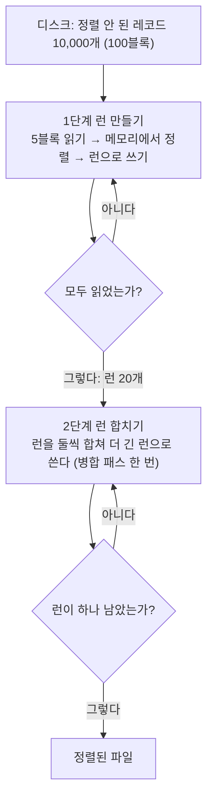



요약

창고에 책이 만 권 있는데 작업 책상에는 한 번에 오백 권만 올릴 수 있을 때 쓰는 정리법이다. 책상에 올릴 수 있는 만큼씩 가져와 정리해서 묶음으로 창고에 돌려놓고, 그 묶음들을 둘씩 합치기를 한 묶음이 남을 때까지 되풀이한다. 창고를 오가는 걸음이 책상 위에서 손을 놀리는 일보다 훨씬 느리다. 그래서 걸리는 시간은 묶음을 합치려고 자료 전체를 몇 번 훑느냐에 달려 있고, 처음 묶음이 많을수록 그 횟수가 는다.

## 예시로 보기

지금까지의 정렬은 자료가 모두 메모리의 배열에 들어 있다고 보았다(내부 정렬). 자료가 메모리보다 크면 배열에 담을 수조차 없다. 디스크에 둔 채로 조금씩 읽어 정렬해야 한다. 이것이 외부 정렬이다. 가장 빠른 내부 정렬 방법을 고쳐서 쓰는데, 평균이 가장 좋은 것은 퀵 정렬이고 가장 나쁜 경우가 가장 좋은 것은 병합 정렬이다[^1]. 외부 정렬은 병합 정렬 쪽을 고친다.

슬라이드의 상황은 이렇다[^2].

- 정렬할 레코드(한 건의 자료)는 10,000개다.
- 메모리에는 한 번에 500개만 들어간다.
- 디스크는 한 번에 한 블록씩 읽고 쓴다. 한 블록에 레코드 100개가 들어간다. 그래서 자료 전체는 100블록, 메모리는 5블록 크기다.

시간은 세 가지 단위로 센다[^2].

| 기호 | 뜻 |
|---|---|
| $$t_{IO}$$ | 블록 하나를 읽거나 쓰는 시간. 디스크 머리를 옮기는 시간(seek), 원판이 돌아오기를 기다리는 시간(latency), 자료를 옮기는 시간을 모두 넣은 것 |
| $$t_{IS}$$ | 메모리를 가득 채운 레코드(500개)를 메모리 안에서 정렬하는 시간 |
| $$t_{IM}$$ | 메모리 안에서 병합해 한 블록(100개) 분량을 만들어 내는 시간 |

## 정의

정렬은 두 단계다[^3].

런(run)은 정렬된 레코드의 줄이다. 1단계는 메모리에 들어가는 만큼씩 정렬해 런을 만들고, 2단계는 [병합 정렬](/Hongs_Blog/studies/data-structures/merge-sort/)의 합치기로 런을 이어 붙인다[^s2].

### 1단계: 런 만들기

5블록을 읽고, 정렬하고, 런 하나로 쓴다. 이 일을 20번 한다[^4].

| 한 일 | 시간 |
|---|---|
| 5블록 읽기 | $$5t_{IO}$$ |
| 메모리에서 정렬 | $$t_{IS}$$ |
| 런으로 5블록 쓰기 | $$5t_{IO}$$ |
| 위를 20번 | $$200t_{IO} + 20t_{IS}$$ |

끝나면 디스크에 5블록짜리 런 R1, …, R20이 있다.

### 2단계: 런 합치기

**두 런을 합치는 법.** 메모리를 입력 버퍼 두 개와 출력 버퍼 하나로 나눈다. 버퍼는 블록을 잠깐 담아 두는 칸이다[^5].

1. 입력 버퍼 0에 R1의 첫 블록을, 입력 버퍼 1에 R2의 첫 블록을 읽어 온다.
2. 두 입력 버퍼의 맨 앞끼리 견주어 작은 레코드를 출력 버퍼로 옮긴다.
3. 출력 버퍼가 가득 차면 디스크에 쓰고 비운다.
4. 입력 버퍼가 비면 그 런의 다음 블록을 읽어 온다.

런은 합쳐서 1,000개인데 메모리에는 500개만 들어간다. 그래도 되는 까닭은 합치기가 두 줄의 맨 앞만 보기 때문이다. 블록 하나씩만 메모리에 있으면 된다.

**패스.** 런을 둘씩 짝지어 모두 합치는 한 바퀴를 병합 패스라 부른다. 한 패스에서는 (짝이 없는 하나를 빼고) 모든 런이 둘씩 합쳐진다. 20개가 10개가 되고, 네 번 더 하면 1개가 된다[^6].

| 패스 | 합치기 전 런 | 합친 뒤 런 | 런 하나의 길이 |
|---|---|---|---|
| 1 | R1~R20 (20개) | S1~S10 (10개) | 10블록 |
| 2 | S1~S10 (10개) | T1~T5 (5개) | 20블록 |
| 3 | T1~T5 (5개) | U1~U3 (3개) | 40, 40, 20블록 |
| 4 | U1~U3 (3개) | V1, V2 (2개) | 80, 20블록 |
| 5 | V1, V2 (2개) | W1 (1개) | 100블록 |

패스 3에서 T5는 짝이 없어 U3로 그대로 내려가고, 패스 4에서도 V2로 그대로 내려간다[^7].

### 시간 계산

| 무엇 | 읽기 | 쓰기 | 병합 | 합 |
|---|---|---|---|---|
| R1과 R2 합치기(5블록씩) | $$10t_{IO}$$ | $$10t_{IO}$$ | $$10t_{IM}$$ | $$20t_{IO} + 10t_{IM}$$ |
| 패스 1: 10쌍 | | | | $$200t_{IO} + 100t_{IM}$$ |
| S1과 S2 합치기(10블록씩) | $$20t_{IO}$$ | $$20t_{IO}$$ | $$20t_{IM}$$ | $$40t_{IO} + 20t_{IM}$$ |
| 패스 2: 5쌍 | | | | $$200t_{IO} + 100t_{IM}$$ |
| 어느 패스든 | $$100t_{IO}$$ | $$100t_{IO}$$ | $$100t_{IM}$$ | $$200t_{IO} + 100t_{IM}$$ |

패스가 지날수록 런은 길어지고 쌍의 수는 준다. 그래서 한 패스의 시간은 늘 같다. 어느 패스든 100블록을 모두 읽고, 모두 쓰고, 모두 병합한다[^8].

패스의 수는 런의 수가 반씩 줄어 1이 될 때까지의 횟수다. 처음 런이 $$r$$개면 $$\lceil \log_2 r \rceil$$번이다. $$\lceil\ \rceil$$는 올림이다. $$\log_2 20 \approx 4.32$$이므로 5번이다($$2^4 = 16$$으로는 모자라고 $$2^5 = 32$$면 넉넉하다)[^9].

$$\text{합치기 전체} = (\text{한 패스의 시간}) \times \lceil \log_2 (\text{처음 런의 수}) \rceil = (200t_{IO} + 100t_{IM}) \times 5 = 1{,}000t_{IO} + 500t_{IM}$$

두 단계를 더하면 $$1{,}200t_{IO} + 20t_{IS} + 500t_{IM}$$이다[^s1].

검증: 레코드 10,000개로 디스크 블록 읽기·쓰기를 흉내 내어 세었다. 런 20개, 런 만들기 $$200t_{IO} + 20t_{IS}$$, R1·R2 합치기 $$20t_{IO} + 10t_{IM}$$, 런 수 20 → 10 → 5 → 3 → 2 → 1, 패스마다 $$200t_{IO} + 100t_{IM}$$, 끝난 파일이 정렬되어 있음. 패스 수가 $$\lceil \log_k r \rceil$$인 것은 $$r \le 300$$, $$k \le 10$$ 전부 — [45_external-merge-sort_verify.py](/Hongs_Blog/studies/data-structures/code/45_external-merge-sort_verify/)

"어느 패스든 100블록"은 짝이 없는 런도 읽어서 다시 쓴다고 볼 때의 값이다. 짝 없는 런을 손대지 않고 두면 패스 3과 4는 80블록만 읽고 써서 $$160t_{IO} + 80t_{IM}$$이고, 합치기 전체는 $$920t_{IO} + 460t_{IM}$$으로 조금 준다. 슬라이드의 식은 위쪽으로 넉넉히 잡은 값이다[^s1].

### 시간을 줄이는 길

전체 시간을 정하는 것은 다음과 같다[^10].

| 단계 | 시간 | 시간을 정하는 것 |
|---|---|---|
| 런 만들기 | $$200t_{IO} + 20t_{IS}$$ | 내부 정렬 시간, 읽고 쓰는 시간 |
| 런 합치기 | $$(200t_{IO} + 100t_{IM}) \times \lceil \log_2 20 \rceil$$ | 내부 병합 시간, 읽고 쓰는 시간, 처음 런의 수, 한 번에 합치는 런의 수 |

슬라이드가 드는 방법을 묶으면 셋이다[^11].

- **읽기, 쓰기, 메모리 안의 일을 겹쳐서 한다.** 읽는 디스크와 쓰는 디스크를 따로 두면, 디스크가 움직이는 동안 메모리에서 정렬이나 병합을 할 수 있다. 런 만들기와 런 합치기 모두에 쓴다.
- **런을 길게 만든다.** 평균 길이가 메모리 크기보다 긴 런을 만든다. 처음 런의 수를 줄이는 것과 같고, 런이 줄면 패스가 준다.
- **패스의 수를 줄인다.** 한 번에 둘이 아니라 여러 런을 합친다: [k-way 병합과 선택 트리](/Hongs_Blog/studies/data-structures/k-way-merge/).

## 예제

**작은 자료로 끝까지 따라가기.** 레코드 16개 9, 4, 7, 1, 8, 2, 6, 3, 5, 16, 10, 13, 12, 11, 15, 14를 메모리 4개, 블록 2개로 정렬한다[^s1].

1. *런 만들기.* 4개씩 읽어 정렬한다. R1 = (1, 4, 7, 9), R2 = (2, 3, 6, 8), R3 = (5, 10, 13, 16), R4 = (11, 12, 14, 15). 런마다 2블록을 읽고 2블록을 쓰므로 $$16t_{IO} + 4t_{IS}$$다.
2. *패스 1.* S1 = (1, 2, 3, 4, 6, 7, 8, 9), S2 = (5, 10, 11, 12, 13, 14, 15, 16). 8블록을 읽고 8블록을 쓴다. $$16t_{IO} + 8t_{IM}$$.
3. *패스 2.* 1부터 16까지가 차례로 놓인 런 하나가 된다. $$16t_{IO} + 8t_{IM}$$.
4. *합.* $$48t_{IO} + 4t_{IS} + 16t_{IM}$$. 패스는 $$\lceil \log_2 4 \rceil = 2$$번이다.

## 활용

- 모의실험 코드: [45_external-merge-sort_verify.py](/Hongs_Blog/studies/data-structures/code/45_external-merge-sort_verify/). 연습: [외부 정렬 시간 계산 예제 사다리](/Hongs_Blog/studies/data-structures/external-sort-ladder/)
- 계산 문제의 순서는 늘 같다. 블록 수와 런 수를 구하고, 런 만들기 시간을 구하고, 한 패스의 시간에 패스 수를 곱한다.
- 흔한 실수: 패스 수를 $$\log_2 20 = 4.32$$에서 내려서 4로 쓰는 것. 4번 합치면 런이 2개 남는다. 올림해야 한다.

## 연결

- 선수: [병합 정렬](/Hongs_Blog/studies/data-structures/merge-sort/)(두 줄 합치기와 병합 패스), [로그](/Hongs_Blog/studies/college-math/logarithm/)(반씩 줄여 1이 될 때까지의 횟수)
- $$t_{IO}$$ 안에 든 디스크 머리 옮기기와 회전 기다리기: [디스크 스케줄링](/Hongs_Blog/studies/operating-systems/disk-scheduling/). 레코드를 블록에 묶어 담는 방법: [레코드 블로킹](/Hongs_Blog/studies/operating-systems/record-blocking/)
- 퀵 정렬이 아니라 병합 정렬을 고치는 까닭: [퀵 정렬과 병합 정렬 비교](/Hongs_Blog/studies/data-structures/quick-vs-merge-sort/)

## 확인 문제

**C1** 처음 런이 10개다. 둘씩 합치는 패스를 되풀이할 때 패스마다 런의 수가 어떻게 변하는지 쓰고, 짝이 없어 그대로 내려가는 런이 생기는 패스를 짚어라.

**답:** 10 → 5 → 3 → 2 → 1. 패스는 4번이다. 둘째 패스(5개 → 3개)와 셋째 패스(3개 → 2개)에서 런 하나가 짝 없이 내려간다. 
**이유:** $$\lceil \log_2 10 \rceil = 4$$다($$2^3 = 8 < 10 \le 16 = 2^4$$). 런의 수가 홀수인 패스에서 하나가 남는다.

**C2** 레코드 6,000개, 메모리 600개, 블록 100개다. 런 만들기 시간, 한 패스의 시간, 전체 시간을 구하라(짝 없는 런도 읽고 쓴다고 본다).

**답:** 런 만들기 $$120t_{IO} + 10t_{IS}$$, 한 패스 $$120t_{IO} + 60t_{IM}$$, 패스 4번, 전체 $$600t_{IO} + 10t_{IS} + 240t_{IM}$$. 
**이유:** 자료는 60블록, 메모리는 6블록이라 런이 10개다. 런 하나에 6블록 읽기와 6블록 쓰기이므로 $$10 \times 12 = 120$$. 한 패스는 60블록 읽기, 60블록 쓰기, 60블록 병합이다. 패스는 $$\lceil \log_2 10 \rceil = 4$$번이라 $$480t_{IO} + 240t_{IM}$$이고, 런 만들기를 더한다.

**C3** 두 런을 합칠 때의 규칙 "입력 버퍼가 비면 읽고, 출력 버퍼가 가득 차면 쓴다"가 하는 일을 한 문장으로 쓰라.

**답:** 메모리에는 런마다 블록 하나와 결과 블록 하나만 둔 채로, 메모리보다 훨씬 긴 두 런을 처음부터 끝까지 합치게 해 준다.

**C4** 한 패스의 시간이 패스마다 같은 까닭과, 그래서 전체 시간을 줄이려면 무엇을 줄여야 하는지 쓰라.

**답:** 어느 패스든 자료 전체(100블록)를 한 번 읽고 한 번 쓰고 한 번 병합하기 때문이다. 런이 길어지는 만큼 쌍의 수가 준다. 그래서 전체 시간은 패스의 수에 비례하고, 패스의 수 $$\lceil \log_2 r \rceil$$를 줄이려면 처음 런의 수 $$r$$을 줄이거나 한 번에 합치는 런의 수를 늘려야 한다.

[^1]: 자료구조 14회 강의 자료 「DS_Week14_Lecture_2024」, p.27 (External Sorting: 가장 빠른 내부 정렬을 고쳐 쓴다)
[^2]: 같은 자료, p.29 (External Merge Sort: 레코드 10,000개, 메모리 500개, 블록 100개, $$t_{IO}$$, $$t_{IS}$$, $$t_{IM}$$)
[^3]: 같은 자료, p.30 (Two phases: Run generation, Run merging. "A run is a sorted sequence of records.")
[^4]: 같은 자료, p.31 (Run Generation: 메모리 5블록, 디스크 100블록 그림과 $$200t_{IO} + 20t_{IS}$$)
[^5]: 같은 자료, p.34 (Merge R1 and R2: Input 0, Input 1, Output 버퍼 그림)
[^6]: 같은 자료, p.32 (Run Merging: Merge Pass)
[^7]: 같은 자료, p.33 (Merge 20 Runs: R, S, T, U, V, W로 내려가는 나무 그림)
[^8]: 같은 자료, p.35~39 (Time To Merge R1 and R2, Pass 1, S1 and S2, Pass 2, Time For One Merge Pass)
[^9]: 같은 자료, p.40 (Total Run-Merging Time)
[^10]: 같은 자료, p.41 (Factors In Overall Run Time)
[^11]: 같은 자료, p.42~45 (Improve Run Generation, Improve Run Merging)
[^s1]: 보충 두 단계를 더한 $$1{,}200t_{IO} + 20t_{IS} + 500t_{IM}$$, 짝 없는 런을 그대로 둘 때의 $$920t_{IO} + 460t_{IM}$$, 패스 표의 런 길이, 16개짜리 예제, 카드 C1~C4의 수치는 슬라이드에 없다. 슬라이드 p.33의 그림에서 T5 → U3 → V2가 짝 없이 내려가는 것을 보고, 그 런을 읽고 쓰지 않는 경우를 따로 세었다. 모두 위 검증 코드의 모의실험으로 확인했다.
[^s2]: 보충 다이어그램 1개는 원본에 없다. 슬라이드 p.30~32의 두 단계를 흐름으로 옮겼다.

