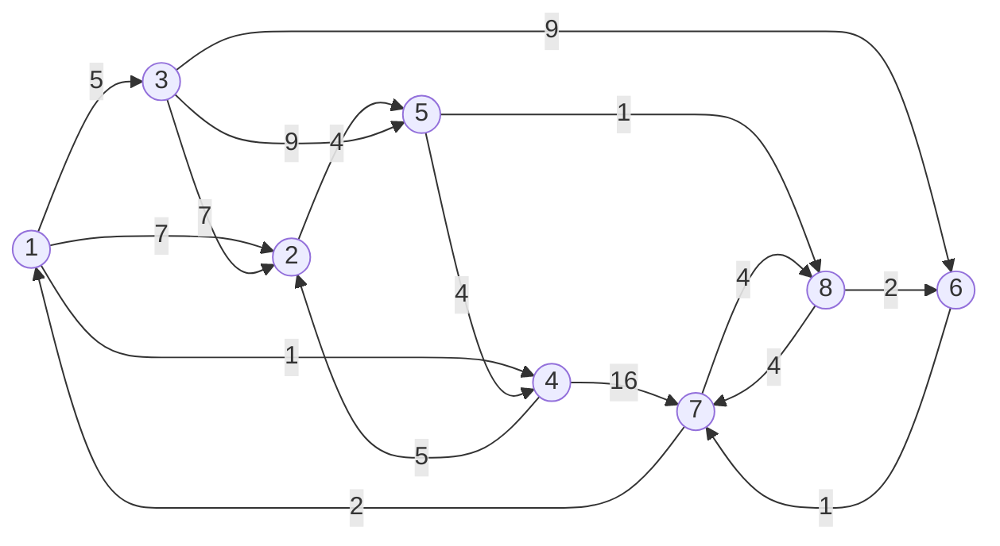


<div class="callout callout-summary" markdown="1">
<div class="callout-title callout-title--default" markdown="span">요약</div>

모든 도시 쌍의 가장 짧은 거리표를 채우는 방법은 거리만 알려 주고, 어느 도시들을 거쳐 가는지는 알려 주지 않는다. 그래서 거리표의 칸을 더 작은 값으로 고칠 때마다 "어느 도시를 거쳐서 줄었는지"를 옆 표에 적어 둔다. 길을 알고 싶으면 그 표에 적힌 도시에서 길을 두 토막으로 가르고, 토막마다 같은 일을 되풀이한다. 표가 하나 더 들 뿐 계산 시간은 그대로지만, 길이 아예 없는 쌍에 이 되짚기를 그냥 부르면 없는 길을 답으로 낸다.

</div>


## 예시로 보기

[플로이드–워셜](/Hongs_Blog/studies/algorithms/floyd-warshall/)을 돌리면 "1에서 7까지 가장 짧은 길이는 14"까지는 안다. 그런데 길 안내를 하려면 어느 점을 차례로 지나는지가 필요하다. 거리표만으로는 그것을 알 수 없다.

점 8개, 방향 간선 16개로 된 그래프를 보자.



화살표 위의 수가 비용이다.

플로이드의 반복을 돌리면서, 칸 $$(i, j)$$의 값이 점 $$k$$를 거쳐서 줄어들 때마다 $$kay(i, j)$$에 그 $$k$$를 적는다. 끝난 뒤의 표가 다음과 같다. 0은 "사이에 낀 점이 없다(간선 하나로 간다)"는 뜻이다.

| $$kay$$ | 1 | 2 | 3 | 4 | 5 | 6 | 7 | 8 |
|---|---|---|---|---|---|---|---|---|
| **1** | 0 | 4 | 0 | 0 | 4 | 8 | 8 | 5 |
| **2** | 8 | 0 | 8 | 5 | 0 | 8 | 8 | 5 |
| **3** | 7 | 0 | 0 | 5 | 0 | 0 | 6 | 5 |
| **4** | 8 | 0 | 8 | 0 | 2 | 8 | 8 | 5 |
| **5** | 8 | 4 | 8 | 0 | 0 | 8 | 8 | 0 |
| **6** | 7 | 7 | 7 | 7 | 7 | 0 | 0 | 7 |
| **7** | 0 | 4 | 1 | 1 | 4 | 8 | 0 | 0 |
| **8** | 7 | 7 | 7 | 7 | 7 | 0 | 6 | 0 |

**1에서 7로 가는 길 되짚기.** $$kay(1, 7) = 8$$이다. 길이 8을 거친다는 뜻이니, "1에서 8까지"와 "8에서 7까지" 두 토막으로 가른다. 토막마다 다시 표를 본다.

| 보는 토막 | $$kay$$ | 한 일 | 지금까지 아는 길 |
|---|---|---|---|
| (1, 7) | 8 | (1, 8)과 (8, 7)로 가른다 | 1 … 8 … 7 |
| (1, 8) | 5 | (1, 5)와 (5, 8)로 가른다 | 1 … 5 … 8 … 7 |
| (1, 5) | 4 | (1, 4)와 (4, 5)로 가른다 | 1 … 4 … 5 … 8 … 7 |
| (1, 4) | 0 | 간선 하나다 | 1 4 … 5 … 8 … 7 |
| (4, 5) | 2 | (4, 2)와 (2, 5)로 가른다 | 1 4 … 2 … 5 … 8 … 7 |
| (4, 2), (2, 5) | 0, 0 | 둘 다 간선 하나다 | 1 4 2 5 … 8 … 7 |
| (5, 8) | 0 | 간선 하나다 | 1 4 2 5 8 … 7 |
| (8, 7) | 6 | (8, 6)과 (6, 7)로 가른다 | 1 4 2 5 8 … 6 … 7 |
| (8, 6), (6, 7) | 0, 0 | 둘 다 간선 하나다 | 1 4 2 5 8 6 7 |

길은 1 → 4 → 2 → 5 → 8 → 6 → 7이고 길이는 $$1 + 5 + 4 + 1 + 2 + 1 = 14$$다. 8에서 7로 바로 가는 간선(비용 4)이 있는데도 6을 거친다. $$2 + 1 = 3$$이 더 싸기 때문이다.

<div class="callout callout-check" markdown="1">
<div class="callout-title" markdown="span">검증: C 구현을 컴파일해 실행(ASan·UBSan)해 끝난 뒤의 비용 표 64칸과 $$kay$$ 표 64칸, 1에서 7로 가는 길, 64쌍 모두에서 "찍힌 길의 간선이 그래프에 있고 길이가 $$c(i, j)$$와 같다"를 확인했다 — [39_floyd-path-output_impl.c](/Hongs_Blog/studies/data-structures/code/39_floyd-path-output_impl/). 같은 알고리즘을 파이썬으로 다시 짜서 무작위 방향 그래프 800개(점 2 ~ 7개, 절반은 음수 간선 포함)의 모든 쌍에서 되짚은 길의 길이 = 전수로 구한 최솟값, $$kay$$ = 길 위의 가장 큰 중간 점임을 확인했다 — [39_floyd-path-output_verify.py](/Hongs_Blog/studies/data-structures/code/39_floyd-path-output_verify/)</div>

</div>


## 정의

$$kay(i, j)$$는 $$i$$에서 $$j$$로 가는 가장 짧은 길 위의 중간 점 가운데 번호가 가장 큰 점이다. 중간 점이 없으면 0이다. 중간 점은 길의 양 끝 $$i$$, $$j$$를 뺀 나머지 점이다.

플로이드의 세 겹 반복에 두 줄만 더하면 된다. $$c(i, j)$$는 지금까지 찾은 $$i$$에서 $$j$$까지의 가장 짧은 길이다.

```c
#define MAXN 8
#define INF 1000000            /* 간선이 없다는 표시. 두 개를 더해도 int를 넘지 않는 값 */

static int n;
static int c[MAXN + 1][MAXN + 1];      /* 처음에는 간선 비용. c[i][i] = 0, 간선이 없으면 INF */
static int kay[MAXN + 1][MAXN + 1];

void floydWithKay(void)
{
    for (int i = 1; i <= n; i++)
        for (int j = 1; j <= n; j++) kay[i][j] = 0;     /* 처음에는 모두 "중간 점 없음" */
    for (int k = 1; k <= n; k++)
        for (int i = 1; i <= n; i++)
            for (int j = 1; j <= n; j++)
                if (c[i][j] > c[i][k] + c[k][j]) {      /* k를 거치면 더 짧다 */
                    kay[i][j] = k;                      /* 그 k를 적어 둔다 */
                    c[i][j] = c[i][k] + c[k][j];
                }
}
```

길을 찍는 함수는 자기 자신을 두 번 부른다([재귀](/Hongs_Blog/studies/algorithms/recursion-backtracking/)).

```c
/* i에서 j로 가는 길을 찍는다. 첫 정점 i는 찍지 않는다 */
void outputPath(int i, int j)
{
    if (i == j) return;
    if (kay[i][j] == 0)                /* 사이에 낀 정점이 없다: 간선 하나로 간다 */
        printf("%d ", j);
    else {                             /* kay[i][j]를 거쳐 간다 */
        outputPath(i, kay[i][j]);
        outputPath(kay[i][j], j);
    }
}
```

`outputPath(1, 7)`은 `4 2 5 8 6 7`을 찍는다. 출발점 1은 부르는 쪽에서 먼저 찍는다.

### 왜 되짚을 수 있나

플로이드의 바깥 반복이 $$k$$일 때 칸 $$(i, j)$$가 줄었다면, 새 길은 "$$i$$에서 $$k$$까지"와 "$$k$$에서 $$j$$까지"를 이은 것이다. 이 두 토막은 그때까지 허락된 점, 곧 $$k$$보다 번호가 작은 점만 거친다. 그 뒤로 더 큰 번호에서 이 칸이 또 줄면 $$kay$$가 그 번호로 바뀐다. 그래서 끝났을 때 $$kay(i, j)$$에 남은 것은 마지막으로 줄인 $$k$$이고, 그것이 길 위에서 번호가 가장 큰 중간 점이다.

두 토막 $$(i, kay)$$와 $$(kay, j)$$의 중간 점은 모두 $$kay(i, j)$$보다 번호가 작다. 가를 때마다 "가장 큰 중간 점 번호"가 줄어드니, 언젠가 0(간선 하나)에 닿아 재귀가 끝난다[^s1].

## 활용

- **이 방법을 쓸 신호.** 모든 쌍의 가장 짧은 길이를 이미 플로이드로 구하고 있는데, 길이뿐 아니라 지나는 점까지 내라고 할 때.
- **비용.** $$kay$$ 표에 $$n^2$$칸이 더 든다. 반복은 그대로 $$\Theta(n^3)$$이다. 길 하나를 찍는 데는, 길의 간선이 $$L$$개일 때 `outputPath`가 $$2L - 1$$번 불린다. 위의 1에서 7은 간선 6개라 11번이다[^s1].
- **길이 없는 쌍.** $$i$$에서 $$j$$로 가는 길이 없으면 $$c(i, j)$$는 끝까지 `INF`이고 $$kay(i, j)$$도 0으로 남는다. 0은 "간선 하나"와 구별이 안 된다. 그대로 `outputPath`를 부르면 없는 간선을 찍는다. 부르기 전에 `c[i][j]`가 `INF`인지 먼저 본다[^s1].
- **한 출발점 방법과 견주기.** [다익스트라](/Hongs_Blog/studies/algorithms/dijkstra/)와 [벨만–포드](/Hongs_Blog/studies/data-structures/bellman-ford/)는 "바로 앞의 점" $$p$$를 적어 두고 도착점에서 거꾸로 따라간다. 플로이드는 "가운데의 한 점" $$kay$$를 적어 두고 길을 둘로 가른다. 적어 두는 것이 다르니 되짚는 모양도 다르다(한 줄로 따라가기 대 둘로 가르기)[^s1].
- **흔한 실수.** 출발점을 찍지 않는다. 거리 값만 고치고 $$kay$$를 같이 고치지 않는다. `INF`를 `INT_MAX`로 두어 `c[i][k] + c[k][j]`가 넘친다.
- 연습: [최단 경로 표 채우기 예제 사다리](/Hongs_Blog/studies/data-structures/shortest-path-ladder/)

## 연결

- 선수: [플로이드–워셜](/Hongs_Blog/studies/algorithms/floyd-warshall/)(점화식 $$c(i, j, k) = \min\{c(i, j, k-1),\ c(i, k, k-1) + c(k, j, k-1)\}$$와 표 하나로 줄이는 까닭), [재귀와 백트래킹](/Hongs_Blog/studies/algorithms/recursion-backtracking/)
- 한 출발점에서 길을 되짚는 법: [벨만–포드 알고리즘](/Hongs_Blog/studies/data-structures/bellman-ford/)의 $$p(v, k)$$, [다익스트라](/Hongs_Blog/studies/algorithms/dijkstra/)의 $$p[\,]$$
- 표를 2차원 배열로 두는 것은 [연결 인접 리스트와 배열 인접 리스트](/Hongs_Blog/studies/data-structures/linked-adjacency-list/)의 비용 인접 행렬이다.

## 확인 문제

<details class="callout callout-question" markdown="1">
<summary class="callout-title" markdown="span">**C1** 위 $$kay$$ 표로 3에서 1로 가는 가장 짧은 길을 되짚어라. 보는 칸과 그 값을 차례로 쓰고, 길과 길이를 답하라.</summary>

**답:** $$kay(3, 1) = 7$$ → (3, 7)과 (7, 1). $$kay(3, 7) = 6$$ → (3, 6)과 (6, 7). $$kay(3, 6) = 0$$, $$kay(6, 7) = 0$$, $$kay(7, 1) = 0$$. 길은 3 → 6 → 7 → 1, 길이는 $$9 + 1 + 2 = 12$$다.<br>
**이유:** 0인 칸은 간선 하나다. `outputPath(3, 1)`은 6, 7, 1을 차례로 찍고, 자기 자신을 포함해 5번 불린다(간선 3개, $$2 \times 3 - 1$$).

</details>


<details class="callout callout-question" markdown="1">
<summary class="callout-title" markdown="span">**C2** 반복이 끝난 뒤 $$kay(i, j)$$에 남은 값이 "마지막으로 줄인 $$k$$"인데, 그것이 왜 길 위에서 번호가 가장 큰 중간 점인가? 이 사실이 `outputPath`가 끝나는 것과 무슨 관계인가?</summary>

**답:** 바깥 반복은 $$k = 1, 2, \dots, n$$ 순서로 돈다. $$k$$에서 줄어든 길은 $$k$$를 지나고, 그 밖의 중간 점은 모두 $$k$$보다 작다. 그 뒤 더 큰 번호에서 줄지 않았다면 길은 그대로이니 $$k$$가 가장 큰 중간 점이다. 그래서 두 토막의 중간 점은 모두 $$kay(i, j)$$보다 작고, 가를 때마다 이 번호가 줄어 결국 0에 닿는다.<br>
**이유:** 가른 토막이 원래 문제보다 "작다"는 보장이 있어야 재귀가 끝난다. 여기서는 가장 큰 중간 점의 번호가 그 크기 구실을 한다.

</details>


<details class="callout callout-question" markdown="1">
<summary class="callout-title" markdown="span">**C3** `outputPath`를 그대로 불렀을 때 틀린 길을 찍는 입력을 하나 만들어라. 어떻게 막는가?</summary>

**답:** 점 1, 2, 3과 간선 1→2(비용 4) 하나. 1에서 3으로 가는 길은 없어서 $$c(1, 3)$$은 `INF`, $$kay(1, 3)$$은 0이다. `outputPath(1, 3)`은 0을 "간선 하나"로 읽고 3을 찍어, 없는 간선 1→3으로 간다고 답한다. 부르기 전에 `c[1][3]`이 `INF`인지 확인하고, 그렇다면 "길이 없다"고 답한다.<br>
**이유:** $$kay$$의 0은 "한 번도 줄지 않았다"는 뜻이다. 처음부터 간선이 있던 경우와 끝까지 길이 없던 경우가 둘 다 여기 들어간다. 둘을 가르는 것은 $$c$$ 표다.

</details>


[^s1]: 보탠 것은 구현 코드와 검증 코드로 확인했다.

