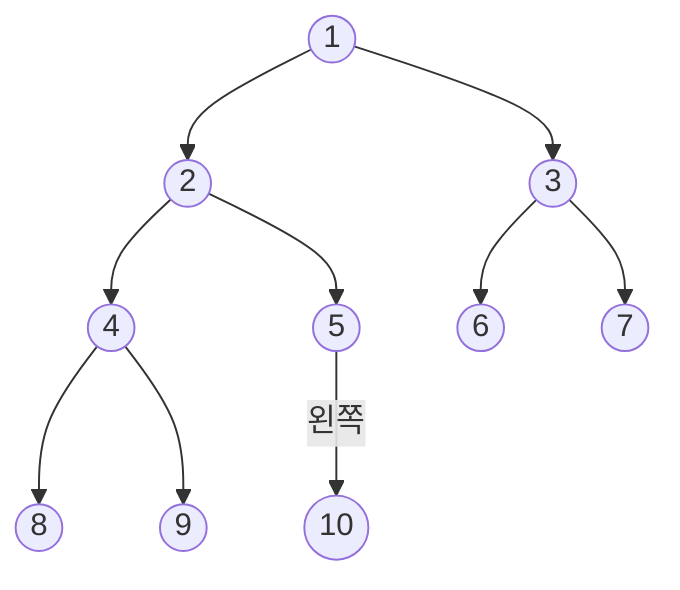


<div class="callout callout-summary" markdown="1">
<div class="callout-title callout-title--default" markdown="span">요약</div>

층마다 빈자리 없이 꽉 채운 이진 트리가 포화 이진 트리다. 위층부터, 같은 층에서는 왼쪽부터 차곡차곡 채우다가 멈춘 모양이 완전 이진 트리다. 이렇게 채운 트리는 칸에 1번부터 차례로 번호를 매기면 부모와 자식의 번호가 2로 나누기와 2를 곱하기로 바로 나와서, 주소를 따로 적지 않고 배열 하나에 담을 수 있다. 다만 한 칸이라도 건너뛰고 채운 트리는 완전 이진 트리가 아니다.

</div>


## 예시로 보기

[이진 트리](/Hongs_Blog/studies/data-structures/binary-tree/)는 노드 수가 같아도 높이가 크게 다르다. 높이가 가장 낮으려면 위층을 다 채운 뒤에 아래층으로 내려가야 한다. 그렇게 채운 모양에 이름이 있다.

층 4개를 모두 채우면 노드가 15개다. 위층부터, 같은 층에서는 왼쪽부터 1번에서 15번까지 번호를 매긴다.

```
                     1
           2                   3
      4         5         6         7
    8   9    10   11   12   13   14   15
```

5번을 보자. 부모는 2번이고 자식은 10번과 11번이다. $$5 \div 2$$의 몫이 2이고, $$5 \times 2 = 10$$, $$5 \times 2 + 1 = 11$$이다. 어느 번호에서나 같은 계산이 맞는다.

이제 1번부터 10번까지만 남긴다. 이것이 노드 10개짜리 완전 이진 트리다.



5번의 왼쪽 자식 10번은 있고, 오른쪽 자식이 될 11번은 없다. $$2 \times 5 + 1 = 11$$이 노드 수 10보다 크기 때문이다. "자식 번호가 노드 수를 넘으면 그 자식은 없다"는 것까지가 규칙이다.

## 정의

**포화 이진 트리(full binary tree).** 층이 $$L$$개이고 노드가 $$2^L - 1$$개인 이진 트리다. 층이 $$L$$개인 이진 트리가 담을 수 있는 가장 많은 수를 다 채운 모양이다. 높이를 선의 수 $$h$$로 세면($$L = h + 1$$) 노드는 $$2^{h+1} - 1$$개다. 층이 4개면 15개다.

**번호 매기기.** 포화 이진 트리의 노드에 1번부터 $$2^L - 1$$번까지 번호를 붙인다. 위층에서 아래층으로, 같은 층에서는 왼쪽에서 오른쪽으로 붙인다.

**완전 이진 트리(complete binary tree).** 노드가 $$n$$개 이상인 포화 이진 트리에 위와 같이 번호를 매긴 뒤, 1번부터 $$n$$번까지의 노드만 남긴 이진 트리다. $$n$$이 정해지면 모양은 하나뿐이다.

포화 이진 트리는 모두 완전 이진 트리다($$n = 2^L - 1$$인 경우). 거꾸로는 아니다.

<div class="callout callout-theorem" markdown="1">
<div class="callout-title" markdown="span">번호 규칙</div>

노드가 $$n$$개인 완전 이진 트리에서 번호 $$i$$($$1 \le i \le n$$)인 노드에 대해
- 부모는 $$\lfloor i/2 \rfloor$$번이다. 단, $$i = 1$$이면 뿌리라서 부모가 없다.
- 왼쪽 자식은 $$2i$$번이다. $$2i > n$$이면 왼쪽 자식이 없다.
- 오른쪽 자식은 $$2i + 1$$번이다. $$2i + 1 > n$$이면 오른쪽 자식이 없다.

</div>


$$\lfloor x \rfloor$$는 $$x$$의 소수점 아래를 버린 정수다. C로는 부모를 `i / 2`로 쓴다. C의 정수 나눗셈은 몫만 남기기 때문이다. 11번의 부모는 $$\lfloor 11/2 \rfloor = 5$$번이다.

<details class="callout callout-note" markdown="1">
<summary class="callout-title" markdown="span">번호 규칙이 맞는 까닭</summary>

1. $$k$$층에는 자리가 $$2^{k-1}$$개 있다([이진 트리](/Hongs_Blog/studies/data-structures/binary-tree/)의 증명). 1층부터 $$k - 1$$층까지의 자리는 $$1 + 2 + \cdots + 2^{k-2} = 2^{k-1} - 1$$개다. 그래서 $$k$$층의 번호는 $$2^{k-1}$$번에서 시작해 $$2^k - 1$$번에서 끝난다.
2. $$k$$층에서 왼쪽으로부터 $$j$$번째($$j = 0, 1, 2, \dots$$) 노드의 번호는 $$i = 2^{k-1} + j$$다.
3. 그 노드 왼쪽에 있는 $$j$$개의 노드가 자식을 둘씩 두니, 이 노드의 왼쪽 자식은 $$k + 1$$층에서 $$2j$$번째다. 번호는 $$2^k + 2j = 2(2^{k-1} + j) = 2i$$다. 오른쪽 자식은 바로 다음인 $$2i + 1$$이다.
4. 부모는 거꾸로다. 자식 번호가 $$2p$$든 $$2p + 1$$이든 2로 나눈 몫은 $$p$$다.
5. 완전 이진 트리는 1번부터 $$n$$번까지만 남긴 것이라, 계산한 자식 번호가 $$n$$을 넘으면 그 노드는 없다[^s2].

</details>


**높이.** 노드가 $$n$$개인 완전 이진 트리의 층 수는 $$\lceil \lg(n+1) \rceil = \lfloor \lg n \rfloor + 1$$이고, 높이(선의 수)는 $$\lfloor \lg n \rfloor$$다. 노드 10개면 층이 4개, 높이가 3이다. 이 값은 노드 $$n$$개인 이진 트리가 가질 수 있는 가장 낮은 높이와 같다. 완전 이진 트리는 같은 노드 수로 만들 수 있는 가장 낮은 트리 가운데 하나다[^s2].

**잎.** 자식이 없는 노드는 $$2i > n$$인 노드, 곧 $$\lfloor n/2 \rfloor + 1$$번부터 $$n$$번까지다. 노드 10개면 6번부터 10번까지 다섯 개다. 자식이 하나뿐인 노드는 $$n$$이 짝수일 때 $$n/2$$번 하나뿐이고, $$n$$이 홀수면 없다[^s2].

<div class="callout callout-check" markdown="1">
<div class="callout-title" markdown="span">검증: 노드를 "위층부터, 왼쪽부터" 하나씩 붙여 만든 트리($$n$$ = 1 ~ 1,000)에서 부모·자식 번호, 층별 번호 범위, 높이 $$\lfloor \lg n \rfloor$$, 잎의 번호와 개수, 0번부터 매긴 번호 규칙, 본문과 카드의 수치를 확인했다 — [22_full-complete-binary-tree_verify.py](/Hongs_Blog/studies/data-structures/code/22_full-complete-binary-tree_verify/)</div>

</div>


### 이름이 책마다 다르다

같은 영어 이름이 교재에 따라 다른 모양을 가리킨다. 이 문서 모음은 아래 표의 첫 줄을 full, 둘째 줄을 complete라는 이름과 짝지어 쓴다.

| 모양 | 이 문서 모음의 영어 이름 | 이 문서 모음 | 다른 교재의 이름 |
|---|---|---|---|
| 모든 층이 꽉 참 | full binary tree | 포화 이진 트리 | perfect binary tree, complete binary tree |
| 위층부터, 왼쪽부터 채움 | complete binary tree | 완전 이진 트리 | nearly complete binary tree |
| 모든 노드의 자식이 0개나 2개 | — | 정 이진 트리 | full binary tree |

셋째 줄은 [재귀적 정의와 구조적 귀납법](/Hongs_Blog/studies/discrete-math/recursive-definitions/)에 나오는 모양이다. 영어 이름만 보고 판단하지 말고 그 자료의 정의를 확인한다[^s3].

## 활용

- **배열에 담기.** 번호 $$i$$의 노드를 배열의 $$i$$번 칸에 넣으면 부모와 자식을 계산으로 찾는다. 완전 이진 트리는 1번부터 $$n$$번까지 빈칸이 없어서 낭비가 없다: [이진 트리의 배열 표현과 연결 표현](/Hongs_Blog/studies/data-structures/binary-tree-representation/).
- **힙.** [힙](/Hongs_Blog/studies/data-structures/max-heap/)은 완전 이진 트리 모양을 늘 지킨다. 그래서 높이가 $$\lfloor \lg n \rfloor$$이고 넣기와 꺼내기가 그만큼만 걸린다.
- **번호 순서.** 번호 순서는 위층부터 왼쪽에서 오른쪽으로 읽은 순서, 곧 [레벨 순서 순회](/Hongs_Blog/studies/data-structures/level-order-traversal/)의 순서다.
- **0번부터 매기면.** 번호를 0번부터 붙이면 부모는 $$\lfloor (j-1)/2 \rfloor$$, 자식은 $$2j + 1$$과 $$2j + 2$$가 된다. $$j = i - 1$$을 넣어 보면 같은 규칙이다. 파이썬의 `heapq`가 이 방식이다: [힙과 우선순위 큐](/Hongs_Blog/studies/algorithms/heap/).
- **2진수로 보기.** 번호 $$i$$를 2진수로 쓰면 왼쪽 자식은 끝에 0을, 오른쪽 자식은 끝에 1을 붙인 수다. 자릿수가 곧 층 번호다: [트리 칸 번호 ↔ 2진법 자릿수](/Hongs_Blog/studies/algorithms/tree-index-binary/).

## 연결

- 선수: [이진 트리](/Hongs_Blog/studies/data-structures/binary-tree/)(노드 수의 한계 $$2^L - 1$$)
- 층별 자리 수를 더하는 합: [등비급수](/Hongs_Blog/studies/college-math/geometric-series/)
- 이 모양을 쓰는 자료구조: [최대 힙과 최소 힙](/Hongs_Blog/studies/data-structures/max-heap/), [승자 트리](/Hongs_Blog/studies/data-structures/winner-tree/)

## 확인 문제

<details class="callout callout-question" markdown="1">
<summary class="callout-title" markdown="span">**C1** 노드가 12개인 완전 이진 트리에서 (가) 11번의 부모 (나) 6번의 두 자식 (다) 7번의 자식 (라) 높이(선의 수) (마) 잎의 수를 구하라.</summary>

**답:** (가) $$\lfloor 11/2 \rfloor = 5$$번. (나) 왼쪽 자식은 12번, 오른쪽 자식은 13번이 될 텐데 $$13 > 12$$라 없다. (다) $$14 > 12$$라 자식이 없다(잎). (라) $$\lfloor \lg 12 \rfloor = 3$$. (마) 7번부터 12번까지 6개.<br>
**이유:** 흔한 실수는 (나)에서 13번도 있다고 답하는 것이다. 자식 번호를 계산한 뒤 $$n$$을 넘는지 꼭 확인한다.

</details>


<details class="callout callout-question" markdown="1">
<summary class="callout-title" markdown="span">**C2** 다음 셋을 포화 이진 트리, 완전 이진 트리, 둘 다 아닌 것으로 나눠라. (가) 3층이 모두 찬 노드 7개짜리. (나) 뿌리, 뿌리의 두 자식, 왼쪽 자식의 두 자식으로 된 노드 5개짜리. (다) 뿌리, 뿌리의 두 자식, 오른쪽 자식의 두 자식으로 된 노드 5개짜리.</summary>

**답:** (가) 포화 이진 트리이고 완전 이진 트리이기도 하다. (나) 완전 이진 트리다(번호 1 ~ 5가 모두 있다). 포화는 아니다. (다) 둘 다 아니다. 번호로 보면 1, 2, 3, 6, 7번이 있고 4, 5번이 비었다.<br>
**이유:** 완전 이진 트리인지는 "번호를 매겼을 때 1번부터 $$n$$번까지 빠진 번호가 없는가"로 가린다. (나)와 (다)는 노드 수와 층 수가 같지만 (다)는 왼쪽을 건너뛰었다.

</details>


<details class="callout callout-question" markdown="1">
<summary class="callout-title" markdown="span">**C3** 완전 이진 트리에서 번호 $$i$$인 노드의 왼쪽 자식이 $$2i$$번인 까닭을 층별 번호로 설명하라.</summary>

**답:** $$k$$층의 번호는 $$2^{k-1}$$번에서 시작한다. $$k$$층의 왼쪽에서 $$j$$번째($$j$$는 0부터) 노드는 $$i = 2^{k-1} + j$$번이다. 이 노드보다 왼쪽에 있는 $$j$$개가 자식을 둘씩 먼저 차지하니, 이 노드의 왼쪽 자식은 $$k + 1$$층의 $$2j$$번째이고 번호는 $$2^k + 2j = 2i$$다.

</details>


[^s2]: 검증 코드에서 번호 공식을 쓰지 않고 만든 트리($$n \le 1{,}000$$)와 비교했다.
[^s3]: Cormen 외, *Introduction to Algorithms* 3판 B.5.3절은 자식이 0개나 2개인 것을 full binary tree, 모든 잎의 깊이가 같고 안쪽 노드의 자식이 꽉 찬 것을 complete라 부르고, 6.1절은 힙을 nearly complete binary tree라 부른다. perfect binary tree는 꽉 찬 모양을 가리킬 때 널리 쓰는 이름이지만 이 책에는 나오지 않는다.

