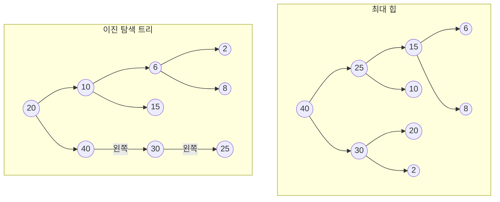


둘 다 "값의 크기에 따라 자리를 정한 이진 트리"라서 그림만 보면 헷갈린다. 가르는 질문은 "크기를 어느 방향으로 맞춰 두었나"다. 최대 힙은 위아래로만 맞춘다(부모가 자식보다 크거나 같다). 이진 탐색 트리는 좌우로 맞춘다(왼쪽은 작고 오른쪽은 크다). 이 차이 하나가 무엇을 빨리 할 수 있는지를 정한다.

같은 키 20, 10, 40, 6, 15, 30, 2, 8, 25를 같은 순서로 넣으면 두 나무는 이렇게 달라진다.

힙에서는 어느 길로 내려가도 값이 작아진다. 하지만 25의 왼쪽(15)과 오른쪽(10) 사이에는 정해진 순서가 없다. 이진 탐색 트리에서는 20의 왼쪽이 모두 20보다 작고 오른쪽이 모두 크다. 대신 가장 큰 40이 뿌리가 아니다.

## 어느 쪽일까

**C1** (가) 응급실에서 지금 가장 위급한 환자를 계속 뽑아야 한다. 환자는 수시로 들어온다. (나) 학번으로 학생 기록을 찾고, 가끔 학번 순서대로 명단을 뽑는다. 어느 쪽인가?

**답:** (가) 최대 힙. 필요한 것은 "가장 큰 것 하나"뿐이고, 그것이 늘 뿌리에 있다. 넣기와 꺼내기는 층 수만큼만 걸린다. (나) 이진 탐색 트리. 아무 키나 찾아야 하고, 중위 순회 한 번이면 학번 순 명단이 나온다. 
**이유:** 힙에서 아무 키를 찾으려면 거의 다 봐야 한다. 이진 탐색 트리에서 가장 큰 것만 계속 뽑으면 되기는 하지만, 나무가 한쪽으로 늘어질 수 있어 힙보다 나을 것이 없다.

**C2** 위 두 그림에서 (다) 가장 큰 값을 찾을 때 보는 노드 수, (라) 없는 값 9를 찾을 때 보는 노드 수를 각각 쓰라.

**답:** (다) 힙은 뿌리 1개. 이진 탐색 트리는 오른쪽으로만 내려가 20, 40의 2개. (라) 힙은 9개 모두. 이진 탐색 트리는 20, 10, 6, 8의 4개. 
**이유:** 힙에서는 9보다 큰 노드 아래 어디에든 9가 있을 수 있다. 9보다 작은 노드 아래만 건너뛸 수 있는데, 그 노드 자체는 봐야 작은지 안다. 이 그림에서는 그렇게 가지를 쳐도 아홉 개를 다 본다. 이진 탐색 트리는 견줄 때마다 한쪽을 통째로 버린다.

**C3** 나무 9(7(5(2, 1), 4(3, −)), 6(3, 2))는 최대 힙인가, 이진 탐색 트리인가? 괄호 안은 (왼쪽 자식, 오른쪽 자식)이다. 두 정의에 하나씩 대어 보라.

**답:** 최대 힙이다. 모든 부모가 자식보다 크거나 같고(9 ≥ 7, 6 / 7 ≥ 5, 4 / 6 ≥ 3, 2 / 5 ≥ 2, 1 / 4 ≥ 3), 층을 왼쪽부터 빈틈없이 채웠다. 이진 탐색 트리는 아니다. 뿌리 9의 오른쪽에 9보다 작은 6이 있다. 
**이유:** 키가 서로 다른 노드가 셋 이상인 최대 힙은 이진 탐색 트리가 될 수 없다. 뿌리가 가장 큰 값인데 오른쪽 자식이 있기 때문이다.

## 결정적 차이

| | 최대 힙 | 이진 탐색 트리 |
|---|---|---|
| 지키는 순서 | 부모 ≥ 자식(위아래) | 왼쪽 부분 트리 < 자기 < 오른쪽 부분 트리(좌우) |
| 모양 | 늘 완전 이진 트리 | 넣는 순서에 따라 달라진다 |
| 담는 곳 | 배열 하나(1번 칸부터), 포인터 없음 | 노드와 포인터 |
| 높이(간선 수) | 늘 $$\lfloor \lg n \rfloor$$ | $$\lfloor \lg n \rfloor$$에서 $$n - 1$$ 사이 |
| 가장 큰 값 보기 | 뿌리, $$O(1)$$ | 오른쪽으로 끝까지, $$O(\text{높이})$$ |
| 넣기, 가장 큰 값 꺼내기 | $$O(\log n)$$ | $$O(\text{높이})$$, 가장 나쁠 때 $$O(n)$$ |
| 아무 키나 찾기 | $$O(n)$$ | $$O(\text{높이})$$ |
| 크기 순으로 모두 읽기 | 그대로는 못 한다 | 중위 순회 $$O(n)$$ |
| 같은 키 | 있어도 된다 | 이 문서 모음의 정의로는 없다 |

$$n$$은 원소 수, $$\lfloor \lg n \rfloor$$은 $$\log_2 n$$에서 소수점 아래를 버린 값이다. 높이를 층 수로 세는 자료에서는 높이가 표의 값보다 1 크다([최대 힙과 최소 힙](/Hongs_Blog/studies/data-structures/max-heap/)).

선택을 가르는 줄은 "가장 큰 값 보기"와 "아무 키나 찾기"다. 힙은 가장 큰 것(최소 힙이면 가장 작은 것) 하나에만 강하고, 이진 탐색 트리는 모든 키에 고르게 통하지만 모양이 망가질 수 있다. 1부터 9까지를 커지는 순서로 넣으면 힙의 높이는 3인데 이진 탐색 트리의 높이는 8이다. 힙은 모양이 정해져 있어 넣는 순서가 높이를 바꾸지 못한다.

검증: 같은 키 아홉 개로 만든 두 나무의 모양, 표의 높이 줄, 카드 C2·C3의 노드 수와 판정을 파이썬으로 확인했고, 무작위 키 300묶음에서 "힙의 높이는 늘 ⌊lg n⌋, 이진 탐색 트리의 높이는 ⌊lg n⌋ ~ n − 1"과 "키가 셋 이상이면 힙은 이진 탐색 트리가 아니다"가 맞았다 — [31_heap-vs-bst_verify.py](/Hongs_Blog/studies/data-structures/code/31_heap-vs-bst_verify/)

## 둘 다 아닐 때

**C4** 둘 다 맞지 않는 상황 두 가지와 그때의 선택지를 쓰라.

**답:** ① 키로 찾고 넣고 지우기만 하면 되고 크기 순서는 쓸 일이 없다 → 해시 테이블([해시 테이블의 홈 버킷과 충돌](/Hongs_Blog/studies/data-structures/hash-table-terms/)). 기대 시간이 $$O(1)$$이다. ② 정렬된 줄 여러 개의 맨 앞 값들 가운데 가장 작은 것을 계속 뽑고, 뽑은 자리에 같은 줄의 다음 값을 넣는다 → [승자 트리](/Hongs_Blog/studies/data-structures/winner-tree/)나 [패자 트리](/Hongs_Blog/studies/data-structures/loser-tree/). 바뀐 자리에서 뿌리까지만 다시 겨루면 된다. 
**이유:** ①에서 이진 탐색 트리는 순서를 지키느라 드는 값(높이만큼 내려가기)을 낸다. [이진 탐색 트리의 탐색과 삽입](/Hongs_Blog/studies/data-structures/bst-search-insert/)의 비용 표에서도 해시 테이블의 기대 시간이 가장 작다. ②에서 힙도 쓸 수 있지만, 선수 자리가 정해진 승자·패자 트리는 "어느 줄에서 나온 값인지"를 자리로 바로 안다.


