
## 먼저 알아야 할 것
- [점근 표기](/Hongs_Blog/studies/discrete-math/asymptotic-notation/), [수학적 귀납법](/Hongs_Blog/studies/discrete-math/induction/), [재귀적 정의와 구조적 귀납법](/Hongs_Blog/studies/discrete-math/recursive-definitions/) (공학수학 이산수학): 횟수를 식으로 적고 재귀로 정의한 구조를 다루는 법
- [그래프의 기초](/Hongs_Blog/studies/discrete-math/graph-basics/), [트리](/Hongs_Blog/studies/discrete-math/trees/) (공학수학 이산수학): 그래프와 트리의 뜻과 용어
- [로그](/Hongs_Blog/studies/college-math/logarithm/), [등비급수](/Hongs_Blog/studies/college-math/geometric-series/) (공학수학 대학수학): 높이와 두 배 늘리기 계산에 쓴다
- 스택, 큐, 힙, 연결 리스트, 순회, 그래프 탐색, 최단 경로의 생각은 알고리즘 과목 문서에 먼저 정리돼 있다. 번호 원칙으로는 먼저 배우는 이 과목이 번호를 가져야 하지만, 이미 있는 문서의 번호는 바꾸지 않고 그 문서의 `과목별 관점`에 이 과목 내용을 합쳤다. 이 과목에는 그쪽에 없는 것(C 배열과 포인터로 만드는 법, 삭제와 재경기 같은 절차, 볼트에 없던 주제)만 번호를 받았다.

> 구현 코드는 C로 쓰고 메모리 오류 검사(ASan, UBSan)를 켠 채 컴파일해 실행했고, 횟수 세기와 전수 비교는 파이썬으로 했다.

## 자료구조의 뜻, 연산 횟수 세기, C 포인터와 동적 메모리

읽기 전에

1. 길이가 같은 두 배열을 같은 삽입 정렬로 정렬하는데 한쪽이 훨씬 오래 걸릴 수 있을까? 어떤 배열일 때 그럴까? → [연산 횟수와 단계 수 세기](/Hongs_Blog/studies/data-structures/operation-step-count/)
2. 두 변수의 값을 맞바꾸는 함수 `swap(a, b)`를 만들어 불렀는데 값이 그대로다. 왜일까? → [포인터 인자와 값 전달](/Hongs_Blog/studies/data-structures/pointer-parameters/)
3. 함수가 끝나면 함수 안의 변수는 사라진다. 함수 안에서 `malloc`으로 빌린 메모리도 함께 사라질까? → [동적 메모리 할당](/Hongs_Blog/studies/data-structures/dynamic-memory-allocation/)

| 번호 | 개념 | 한 줄 | 개념 코드 | 연습 |
|---|---|---|---|---|
| 01 | [자료구조란](/Hongs_Blog/studies/data-structures/data-structure-definition/) | 값을 놓는 모양과 그 위의 연산을 함께 정한 것. 배열·레코드는 주소를 계산하고 연결 구조는 주소를 저장한다 | — | — |
| 02 | [연산 횟수와 단계 수 세기](/Hongs_Blog/studies/data-structures/operation-step-count/) | 일을 몇 번 하는지 $$n$$의 식으로 센다. 삽입 정렬 최악 비교 $$(n-1)n/2$$번, 단계 수 $$n + (n-1)(n+3)$$ | [verify](/Hongs_Blog/studies/data-structures/code/02_operation-step-count_verify/) | [단계 수 세기 예제 사다리](/Hongs_Blog/studies/data-structures/step-count-ladder/) · [문제 코드](/Hongs_Blog/studies/data-structures/code/02_step-count-ladder_p4/) |
| 03 | [포인터](/Hongs_Blog/studies/data-structures/c-pointer/) | 다른 칸의 주소를 담는 변수. `&`로 주소를 얻고 `*`로 따라간다 | [impl](/Hongs_Blog/studies/data-structures/code/03_c-pointer_impl/) | — |
| 04 | [포인터 인자와 값 전달](/Hongs_Blog/studies/data-structures/pointer-parameters/) | 인자는 값을 베껴 넘어간다. 원본을 고치려면 주소를 넘긴다 | [impl](/Hongs_Blog/studies/data-structures/code/04_pointer-parameters_impl/) | — |
| 05 | [배열과 포인터](/Hongs_Blog/studies/data-structures/array-pointer/) | 칸의 주소 = 시작 주소 + 번호 × 칸 크기. 배열 이름은 첫 칸의 주소처럼 쓰인다 | [impl](/Hongs_Blog/studies/data-structures/code/05_array-pointer_impl/) | [포인터와 주소 계산 연습](/Hongs_Blog/studies/data-structures/pointer-address-practice/) · [문제 코드](/Hongs_Blog/studies/data-structures/code/05_pointer-address-practice_p4/) |
| 06 | [동적 메모리 할당](/Hongs_Blog/studies/data-structures/dynamic-memory-allocation/) | 필요한 만큼 빌리고(`malloc`·`calloc`·`realloc`) 직접 돌려준다(`free`). 안 돌려주면 누수 | [impl](/Hongs_Blog/studies/data-structures/code/06_dynamic-memory-allocation_impl/) | — |

삽입 정렬은 여기서 횟수를 세는 예로 쓰이고, 정렬 방법으로는 40번에서 다룬다. 시간표와 점근 표기는 [시간 복잡도로 방법 고르기](/Hongs_Blog/studies/algorithms/complexity-budget/), [점근 표기](/Hongs_Blog/studies/discrete-math/asymptotic-notation/) 문서의 `과목별 관점`에 합쳤다.
떠올려 보기: 노트를 닫고 변수 하나, 그것을 가리키는 포인터, 그 포인터를 가리키는 포인터를 칸과 화살표로 그린 뒤 `&`와 `*`가 각각 어느 쪽으로 가는지 적어 본다.

## 배열 배치, 희소 행렬, 스택, 큐

읽기 전에

1. 3줄 4칸짜리 표를 한 줄짜리 메모리에 놓았다. 2번 줄 1번 칸은 앞에서 몇 번째에 있을까? → [행 우선 배치와 열 우선 배치](/Hongs_Blog/studies/data-structures/row-major-mapping/)
2. 꽉 찬 배열을 늘릴 때마다 원소를 모두 옮겨야 한다. 한 칸씩 늘릴 때와 두 배로 늘릴 때, 1,000개를 넣는 동안 옮기는 횟수는 얼마나 차이 날까? → [배열 두 배 늘리기](/Hongs_Blog/studies/data-structures/array-doubling/)
3. 칸이 여섯인 배열을 고리처럼 써서 큐를 만들면 몇 개까지 담을 수 있을까? → [원형 큐](/Hongs_Blog/studies/data-structures/circular-queue/)

| 번호 | 개념 | 한 줄 | 개념 코드 | 연습 |
|---|---|---|---|---|
| 07 | [추상 자료형](/Hongs_Blog/studies/data-structures/abstract-data-type/) | 무엇을 할 수 있는지만 정하고 어떻게 만드는지는 정하지 않은 약속 | — | — |
| 08 | [배열 두 배 늘리기](/Hongs_Blog/studies/data-structures/array-doubling/) | 꽉 차면 용량을 두 배로. 한 번은 비싸도 $$n$$번 전체는 $$O(n)$$ | [impl](/Hongs_Blog/studies/data-structures/code/08_array-doubling_impl/) · [verify](/Hongs_Blog/studies/data-structures/code/08_array-doubling_verify/) | — |
| 09 | [행 우선 배치와 열 우선 배치](/Hongs_Blog/studies/data-structures/row-major-mapping/) | 표를 한 줄로 펴기. 행 우선이면 `x[i][j]`는 $$ic + j$$번 칸, 배열의 배열은 덤이 행 수 × 4바이트 | [impl](/Hongs_Blog/studies/data-structures/code/09_row-major-mapping_impl/) | — |
| 10 | [특수 행렬을 1차원 배열에 담기](/Hongs_Blog/studies/data-structures/triangular-matrix-mapping/) | 0의 자리가 정해진 행렬은 값이 오는 칸만 담는다. 아래삼각의 $$x(i, j)$$는 $$i(i-1)/2 + j - 1$$번 위치 | [impl](/Hongs_Blog/studies/data-structures/code/10_triangular-matrix-mapping_impl/) | [배열 위치 공식 예제 사다리](/Hongs_Blog/studies/data-structures/array-mapping-ladder/) · [문제 코드](/Hongs_Blog/studies/data-structures/code/10_array-mapping-ladder_p4/) |
| 11 | [희소 행렬의 3원소 표현](/Hongs_Blog/studies/data-structures/sparse-matrix-triples/) | 0이 아닌 칸만 (행, 열, 값)으로 적어 행 우선 순서로 늘어놓는다. $$3t < mn$$일 때만 이득 | [impl](/Hongs_Blog/studies/data-structures/code/11_sparse-matrix-triples_impl/) | — |
| 12 | [희소 행렬의 전치](/Hongs_Blog/studies/data-structures/sparse-matrix-transpose/) | 열별 개수 → 시작 칸 → 꽂기 세 단계로 정렬 없이 $$O(n + t)$$ | [impl](/Hongs_Blog/studies/data-structures/code/12_sparse-matrix-transpose_impl/) · [verify](/Hongs_Blog/studies/data-structures/code/12_sparse-matrix-transpose_verify/) | [희소 행렬 전치 예제 사다리](/Hongs_Blog/studies/data-structures/sparse-transpose-ladder/) · [문제 코드](/Hongs_Blog/studies/data-structures/code/12_sparse-transpose-ladder_p4/) |
| 13 | [배열로 만든 스택](/Hongs_Blog/studies/data-structures/array-stack/) | 배열 하나와 맨 위 칸 번호 top. 가득 차면 끝내거나 두 배로 늘린다 | [impl](/Hongs_Blog/studies/data-structures/code/13_array-stack_impl/) | [스택 응용 연습](/Hongs_Blog/studies/data-structures/stack-applications-practice/) · [문제 코드](/Hongs_Blog/studies/data-structures/code/13_stack-applications-practice_p1/) · [문제 코드](/Hongs_Blog/studies/data-structures/code/13_stack-applications-practice_p2/) |
| 14 | [원형 큐](/Hongs_Blog/studies/data-structures/circular-queue/) | 배열의 끝과 처음을 이은 큐. 빔과 가득 참을 가르려고 한 칸을 비워 $$n - 1$$개까지 | [impl](/Hongs_Blog/studies/data-structures/code/14_circular-queue_impl/) | [원형 큐 추적 예제 사다리](/Hongs_Blog/studies/data-structures/circular-queue-ladder/) · [문제 코드](/Hongs_Blog/studies/data-structures/code/14_circular-queue-ladder_p4/) |

희소 행렬이 행 우선 순서를 쓰므로 배열 배치(09·10)를 앞에 둔다. 스택과 큐의 쓰임은 [스택](/Hongs_Blog/studies/algorithms/stack/), [큐와 덱](/Hongs_Blog/studies/algorithms/queue-deque/) 문서의 `과목별 관점`에 합쳤다.
떠올려 보기: 노트를 닫고, 스택은 정수 하나(top)로 되는데 큐는 왜 둘(front, rear)이 필요하고 한 칸까지 비워야 하는지 써 본다.

## 연결 리스트

읽기 전에

1. 목록 가운데에 원소를 끼울 때, 뒤의 원소를 하나도 옮기지 않는 방법이 있을까? → [단순 연결 리스트](/Hongs_Blog/studies/data-structures/singly-linked-list/)
2. 링크 두 개를 고쳐 노드를 끼울 때, 어느 쪽을 먼저 고쳐야 할까? → [단순 연결 리스트](/Hongs_Blog/studies/data-structures/singly-linked-list/)
3. 연결 리스트로 스택을 만들면 맨 위는 줄의 앞쪽일까 뒤쪽일까? → [연결 리스트로 만든 스택](/Hongs_Blog/studies/data-structures/linked-stack/)

| 번호 | 개념 | 한 줄 | 개념 코드 | 연습 |
|---|---|---|---|---|
| 15 | [단순 연결 리스트](/Hongs_Blog/studies/data-structures/singly-linked-list/) | 원소마다 다음 노드의 주소를 적은 줄. 링크를 고치는 차례가 틀리면 뒤쪽을 잃는다 | [impl](/Hongs_Blog/studies/data-structures/code/15_singly-linked-list_impl/) | — |
| 16 | [배열과 연결 리스트 비교](/Hongs_Blog/studies/data-structures/array-vs-linked-list/) | 주소를 계산하는가, 적어 두는가. k번 읽기는 배열, 짚은 자리에 끼우기는 연결 리스트 | [impl](/Hongs_Blog/studies/data-structures/code/16_array-vs-linked-list_impl/) | — |
| 17 | [연결 리스트의 변형](/Hongs_Blog/studies/data-structures/linked-list-variants/) | 헤더 노드, 원형, 이중 연결. 편해지는 만큼 링크가 는다 | [impl](/Hongs_Blog/studies/data-structures/code/17_linked-list-variants_impl/) | — |
| 18 | [연결 리스트로 만든 스택](/Hongs_Blog/studies/data-structures/linked-stack/) | 체인의 맨 앞을 top으로 삼은 스택. 칸 수를 정하지 않는다 | [impl](/Hongs_Blog/studies/data-structures/code/18_linked-stack_impl/) | — |
| 19 | [연결 리스트로 만든 큐](/Hongs_Blog/studies/data-structures/linked-queue/) | front와 rear 두 포인터. 비는 순간과 차는 순간에는 둘을 함께 고친다 | [impl](/Hongs_Blog/studies/data-structures/code/19_linked-queue_impl/) | [연결 리스트 연습](/Hongs_Blog/studies/data-structures/linked-list-practice/) · [문제 코드](/Hongs_Blog/studies/data-structures/code/19_linked-list-practice_p1/) · [문제 코드](/Hongs_Blog/studies/data-structures/code/19_linked-list-practice_p2/) · [문제 코드](/Hongs_Blog/studies/data-structures/code/19_linked-list-practice_p3/) · [문제 코드](/Hongs_Blog/studies/data-structures/code/19_linked-list-practice_p4/) |
| 20 | [선형 자료구조](/Hongs_Blog/studies/data-structures/linear-data-structure/) | 원소마다 앞 하나 뒤 하나인 구조를 묶는 말. "한 줄"은 순서 이야기지 메모리 이야기가 아니다 | — | — |

20번은 선형 구조를 다 배운 자리라 여기에 둔다. 칸 번호로 만든 연결 리스트는 [연결 리스트](/Hongs_Blog/studies/algorithms/linked-list/) 문서에 있다.
떠올려 보기: 노트를 닫고, 체인에서 한 번에 끝나는 일 세 가지와 그렇지 않은 일 하나를 쓰고, 그것이 스택과 큐의 모양을 어떻게 정하는지 써 본다.

## 트리, 이진 트리, 순회, 우선순위 큐와 힙

읽기 전에

1. 노드가 1,000개인 이진 트리는 가장 낮으면 몇 층이고 가장 높으면 몇 층일까? → [이진 트리](/Hongs_Blog/studies/data-structures/binary-tree/)
2. 전위 순회 결과와 후위 순회 결과를 둘 다 알면 원래 트리를 다시 그릴 수 있을까? → [순회 결과로 이진 트리 되살리기](/Hongs_Blog/studies/data-structures/tree-from-traversals/)
3. 가장 큰 값만 빨리 꺼내면 될 때, 배열을 늘 정렬해 두는 것보다 일을 덜 하는 방법이 있을까? → [최대 힙과 최소 힙](/Hongs_Blog/studies/data-structures/max-heap/)

| 번호 | 개념 | 한 줄 | 개념 코드 | 연습 |
|---|---|---|---|---|
| 21 | [이진 트리](/Hongs_Blog/studies/data-structures/binary-tree/) | 자식을 둘까지만 두고 왼쪽·오른쪽을 구별하는 트리. 층이 $$L$$개면 노드는 $$L$$개에서 $$2^L - 1$$개 | [verify](/Hongs_Blog/studies/data-structures/code/21_binary-tree_verify/) | — |
| 22 | [포화 이진 트리와 완전 이진 트리](/Hongs_Blog/studies/data-structures/full-complete-binary-tree/) | 위층부터 왼쪽부터 채운 트리. 번호 $$i$$의 부모는 $$\lfloor i/2 \rfloor$$, 자식은 $$2i$$와 $$2i + 1$$ | [verify](/Hongs_Blog/studies/data-structures/code/22_full-complete-binary-tree_verify/) | — |
| 23 | [이진 트리의 배열 표현과 연결 표현](/Hongs_Blog/studies/data-structures/binary-tree-representation/) | 번호대로 배열에 넣기와 자식 주소 적어 두기. 치우친 트리는 배열이 $$2^n$$칸까지 든다 | [impl](/Hongs_Blog/studies/data-structures/code/23_binary-tree-representation_impl/) | — |
| 24 | [레벨 순서 순회](/Hongs_Blog/studies/data-structures/level-order-traversal/) | 자식을 큐 뒤에 세워 두고 위층부터 한 층씩 방문 | [impl](/Hongs_Blog/studies/data-structures/code/24_level-order-traversal_impl/) | — |
| 25 | [수식 트리와 전위·중위·후위 표기](/Hongs_Blog/studies/data-structures/expression-tree/) | 식을 트리로 그려 세 순회로 읽으면 전위·중위·후위 표기. 중위만 괄호가 필요하다 | [verify](/Hongs_Blog/studies/data-structures/code/25_expression-tree_verify/) | — |
| 26 | [순회 결과로 이진 트리 되살리기](/Hongs_Blog/studies/data-structures/tree-from-traversals/) | 중위와 다른 한 줄이 있어야 트리가 하나로 정해진다 | [impl](/Hongs_Blog/studies/data-structures/code/26_tree-from-traversals_impl/) · [verify](/Hongs_Blog/studies/data-structures/code/26_tree-from-traversals_verify/) | [이진 트리 순회 예제 사다리](/Hongs_Blog/studies/data-structures/tree-traversal-ladder/) · [문제 코드](/Hongs_Blog/studies/data-structures/code/26_tree-traversal-ladder_p4/) |
| 27 | [최대 힙과 최소 힙](/Hongs_Blog/studies/data-structures/max-heap/) | 부모가 자식보다 작지 않은 완전 이진 트리. 넣기·꺼내기는 구멍을 한 줄만 옮겨 $$O(\log n)$$ | [impl](/Hongs_Blog/studies/data-structures/code/27_max-heap_impl/) | [힙 삽입·삭제 추적 예제 사다리](/Hongs_Blog/studies/data-structures/heap-tracing-ladder/) · [문제 코드](/Hongs_Blog/studies/data-structures/code/27_heap-tracing-ladder_p4/) |
| 28 | [우선순위 큐 정렬과 힙 정렬](/Hongs_Blog/studies/data-structures/heap-sort/) | 힙에 넣고 꺼내 정렬하면 $$O(n \log n)$$. 배열 안에서 하면 덤 메모리가 없다 | [impl](/Hongs_Blog/studies/data-structures/code/28_heap-sort_impl/) · [verify](/Hongs_Blog/studies/data-structures/code/28_heap-sort_verify/) | — |
| 29 | [LPT 스케줄링](/Hongs_Blog/studies/data-structures/lpt-scheduling/) | 긴 작업부터 가장 먼저 비는 기계에. 최적의 $$\frac43 - \frac{1}{3m}$$배 이내 | [verify](/Hongs_Blog/studies/data-structures/code/29_lpt-scheduling_verify/) | — |

트리의 뜻과 높이는 [트리](/Hongs_Blog/studies/discrete-math/trees/), 전위·중위·후위 순회는 [트리 순회와 이진 탐색 트리](/Hongs_Blog/studies/algorithms/tree-traversal-bst/), 힙의 쓰임은 [힙과 우선순위 큐](/Hongs_Blog/studies/algorithms/heap/) 문서의 `과목별 관점`에 합쳤다.
떠올려 보기: 노트를 닫고 이진 트리를 담는 두 방법, 네 가지 순회, 힙의 넣기·꺼내기가 층수만큼만 걸리는 까닭을 그림과 함께 써 본다.

## 이진 탐색 트리, 색인 이진 탐색 트리, 승자·패자 트리

읽기 전에

1. 1, 2, 3, …, 1,000을 이 순서로 이진 탐색 트리에 넣으면 1,000을 찾을 때 노드를 몇 개 볼까? → [이진 탐색 트리의 탐색과 삽입](/Hongs_Blog/studies/data-structures/bst-search-insert/)
2. 자식이 둘 달린 노드를 지우면 그 자리에 무엇이 와야 순서가 안 깨질까? → [이진 탐색 트리의 삭제](/Hongs_Blog/studies/data-structures/bst-delete/)
3. 16명 토너먼트에서 우승자 한 명의 값만 바뀌면 경기를 몇 번 다시 치르면 될까? → [승자 트리](/Hongs_Blog/studies/data-structures/winner-tree/)

| 번호 | 개념 | 한 줄 | 개념 코드 | 연습 |
|---|---|---|---|---|
| 30 | [이진 탐색 트리의 탐색과 삽입](/Hongs_Blog/studies/data-structures/bst-search-insert/) | 작으면 왼쪽, 크면 오른쪽으로 한 길만 내려가 찾고, 끊긴 자리에 매단다. 시간은 $$O(\text{높이})$$ | [impl](/Hongs_Blog/studies/data-structures/code/30_bst-search-insert_impl/) | [트리와 힙 문제 풀이](/Hongs_Blog/studies/data-structures/week9-inclass/) · [문제 코드](/Hongs_Blog/studies/data-structures/code/30_week9-inclass_p1/) · [문제 코드](/Hongs_Blog/studies/data-structures/code/30_week9-inclass_p2/) · [문제 코드](/Hongs_Blog/studies/data-structures/code/30_week9-inclass_p3/) |
| 31 | [최대 힙과 이진 탐색 트리 비교](/Hongs_Blog/studies/data-structures/heap-vs-bst/) | 힙은 위아래로만, 이진 탐색 트리는 좌우로 크기를 맞춘다 | [verify](/Hongs_Blog/studies/data-structures/code/31_heap-vs-bst_verify/) | — |
| 32 | [이진 탐색 트리의 삭제](/Hongs_Blog/studies/data-structures/bst-delete/) | 자식이 둘이면 왼쪽에서 가장 큰 키를 올려 적고 그 노드를 뗀다 | [impl](/Hongs_Blog/studies/data-structures/code/32_bst-delete_impl/) | [이진 탐색 트리 삽입·삭제 예제 사다리](/Hongs_Blog/studies/data-structures/bst-ladder/) · [문제 코드](/Hongs_Blog/studies/data-structures/code/32_bst-ladder_p4/) |
| 33 | [색인 이진 탐색 트리](/Hongs_Blog/studies/data-structures/indexed-bst/) | 노드마다 왼쪽 노드 수(leftSize)를 적어 몇 번째 값을 $$O(\text{높이})$$에 찾는다 | [impl](/Hongs_Blog/studies/data-structures/code/33_indexed-bst_impl/) | — |
| 34 | [승자 트리](/Hongs_Blog/studies/data-structures/winner-tree/) | 이긴 쪽을 적어 올라가는 토너먼트. 만들기 $$O(n)$$, 다시 겨루기 $$O(\log n)$$ | [impl](/Hongs_Blog/studies/data-structures/code/34_winner-tree_impl/) | — |
| 35 | [패자 트리](/Hongs_Blog/studies/data-structures/loser-tree/) | 진 쪽을 적어 두면 다시 겨룰 때 옆 가지를 안 봐도 된다 | [impl](/Hongs_Blog/studies/data-structures/code/35_loser-tree_impl/) | [승자 트리와 패자 트리 재경기 예제 사다리](/Hongs_Blog/studies/data-structures/selection-tree-ladder/) · [문제 코드](/Hongs_Blog/studies/data-structures/code/35_selection-tree-ladder_p4/) |

떠올려 보기: 노트를 닫고 이진 탐색 트리의 찾기·넣기·지우기와 승자·패자 트리의 다시 겨루기가 각각 나무의 어느 길을 지나는지, 왜 모두 높이만큼만 걸리는지 써 본다.

## 그래프의 뜻과 표현

읽기 전에

1. 점 5개, 선 5개인 그래프를 이웃 목록으로 적으면 목록에 적힌 번호는 모두 몇 개일까? → [연결 인접 리스트와 배열 인접 리스트](/Hongs_Blog/studies/data-structures/linked-adjacency-list/)
2. 0과 1의 표로 적을 때 방향 없는 그래프는 왜 표의 절반만 적어도 될까? → [연결 인접 리스트와 배열 인접 리스트](/Hongs_Blog/studies/data-structures/linked-adjacency-list/)

| 번호 | 개념 | 한 줄 | 개념 코드 | 연습 |
|---|---|---|---|---|
| 36 | [연결 인접 리스트와 배열 인접 리스트](/Hongs_Blog/studies/data-structures/linked-adjacency-list/) | 이웃 목록을 체인이나 배열로 담는다. 원소 수는 무방향 $$2m$$, 방향 $$m$$ | [impl](/Hongs_Blog/studies/data-structures/code/36_linked-adjacency-list_impl/) | — |

그래프의 뜻과 용어는 [그래프의 기초](/Hongs_Blog/studies/discrete-math/graph-basics/), 인접 행렬과 인접 리스트의 고르기는 [그래프 표현](/Hongs_Blog/studies/algorithms/graph-representation/) 문서에 있다. 이 과목에는 C로 만드는 방법만 번호를 받았다.
떠올려 보기: 노트를 닫고 인접 행렬, 연결 인접 리스트, 배열 인접 리스트가 쓰는 자리와 "한 점의 이웃 모두 보기"에 드는 시간을 견줘 써 본다.

## 너비 우선 탐색, 최소 비용 신장 트리

읽기 전에

1. 같은 그래프를 같은 점에서 깊이 우선으로 돌 때와 너비 우선으로 돌 때, 남는 나무는 같을까? → [너비 우선 탐색(BFS)](/Hongs_Blog/studies/algorithms/bfs/)
2. 간선을 하나씩 고르지 않고 덩어리마다 하나씩 한꺼번에 고르면 몇 바퀴 만에 끝날까? → [솔린 알고리즘](/Hongs_Blog/studies/data-structures/sollin-algorithm/)
3. 간선 비용이 모두 다르면 가장 싼 신장 트리는 몇 개일까? → [최소 신장 트리](/Hongs_Blog/studies/algorithms/mst/)

| 번호 | 개념 | 한 줄 | 개념 코드 | 연습 |
|---|---|---|---|---|
| 37 | [솔린 알고리즘](/Hongs_Blog/studies/data-structures/sollin-algorithm/) | 덩어리마다 가장 싼 간선을 한꺼번에 골라 덩어리를 절반씩 줄인다 | [verify](/Hongs_Blog/studies/data-structures/code/37_sollin-algorithm_verify/) | [그래프 탐색과 신장 트리 연습](/Hongs_Blog/studies/data-structures/graph-spanning-practice/) · [문제 코드](/Hongs_Blog/studies/data-structures/code/37_graph-spanning-practice_p5/) |

탐색과 신장 트리는 [너비 우선 탐색(BFS)](/Hongs_Blog/studies/algorithms/bfs/), [깊이 우선 탐색(DFS)](/Hongs_Blog/studies/algorithms/dfs/), 크루스칼과 프림은 [최소 신장 트리](/Hongs_Blog/studies/algorithms/mst/) 문서의 `과목별 관점`에 합쳤다.
떠올려 보기: 노트를 닫고 고르기 전략 셋(크루스칼, 프림, 솔린)과 버리기 전략 둘이 각각 "어떤 간선 가운데 가장 싼(비싼) 것"을 보는지 써 본다.

## 최단 경로

읽기 전에

1. 음수 비용인 간선이 하나 있으면 "가까운 점부터 확정하기"는 어디서 틀릴까? → [벨만–포드 알고리즘](/Hongs_Blog/studies/data-structures/bellman-ford/)
2. 점이 1,000개이고 거의 모든 쌍에 간선이 있으면, 힙을 쓰는 쪽과 배열을 훑는 쪽 가운데 어느 쪽이 빠를까? → [다익스트라](/Hongs_Blog/studies/algorithms/dijkstra/)
3. 모든 쌍의 최단 거리표만 가지고 실제로 지나는 점들을 알아낼 수 있을까? → [플로이드 알고리즘의 경로 출력](/Hongs_Blog/studies/data-structures/floyd-path-output/)

| 번호 | 개념 | 한 줄 | 개념 코드 | 연습 |
|---|---|---|---|---|
| 38 | [벨만–포드 알고리즘](/Hongs_Blog/studies/data-structures/bellman-ford/) | 간선 수 제한을 하나씩 늘리는 $$d(v, k)$$ 표로 음수 간선이 있어도 최단 길이를 구한다 | [verify](/Hongs_Blog/studies/data-structures/code/38_bellman-ford_verify/) | — |
| 39 | [플로이드 알고리즘의 경로 출력](/Hongs_Blog/studies/data-structures/floyd-path-output/) | 줄일 때 거친 점 $$kay(i, j)$$를 적어 두고 길을 둘로 갈라 되짚는다 | [impl](/Hongs_Blog/studies/data-structures/code/39_floyd-path-output_impl/) · [verify](/Hongs_Blog/studies/data-structures/code/39_floyd-path-output_verify/) | [최단 경로 표 채우기 예제 사다리](/Hongs_Blog/studies/data-structures/shortest-path-ladder/) · [문제 코드](/Hongs_Blog/studies/data-structures/code/39_shortest-path-ladder_p4/) |

다익스트라와 플로이드의 점화식은 [다익스트라](/Hongs_Blog/studies/algorithms/dijkstra/), [플로이드–워셜](/Hongs_Blog/studies/algorithms/floyd-warshall/) 문서의 `과목별 관점`에 합쳤다.
떠올려 보기: 노트를 닫고 세 알고리즘이 각각 무엇에 제한을 걸고(확정한 점, 간선 수, 중간 점 번호) 길을 되짚으려고 무엇을 적어 두는지(p, p, kay) 써 본다.

## 정렬과 외부 정렬

읽기 전에

1. 이미 정렬된 배열을 넣으면 오히려 가장 느려지는 "빠른" 정렬이 있을까? 왜 그럴까? → [퀵 정렬](/Hongs_Blog/studies/data-structures/quick-sort/)
2. 정렬된 두 줄을 한 줄로 합칠 때 값이 모두 $$n + m$$개면 비교는 많아야 몇 번일까? → [병합 정렬](/Hongs_Blog/studies/data-structures/merge-sort/)
3. 레코드 10,000개를 정렬하는데 메모리에 500개만 들어간다면 디스크의 자료 전체를 몇 번 훑어야 할까? → [외부 병합 정렬](/Hongs_Blog/studies/data-structures/external-merge-sort/)

| 번호 | 개념 | 한 줄 | 개념 코드 | 연습 |
|---|---|---|---|---|
| 40 | [삽입 정렬](/Hongs_Blog/studies/data-structures/insertion-sort/) | 정렬된 앞부분에 값을 하나씩 끼운다. 거의 정렬된 자료에 빠르고 가장 나쁠 때 비교 $$\frac{(n-1)n}{2}$$번 | [impl](/Hongs_Blog/studies/data-structures/code/40_insertion-sort_impl/) · [verify](/Hongs_Blog/studies/data-structures/code/40_insertion-sort_verify/) | — |
| 41 | [선택 정렬](/Hongs_Blog/studies/data-structures/selection-sort/) | 가장 큰 값을 골라 맨 뒤로 보내기를 되풀이한다. 비교는 늘 $$\frac{n(n-1)}{2}$$번, 맞바꾸기는 많아야 $$n - 1$$번 | [impl](/Hongs_Blog/studies/data-structures/code/41_selection-sort_impl/) · [verify](/Hongs_Blog/studies/data-structures/code/41_selection-sort_verify/) | — |
| 42 | [퀵 정렬](/Hongs_Blog/studies/data-structures/quick-sort/) | 피벗으로 갈라 두 조각을 따로 정렬한다. 평균 $$O(n \log n)$$, 조각이 한쪽으로 몰리면 $$O(n^2)$$ | [impl](/Hongs_Blog/studies/data-structures/code/42_quick-sort_impl/) · [verify](/Hongs_Blog/studies/data-structures/code/42_quick-sort_verify/) | [퀵 정렬 분할 예제 사다리](/Hongs_Blog/studies/data-structures/quick-partition-ladder/) · [문제 코드](/Hongs_Blog/studies/data-structures/code/42_quick-partition-ladder_p4/) |
| 43 | [병합 정렬](/Hongs_Blog/studies/data-structures/merge-sort/) | 반으로 나눠 정렬하고 맨 앞끼리 견주어 합친다. 늘 $$O(n \log n)$$, 덤 배열 $$O(n)$$ | [impl](/Hongs_Blog/studies/data-structures/code/43_merge-sort_impl/) · [verify](/Hongs_Blog/studies/data-structures/code/43_merge-sort_verify/) | [정렬 추적 연습](/Hongs_Blog/studies/data-structures/sort-tracing-practice/) · [문제 코드](/Hongs_Blog/studies/data-structures/code/43_sort-tracing-practice_p5/) |
| 44 | [퀵 정렬과 병합 정렬 비교](/Hongs_Blog/studies/data-structures/quick-vs-merge-sort/) | 값으로 나누는가 자리로 나누는가. 평균은 퀵, 가장 나쁜 경우와 디스크는 병합 | [verify](/Hongs_Blog/studies/data-structures/code/44_quick-vs-merge-sort_verify/) | — |
| 45 | [외부 병합 정렬](/Hongs_Blog/studies/data-structures/external-merge-sort/) | 메모리만큼씩 정렬해 런을 만들고 둘씩 합친다. 패스마다 $$200t_{IO} + 100t_{IM}$$, 패스 $$\lceil \log_2 20 \rceil = 5$$번 | [verify](/Hongs_Blog/studies/data-structures/code/45_external-merge-sort_verify/) | — |
| 46 | [k-way 병합과 선택 트리](/Hongs_Blog/studies/data-structures/k-way-merge/) | 한 번에 $$k$$개씩 합치면 패스가 $$\lceil \log_k r \rceil$$번. 선택 트리로 고르면 비교가 $$k - 1$$번에서 $$\log_2 k$$번으로 | [verify](/Hongs_Blog/studies/data-structures/code/46_k-way-merge_verify/) | [외부 정렬 시간 계산 예제 사다리](/Hongs_Blog/studies/data-structures/external-sort-ladder/) · [문제 코드](/Hongs_Blog/studies/data-structures/code/46_external-sort-ladder_p4/) |

정렬을 고르는 기준은 [정렬과 정렬 기준](/Hongs_Blog/studies/algorithms/sorting/) 문서에 있다. 힙 정렬은 28번에 있다.
떠올려 보기: 노트를 닫고 삽입·선택·퀵·병합 정렬이 각각 "어디서 일을 하는지"와 가장 나쁠 때의 빠르기를 표로 쓰고, 외부 정렬의 두 단계와 패스 수 식을 써 본다.

## 해시 테이블

읽기 전에

1. 서로 다른 두 키가 같은 칸으로 계산되면 나중에 온 것은 어디에 둘까? 방법을 두 가지 떠올려 보자. → [선형 탐사](/Hongs_Blog/studies/data-structures/linear-probing/)
2. 버킷 수를 100으로 잡으면 왜 나쁠까? → [나눗셈 해시 함수](/Hongs_Blog/studies/data-structures/hash-function-division/)
3. 표가 90% 찼을 때와 50% 찼을 때, 없는 키를 찾는 수고는 몇 배 차이 날까? → [선형 탐사](/Hongs_Blog/studies/data-structures/linear-probing/)

| 번호 | 개념 | 한 줄 | 개념 코드 | 연습 |
|---|---|---|---|---|
| 47 | [해시 테이블의 홈 버킷과 충돌](/Hongs_Blog/studies/data-structures/hash-table-terms/) | 키가 계산대로 가야 할 칸이 홈 버킷. 충돌은 "누가 먼저 와 있다", 넘침은 "자리가 없다" | [verify](/Hongs_Blog/studies/data-structures/code/47_hash-table-terms_verify/) | — |
| 48 | [나눗셈 해시 함수](/Hongs_Blog/studies/data-structures/hash-function-division/) | 홈 버킷 = 수 % 버킷 수. 나누는 수는 짝수를 피하고 소수로 | [impl](/Hongs_Blog/studies/data-structures/code/48_hash-function-division_impl/) · [verify](/Hongs_Blog/studies/data-structures/code/48_hash-function-division_verify/) | — |
| 49 | [선형 탐사](/Hongs_Blog/studies/data-structures/linear-probing/) | 홈 버킷이 차 있으면 다음 빈 버킷에 넣는다. 지울 때는 뒤의 키를 당겨 온다. $$U_n \approx \frac12\left(1 + \frac{1}{(1-\alpha)^2}\right)$$ | [impl](/Hongs_Blog/studies/data-structures/code/49_linear-probing_impl/) · [verify](/Hongs_Blog/studies/data-structures/code/49_linear-probing_verify/) | [선형 탐사 삽입·삭제 예제 사다리](/Hongs_Blog/studies/data-structures/linear-probing-ladder/) · [문제 코드](/Hongs_Blog/studies/data-structures/code/49_linear-probing-ladder_p4/) |
| 50 | [체이닝](/Hongs_Blog/studies/data-structures/hash-chaining/) | 버킷마다 동의어를 체인으로 매단다. 체인 길이 평균 $$\alpha$$, $$S_n \approx 1 + \frac{\alpha}{2}$$ | [impl](/Hongs_Blog/studies/data-structures/code/50_hash-chaining_impl/) · [verify](/Hongs_Blog/studies/data-structures/code/50_hash-chaining_verify/) | — |
| 51 | [선형 탐사와 체이닝 비교](/Hongs_Blog/studies/data-structures/probing-vs-chaining/) | 넘친 쌍을 표 안에 두는가 밖에 매다는가. 찰수록 느려지는 쪽과 포인터가 드는 쪽 | [verify](/Hongs_Blog/studies/data-structures/code/51_probing-vs-chaining_verify/) | — |
| 52 | [적재율로 해시 테이블 크기 정하기](/Hongs_Blog/studies/data-structures/load-factor-design/) | $$S_n \le 10$$, $$U_n \le 13$$이면 $$\alpha \le \frac45$$, 쌍 1,000개면 $$b \ge 1250$$. 넘으면 두 배로 늘려 다시 넣는다 | [verify](/Hongs_Blog/studies/data-structures/code/52_load-factor-design_verify/) | — |

딕셔너리를 쓰는 쪽의 이야기는 [딕셔너리와 집합](/Hongs_Blog/studies/algorithms/hash-dict-set/), 탐사 횟수의 확률 계산은 [해싱과 무작위 알고리즘의 확률](/Hongs_Blog/studies/probability-statistics/randomized-analysis/) 문서의 `과목별 관점`에 합쳤다.
떠올려 보기: 노트를 닫고 홈 버킷·동의어·충돌·넘침의 뜻을 쓰고, 선형 탐사에서 키를 지울 때 "그 칸만 비우면" 무슨 일이 생기는지 예를 하나 만들어 본다.

## 다른 과목과의 연결
- [포인터](/Hongs_Blog/studies/data-structures/c-pointer/), [동적 메모리 할당](/Hongs_Blog/studies/data-structures/dynamic-memory-allocation/) ↔ [참조 타입과 메모리 영역](/Hongs_Blog/studies/java/java-reference-types/) (2-1학기 소프트웨어 프로젝트): C는 주소를 직접 다루고 직접 돌려주고, 자바는 참조만 주고 알아서 치운다
- [배열로 만든 스택](/Hongs_Blog/studies/data-structures/array-stack/) ↔ [런타임 스택과 PUSH·POP](/Hongs_Blog/studies/assembly-language/runtime-stack/), [활성 레코드](/Hongs_Blog/studies/compilers/activation-record/) (2-1학기 어셈블리어, 3-2학기 컴파일러): 같은 스택을 프로세서와 컴파일러가 함수 호출에 쓴다
- [행 우선 배치와 열 우선 배치](/Hongs_Blog/studies/data-structures/row-major-mapping/) ↔ [지역성의 원리](/Hongs_Blog/studies/computer-architecture/locality-principle/) (2-1학기 컴퓨터 구조): 놓인 순서대로 훑어야 캐시에서 덜 실패한다
- [수식 트리와 전위·중위·후위 표기](/Hongs_Blog/studies/data-structures/expression-tree/) ↔ [추상 구문 트리](/Hongs_Blog/studies/compilers/abstract-syntax-tree/) (3-2학기 컴파일러): 식을 트리로 세우는 같은 생각
- [해시 테이블의 홈 버킷과 충돌](/Hongs_Blog/studies/data-structures/hash-table-terms/) ↔ [심벌 테이블과 스코프 검사](/Hongs_Blog/studies/compilers/symbol-table-scope-checking/) (3-2학기 컴파일러): 이름으로 바로 찾는 표
- [외부 병합 정렬](/Hongs_Blog/studies/data-structures/external-merge-sort/) ↔ [디스크 스케줄링](/Hongs_Blog/studies/operating-systems/disk-scheduling/) (3-1학기 운영체제): 디스크를 읽고 쓰는 횟수가 시간을 정한다
- [이진 탐색 트리의 탐색과 삽입](/Hongs_Blog/studies/data-structures/bst-search-insert/) ↔ [B-트리와 이진 탐색 트리 비교](/Hongs_Blog/studies/database-design/b-tree-vs-bst/) (2-2학기 데이터베이스 설계): 노드 하나에 키를 여럿 담으면 디스크에 맞는 탐색 트리가 된다
- [malloc·free ↔ 소유권과 Drop](/Hongs_Blog/studies/rust/malloc-free-vs-ownership/) ↔ [동적 메모리 할당](/Hongs_Blog/studies/data-structures/dynamic-memory-allocation/), [포인터 인자와 값 전달](/Hongs_Blog/studies/data-structures/pointer-parameters/) (Rust): C에서 사람이 기억하던 `free`를 주인의 범위 끝이 대신한다

## 흐름

```mermaid
graph TD
  C1["01 자료구조란"]
  C2["02 연산 횟수와 단계 수 세기"]
  C3["03 포인터"]
  C4["04 포인터 인자와 값 전달"]
  C5["05 배열과 포인터"]
  C6["06 동적 메모리 할당"]
  C7["07 추상 자료형"]
  C8["08 배열 두 배 늘리기"]
  C9["09 행 우선 배치와 열 우선 배치"]
  C10["10 특수 행렬을 1차원 배열에 담기"]
  C11["11 희소 행렬의 3원소 표현"]
  C12["12 희소 행렬의 전치"]
  C13["13 배열로 만든 스택"]
  C14["14 원형 큐"]
  C15["15 단순 연결 리스트"]
  C16["16 배열과 연결 리스트 비교"]
  C17["17 연결 리스트의 변형"]
  C18["18 연결 리스트로 만든 스택"]
  C19["19 연결 리스트로 만든 큐"]
  C20["20 선형 자료구조"]
  C21["21 이진 트리"]
  C22["22 포화 이진 트리와 완전 이진 트리"]
  C23["23 이진 트리의 배열 표현과 연결 표현"]
  C24["24 레벨 순서 순회"]
  C25["25 수식 트리와 전위·중위·후위 표기"]
  C26["26 순회 결과로 이진 트리 되살리기"]
  C27["27 최대 힙과 최소 힙"]
  C28["28 우선순위 큐 정렬과 힙 정렬"]
  C29["29 LPT 스케줄링"]
  C30["30 이진 탐색 트리의 탐색과 삽입"]
  C31["31 최대 힙과 이진 탐색 트리 비교"]
  C32["32 이진 탐색 트리의 삭제"]
  C33["33 색인 이진 탐색 트리"]
  C34["34 승자 트리"]
  C35["35 패자 트리"]
  C36["36 연결 인접 리스트와 배열 인접 리스트"]
  C37["37 솔린 알고리즘"]
  C38["38 벨만–포드 알고리즘"]
  C39["39 플로이드 알고리즘의 경로 출력"]
  C40["40 삽입 정렬"]
  C41["41 선택 정렬"]
  C42["42 퀵 정렬"]
  C43["43 병합 정렬"]
  C44["44 퀵 정렬과 병합 정렬 비교"]
  C45["45 외부 병합 정렬"]
  C46["46 k-way 병합과 선택 트리"]
  C47["47 해시 테이블의 홈 버킷과 충돌"]
  C48["48 나눗셈 해시 함수"]
  C49["49 선형 탐사"]
  C50["50 체이닝"]
  C51["51 선형 탐사와 체이닝 비교"]
  C52["52 적재율로 해시 테이블 크기 정하기"]
  C1 --> C2
  C1 --> C3
  C3 --> C4
  C3 --> C5
  C3 --> C6
  C5 --> C6
  C1 --> C7
  C6 --> C8
  C2 --> C8
  C5 --> C9
  C6 --> C9
  C9 --> C10
  C9 --> C11
  C11 --> C12
  C7 --> C13
  C5 --> C13
  C7 --> C14
  C5 --> C14
  C3 --> C15
  C6 --> C15
  C5 --> C16
  C15 --> C16
  C15 --> C17
  C15 --> C18
  C13 --> C18
  C15 --> C19
  C14 --> C19
  C1 --> C20
  C13 --> C20
  C14 --> C20
  C15 --> C20
  C21 --> C22
  C22 --> C23
  C3 --> C23
  C6 --> C23
  C23 --> C24
  C14 --> C24
  C21 --> C25
  C13 --> C25
  C21 --> C26
  C24 --> C26
  C22 --> C27
  C23 --> C27
  C7 --> C27
  C27 --> C28
  C27 --> C29
  C21 --> C30
  C23 --> C30
  C4 --> C30
  C27 --> C31
  C30 --> C31
  C30 --> C32
  C6 --> C32
  C3 --> C32
  C30 --> C33
  C32 --> C33
  C22 --> C34
  C23 --> C34
  C34 --> C35
  C15 --> C36
  C6 --> C36
  C36 --> C38
  C2 --> C40
  C40 --> C41
  C40 --> C42
  C40 --> C43
  C6 --> C43
  C42 --> C44
  C43 --> C44
  C43 --> C45
  C45 --> C46
  C34 --> C46
  C35 --> C46
  C7 --> C47
  C5 --> C47
  C47 --> C48
  C3 --> C48
  C47 --> C49
  C48 --> C49
  C14 --> C49
  C47 --> C50
  C15 --> C50
  C49 --> C51
  C50 --> C51
  C49 --> C52
  C48 --> C52
  C8 --> C52
```


