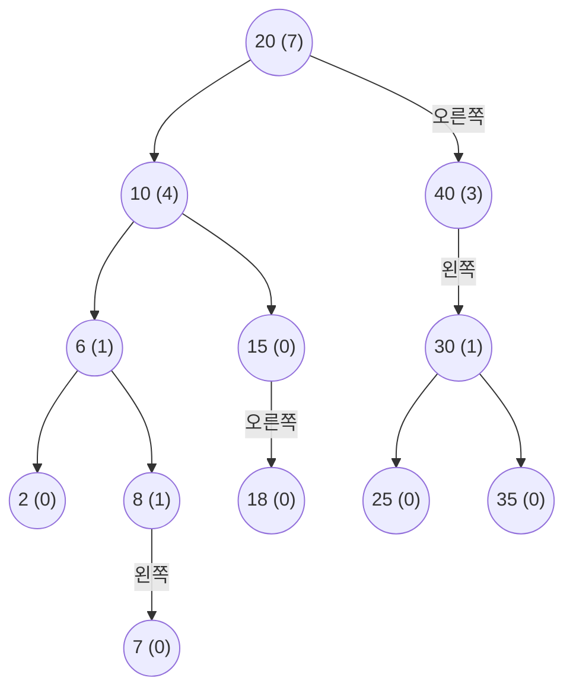
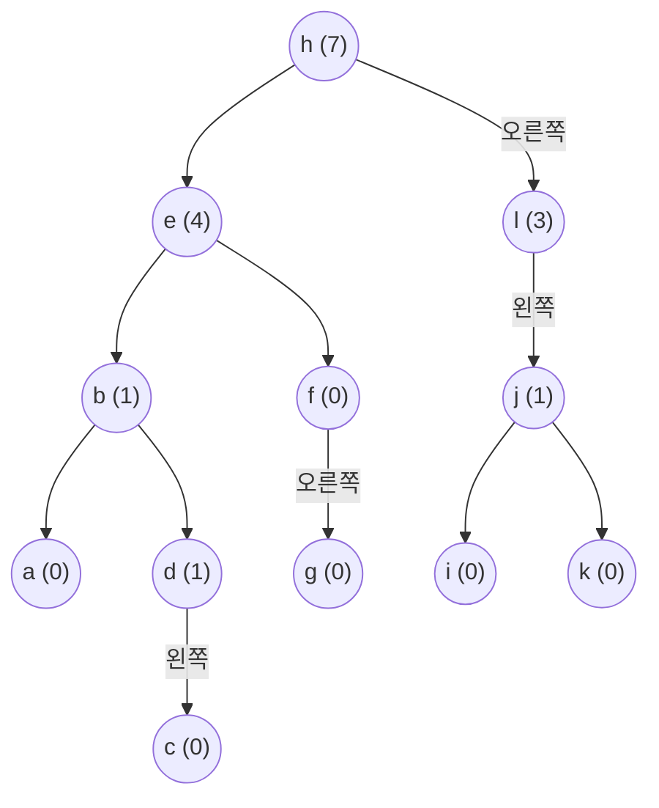


<div class="callout callout-summary" markdown="1">
<div class="callout-title callout-title--default" markdown="span">요약</div>

왼쪽에는 작은 값, 오른쪽에는 큰 값이 오게 엮은 나무의 갈림길마다 "내 왼쪽 아래에 값이 몇 개 달렸나"를 적어 둔다. 그 수만 보면 "작은 것부터 세어 몇 번째 값"이 왼쪽에 있는지 오른쪽에 있는지 바로 알아서, 하나씩 세지 않고 층 수만큼만 내려가면 된다. 같은 방법으로 순서가 있는 줄을 나무에 담으면 가운데 끼우기와 몇 번째 읽기가 둘 다 빨라진다. 대신 넣거나 지울 때마다 내려간 길 위의 수를 함께 고쳐야 하고, 나무가 한쪽으로 늘어지면 이득이 사라진다.

</div>


## 예시로 보기

이진 탐색 트리는 키로 찾기는 빠르다. 그런데 "작은 것부터 여섯째 키가 뭐냐"고 물으면 곤란하다. 중위 순회로 앞에서부터 여섯 개를 세는 수밖에 없다. 정렬된 배열은 몇 번째든 한 번에 읽지만 가운데 끼우기가 느리고, 연결 리스트는 그 반대다([배열과 연결 리스트 비교](/Hongs_Blog/studies/data-structures/array-vs-linked-list/)). 노드마다 수 하나를 더 적어 두면 이 둘을 한꺼번에 얻는다[^s1].

[이진 탐색 트리의 삭제](/Hongs_Blog/studies/data-structures/bst-delete/)에서 본 나무에, 노드마다 왼쪽 부분 트리의 노드 수를 괄호 안에 적었다. 슬라이드는 이 수를 `leftSize`라 부른다[^1].



20의 왼쪽 아래에는 10, 6, 15, 2, 8, 18, 7의 일곱 개가 달려 있어 7이다. 40은 왼쪽 아래에 30, 25, 35가 있어 3이다[^s2].

키를 작은 것부터 늘어놓으면 2, 6, 7, 8, 10, 15, 18, 20, 25, 30, 35, 40이다. 이 줄에서 0부터 센 자리를 그 키의 **순위**(rank)라 한다. 2의 순위는 0, 15의 순위는 5, 20의 순위는 7이다[^2]. 뿌리 20의 괄호 안 수가 7인 것은 우연이 아니다. 20보다 작은 키가 모두 왼쪽 아래에 있으니, 그 개수가 곧 20의 순위다.

**순위 5인 키 찾기.** 뿌리에서 시작해 찾는 순위를 괄호 안 수와 견준다.

| 지금 노드 (괄호 안 수) | 찾는 순위 | 견준 결과 | 다음 |
|---|---|---|---|
| 20 (7) | 5 | 5 < 7: 왼쪽 아래 일곱 개 가운데 있다 | 왼쪽으로, 순위는 그대로 5 |
| 10 (4) | 5 | 5 > 4: 왼쪽 네 개와 10 자신을 지나친다 | 오른쪽으로, 순위는 5 − 4 − 1 = 0 |
| 15 (0) | 0 | 같다 | 15가 답이다 |

노드 셋만 보고 끝났다. 10에서 오른쪽으로 갈 때 순위를 5에서 0으로 줄인 까닭은, 10의 왼쪽 네 개(2, 6, 7, 8)와 10 자신까지 다섯 개가 찾는 키보다 앞에 있기 때문이다. 오른쪽 부분 트리 안에서는 그 다섯을 빼고 다시 0부터 센다.

<div class="callout callout-check" markdown="1">
<div class="callout-title" markdown="span">검증: 컴파일해 실행(ASan·UBSan). 슬라이드 나무의 leftSize 12개와 순위 셋, 위 추적, Insert(5, 'm')의 결과, 무작위 키 2,000묶음에서 "색인 i의 키 = 정렬 배열의 i번째"와 "그 키의 순위 = i", 무작위 줄 연산 2,000묶음에서 배열 모형과 같은 결과, malloc 횟수 = free 횟수를 확인했다 — [33_indexed-bst_impl.c](/Hongs_Blog/studies/data-structures/code/33_indexed-bst_impl/)</div>

</div>


## 정의

색인 이진 탐색 트리는 이진 탐색 트리이고, 노드마다 칸이 하나 더 있다[^1].

- $$\text{leftSize}(x)$$ = 노드 $$x$$의 왼쪽 부분 트리에 든 노드 수.
- $$\text{rank}(k)$$ = 키 $$k$$가 중위 순회에서 나오는 자리(0부터). 중위 순회는 키가 커지는 순서이므로, $$k$$보다 작은 키의 수와 같다[^2].
- 둘의 관계: $$\text{leftSize}(x)$$는 "$$x$$를 뿌리로 하는 부분 트리만 놓고 본 $$x$$의 순위"다[^2].

**색인으로 찾기.** 찾는 순위를 $$\text{index}$$라 하고 노드 $$x$$에서 시작한다[^3].

$$\text{찾는 노드} = \begin{cases} x & \text{index} = \text{leftSize}(x) \\ x\text{의 왼쪽 부분 트리에서 순위 } \text{index}\text{인 노드} & \text{index} < \text{leftSize}(x) \\ x\text{의 오른쪽 부분 트리에서 순위 } \text{index} - \text{leftSize}(x) - 1\text{인 노드} & \text{index} > \text{leftSize}(x) \end{cases}$$


셋째 줄에서 빼는 $$\text{leftSize}(x) + 1$$은 왼쪽 부분 트리의 노드들과 $$x$$ 자신이다. 작은 예로, 위 표의 둘째 줄이 $$5 - 4 - 1 = 0$$이다.

```c
typedef struct node *treePointer;
typedef struct node {
    int key;
    int leftSize;        /* 왼쪽 부분 트리의 노드 수 */
    treePointer leftChild, rightChild;
} node;

/* 순위 index(0부터)인 노드. 범위 밖이면 NULL */
treePointer findByIndex(treePointer x, int index)
{
    while (x) {
        if (index == x->leftSize) return x;              /* 바로 이 노드 */
        if (index < x->leftSize) x = x->leftChild;       /* 왼쪽에서 같은 순위 */
        else {                                           /* 오른쪽에서 줄어든 순위 */
            index -= x->leftSize + 1;
            x = x->rightChild;
        }
    }
    return NULL;
}
```

거꾸로 키의 순위를 구할 때는 키로 찾으며 내려가다가, 오른쪽으로 꺾을 때마다 "지나친 수"($$\text{leftSize} + 1$$)를 더하고, 찾은 노드의 $$\text{leftSize}$$를 마지막에 더한다. 18의 순위는 20에서 왼쪽(더하지 않음), 10에서 오른쪽($$4 + 1$$), 15에서 오른쪽($$0 + 1$$), 18에서 멈춤($$0$$)이라 $$5 + 1 + 0 = 6$$이다[^s1].

## 줄을 나무에 담기

키가 없어도 된다. 순서가 있는 줄 `[a, b, c, d, e, f, g, h, i, j, k, l]`을 "중위 순회로 읽으면 이 순서가 나오는 나무"에 담고 `leftSize`를 적어 두면, 몇 번째 원소든 위와 같은 방법으로 찾는다. 슬라이드는 이것을 색인 이진 트리로 나타낸 선형 리스트라 부른다[^4].



앞의 나무와 모양이 같고 키 대신 글자가 들어 있다. 여기서는 글자끼리 크기를 견주지 않고 `leftSize`만 보고 내려간다[^s2].

**Insert(5, 'm'): 5번 자리에 m 끼우기.** 끝난 뒤의 줄은 `[a, b, c, d, e, m, f, …]`이다. m은 4번 원소 e 바로 뒤, f 바로 앞에 와야 한다[^5].

| 지금 노드 (leftSize) | 끼울 자리 | 견준 결과 | 한 일 |
|---|---|---|---|
| h (7) | 5 | 5 ≤ 7: 왼쪽 부분 트리 안이다 | h의 leftSize를 8로 늘리고 왼쪽으로 |
| e (4) | 5 | 5 > 4: e보다 뒤다 | 자리를 5 − 4 − 1 = 0으로 줄이고 오른쪽으로 |
| f (0) | 0 | 0 ≤ 0: f보다 앞이다 | f의 leftSize를 1로 늘리고 왼쪽으로 |
| (빈자리) | | | m을 f의 왼쪽 자식으로 단다 |

m은 "e의 오른쪽 부분 트리에서 가장 왼쪽 노드"가 된다. 중위 순회에서 e 바로 다음에 읽히는 자리다. `leftSize`는 내려가며 왼쪽으로 꺾은 노드(h와 f)만 1씩 늘었다. 그 노드들의 왼쪽 아래에 새 노드가 생겼기 때문이다.

방법은 이것 하나가 아니다. 슬라이드는 "m을 e의 오른쪽 자식으로 달고, e의 옛 오른쪽 부분 트리(f, g)를 m의 오른쪽에 단다"도 보여 준다. 그때는 h의 `leftSize`만 8로 바뀐다. 어느 방법이든 뿌리에서 새 노드까지의 길 위에서 `leftSize` 몇 개를 고쳐야 하고, 걸리는 시간은 $$O(\text{높이})$$다[^5].

```c
/* 줄의 index번째 자리에 끼우기 (0 <= index <= 원소 수) */
void listInsert(treePointer *root, int index, int element)
{
    treePointer *link = root;
    while (*link) {
        treePointer x = *link;
        if (index <= x->leftSize) { x->leftSize++; link = &x->leftChild; }
        else { index -= x->leftSize + 1; link = &x->rightChild; }
    }
    *link = newNode(element);        /* leftSize 0인 새 노드 */
}
```

`link`는 [이진 탐색 트리의 삭제](/Hongs_Blog/studies/data-structures/bst-delete/)에서처럼 "새 노드를 적어 넣을 칸"의 주소다. 지울 때는 반대로, 찾으며 내려가다 왼쪽으로 꺾은 노드의 `leftSize`를 1씩 줄이고 그 문서의 방법으로 노드를 뗀다[^s1].

## 활용

- **비용.** 색인으로 찾기, 순위 구하기, 끼우기, 지우기 모두 뿌리에서 한 길만 내려가 $$O(\text{높이})$$다[^5]. 높이는 간선 수로 $$\lfloor \lg n \rfloor$$에서 $$n - 1$$ 사이다([이진 탐색 트리의 탐색과 삽입](/Hongs_Blog/studies/data-structures/bst-search-insert/)). 위 나무(높이 4)에서는 어느 순위든 노드 5개 이하만 본다. 메모리는 노드마다 정수 칸 하나가 더 든다.
- **다른 구조와 견주기.** 원소가 $$n$$개인 줄에서 $$k$$번째를 다룰 때다[^s1].

| 연산 | 배열 | 연결 리스트 | 색인 이진 트리 |
|---|---|---|---|
| $$k$$번째 읽기 | $$O(1)$$ | $$O(k)$$ | $$O(\text{높이})$$ |
| $$k$$번째 자리에 끼우기·지우기 | $$O(n - k)$$: 뒤를 민다 | $$O(k)$$: 자리까지 걸어간다 | $$O(\text{높이})$$ |

읽기만 많으면 배열이 낫다. 읽기와 가운데 끼우기가 섞여 있고 나무의 높이가 $$\log n$$ 근처일 때 색인 이진 트리가 이긴다.

- **흔한 실수.** 넣거나 지운 뒤 `leftSize`를 안 고친다. 오른쪽으로 내려갈 때 순위에서 $$\text{leftSize} + 1$$을 빼지 않거나 1을 빠뜨린다. 이미 있는 키라 넣지 않았는데 내려가며 `leftSize`를 올려 둔다(그래서 구현은 먼저 키가 있는지 본다).
- 구현: [33_indexed-bst_impl.c](/Hongs_Blog/studies/data-structures/code/33_indexed-bst_impl/)

## 연결

- 선수: [이진 탐색 트리의 탐색과 삽입](/Hongs_Blog/studies/data-structures/bst-search-insert/), [이진 탐색 트리의 삭제](/Hongs_Blog/studies/data-structures/bst-delete/)
- 줄을 담는 다른 방법: [선형 자료구조](/Hongs_Blog/studies/data-structures/linear-data-structure/), [배열과 연결 리스트 비교](/Hongs_Blog/studies/data-structures/array-vs-linked-list/)
- 순위가 중위 순회의 자리라는 점: [트리 순회와 이진 탐색 트리](/Hongs_Blog/studies/algorithms/tree-traversal-bst/)
- 같은 생각: [이분 탐색](/Hongs_Blog/studies/algorithms/binary-search/)은 정렬된 배열에서 "앞에 몇 개가 있나"를 칸 번호로 바로 안다. 색인 이진 탐색 트리는 그 수를 노드에 적어 두어 같은 판단을 한다.

## 확인 문제

<details class="callout callout-question" markdown="1">
<summary class="callout-title" markdown="span">**C1** 위 나무(키 12개)에서 순위 9인 키를 찾는다. 들르는 노드와, 노드마다 견준 결과를 쓰라.</summary>

**답:** 20 → 40 → 30, 답은 30이다. 20(leftSize 7): 9 > 7이라 오른쪽으로 가고 순위는 9 − 7 − 1 = 1. 40(leftSize 3): 1 < 3이라 왼쪽으로, 순위는 그대로 1. 30(leftSize 1): 같다.<br>
**이유:** 작은 것부터 늘어놓은 2, 6, 7, 8, 10, 15, 18, 20, 25, 30, 35, 40에서 0부터 세어 아홉째가 30이다.

</details>


<details class="callout callout-question" markdown="1">
<summary class="callout-title" markdown="span">**C2** 줄 `[a, b, …, l]`을 담은 위 나무에 Insert(5, 'm')을 했다. `leftSize`가 바뀌는 노드와 바뀐 값, m이 달리는 자리를 쓰라.</summary>

**답:** h가 7에서 8로, f가 0에서 1로 바뀐다. e는 4 그대로다. m은 f의 왼쪽 자식이 된다.<br>
**이유:** 내려가며 왼쪽으로 꺾은 노드만 왼쪽 아래에 새 노드가 생긴다. e에서는 오른쪽으로 꺾었으니 e의 왼쪽 부분 트리는 그대로다.

</details>


<details class="callout callout-question" markdown="1">
<summary class="callout-title" markdown="span">**C3** 색인으로 찾을 때 오른쪽으로 내려가면 순위에서 $$\text{leftSize}(x) + 1$$을 빼는 까닭은 무엇인가? 1을 빼지 않으면 위 나무에서 순위 5를 찾을 때 어떻게 되는가?</summary>

**답:** 오른쪽 부분 트리의 키는 $$x$$의 왼쪽 부분 트리 전체($$\text{leftSize}(x)$$개)와 $$x$$ 자신(1개)보다 뒤에 온다. 그만큼을 지나쳤으니 오른쪽 부분 트리 안에서는 그 수를 뺀 순위로 다시 센다. 1을 빼지 않으면 10에서 순위가 5 − 4 = 1이 된다. 15(leftSize 0)에서 1 > 0이라 오른쪽으로 가고, 18(leftSize 0)에서도 1 > 0이라 또 오른쪽으로 가서 빈자리에 닿는다. 순위 5인 키가 있는데도 없다고 답한다.<br>
**이유:** $$\text{leftSize}$$는 부분 트리 안에서의 순위다. 부분 트리를 옮겨 갈 때마다 기준이 바뀐다.

</details>


[^1]: 자료구조 9회 강의 자료 「DS_Week9_Lecture_BST_2024」, p.19 (정의와 leftSize를 적은 그림)
[^2]: 같은 자료, p.20 (rank의 정의, rank(2) = 0, rank(15) = 5, rank(20) = 7, leftSize와 rank의 관계)
[^3]: 같은 자료, p.21 (Search(index)와 Delete(index)의 세 줄 규칙)
[^4]: 같은 자료, p.22 (Linear List As Indexed Binary Tree, list = [a, b, …, l])
[^5]: 같은 자료, p.23~25 (Insert(5, 'm')의 두 가지 방법, "Must update some leftSize values on path from root to new node", "Complexity is O(height)")
[^s1]: <span class="fn-tag" title="수업 자료에 없고 따로 보탠 내용">보충</span> 도입의 비교, 순위 5를 찾는 추적 표, `findByIndex`·`listInsert` 코드, 키의 순위를 구하는 방법과 18의 계산, Insert(5, 'm')의 추적 표, 지우기에서 leftSize를 줄이는 방법, 견주는 표, 흔한 실수, 카드 셋은 원본에 없다. 슬라이드는 규칙 세 줄과 그림만 준다. 코드와 수치는 구현 파일에서 돌려 확인했다. 지우기는 슬라이드 p.21의 제목에만 나오고 방법이 없어, 삭제 문서의 방법에 leftSize 고치기를 더해 만들고 배열 모형과 견줘 확인했다.
[^s2]: <span class="fn-tag" title="수업 자료에 없고 따로 보탠 내용">보충</span> 다이어그램 2개는 슬라이드 p.19와 p.22의 그림을 옮겨 그린 것이다.

