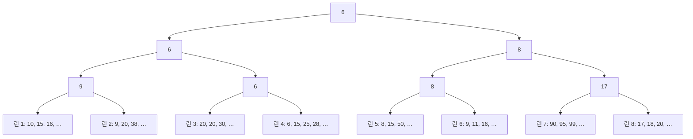



요약

키 순서로 선 여러 줄을 한 줄로 합칠 때, 두 줄씩 합치기를 여러 번 하는 대신 모든 줄의 맨 앞 사람을 한꺼번에 견주어 가장 작은 사람부터 뽑아내는 방식이다. 한 번에 많은 줄을 합칠수록 자료 전체를 훑는 횟수가 준다. 다만 맨 앞 사람들 가운데 가장 작은 사람을 고르는 일이 줄 수만큼 무거워지는데, 토너먼트 대진표를 만들어 두면 줄이 많아도 몇 번만 견주면 된다. 그렇다고 줄 수를 마냥 늘리면 줄마다 필요한 작업 칸이 잘게 쪼개져 디스크를 오가는 횟수가 다시 는다.

## 예시로 보기

[외부 병합 정렬](/Hongs_Blog/studies/data-structures/external-merge-sort/)에서 런 20개를 둘씩 합치면 패스가 5번이었다. 패스 한 번은 디스크의 자료 전체를 읽고 다시 쓰는 일이라 비싸다. 한 번에 다섯 개씩 합치면 어떻게 될까[^1].

| 패스 | 둘씩 합칠 때 런의 수 | 다섯씩 합칠 때 런의 수 |
|---|---|---|
| 처음 | 20 | 20 |
| 1 | 10 | 4 (R1~R5 → S1, …, R16~R20 → S4) |
| 2 | 5 | 1 (S1~S4 → T1) |
| 3 | 3 | |
| 4 | 2 | |
| 5 | 1 | |

패스가 5번에서 2번으로 준다. 한 번에 합치는 런의 수 $$k$$를 병합 차수(merge order)라 부르고, $$k$$개씩 합치는 것을 k-way 병합이라 부른다.

검증: 패스 수가 $$\lceil \log_k r \rceil$$인 것($$r \le 300$$, $$k \le 10$$ 전부), 런 64개를 $$k$$ = 2, 4, 8, 64로 끝까지 합치며 센 비교 횟수, 슬라이드의 런 8개로 만든 승자 트리와 다시 겨루기·패자 트리의 칸, 내보내는 차례, 버퍼 크기 — [46_k-way-merge_verify.py](/Hongs_Blog/studies/data-structures/code/46_k-way-merge_verify/)

## 정의

**패스의 수.** 처음 런이 $$r$$개이고 한 번에 $$k$$개씩 합치면, 패스마다 런의 수가 $$k$$분의 1로 준다. 1개가 될 때까지의 횟수는 다음과 같다[^2].

$$\text{패스의 수} = \lceil \log_k r \rceil$$

$$\log_k r$$은 "$$k$$를 몇 번 곱해야 $$r$$이 되는가"이고 $$\lceil\ \rceil$$는 올림이다. $$r = 20$$이면 $$k = 2$$일 때 5번($$2^5 = 32 \ge 20$$), $$k = 4$$일 때 3번($$4^3 = 64$$), $$k = 5$$일 때 2번($$5^2 = 25$$), $$k = 20$$일 때 1번이다.

$$k$$를 키우면 패스는 준다. 대신 치르는 값이 두 가지 있다.

### 치르는 값 1: 패스 한 번의 입출력

합치는 동안 런마다 입력 버퍼가 하나씩 있어야 한다. 필요한 입력 버퍼의 수는 $$k$$에 비례한다. 메모리 크기는 정해져 있으므로, $$k$$가 어느 선을 넘으면 버퍼 하나의 크기(블록 크기)를 줄여야 한다. 블록이 작아지면 같은 자료의 블록 수가 늘고, 패스 한 번에 디스크 머리를 옮기고 회전을 기다리는 횟수도 는다[^3].

가장 단순하게 입력 버퍼 $$k$$개와 출력 버퍼 1개를 둔다고 하고, 메모리가 레코드 500개라고 하자. 블록 크기는 많아야 $$\lfloor 500 / (k + 1) \rfloor$$개다[^s1].

| $$k$$ | 블록 크기의 한계 | 레코드 10,000개의 블록 수 |
|---|---|---|
| 2 | 166개 (100개 블록을 그대로 쓸 수 있다) | 100 |
| 4 | 100개 | 100 |
| 5 | 83개 | 121 |
| 9 | 50개 | 200 |
| 19 | 25개 | 400 |

### 치르는 값 2: 메모리 안에서 고르는 일

$$k$$개 런의 맨 앞 레코드 가운데 가장 작은 것을 골라야 출력 버퍼로 옮길 수 있다.

**한 줄로 견주기.** 맨 앞 $$k$$개를 차례로 견주면 레코드 하나를 고르는 데 비교가 $$k - 1$$번 든다. 레코드가 모두 $$n$$개면 패스 한 번의 병합 시간은 $$c(k - 1)n$$이다($$c$$는 상수). 패스 수를 곱한 전체 병합 시간은[^4]

$$c(k - 1)\,n \log_k r \approx cn\,\frac{k}{\log_2 k}\,\log_2 r$$

이다. 뒤의 꼴은 $$\log_k r = \frac{\log_2 r}{\log_2 k}$$로 바꿔 쓰고 $$k - 1$$을 $$k$$로 어림한 것이다. $$\frac{k - 1}{\log_2 k}$$는 $$k$$ = 2, 4, 8, 16에서 1, 1.5, 2.33, 3.75로 커진다. 패스는 줄었는데 메모리 안에서 하는 비교는 오히려 는다[^s1].

**선택 트리로 고르기.** 맨 앞 $$k$$개를 토너먼트 대진표에 올려 두면, 레코드 하나를 내보낸 뒤 그 런의 다음 레코드가 지나는 길만 다시 겨루면 된다. 그 길의 길이는 $$\log_2 k$$다. 그래서[^5]

$$\text{패스 한 번} = dn\log_2 k, \qquad \text{전체} = (dn\log_2 k)\log_k r = dn\log_2 r$$

이다($$d$$는 상수). $$\log_2 k$$와 $$\log_k r$$을 곱하면 $$\log_2 r$$이 되어 $$k$$가 사라진다. 선택 트리를 쓰면 메모리 안의 병합 시간이 $$k$$와 상관없어진다.

런 64개를 끝까지 합치며 레코드 하나당 비교 횟수를 세면 이렇다(런마다 32개, 모두 2,048개)[^s1].

| $$k$$ | 패스 | 한 줄로 견주기: 어림 $$(k - 1) \times$$ 패스 | 센 값 | 승자 트리: 어림 $$\log_2 k \times$$ 패스 | 센 값 |
|---|---|---|---|---|---|
| 2 | 6 | 6 | 5.94 | 6 | 6.03 |
| 4 | 3 | 9 | 8.88 | 6 | 6.03 |
| 8 | 2 | 14 | 13.77 | 6 | 6.03 |
| 64 | 1 | 63 | 61.15 | 6 | 6.03 |

한 줄로 견주기의 센 값이 어림보다 조금 작은 것은 런이 바닥나면 견줄 상대가 줄기 때문이다. 승자 트리의 0.03은 트리를 처음 만들 때의 비교다.

### 슬라이드의 선택 트리

런 8개의 맨 앞이 10, 9, 20, 6, 8, 9, 90, 17이다[^6].

칸마다 두 자식 가운데 작은 값(이긴 쪽)을 적은 [승자 트리](/Hongs_Blog/studies/data-structures/winner-tree/)다. 뿌리의 6이 가장 작은 레코드다[^s2].

6을 내보내면 런 4의 맨 앞이 15가 된다. 다시 겨루는 칸은 런 4에서 뿌리까지의 세 칸뿐이다. 15와 20 가운데 15, 9와 15 가운데 9, 9와 8 가운데 8이 올라가 뿌리가 8이 된다[^7]. 비교는 3번, 곧 $$\log_2 8$$번이다. 이렇게 뽑혀 나오는 차례는 6, 8, 9, 9, 10, 11, 15, 15, 15, …다[^s1].

슬라이드는 같은 런으로 [패자 트리](/Hongs_Blog/studies/data-structures/loser-tree/)도 보여 준다. 칸마다 진 쪽을 적어 위에서부터 8 / 9, 17 / 10, 20, 9, 90이고, 우승자 6은 맨 위에 따로 둔다[^8]. 패자 트리는 다시 겨룰 때 형제 칸을 볼 필요 없이 부모 칸만 따라 올라가면 된다.

## 활용

- 적용 조건: 정렬된 줄이 여러 개 있고, 그것을 하나로 합쳐야 할 때. 디스크의 런뿐 아니라 메모리 안의 정렬된 배열 여러 개에도 쓴다.
- 알아보는 신호: "정렬된 목록 $$k$$개를 하나로", "패스 수를 줄여라", "$$k$$개 가운데 가장 작은 것을 되풀이해 뽑는다".
- 연습: [외부 정렬 시간 계산 예제 사다리](/Hongs_Blog/studies/data-structures/external-sort-ladder/)
- 맨 앞 $$k$$개 가운데 가장 작은 것을 되풀이해 뽑는 일은 [최소 힙](/Hongs_Blog/studies/data-structures/max-heap/)으로도 $$O(\log k)$$에 할 수 있다[^s1].
- 흔한 실수: "$$k$$가 클수록 무조건 좋다"고 보는 것. 패스는 줄지만 버퍼가 잘게 쪼개져 패스 한 번의 입출력이 늘고, 선택 트리 없이는 비교도 는다.

## 연결

- 선수: [외부 병합 정렬](/Hongs_Blog/studies/data-structures/external-merge-sort/)(패스와 버퍼), [승자 트리](/Hongs_Blog/studies/data-structures/winner-tree/)와 [패자 트리](/Hongs_Blog/studies/data-structures/loser-tree/)(만들기와 다시 겨루기), [로그](/Hongs_Blog/studies/college-math/logarithm/)(밑 바꾸기 $$\log_k r = \frac{\log_2 r}{\log_2 k}$$)
- 두 줄 합치기($$k = 2$$): [병합 정렬](/Hongs_Blog/studies/data-structures/merge-sort/)

## 확인 문제

**C1** 처음 런이 100개다. 2개씩, 4개씩, 10개씩 합칠 때 패스는 각각 몇 번인가?

**답:** 7번, 4번, 2번. 
**이유:** $$2^6 = 64 < 100 \le 128 = 2^7$$, $$4^3 = 64 < 100 \le 256 = 4^4$$, $$10^2 = 100$$. $$\lceil \log_k 100 \rceil$$을 구할 때는 $$k$$를 거듭 곱해 100 이상이 되는 첫 횟수를 찾는다.

**C2** 런 64개를 8개씩 합친다. 레코드 하나당 메모리 안의 비교는 한 줄로 견주기와 선택 트리에서 각각 약 몇 번인가? 선택 트리 쪽의 답이 $$k$$를 바꿔도 그대로인 까닭은?

**답:** 한 줄로 견주기 약 14번($$7 \times 2$$패스), 선택 트리 약 6번($$3 \times 2$$패스). 
**이유:** 선택 트리의 비교는 패스 한 번에 $$\log_2 k$$번, 패스는 $$\log_k r$$번이다. 둘을 곱하면 $$\log_2 k \times \frac{\log_2 r}{\log_2 k} = \log_2 r = 6$$으로 $$k$$가 지워진다. $$k$$를 키우면 한 번 고르는 일은 무거워지지만 그만큼 패스가 줄어 서로 지운다. 한 줄로 견주기는 고르는 일이 $$k - 1$$로 더 빨리 무거워져 지워지지 않는다.

**C3** 위 승자 트리에서 6과 8을 차례로 내보냈다. 이때 런 5의 맨 앞은 15다. 다시 겨룬 뒤 뿌리의 값과, 뿌리 바로 아래 두 칸의 값을 쓰라.

**답:** 뿌리 9, 그 아래 두 칸은 9와 9다. 
**이유:** 런 5의 15와 런 6의 9 가운데 9가 올라간다. 그 위에서 9와 17 가운데 9가 올라간다. 뿌리에서는 왼쪽의 9(런 2)와 오른쪽의 9(런 6)가 만난다. 다시 겨룬 칸은 런 5에서 뿌리까지의 세 칸뿐이다.

[^1]: 자료구조 14회 강의 자료 「DS_Week14_Lecture_2024」, p.46 (Merge 20 Runs Using 5-Way Merging: "Number of passes = 2")
[^2]: 같은 자료, p.45 (Improve Run Merging: higher-order merge, 패스 수 식)
[^3]: 같은 자료, p.47 (I/O Time Per Merge Pass)
[^4]: 같은 자료, p.48 (Internal Merge Time: Naïve way)
[^5]: 같은 자료, p.49 (Merge Time Using A Selection Tree)
[^6]: 같은 자료, p.50 (Selection Trees: Winner Trees, $$k = 8$$, $$O(n \log_2 k)$$)
[^7]: 같은 자료, p.51 (6을 내보낸 뒤 다시 겨룬 승자 트리)
[^8]: 같은 자료, p.52 (Selection Trees: Loser Trees)
[^s1]: 보충 $$r = 20$$의 $$k = 4$$, $$k = 20$$ 값, 버퍼 $$k + 1$$개 모형과 블록 크기 표, $$\frac{k - 1}{\log_2 k}$$의 값, 런 64개의 비교 횟수 표, 내보내는 차례 아홉 개, 최소 힙으로도 할 수 있다는 것, 카드 C1~C3은 슬라이드에 없다. 슬라이드는 입력 버퍼의 수가 $$k$$에 비례한다고만 적는다. 내보내는 차례는 그림에 보이는 값만으로 정해지는 데까지 적었다. 모두 위 검증 코드로 확인했고, 비교 횟수 표는 센 값이다.
[^s2]: 보충 다이어그램 1개는 슬라이드 p.50의 그림을 옮겨 그린 것이다. 런의 값은 그림에 보이는 것만 적었다.

