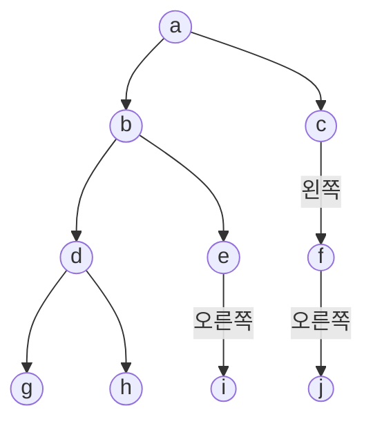


<div class="callout callout-summary" markdown="1">
<div class="callout-title callout-title--default" markdown="span">요약</div>

이진 트리의 칸을 위층부터 한 층씩, 같은 층에서는 왼쪽부터 차례로 들르는 방법이다. 지금 들른 칸의 자식들을 줄 맨 뒤에 세워 두고, 다음에는 줄 맨 앞의 칸을 들르기만 하면 이 순서가 나온다. 함수가 자기를 다시 부르지 않고 고리 하나로 끝난다. 대신 줄 서 있는 칸을 담아 둘 자리가 따로 필요하고, 넓게 퍼진 트리에서는 그 줄이 전체 칸의 절반쯤까지 길어진다.

</div>


## 예시로 보기

트리로 하는 일은 대개 "모든 노드를 정확히 한 번씩 들르며 무언가를 한다"는 꼴이다. 이렇게 도는 것을 순회라 하고, 노드에 들러 하는 일(출력, 복사, 계산)을 방문이라 한다. 도는 순서는 네 가지다.

| 이름 | 순서 |
|---|---|
| 전위(preorder) | 뿌리 → 왼쪽 → 오른쪽 |
| 중위(inorder) | 왼쪽 → 뿌리 → 오른쪽 |
| 후위(postorder) | 왼쪽 → 오른쪽 → 뿌리 |
| 레벨 순서(level order) | 위층부터, 같은 층은 왼쪽부터 |

앞의 셋은 한 가지를 끝까지 내려갔다가 돌아오는 순서라 재귀로 쓰면 세 줄이다: [트리 순회와 이진 탐색 트리](/Hongs_Blog/studies/algorithms/tree-traversal-bst/). 레벨 순서는 그렇게 쓸 수 없다. 아래 트리에서 d를 들른 다음에는 d의 자식이 아니라 옆 가지의 e로 건너가야 한다. d에서 e로 가는 선은 없다.



그래서 "나중에 들를 노드"를 적어 두는 줄이 필요하다. 먼저 적은 것을 먼저 꺼내는 줄, 곧 큐를 쓴다. 노드를 방문할 때마다 그 자식을 큐 뒤에 넣고, 큐 맨 앞에서 다음 노드를 꺼낸다.

| 방문 | 자식을 넣은 뒤의 큐 (앞 → 뒤) | 다음에 꺼내는 노드 |
|---|---|---|
| a | b c | b |
| b | c d e | c |
| c | d e f | d |
| d | e f g h | e |
| e | f g h i | f |
| f | g h i j | g |
| g | h i j | h |
| h | i j | i |
| i | j | j |
| j | (비었다) | 끝 |

방문한 순서는 a b c d e f g h i j다. d를 방문할 때 큐에는 같은 층의 e, f가 d의 자식 g, h보다 앞에 서 있다. 그래서 e로 건너간다.

## 알고리즘

**입력:** 이진 트리의 뿌리를 가리키는 포인터 `root`(빈 트리면 `NULL`).
**하는 일:** 모든 노드를 레벨 순서로 한 번씩 방문한다.

```
ptr = 뿌리
ptr이 NULL이 아닌 동안:
    ptr이 가리키는 노드를 방문하고, 그 자식들을 큐에 넣는다
    큐가 비었으면 ptr = NULL
    아니면 큐에서 하나를 꺼내 ptr로 둔다
```

```c
void levelOrder(treePointer root, char *out)     /* 방문 = 글자를 out 끝에 붙이기 */
{
    int n = countNodes(root), k = 0;
    treePointer *queue = malloc(sizeof(*queue) * (size_t)(n > 0 ? n : 1));
    int front = 0, rear = 0;        /* front: 다음에 꺼낼 칸, rear: 다음에 넣을 칸 */
    treePointer ptr = root;

    while (ptr != NULL) {
        out[k++] = ptr->data;                                   /* 방문 */
        if (ptr->leftChild != NULL)  queue[rear++] = ptr->leftChild;
        if (ptr->rightChild != NULL) queue[rear++] = ptr->rightChild;
        ptr = (front == rear) ? NULL : queue[front++];           /* 비었으면 끝 */
    }
    out[k] = '\0';
    free(queue);
}
```

큐에 넣는 것은 값이 아니라 노드의 주소다. 꺼낸 뒤에 그 노드의 자식을 찾아가야 하기 때문이다. 뿌리를 뺀 모든 노드가 정확히 한 번씩 큐에 들어가므로, 큐 배열은 노드 수만큼의 칸이면 넉넉하고 앞쪽 칸을 다시 쓸 일이 없다. 노드 수를 미리 모르면 [원형 큐](/Hongs_Blog/studies/data-structures/circular-queue/)나 [연결 리스트로 만든 큐](/Hongs_Blog/studies/data-structures/linked-queue/)를 쓴다[^s1].

**왜 층별 순서가 나오는가.** 큐에 서 있는 노드들은 늘 "얕은 층이 앞, 같은 층이면 왼쪽이 앞"이다. 맨 앞의 노드 x를 꺼내 그 자식을 뒤에 붙여도 이 줄 세우기는 계속 맞는다. 큐에 남은 노드는 x와 같은 층이거나 한 층 아래뿐이고, x의 자식은 한 층 아래다. 같은 층에서 먼저 들어와 있던 노드는 x보다 왼쪽에 있는 노드의 자식이라 x의 자식보다 왼쪽이다. 그래서 꺼내는 순서가 곧 층별 순서다[^s1].

**비용.** 노드마다 큐에 한 번 들어가고 한 번 나오니 시간은 $$O(n)$$이다. 큐가 가장 길어지는 때는 한 층이 통째로 들어 있을 때다. 층이 모두 찬 트리에서는 맨 아래층에 전체의 절반쯤인 $$(n + 1)/2$$개가 있어, 큐 자리도 그만큼 든다. 한 줄로 늘어선 트리에서는 큐에 늘 하나뿐이다[^s1].

<div class="callout callout-check" markdown="1">
<div class="callout-title" markdown="span">검증: 컴파일해 실행(ASan·UBSan). 예시 트리에서 방문 순서 a ~ j와 위 표의 큐 내용, 큐를 스택으로 바꿨을 때의 순서, 완전 이진 트리에서 레벨 순서가 배열 칸 순서와 같음, 빈 트리·노드 하나·한 줄 트리, 무작위 트리 2,000개에서 깊이별로 모은 결과와 같음, 카드의 값을 확인했다. 잡은 메모리는 모두 풀었다(`leaks` 도구로 확인) — [24_level-order-traversal_impl.c](/Hongs_Blog/studies/data-structures/code/24_level-order-traversal_impl/)</div>

</div>


## 활용

- **완전 이진 트리에서는 배열 순서 그대로다.** [완전 이진 트리](/Hongs_Blog/studies/data-structures/full-complete-binary-tree/)의 번호가 바로 레벨 순서로 매긴 번호라서, 배열 표현의 `tree[1]`부터 `tree[n]`까지 차례로 읽으면 레벨 순서 순회다[^s1].
- **트리 되살리기.** 중위 순회 결과와 레벨 순서 결과가 있으면 트리가 하나로 정해진다: [순회 결과로 이진 트리 되살리기](/Hongs_Blog/studies/data-structures/tree-from-traversals/).
- **그래프로 넓히면.** 같은 생각을 그래프에 쓰면 [너비 우선 탐색(BFS)](/Hongs_Blog/studies/algorithms/bfs/)이다. 그래프에는 같은 노드로 가는 길이 여럿이라 "이미 들른 곳" 표시가 필요하다. 트리는 노드마다 오는 길이 부모 하나뿐이라 그 표시가 필요 없다[^s1].
- **흔한 실수.** 큐 대신 스택을 쓴다. 나중에 넣은 것을 먼저 꺼내면 위 트리에서 a c f j b e i d h g가 나온다. 한 가지를 끝까지 내려가는 순서가 되어 버린다[^s1].

## 연결

- 선수: [이진 트리의 배열 표현과 연결 표현](/Hongs_Blog/studies/data-structures/binary-tree-representation/)(노드 구조체), [원형 큐](/Hongs_Blog/studies/data-structures/circular-queue/)
- 나머지 세 순회: [트리 순회와 이진 탐색 트리](/Hongs_Blog/studies/algorithms/tree-traversal-bst/). 세 순회는 재귀(스택)로, 레벨 순서는 큐로 돈다.
- 큐의 뜻: [큐와 덱](/Hongs_Blog/studies/algorithms/queue-deque/)

## 확인 문제

<details class="callout callout-question" markdown="1">
<summary class="callout-title" markdown="span">**C1** 뿌리가 1이고, 1의 자식이 2와 3, 2의 자식이 4와 5, 5의 왼쪽 자식이 7, 3의 오른쪽 자식이 6인 이진 트리를 레벨 순서로 순회한다. 방문 순서와, 노드를 방문할 때마다 자식을 넣은 직후의 큐를 적어라.</summary>

**답:** 방문 순서는 1 2 3 4 5 6 7이다. 큐는 1 방문 뒤 [2 3], 2 방문 뒤 [3 4 5], 3 방문 뒤 [4 5 6], 4 방문 뒤 [5 6], 5 방문 뒤 [6 7], 6 방문 뒤 [7], 7 방문 뒤 빈 큐다.<br>
**이유:** 흔한 오답은 7을 6보다 먼저 쓰는 것이다. 7은 4층이고 6은 3층이다. 6이 5와 같은 층이라 5의 자식 7보다 먼저 큐에 들어가 있다.

</details>


<details class="callout callout-question" markdown="1">
<summary class="callout-title" markdown="span">**C2** `levelOrder`의 `while` 고리가 한 바퀴 돌 때 하는 일을 한 문장으로 쓰라.</summary>

**답:** 지금 노드를 방문하고 그 자식들을 큐 뒤에 넣은 다음, 큐 맨 앞의 노드를 꺼내 다음에 방문할 노드로 삼는다(큐가 비었으면 끝낸다).

</details>


<details class="callout callout-question" markdown="1">
<summary class="callout-title" markdown="span">**C3** 큐를 스택으로 바꾸면 왜 층별 순서가 깨지는가? 본문의 트리에서 처음 네 번의 방문으로 설명하라.</summary>

**답:** 스택은 가장 나중에 넣은 것을 먼저 꺼낸다. a를 방문하고 b, c를 넣으면 c가 먼저 나온다. c를 방문하고 f를 넣으면, 먼저 들어와 기다리던 b보다 방금 넣은 f가 먼저 나온다. 그다음도 f의 자식 j다. 방문 순서가 a c f j로, 2층의 b를 남겨 둔 채 4층까지 내려간다.<br>
**이유:** 층별 순서는 "먼저 발견한 노드를 먼저 방문"해야 나온다. 그것이 큐의 꺼내는 규칙이다.

</details>


[^s1]: 표의 큐 내용과 스택으로 바꾼 결과는 구현 코드가 낸 값이다.

