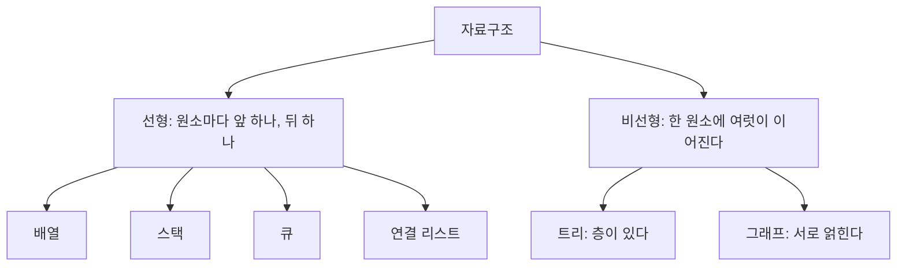



요약

원소들이 한 줄로 서서, 맨 앞과 맨 뒤를 빼면 누구나 바로 앞 원소 하나와 바로 뒤 원소 하나만 갖는 자료구조를 묶어 부르는 말이다. 배열, 스택, 큐, 연결 리스트가 여기에 든다. 한 줄이라 처음부터 끝까지 한 번에 훑을 수 있고 만들기도 쉽다. 반면 윗사람 하나에 아랫사람이 여럿 달린 조직도나 길이 이리저리 얽힌 노선도 같은 관계는 한 줄로 담지 못한다.

## 예시로 보기

배열, 스택, 큐, 연결 리스트는 만드는 법이 서로 달랐다. 그런데 넷에는 같은 점이 있다. 원소를 a, b, c, d, e처럼 한 줄로 늘어놓을 수 있고, 원소마다 "바로 앞"과 "바로 뒤"가 하나씩 정해진다[^1].

회사 조직도는 그렇지 않다. 사장 아래에 부장이 둘, 부장 아래에 과장이 셋씩 있으면 "사장의 바로 뒤"가 하나로 정해지지 않는다. 지하철 노선도도 그렇다. 환승역에는 이웃한 역이 셋, 넷이다. 앞의 것이 트리이고 뒤의 것이 그래프다. 이렇게 한 줄로 세울 수 없는 구조를 비선형 자료구조라 부른다[^3].

이 과목은 2 ~ 5주차에 왼쪽 가지를, 6 ~ 12주차에 오른쪽 가지(트리와 그래프)를 다룬다[^s1].

## 정의

**선형 자료구조**는 원소를 차례대로 담고, 원소가 앞 원소와 뒤 원소에 이어져 있는 구조다[^1].

기호로 쓰면, 원소 $$n$$개를 $$(a_0, a_1, \dots, a_{n-1})$$로 늘어놓을 수 있다. $$a_i$$의 앞 원소는 $$a_{i-1}$$ 하나이고 뒤 원소는 $$a_{i+1}$$ 하나다. 맨 앞 $$a_0$$에는 앞 원소가, 맨 뒤 $$a_{n-1}$$에는 뒤 원소가 없다[^s1].

유인물이 드는 성질은 넷이다[^1].

- 원소 사이의 관계가 "앞과 뒤" 한 가지뿐이다.
- 원소가 모두 한 층에 놓여, 처음부터 끝까지 한 번에 훑는다.
- 차례대로 놓여 있어 만들기 쉽다.
- 원소가 늘면 걸리는 시간도 는다.

종류도 넷을 든다[^2].

| 종류 | 유인물의 설명 | 이 볼트의 문서 |
|---|---|---|
| 배열 | 같은 형의 원소를 모은 것. 학생 10명의 번호를 변수 10개 대신 크기 10인 배열 하나에 담는다 | [배열과 포인터](/Hongs_Blog/studies/data-structures/array-pointer/) |
| 스택 | 나중에 넣은 것을 먼저 꺼낸다(LIFO). 넣기가 push, 꺼내기가 pop | [배열로 만든 스택](/Hongs_Blog/studies/data-structures/array-stack/), [연결 리스트로 만든 스택](/Hongs_Blog/studies/data-structures/linked-stack/) |
| 큐 | 먼저 넣은 것을 먼저 꺼낸다(FIFO). 뒤쪽에 넣기가 enqueue, 앞쪽에서 빼기가 dequeue | [원형 큐](/Hongs_Blog/studies/data-structures/circular-queue/), [연결 리스트로 만든 큐](/Hongs_Blog/studies/data-structures/linked-queue/) |
| 연결 리스트 | 원소와 "다음 노드의 주소" 두 부분으로 된 노드의 모임 | [단순 연결 리스트](/Hongs_Blog/studies/data-structures/singly-linked-list/) |

**"한 줄"은 순서 이야기이지 메모리 이야기가 아니다.** 배열은 메모리에서도 원소가 붙어 있다. 연결 리스트의 노드는 메모리 여기저기에 흩어져 있지만, 링크를 따라가면 한 줄이라 선형이다. 유인물의 "메모리에 차례대로 놓여 있어 만들기 쉽다"는 배열에 맞는 말이다[^s1]. 스택과 큐도 마찬가지다. 배열로 만들든 연결 리스트로 만들든 원소가 한 줄로 서니 선형이다.

### 선형과 비선형

두 갈래는 아홉 가지로 견준다[^3]. [확인필요]를 붙인 세 줄은 표 아래에서 따로 다룬다.

| | 선형 | 비선형 |
|---|---|---|
| 놓이는 모양 | 차례대로 한 줄로 서서 서로 이어진다 | 층을 이루거나 한 줄이 아닌 모양이다 |
| 종류 | 배열, 연결 리스트, 스택, 큐 | 트리, 그래프 |
| 만들기 | 한 줄이라 쉽다 | 한 줄이 아니라 어렵다 |
| 훑기 | 모두 한 층이라 한 번에 끝까지 간다 | 한 번에 죽 가지 못한다. 여러 번에 나눠 간다 |
| 이웃 | 앞 원소와 뒤 원소 | 여러 원소 |
| 층 | 없다. 모든 원소가 한 층이다 | 여러 층이다 |
| 메모리 [확인필요] | 효율적으로 쓰지 못한다 | 매우 효율적으로 쓴다 |
| 시간 [확인필요] | 입력이 커지면 는다 | 입력이 커져도 대체로 같다 |
| 쓰임 [확인필요] | 주로 소프트웨어 개발 | 영상 처리, 인공지능 |

"훑기" 줄은 이렇게 읽으면 된다. 한 줄이면 "다음"이 하나뿐이라 고민 없이 끝까지 간다. 트리는 갈림길마다 어느 쪽부터 갈지 정해야 하고, 한쪽을 다 본 뒤 돌아올 자리를 기억해 둬야 한다. 그래서 같은 트리에도 훑는 순서가 여럿 있다([트리 순회](/Hongs_Blog/studies/algorithms/tree-traversal-bst/), [레벨 순서 순회](/Hongs_Blog/studies/data-structures/level-order-traversal/))[^s1]. 많은 트리는 "한 줄로 선 이웃끼리의 관계"로는 나타낼 수 없다[^4].

원본 오류 의심

원문: 유인물 p.2의 표는 "선형 구조는 메모리를 효율적으로 쓰지 못하고, 비선형 구조는 매우 효율적으로 쓴다", "비선형 구조의 시간 복잡도는 입력이 커져도 대체로 같다", "선형 구조는 주로 소프트웨어 개발에, 비선형 구조는 영상 처리와 인공지능에 쓴다"고 적는다. p.1에는 "배열은 메모리를 많이 아낀다"는 말도 있다. 
문제점: 근거가 적혀 있지 않고, 앞의 두 줄은 이 강의의 다른 자료와 맞지 않는다. 메모리는 선형인지 아닌지로 갈리지 않는다. 같은 선형 구조인 배열과 연결 리스트부터 쓰는 양이 다르고, 트리의 노드는 원소마다 자식을 가리키는 주소를 둘씩 더 둔다(6주차 p.24). 시간도 그렇다. 이진 탐색 트리에서 찾는 시간은 트리의 높이에 비례하고, 나쁜 경우에는 원소 수에 비례한다(9주차 p.10의 "O(height) = O(n)"). 배열은 변수 10개를 따로 두는 것보다 코드를 줄여 주지만, 메모리는 똑같이 쓴다. 
수정안: 메모리와 시간은 "선형이냐 비선형이냐"가 아니라 어떤 구조로 어떤 일을 하느냐로 정해진다고 읽는다. 쓰임 줄은 외우지 않는다. 
근거: `char` 원소 1,000개를 담는 데 배열은 1,000바이트, 단순 연결 리스트는 16,000바이트였다([배열과 연결 리스트 비교](/Hongs_Blog/studies/data-structures/array-vs-linked-list/)의 측정). 유인물이 무엇을 가리켜 한 말인지는 알 수 없어 표에는 원문대로 두고 [확인필요]를 붙였다[^s2].

## 활용

- 새 자료구조를 만나면 먼저 "원소마다 이웃이 몇인가"를 본다. 앞뒤 하나씩이면 이 문서의 네 가지 가운데 하나로 만들 수 있다. 이웃이 여럿이면 [이진 트리](/Hongs_Blog/studies/data-structures/binary-tree/)나 그래프가 필요하다.
- 선형 구조 안에서 무엇을 고를지는 [배열과 연결 리스트 비교](/Hongs_Blog/studies/data-structures/array-vs-linked-list/)에 있다.
- 비선형 구조도 메모리에 담을 때는 결국 배열이나 노드의 링크를 쓴다. 트리를 배열 한 줄에 담는 방법이 [이진 트리의 배열 표현과 연결 표현](/Hongs_Blog/studies/data-structures/binary-tree-representation/)이다. "선형이냐"는 담는 그릇이 아니라 원소 사이의 관계를 두고 하는 말이다[^s1].

## 연결

- 선수: [자료구조란](/Hongs_Blog/studies/data-structures/data-structure-definition/), [배열로 만든 스택](/Hongs_Blog/studies/data-structures/array-stack/), [원형 큐](/Hongs_Blog/studies/data-structures/circular-queue/), [단순 연결 리스트](/Hongs_Blog/studies/data-structures/singly-linked-list/)
- 비선형 구조: [트리](/Hongs_Blog/studies/discrete-math/trees/), [이진 트리](/Hongs_Blog/studies/data-structures/binary-tree/), [그래프의 기초](/Hongs_Blog/studies/discrete-math/graph-basics/)

## 확인 문제

**C1** 배열, 이진 트리, 큐, 그래프, 연결 리스트, 스택을 선형과 비선형으로 나누고, 나누는 기준을 한 문장으로 써라.

**답:** 선형은 배열, 큐, 연결 리스트, 스택이다. 비선형은 이진 트리와 그래프다. 기준은 "맨 앞과 맨 뒤를 빼면 모든 원소에 바로 앞 원소 하나와 바로 뒤 원소 하나만 있는가"다. 
**이유:** 이진 트리의 노드에는 자식이 둘까지 있고, 그래프의 정점에는 이웃이 여럿 있어서 "바로 뒤"가 하나로 정해지지 않는다.

**C2** 연결 리스트의 노드는 메모리 여기저기에 흩어져 있다. 그런데도 선형 자료구조인 까닭은?

**답:** 선형인지는 원소 사이의 순서로 정하고, 메모리에서 붙어 있는지로 정하지 않는다. 연결 리스트는 노드마다 다음 노드가 하나뿐이라 링크를 따라가면 원소가 한 줄로 나온다. 
**이유:** 흔한 오답은 "배열처럼 붙어 있어야 선형"이다. 그 말대로라면 같은 스택이 배열로 만들면 선형이고 연결 리스트로 만들면 비선형이 된다.

**C3** 유인물의 표는 "선형 구조는 메모리를 효율적으로 쓰지 못한다"고 적는다. 이 말에 맞지 않는 선형 구조를 하나 들고, 같은 원소를 담을 때 그보다 메모리를 더 쓰는 구조를 하나 들어라.

**답:** 배열이다. 원소 말고는 덤으로 쓰는 메모리가 없다. 같은 원소를 연결 리스트에 담으면 원소마다 링크 한 칸이, 이진 트리에 담으면 원소마다 자식 주소 두 칸이 더 든다. 
**이유:** `char` 1,000개가 배열로는 1,000바이트, 단순 연결 리스트로는 16,000바이트였다. 메모리 쓰임은 선형인지 아닌지가 아니라 원소마다 주소를 몇 개 적느냐로 갈린다.

[^1]: 자료구조 5회 강의 자료 「Linear Data Structure」, p.1 (1. Definitions, 2. Characteristics of linear data structure의 A ~ H)
[^2]: 같은 자료, p.1~2 (3. Types in Linear Data Structure: Array, Stack, Queue, Linked list)
[^3]: 같은 자료, p.2 (4. Differences between the Linear data structure and non-linear data structure의 표 아홉 줄)
[^4]: 자료구조 6회 강의 자료 「DS_Week6_Lecture_2024」, p.3 (트리의 정의. 선형 자료구조와 달리 많은 트리는 한 줄로 선 이웃 노드 사이의 관계로 나타낼 수 없다)
[^s1]: 보충 조직도와 노선도의 예, 분류 그림, 기호로 쓴 정의, "한 줄은 순서 이야기"라는 단락, "훑기" 줄의 풀이, 활용 항목, 카드 C1~C3은 유인물에 없다. 분류 그림은 유인물 p.2 표의 "종류" 줄을 옮긴 것이다.
[^s2]: 보충 세 줄에 대한 반론은 유인물에 없다. 근거로 든 것은 이 강의의 6주차 슬라이드 p.24(노드에 leftChild, rightChild 두 주소), 9주차 슬라이드 p.10(Search의 복잡도 O(height) = O(n)), 그리고 [16_array-vs-linked-list_impl.c](/Hongs_Blog/studies/data-structures/code/16_array-vs-linked-list_impl/)의 측정이다.

