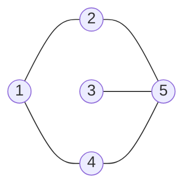


<div class="callout callout-summary" markdown="1">
<div class="callout-title callout-title--default" markdown="span">요약</div>

점과 선으로 된 그림을 메모리에 적는 방법이다. 표 하나에 "두 점이 이어졌나"를 모든 쌍에 대해 0과 1로 적을 수도 있고, 점마다 이웃 번호만 줄줄이 적어 둘 수도 있다. 이웃 목록은 칸을 하나씩 화살표로 이어 만들거나, 길이가 정해진 한 줄짜리 칸 묶음으로 만든다. 표는 두 점이 이어졌는지 한 번에 알지만 점 수의 제곱만큼 자리를 쓰고, 목록은 선의 수만큼만 쓰지만 이어졌는지 알려면 목록을 훑어야 한다.

</div>


## 예시로 보기

그래프의 뜻(점과 선, 차수, 방향)은 [그래프의 기초](/Hongs_Blog/studies/discrete-math/graph-basics/)에서 다뤘다. 그런데 종이에 그린 그림은 프로그램이 읽지 못한다. 탐색을 하려면 "이 점의 이웃이 누구냐"에 답할 수 있게 배열이나 포인터로 옮겨 적어야 한다.

점 5개, 선 5개(1–2, 1–4, 2–5, 3–5, 4–5)로 된 그래프를 보자.



방향이 없는 선 다섯 개다.

**표로 적기(인접 행렬).** $$i$$행 $$j$$열에 "점 $$i$$와 점 $$j$$가 이어졌으면 1, 아니면 0"을 적는다.

| | 1 | 2 | 3 | 4 | 5 |
|---|---|---|---|---|---|
| **1** | 0 | 1 | 0 | 1 | 0 |
| **2** | 1 | 0 | 0 | 0 | 1 |
| **3** | 0 | 0 | 0 | 0 | 1 |
| **4** | 1 | 0 | 0 | 0 | 1 |
| **5** | 0 | 1 | 1 | 1 | 0 |

**목록으로 적기(인접 리스트).** 점마다 이웃 번호만 적는다.

```
aList[1] = (2, 4)
aList[2] = (1, 5)
aList[3] = (5)
aList[4] = (5, 1)
aList[5] = (2, 4, 3)
```

목록에 적힌 번호를 모두 세면 10개다. 선이 5개인데 10개인 까닭은 선 1–2가 1의 목록에도, 2의 목록에도 한 번씩 적히기 때문이다. 표는 25칸 가운데 1이 10개이고 나머지 15칸은 0을 적느라 쓴다.

<div class="callout callout-check" markdown="1">
<div class="callout-title" markdown="span">검증: 컴파일해 실행(ASan·UBSan). 위 표와 목록, 체인 노드 10개, 방향 그래프의 노드 6개, 아래 삼각 10비트, 차수를 구할 때 보는 칸 수, 무작위 그래프 500개에서 행렬 → 체인 → 행렬과 행렬 → 배열 리스트 → 행렬이 제자리로 돌아오는 것, malloc 횟수 = free 횟수를 확인했다 — [36_linked-adjacency-list_impl.c](/Hongs_Blog/studies/data-structures/code/36_linked-adjacency-list_impl/)</div>

</div>


## 정의

점(정점)의 수를 $$n$$, 선(간선)의 수를 $$m$$이라 한다. 간선 수를 $$e$$로 적는 책도 있다. 그래프를 적는 방법은 크게 인접 행렬과 인접 리스트 둘이고, 인접 리스트는 다시 연결 인접 리스트와 배열 인접 리스트로 나뉜다.

### 인접 행렬

$$n \times n$$ 크기의 0/1 표 $$A$$다. $$(i, j)$$가 간선이면 $$A(i, j) = 1$$이고 아니면 0이다. 기호로 쓰면 $$A(i, j) = 1 \iff (i, j) \in E$$다. $$\iff$$는 "양쪽이 같은 말"이라는 뜻이고, $$E$$는 간선의 모임이다.

- 대각선은 모두 0이다. 간선은 서로 다른 두 점을 잇기 때문이다.
- 방향이 없는 그래프의 행렬은 대칭이다. 모든 $$i$$, $$j$$에 대해 $$A(i, j) = A(j, i)$$다. 방향 그래프의 행렬은 대칭이 아니어도 된다.
- 자리는 $$n^2$$비트가 든다. 방향이 없는 그래프는 대각선을 뺀 아래쪽(또는 위쪽) 삼각형만 적으면 되어 $$\frac{(n-1)n}{2}$$비트다. $$n = 5$$면 25비트 대신 10비트다.
- 한 점의 차수나 이웃을 알려면 그 점의 줄 $$n$$칸을 다 본다. $$O(n)$$이다.

아래 삼각형만 한 줄로 세울 때, $$i > j$$인 칸 $$(i, j)$$는 $$\frac{(i-1)(i-2)}{2} + (j - 1)$$번 비트(0부터)에 둔다. $$(2, 1)$$이 0번, $$(3, 1)$$과 $$(3, 2)$$가 1번과 2번, $$(5, 4)$$가 9번이다. [특수 행렬을 1차원 배열에 담기](/Hongs_Blog/studies/data-structures/triangular-matrix-mapping/)의 아래삼각 행렬 식에서 대각선 줄을 뺀 것이다[^s1].

### 인접 리스트

점 $$i$$의 인접 리스트는 $$i$$에서 간선으로 바로 갈 수 있는 점들을 늘어놓은 줄이다. 이런 줄 $$n$$개를 배열에 담는다. 줄을 무엇으로 만드느냐에 따라 둘로 갈린다.

**연결 인접 리스트.** 줄 하나하나가 체인([단순 연결 리스트](/Hongs_Blog/studies/data-structures/singly-linked-list/))이다. 배열 `aList`의 칸마다 체인의 첫 노드를 가리키는 포인터가 들어 있다.

```
aList[1] -> [2|·] -> [4|NULL]
aList[2] -> [1|·] -> [5|NULL]
aList[3] -> [5|NULL]
aList[4] -> [5|·] -> [1|NULL]
aList[5] -> [2|·] -> [4|·] -> [3|NULL]
```

- 배열의 길이는 $$n$$이다.
- 체인 노드의 수는 방향이 없는 그래프에서 $$2m$$, 방향 그래프에서 $$m$$이다. 방향이 없는 간선 $$u$$–$$v$$는 $$u$$의 체인과 $$v$$의 체인에 한 번씩 들어가고, 방향 간선 $$u \to v$$는 $$u$$의 체인에만 들어간다.

```c
typedef struct node *nodePointer;
typedef struct node {
    int vertex;          /* 이웃 정점 번호 */
    nodePointer link;    /* 같은 체인의 다음 노드 */
} node;

typedef struct {
    int n;               /* 정점 수 */
    nodePointer *aList;  /* aList[1 .. n]: 정점 i의 체인 첫 노드 */
} linkedGraph;

/* u의 체인 맨 앞에 v를 끼운다: 방향 간선 u -> v 하나에 노드 하나 */
void addArc(linkedGraph *g, int u, int v)
{
    nodePointer p = malloc(sizeof(*p));
    if (p == NULL) { fprintf(stderr, "메모리가 모자란다\n"); exit(1); }
    p->vertex = v;
    p->link = g->aList[u];
    g->aList[u] = p;
}

/* 무방향 간선 u - v: 양쪽 체인에 하나씩, 노드 둘 */
void addEdge(linkedGraph *g, int u, int v)
{
    addArc(g, u, v);
    addArc(g, v, u);
}
```

맨 앞에 끼우므로 늦게 넣은 이웃이 체인의 앞에 온다. 위 그림의 순서는 간선을 1–4, 3–5, 4–5, 2–5, 1–2 순서로 넣었을 때 나온다. 다 쓴 뒤에는 체인의 노드를 하나씩 `free`한다([동적 메모리 할당](/Hongs_Blog/studies/data-structures/dynamic-memory-allocation/))[^s1].

**배열 인접 리스트.** 줄 하나하나가 배열이다. 점마다 이웃 수만큼의 배열을 잡고 길이를 따로 적어 둔다.

```
aList[1] -> | 2 | 4 |        길이 2
aList[2] -> | 1 | 5 |        길이 2
aList[3] -> | 5 |            길이 1
aList[4] -> | 5 | 1 |        길이 2
aList[5] -> | 2 | 4 | 3 |    길이 3
```

- 배열 `aList`의 길이는 $$n$$이다.
- 줄에 든 원소의 수는 방향이 없는 그래프에서 $$2m$$, 방향 그래프에서 $$m$$이다.

```c
typedef struct {
    int n;
    int *length;   /* length[i]: 정점 i의 이웃 수 */
    int **aList;   /* aList[i][0 .. length[i]-1]: 정점 i의 이웃 */
} arrayGraph;
```

### 가중치가 있는 그래프

간선마다 비용이 있으면, 행렬에는 0/1 대신 비용을 적는다. $$C(i, j)$$ = 간선 $$(i, j)$$의 비용이다. 이것을 비용 인접 행렬이라 한다. 인접 리스트에서는 줄의 원소 하나를 (이웃 정점, 간선 비용) 쌍으로 만든다.

## 활용

- **어느 것을 쓰나.** 세 표현을 한 표로 모으면 다음과 같다[^s1].

| | 인접 행렬 | 연결 인접 리스트 | 배열 인접 리스트 |
|---|---|---|---|
| 자리 | $$n^2$$비트(무방향은 $$\frac{(n-1)n}{2}$$) | 포인터 $$n$$개 + 노드 $$2m$$개 | 포인터 $$n$$개 + 원소 $$2m$$개 |
| 점 $$i$$의 이웃 모두 보기 | $$O(n)$$ | $$O(i\text{의 차수})$$ | $$O(i\text{의 차수})$$ |
| $$i$$와 $$j$$가 이어졌나 | $$O(1)$$ | $$O(i\text{의 차수})$$ | $$O(i\text{의 차수})$$ |
| 간선 하나 더 넣기 | $$O(1)$$ | $$O(1)$$: 체인 맨 앞에 끼운다 | 배열이 꽉 차면 늘려야 한다 |

위 그래프의 점 3은 이웃이 하나다. 행렬에서 3의 차수를 구하려면 그래도 5칸을 다 보고, 리스트에서는 노드 하나만 본다. 간선이 $$n^2$$에 가깝게 많으면 리스트도 행렬만큼 길어져서 이 이득이 없다.

- **탐색의 비용이 표현에 따라 갈린다.** 모든 점에서 이웃을 한 번씩 훑는 탐색은 행렬이면 $$n$$줄 × $$n$$칸으로 $$O(n^2)$$, 리스트면 점 $$n$$개와 노드 $$2m$$개를 보아 $$O(n + m)$$이다([깊이 우선 탐색(DFS)](/Hongs_Blog/studies/algorithms/dfs/), [너비 우선 탐색(BFS)](/Hongs_Blog/studies/algorithms/bfs/)).
- **체인 대 배열.** 체인 노드는 이웃 번호 말고도 포인터 한 칸을 더 가진다. 이 컴퓨터에서 재 보면 노드 하나가 16바이트, 배열 원소 하나가 4바이트다. 대신 체인은 간선을 하나씩 받아 그때그때 끼울 수 있고, 배열은 이웃 수를 미리 알거나 [배열 두 배 늘리기](/Hongs_Blog/studies/data-structures/array-doubling/)를 써야 한다([배열과 연결 리스트 비교](/Hongs_Blog/studies/data-structures/array-vs-linked-list/))[^s1].
- **흔한 실수.** 방향이 없는 간선을 한쪽 체인에만 넣는다. 정점 번호가 1부터인데 배열을 $$n$$칸만 잡는다($$n + 1$$칸을 잡고 0번을 비운다). 그래프를 다 쓰고 체인을 풀지 않는다.
- 파이썬 리스트로 같은 표현을 만드는 법과 격자 그래프는 [그래프 표현](/Hongs_Blog/studies/algorithms/graph-representation/)에 있다.

## 연결

- 선수: [그래프의 기초](/Hongs_Blog/studies/discrete-math/graph-basics/), [단순 연결 리스트](/Hongs_Blog/studies/data-structures/singly-linked-list/), [동적 메모리 할당](/Hongs_Blog/studies/data-structures/dynamic-memory-allocation/)
- 노드 수 $$2m$$은 [그래프의 기초](/Hongs_Blog/studies/discrete-math/graph-basics/)의 "차수를 모두 더하면 간선 수의 두 배"와 같은 사실이다. 점 $$i$$의 체인 길이가 곧 $$i$$의 차수다.
- 인접 리스트는 인접 행렬에서 1인 칸만 골라 적은 것이다. 0이 대부분인 표에서 0이 아닌 칸만 적는 [희소 행렬의 3원소 표현](/Hongs_Blog/studies/data-structures/sparse-matrix-triples/)과 같은 생각이다.
- 이 표현 위에서 도는 알고리즘: [너비 우선 탐색(BFS)](/Hongs_Blog/studies/algorithms/bfs/), [깊이 우선 탐색(DFS)](/Hongs_Blog/studies/algorithms/dfs/), [최소 신장 트리](/Hongs_Blog/studies/algorithms/mst/), [다익스트라](/Hongs_Blog/studies/algorithms/dijkstra/)

## 확인 문제

<details class="callout callout-question" markdown="1">
<summary class="callout-title" markdown="span">**C1** 빈 연결 인접 리스트(점 5개)에 `addEdge`를 (1, 4), (3, 5), (4, 5), (2, 5), (1, 2) 순서로 불렀다. `aList[5]`의 체인을 앞에서부터 쓰고, 체인 노드가 모두 몇 개인지 답하라.</summary>

**답:** `aList[5]`는 2 → 4 → 3이다. 노드는 모두 10개다.<br>
**이유:** `addArc`는 체인의 맨 앞에 끼운다. 5의 체인에는 3, 4, 2 순서로 들어가서 늦게 들어간 2가 맨 앞이다. `addEdge` 한 번에 노드가 둘 생기니 5번 부르면 10개다.

</details>


<details class="callout callout-question" markdown="1">
<summary class="callout-title" markdown="span">**C2** 방향이 없는 그래프의 연결 인접 리스트에서 체인 노드가 $$2m$$개이고, 방향 그래프에서는 $$m$$개인 까닭은?</summary>

**답:** 방향이 없는 간선 $$u$$–$$v$$는 "$$u$$의 이웃에 $$v$$"와 "$$v$$의 이웃에 $$u$$" 두 번 적힌다. 방향 간선 $$u \to v$$는 $$u$$에서 $$v$$로만 갈 수 있으니 $$u$$의 체인에 한 번만 적힌다.<br>
**이유:** 예를 들어 방향 그래프 1→4, 2→1, 2→5, 4→5, 5→2, 5→3은 간선이 6개이고 체인 노드도 6개다. 같은 점들을 방향 없이 이었다면 노드가 두 배다.

</details>


<details class="callout callout-question" markdown="1">
<summary class="callout-title" markdown="span">**C3** 방향 그래프의 인접 행렬이 다음과 같다(행이 출발점, 열이 도착점). 인접 리스트로 옮겨 적고, 이 행렬이 대칭이 아님을 보이는 칸 한 쌍을 들어라.</summary>

```
    1 2 3 4 5
1 | 0 0 0 1 0
2 | 1 0 0 0 1
3 | 0 0 0 0 0
4 | 0 0 0 0 1
5 | 0 1 1 0 0
```
**답:** aList[1] = (4), aList[2] = (1, 5), aList[3] = (), aList[4] = (5), aList[5] = (2, 3). 목록 안의 순서는 상관없다. $$A(1, 4) = 1$$인데 $$A(4, 1) = 0$$이라 대칭이 아니다.<br>
**이유:** 행 $$i$$에서 1인 열 번호를 모으면 $$i$$의 인접 리스트다. 1이 모두 6개라 원소도 6개다. 1에서 4로 가는 간선은 있지만 4에서 1로 가는 간선은 없다.

</details>


[^s1]: 코드와 수치는 구현 파일에서 돌려 확인했다. 바이트 수는 이 맥(64비트)에서 잰 값이고 컴퓨터에 따라 다를 수 있다.

