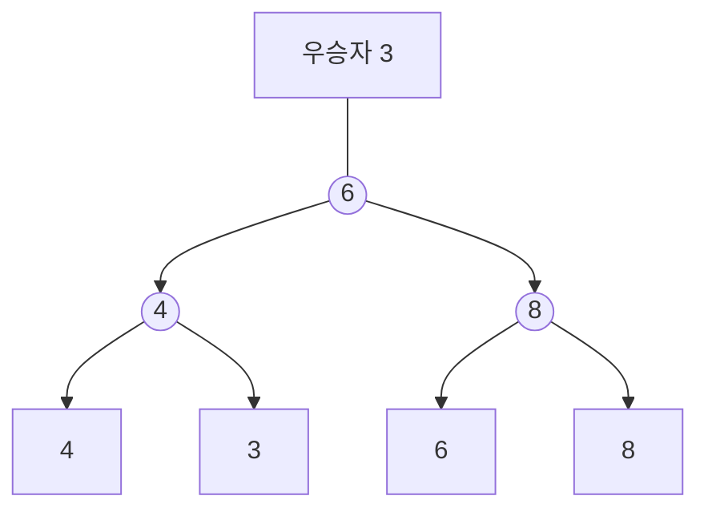


<div class="callout callout-summary" markdown="1">
<div class="callout-title callout-title--default" markdown="span">요약</div>

토너먼트 대진표를 나무로 그리되, 경기 칸에 이긴 쪽이 아니라 진 쪽을 적어 두고 우승자는 맨 위에 따로 적는다. 우승자의 값이 바뀌어 다시 겨룰 때, 올라가는 길의 칸마다 "지난번 상대"가 바로 적혀 있어서 옆 가지를 찾아볼 필요가 없다. 다만 이 방법은 바뀐 선수가 지난번 우승자일 때만 맞고, 다른 선수의 값을 바꾸고 같은 식으로 올라가면 틀린 우승자가 나온다.

</div>


## 예시로 보기

[승자 트리](/Hongs_Blog/studies/data-structures/winner-tree/)에서 우승자의 값을 바꾸고 다시 겨룰 때, 층마다 "옆 가지에서 올라와 있던 승자"를 찾아서 견줬다. 그런데 우승자는 올라가는 길의 모든 경기에서 이긴 선수다. 그러니 길 위의 경기마다 상대는 그 경기에서 **진** 선수다. 진 선수를 경기 칸에 적어 두면 상대를 찾으러 옆으로 갈 일이 없다.

선수 넷(4, 3, 6, 8)이면 이렇게 생겼다. 작은 수가 이긴다.



동그라미 안의 수는 그 경기에서 진 선수의 값이다. 4와 3이 겨뤄 4가 지고, 6과 8이 겨뤄 8이 진다. 결승은 올라온 3과 6이 겨뤄 6이 지고, 우승자 3은 맨 위에 따로 적는다[^s2].

[승자 트리](/Hongs_Blog/studies/data-structures/winner-tree/)의 16명(4, 3, 6, 8, 1, 5, 7, 3, 2, 6, 9, 4, 5, 2, 5, 8)으로 만들면 다음과 같다. 노드 번호와 칸 번호는 승자 트리와 같다.

```
우승자                             1
노드 1                             2
노드 2~3               3                       2
노드 4~7         6           3           4           5
노드 8~15     4     8     5     7     6     9     5     8
선수         4  3  6  8  1  5  7  3  2  6  9  4  5  2  5  8
칸 번호     16 17 18 19 20 21 22 23 24 25 26 27 28 29 30 31
```

만드는 순서는 승자 트리와 같다. 경기마다 이긴 쪽을 위로 올려 보내고, 칸에는 진 쪽을 남긴다. 8번 노드는 4 대 3이라 4를 적고 3을 올린다. 4번 노드는 올라온 3과 6이 겨뤄 6을 적고 3을 올린다.

**우승자를 9로 바꾸고 다시 겨루기.** 우승자는 다섯째 선수(20번 칸)의 1이다. 이 값을 9로 바꾼다. 길은 10, 5, 2, 1번 노드다. 올라가는 선수를 칸에 적힌 패자와 겨루게 하고, 진 쪽을 칸에 남긴다.

| 노드 | 올라온 선수 | 칸에 적혀 있던 패자 | 이겨서 올라가는 쪽 | 칸에 새로 적는 쪽 |
|---|---|---|---|---|
| 10 | 9 | 5 | 5 | 9 |
| 5 | 5 | 3 | 3 | 5 |
| 2 | 3 | 3 | 3 | 3 |
| 1 | 3 | 2 | 2 | 3 |

새 우승자는 2다. 층마다 읽은 트리 칸은 그 경기 칸 하나, 모두 네 칸이다. 승자 트리였다면 층마다 두 자식 칸을 읽어 여덟 칸이다. 2번 노드에서는 값이 3으로 같은 두 선수가 만난다. 번호가 앞선 둘째 선수가 이겨 올라가고 여덟째 선수가 칸에 남는다.

<div class="callout callout-check" markdown="1">
<div class="callout-title" markdown="span">검증: 컴파일해 실행(ASan·UBSan). 16명의 층별 패자와 우승자, 만들 때 경기 15번, 위 표(경기 4번, 읽은 칸 4개), 아래 런 8개의 예, 우승자가 아닌 선수를 바꿨을 때의 반례, 무작위 2,000묶음(선수 1 ~ 40명)에서 패자 트리 정렬 = `qsort`와 "우승자를 바꾸고 다시 겨룬 결과 = 직접 찾은 최솟값"을 확인했다 — [35_loser-tree_impl.c](/Hongs_Blog/studies/data-structures/code/35_loser-tree_impl/)</div>

</div>


## 정의

패자 트리는 경기 노드마다 그 경기의 승자 대신 **패자**를 적어 둔 토너먼트 트리다. 전체 우승자는 뿌리 위에 따로 적는다. 모양, 노드 번호, 선수의 자리는 [승자 트리](/Hongs_Blog/studies/data-structures/winner-tree/)와 같다. 선수 $$n$$명이면 경기 노드가 $$n - 1$$개다.

**이 구조가 지키는 것.** 경기 노드 $$i$$에 적힌 선수는, $$i$$ 아래의 선수들끼리 치른 토너먼트에서 결승에 올라와 진 선수다. 그래서 우승자가 지나온 길의 칸에는 "우승자에게 직접 진 선수들"이 적혀 있다[^s1].

```c
typedef struct {
    int n;        /* 선수 수 */
    int *player;  /* player[0 .. n-1]: 선수의 값 */
    int *tree;    /* tree[1 .. n-1]: 그 경기에서 진 선수의 번호, tree[0]: 전체 우승자 */
} loserTree;

/* 선수 a가 선수 b를 이기는가. 값이 같으면 번호가 앞선 쪽이 이긴다 */
static int beats(const loserTree *t, int a, int b)
{
    if (t->player[a] != t->player[b]) return t->player[a] < t->player[b];
    return a < b;
}

/* 우승자의 값을 바꾸고 다시 겨룬다 */
void replaceWinnerAndReplay(loserTree *t, int value)
{
    int challenger = t->tree[0];                     /* 지난번 우승자가 올라간다 */
    t->player[challenger] = value;
    for (int i = (challenger + t->n) / 2; i >= 1; i /= 2) {
        if (beats(t, t->tree[i], challenger)) {      /* 칸에 적힌 패자가 이기면 */
            int tmp = t->tree[i];                    /* 둘이 자리를 바꾼다 */
            t->tree[i] = challenger;
            challenger = tmp;
        }
    }
    t->tree[0] = challenger;
}
```

반복문 안에서 읽는 트리 칸은 `tree[i]` 하나뿐이다. 승자 트리의 `changeAndReplay`가 `2 * i`와 `2 * i + 1` 두 칸을 읽던 것과 견줘 보면 차이가 보인다. 만들 때는 올려 보낼 승자를 잠깐 적어 둘 곳이 필요하다. 구현 파일의 `createLoserTree`는 그 용도로 배열 하나를 잠깐 쓰고 푼다[^s1].

**비용.** $$n$$은 선수 수다.

| 연산 | 하는 일 | 시간 |
|---|---|---|
| 만들기 | 경기 노드마다 경기 한 번, 올라갈 승자를 잠깐 적어 두기 | $$O(n)$$, 더 정확히는 $$\Theta(n)$$ |
| 우승자 보기 | `tree[0]` 한 칸 | $$O(1)$$ |
| 우승자를 바꾸고 다시 겨루기 | 경기 노드가 있는 층마다 경기 한 번 | $$O(\log n)$$, 더 정확히는 $$\Theta(\log n)$$ |

$$O$$와 $$\Theta$$로 적은 시간은 승자 트리와 같다. 줄어드는 것은 층마다 하는 일의 양이다.

## 승자 트리와 무엇이 다른가

| | 승자 트리 | 패자 트리 |
|---|---|---|
| 경기 칸에 적는 것 | 이긴 선수 | 진 선수(우승자는 따로) |
| 다시 겨룰 때 상대 | 옆 가지의 승자. 형제 칸을 찾아 읽는다 | 그 경기 칸에 적혀 있다 |
| 층마다 읽는 트리 칸 | 두 자식 칸 | 그 경기 칸 하나 |
| 아무 선수의 값이나 바꿔도 되나 | 된다 | 지난번 우승자만 된다 |
| 경기 수(16명, 한 번 다시 겨루기) | 4 | 4 |

"가장 작은 값을 내보내고, 그 자리에 새 값을 넣기"만 되풀이하는 일에서는 바뀌는 선수가 늘 지난번 우승자다. 그래서 패자 트리의 제약이 걸리지 않고, 덜 읽는 이득만 남는다[^s1].

정렬된 줄(런) 8개를 합칠 때도 패자 트리를 쓴다. 줄마다 맨 앞 값이 10, 9, 20, 6, 8, 9, 90, 17이면 패자는 아래 층부터 10, 20, 9, 90 / 9, 17 / 8이고 우승자는 6이다. 6을 내보내고 넷째 줄의 다음 값을 그 자리에 넣어 다시 겨루기를 되풀이한다([k-way 병합과 선택 트리](/Hongs_Blog/studies/data-structures/k-way-merge/)).

## 활용

- **쓰는 곳.** 디스크에 있는 정렬된 줄 여러 개를 하나로 합치는 [외부 병합 정렬](/Hongs_Blog/studies/data-structures/external-merge-sort/). 줄이 $$k$$개면 값 하나를 내보낼 때마다 $$\log_2 k$$번 견준다.
- **패자 트리로 정렬.** 우승자를 적고 그 자리를 아주 큰 값으로 바꿔 다시 겨루기를 $$n$$번 한다. 승자 트리의 정렬과 같은 $$O(n \log n)$$이다.
- **흔한 실수.** 우승자가 아닌 선수를 바꾸고 같은 방법으로 올라간다(확인 문제 C2). 올라온 선수가 이겼는데도 칸을 고친다. 진 쪽이 칸에 남는다는 것만 기억하면 된다. 우승자 칸(`tree[0]`)을 고치지 않는다.
- 구현: [35_loser-tree_impl.c](/Hongs_Blog/studies/data-structures/code/35_loser-tree_impl/). 연습: [승자 트리와 패자 트리 재경기 예제 사다리](/Hongs_Blog/studies/data-structures/selection-tree-ladder/)

## 연결

- 선수: [승자 트리](/Hongs_Blog/studies/data-structures/winner-tree/)
- 쓰이는 곳: [k-way 병합과 선택 트리](/Hongs_Blog/studies/data-structures/k-way-merge/), [외부 병합 정렬](/Hongs_Blog/studies/data-structures/external-merge-sort/)
- 같은 일을 하는 다른 구조: [최대 힙과 최소 힙](/Hongs_Blog/studies/data-structures/max-heap/)

## 확인 문제

<details class="callout callout-question" markdown="1">
<summary class="callout-title" markdown="span">**C1** 위 16명 패자 트리(처음 상태)에서 우승자 1을 4로 바꾸고 다시 겨룬다. 10, 5, 2, 1번 노드에 적히는 값과 새 우승자를 쓰라.</summary>

**답:** 10번 5, 5번 4, 2번 3, 1번 3. 새 우승자는 2다.<br>
**이유:** 10번: 올라온 4가 적혀 있던 5를 이겨 5는 그대로 남는다. 5번: 적혀 있던 3이 4를 이겨 4가 남고 3이 올라간다. 2번: 3 대 3, 번호가 앞선 쪽이 올라가고 다른 3이 남는다. 1번: 적혀 있던 2가 3을 이겨 3이 남고 2가 우승자가 된다.

</details>


<details class="callout callout-question" markdown="1">
<summary class="callout-title" markdown="span">**C2** 선수 넷의 값이 1, 2, 3, 4다. 셋째 선수의 3을 10으로 바꾸고 "바뀐 선수의 칸에서 뿌리까지 올라가며 다시 겨루기"를 한다. 승자 트리와 패자 트리(위 `replaceWinnerAndReplay`와 같은 방식)는 각각 누구를 우승자로 내는가? 다르다면 왜 다른가?</summary>

**답:** 승자 트리는 1(옳다). 3번 노드에서 10 대 4로 4가, 1번 노드에서 1 대 4로 1이 이긴다. 패자 트리는 4(틀리다). 3번 노드에 적힌 4가 10을 이겨 올라가고, 1번 노드에 적혀 있는 것은 셋째 선수 자신(지난 결승의 패자, 이제 10)이라 4가 또 이긴다. 진짜 우승자 1은 길 위 어느 칸에도 적혀 있지 않다.<br>
**이유:** 승자 트리의 칸에는 "그 아래에서 가장 작은 선수"가 있어 어느 길로 올라가도 옆 가지의 승자와 만난다. 패자 트리의 칸에 있는 것은 진 선수뿐이다. 길 위의 패자들이 곧 상대가 되는 것은 올라가는 선수가 지난번 우승자일 때뿐이다.

</details>


<details class="callout callout-question" markdown="1">
<summary class="callout-title" markdown="span">**C3** 패자 트리에서 우승자를 바꾸고 다시 겨룰 때 형제 칸을 보지 않아도 되는 까닭은?</summary>

**답:** 지난번 우승자는 자기 칸에서 뿌리까지 가는 길의 모든 경기에서 이겼다. 그 경기들의 상대는 모두 거기서 졌고, 진 선수가 바로 그 경기 칸에 적혀 있다. 그 상대가 옆 가지 전체의 승자이기도 하다. 그래서 칸에 적힌 선수와만 겨루면 옆 가지 전체와 겨룬 것과 같다.<br>
**이유:** 겨룬 뒤 진 쪽을 칸에 남기고 이긴 쪽을 올리면, 그 칸에는 다시 "이 경기의 패자"가 적힌다. 구조가 지키는 것이 그대로다.

</details>


[^s1]: 수치와 반례는 구현 코드로 확인했다.
[^s2]: 16명 그림의 맨 왼쪽 네 선수만 떼어 그렸다.

