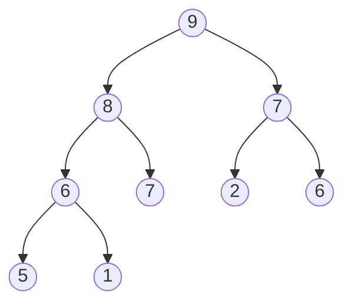


<div class="callout callout-summary" markdown="1">
<div class="callout-title callout-title--default" markdown="span">요약</div>

최대 힙은 "부모는 자식보다 작지 않다"는 규칙 하나만 지키며, 위층부터 왼쪽부터 빈틈없이 채운 이진 트리다. 맨 위에는 늘 가장 큰 값이 있고, 값을 넣거나 맨 위 값을 꺼낸 뒤에는 맨 위와 맨 아래를 잇는 한 줄만 고치면 되어서 값이 백만 개여도 스무 번쯤 옮겨 적으면 끝난다. 대신 형제끼리는 순서가 없어서 전체가 정렬된 것은 아니고, 맨 위가 아닌 값을 찾으려면 다 훑어야 한다. 규칙의 방향을 뒤집어 맨 위에 가장 작은 값을 두면 최소 힙이다.

</div>


## 예시로 보기

값을 계속 받으면서 그때그때 가장 큰 값을 꺼내야 하는 일이 있다. 배열에 받는 대로 넣어 두면 넣기는 한 번에 끝나지만, 꺼낼 때마다 전부 훑어야 한다. 늘 정렬해 두면 꺼내기는 한 번에 끝나지만, 넣을 때마다 값들을 밀어야 한다. 둘 다 값이 $$n$$개면 $$n$$번쯤 일한다.

힙은 "완전히 정렬하지는 않고, 가장 큰 값만 맨 위에 오게" 해서 두 일을 모두 줄인다. 아래가 최대 힙의 예다.



```
칸 번호   0   1   2   3   4   5   6   7   8   9
heap    [   | 9 | 8 | 7 | 6 | 7 | 2 | 6 | 5 | 1 ]
```

어느 노드를 보아도 부모가 자식보다 작지 않다. 그런데 배열은 정렬되어 있지 않다. 4번 칸의 6 뒤에 더 큰 7이 오고, 6번 칸의 2 뒤에 더 큰 6이 온다. 2층의 8과 7, 3층의 6·7·2·6처럼 형제나 사촌끼리는 순서를 따지지 않는다.

트리 모양이 [완전 이진 트리](/Hongs_Blog/studies/data-structures/full-complete-binary-tree/)라서 선을 따로 적지 않고 배열에 담는다. 4번 칸(6)의 부모는 $$4 / 2 = 2$$번 칸(8)이고, 자식은 8번 칸(5)과 9번 칸(1)이다.

## 정의

### 우선순위 큐

**우선순위 큐**는 값마다 우선순위(키)가 있는 값들의 모임으로, 다음 일을 할 수 있다.

| 연산 | 하는 일 | 힙으로 만들 때의 비용 |
|---|---|---|
| empty | 비었는가 | $$O(1)$$ |
| size | 몇 개 들었는가 | $$O(1)$$ |
| push | 값을 하나 넣는다 | $$O(\log n)$$ |
| top | 우선순위가 가장 높은 값을 본다 | $$O(1)$$ |
| pop | 우선순위가 가장 높은 값을 꺼낸다 | $$O(\log n)$$ |

가장 큰 키를 꺼내면 최대 우선순위 큐, 가장 작은 키를 꺼내면 최소 우선순위 큐다. 무엇을 할 수 있는지만 정한 것이라 [추상 자료형](/Hongs_Blog/studies/data-structures/abstract-data-type/)이고, 힙은 이것을 만드는 방법 가운데 하나다.

### 최대 트리와 최대 힙

**최대 트리(max tree).** 노드마다 값이 있고, 어느 노드의 값이든 그 노드를 뿌리로 하는 부분 트리에서 가장 큰 값인 트리다. "어느 노드도 자기보다 큰 후손을 두지 않는다"와 같은 말이다. 이진 트리일 필요는 없다. 자식이 셋인 노드가 있어도 된다.

"부모가 자식보다 작지 않다"만 모든 부모와 자식 사이에서 확인해도 최대 트리다. 자식은 손자보다 작지 않고, 손자는 그 아래보다 작지 않으니, 뿌리에서 내려가는 길을 따라 값이 커지는 일이 없다[^s1].

**최대 힙(max heap).** 완전 이진 트리이면서 최대 트리인 것이다. 부등호를 뒤집은 최소 트리와 완전 이진 트리를 합치면 **최소 힙**이다.

조건이 둘이라는 점에 주의한다. 값의 규칙을 지켜도 모양이 완전 이진 트리가 아니면 힙이 아니다.

배열로 쓰면 이렇다. 값이 $$n$$개일 때,

- 모양: `heap[1]`부터 `heap[n]`까지 빈칸 없이 차 있다.
- 값: $$2 \le i \le n$$인 모든 $$i$$에 대해 `heap[i / 2] >= heap[i]`다(최소 힙은 `<=`).

이 두 줄이 힙이 늘 지켜야 하는 규칙(표현 불변식)이다.

**높이.** 값이 $$n$$개인 힙은 층이 $$\lceil \lg(n+1) \rceil$$개이고, 높이를 선의 수로 세면 $$\lfloor \lg n \rfloor$$다. 9개짜리 위 힙은 4층, 높이 3이다. 백만 개면 20층이다.


### 칸 번호를 0번부터 쓰는 자료

이 문서는 배열의 1번 칸부터 쓰고, 파이썬의 `heapq`와 [힙과 우선순위 큐](/Hongs_Blog/studies/algorithms/heap/) 문서는 0번 칸부터 쓴다. 같은 힙이고 번호만 하나씩 밀린다.

| | 이 문서 (1번 칸부터) | `heapq` (0번 칸부터) |
|---|---|---|
| 뿌리 | `heap[1]` | `h[0]` |
| $$i$$번 칸의 부모 | `i / 2` | `(i - 1) / 2` |
| $$i$$번 칸의 왼쪽 자식 | `2 * i` | `2 * i + 1` |
| $$i$$번 칸의 오른쪽 자식 | `2 * i + 1` | `2 * i + 2` |
| 값 $$n$$개를 담는 배열 | $$n + 1$$칸 | $$n$$칸 |
| 꺼내는 값 | 이 문서의 코드는 가장 큰 값 | 가장 작은 값 |

## 넣기와 꺼내기

두 연산 모두 값을 맞바꾸지 않고 **구멍**을 옮긴다. 넣을 값을 손에 든 채로 빈자리(구멍)를 한 층씩 옮기다가, 자리가 정해지면 그때 한 번만 적는다[^s2].

```c
#define MAX_ELEMENT 200

typedef struct {
    int heap[MAX_ELEMENT + 1];      /* 1번 칸부터 쓰므로 한 칸 더 잡는다 */
    int heap_size;
} heapType;
```

### 넣기

1. 배열 끝에 새 칸을 하나 늘린다. 그 칸이 구멍이다. 모양은 이것으로 완전 이진 트리 그대로다.
2. 구멍의 부모가 넣을 값보다 작으면, 부모를 구멍으로 내려 적고 구멍을 부모 자리로 올린다.
3. 부모가 넣을 값보다 작지 않거나 구멍이 뿌리에 닿으면, 구멍에 값을 적는다.

```c
void pushHeap(heapType *h, int item)
{
    int i;
    if (h->heap_size >= MAX_ELEMENT) {
        fprintf(stderr, "Heap is full\n");
        return;
    }
    i = ++h->heap_size;                           /* 새 칸의 번호. 여기가 처음 구멍이다 */
    while (i != 1 && item > h->heap[i / 2]) {     /* 부모가 item보다 작으면 */
        h->heap[i] = h->heap[i / 2];              /* 부모를 구멍으로 내려 적고 */
        i /= 2;                                   /* 구멍은 부모 자리로 올라간다 */
    }
    h->heap[i] = item;                            /* 자리가 정해진 뒤에 한 번만 적는다 */
}
```

위 힙에 20을 넣는다. `_`가 구멍이다.

| 구멍 | 부모 | 한 일 | 배열 (1번 칸부터) |
|---|---|---|---|
| 10번 | 5번의 7 | $$20 > 7$$: 7을 10번에 적는다 | 9 8 7 6 7 2 6 5 1 _ |
| 5번 | 2번의 8 | $$20 > 8$$: 8을 5번에 적는다 | 9 8 7 6 _ 2 6 5 1 7 |
| 2번 | 1번의 9 | $$20 > 9$$: 9를 2번에 적는다 | 9 _ 7 6 8 2 6 5 1 7 |
| 1번 | 없음(뿌리) | 20을 1번에 적는다 | _ 9 7 6 8 2 6 5 1 7 |
| | | 끝 | 20 9 7 6 8 2 6 5 1 7 |

20 대신 5를 넣었다면 첫 줄에서 $$5 > 7$$이 거짓이라 10번 칸에 그대로 적고 끝난다. 20을 넣은 뒤 15를 더 넣으면 구멍이 11번 → 5번 → 2번으로 올라가 20 15 7 6 9 2 6 5 1 7 8이 된다.

### 가장 큰 값 꺼내기

1. 뿌리의 값을 따로 적어 둔다. 돌려줄 값이다.
2. 값이 하나 줄었으니 완전 이진 트리가 되려면 마지막 칸이 없어져야 한다. 마지막 칸의 값을 떼어 손에 들고 배열을 한 칸 줄인다.
3. 구멍은 뿌리다. 구멍의 두 자식 가운데 큰 쪽이 손에 든 값보다 크면, 그 자식을 구멍으로 올려 적고 구멍을 그 자식 자리로 내린다.
4. 두 자식이 모두 손에 든 값보다 크지 않거나 자식이 없으면, 구멍에 손에 든 값을 적는다.

```c
int popHeap(heapType *h)
{
    int parent, child, item, tmp;
    if (h->heap_size == 0) {
        fprintf(stderr, "Heap is empty\n");
        return -1;
    }
    item = h->heap[1];                            /* 돌려줄 값: 가장 큰 값 */
    tmp = h->heap[h->heap_size--];                /* 마지막 칸의 값을 떼어 손에 든다 */
    parent = 1;                                   /* 구멍은 뿌리에서 시작한다 */
    child = 2;
    while (child <= h->heap_size) {
        if (child < h->heap_size && h->heap[child] < h->heap[child + 1])
            child++;                              /* 두 자식 가운데 더 큰 쪽 */
        if (tmp >= h->heap[child]) break;         /* 손에 든 값이 두 자식보다 작지 않으면 여기다 */
        h->heap[parent] = h->heap[child];         /* 큰 자식을 구멍으로 올려 적고 */
        parent = child;                           /* 구멍은 그 자식 자리로 내려간다 */
        child *= 2;
    }
    h->heap[parent] = tmp;
    return item;
}
```

20과 15를 넣은 힙 20 15 7 6 9 2 6 5 1 7 8에서 꺼낸다. 20을 돌려주고, 마지막 값 8을 손에 든다.

| 구멍 | 두 자식 | 한 일 | 배열 (1번 칸부터) |
|---|---|---|---|
| 1번 | 2번의 15, 3번의 7 | 큰 쪽 15 > 8: 15를 1번에 적는다 | _ 15 7 6 9 2 6 5 1 7 |
| 2번 | 4번의 6, 5번의 9 | 큰 쪽 9 > 8: 9를 2번에 적는다 | 15 _ 7 6 9 2 6 5 1 7 |
| 5번 | 10번의 7 | $$8 \ge 7$$: 멈춘다. 8을 5번에 적는다 | 15 9 7 6 _ 2 6 5 1 7 |
| | | 끝 | 15 9 7 6 8 2 6 5 1 7 |

한 번 더 꺼내면 15가 나오고, 마지막 값 7을 들고 구멍이 1번 → 2번 → 5번으로 내려가 처음의 9 8 7 6 7 2 6 5 1로 돌아온다.

빈 힙에서 꺼내면 이 코드는 $$-1$$을 돌려준다. 값으로 $$-1$$도 넣는 프로그램이라면 둘을 구별할 수 없으니, 꺼내기 전에 `heap_size`가 0인지 먼저 본다[^s2].

### 최소 힙은 부등호 세 군데만 다르다

최대 힙 코드를 최소 힙 코드로 바꾸려면 아래 세 군데의 부등호만 뒤집는다.

| 자리 | 최대 힙 | 최소 힙 |
|---|---|---|
| 넣기: 구멍을 올리는 조건 | `item > h->heap[i / 2]` | `item < h->heap[i / 2]` |
| 꺼내기: 자식 고르기 | `h->heap[child] < h->heap[child + 1]` (큰 쪽) | `h->heap[child] > h->heap[child + 1]` (작은 쪽) |
| 꺼내기: 멈추는 조건 | `tmp >= h->heap[child]` | `tmp <= h->heap[child]` |


<div class="callout callout-check" markdown="1">
<div class="callout-title" markdown="span">검증: 컴파일해 실행(ASan·UBSan). 예시의 9개짜리 힙, 5·20·15 넣기와 20·15 꺼내기의 단계별 배열(위 두 표)과 구멍이 지나간 칸, 빈 힙과 꽉 찬 힙, 카드의 값을 확인했다. 무작위 넣기·꺼내기 2,000묶음(연산 140,602번)에서 최대 힙과 최소 힙이 정렬해 둔 배열과 같은 값을 꺼냈고, 연산마다 불변식이 맞았고, 옮겨 적은 횟수가 $$\lfloor \lg n \rfloor$$을 넘지 않았다 — [27_max-heap_impl.c](/Hongs_Blog/studies/data-structures/code/27_max-heap_impl/)</div>

</div>


### 왜 한 줄만 고쳐도 힙인가

넣기와 꺼내기는 뿌리와 잎을 잇는 길 하나에 놓인 값만 한 칸씩 옮긴다. 옮긴 값마다 새 자리의 위아래와 순서가 맞는지 보면 된다[^s3].

<details class="callout callout-proof" markdown="1">
<summary class="callout-title" markdown="span">논증 펼치기</summary>

**넣기.** 구멍이 지나온 길의 값들은 저마다 한 칸씩 내려왔다.
1. 내려온 값 $$p$$는 원래 자기 자식이던 칸으로 갔다. 그 칸 아래에 있는 값들은 원래 $$p$$의 후손이었으니 $$p$$보다 크지 않다. — 원래 힙이 최대 트리였다
2. 그 칸의 새 부모 자리에는 원래 $$p$$의 부모였던 값이 내려와 있거나 구멍이 있다. 원래 부모는 $$p$$보다 작지 않다. — 같은 이유
3. 구멍의 두 자식은 방금 내려보낸 $$p$$와, $$p$$의 원래 다른 자식이다. 둘 다 $$p$$ 이하이고, 구멍을 올린 조건이 $$\text{item} > p$$였다. 그래서 item은 구멍의 두 자식보다 크다. — 고리의 조건
4. 고리가 멈추는 것은 구멍이 뿌리이거나 item이 구멍의 부모보다 크지 않을 때다. 이때 구멍에 item을 적으면 위와 아래 모두 순서가 맞는다. 모양은 $$n + 1$$번 칸이 하나 늘었을 뿐이라 완전 이진 트리다. ∎

**꺼내기.** 구멍이 지나온 길의 값들은 저마다 한 칸씩 올라왔다.
1. 올라온 값 $$c$$는 두 자식 가운데 큰 쪽이었다. 그래서 새 자리에서 옆에 남은 형제보다 작지 않다. — 큰 쪽을 골랐다
2. $$c$$가 올라간 자리의 부모에는 원래 $$c$$의 조상이던 값이 있다. 그 값은 $$c$$보다 작지 않다. — 원래 힙이 최대 트리였다
3. 구멍의 부모에 올라가 있는 값은 손에 든 tmp보다 크다. tmp보다 클 때만 올렸기 때문이다. — 고리의 조건
4. 고리가 멈추는 것은 구멍에 자식이 없거나 tmp가 큰 자식보다 작지 않을 때다. 큰 자식보다 작지 않으면 작은 자식보다도 작지 않다. 이때 구멍에 tmp를 적으면 위와 아래 모두 순서가 맞는다. 모양은 마지막 칸을 하나 뗐을 뿐이라 완전 이진 트리다. ∎

</details>


**비용.** 구멍은 한 바퀴에 한 층씩 움직이고, 층과 층 사이는 $$\lfloor \lg n \rfloor$$개다. 그래서 값을 옮겨 적는 횟수가 $$\lfloor \lg n \rfloor$$을 넘지 않는다. 값을 맞바꾸면 한 층에 세 번 적지만 구멍을 옮기면 한 번만 적는다[^s2].

### 스스로 설명해 보기

<details class="callout callout-question" markdown="1">
<summary class="callout-title" markdown="span">1. `pushHeap`은 왜 부모하고만 비교하고 형제와는 비교하지 않는가?</summary>

형제는 원래 부모보다 크지 않았다. item이 부모보다 커서 부모가 내려왔다면 item은 형제보다도 크다. item이 부모보다 크지 않아 제자리에 놓인다면 형제와는 순서를 따질 일이 없다(형제끼리는 규칙이 없다).

</details>


<details class="callout callout-question" markdown="1">
<summary class="callout-title" markdown="span">2. `popHeap`에서 `child++`를 하는 줄을 빼면 어떻게 되는가?</summary>

늘 왼쪽 자식만 올리게 된다. 왼쪽 자식이 오른쪽 자식보다 작으면, 올라간 값이 옆에 남은 형제보다 작아 규칙이 깨진다. [9, 5, 8, 4]에서 9를 꺼내며 왼쪽의 5를 올리면 [5, 4, 8]이 되어 뿌리 5가 자식 8보다 작다. 큰 쪽 8을 올리면 [8, 5, 4]다.

</details>


<details class="callout callout-question" markdown="1">
<summary class="callout-title" markdown="span">3. `if (tmp >= h->heap[child]) break;`에서 멈춰도 되는 근거는?</summary>

`child`는 두 자식 가운데 큰 쪽이다. tmp가 큰 쪽보다 작지 않으면 작은 쪽보다도 작지 않아 아래로는 맞는다. 위로는, 구멍의 부모에 있는 값이 직전 바퀴에서 "tmp보다 커서" 올라온 값이니 맞는다.

</details>


<details class="callout callout-question" markdown="1">
<summary class="callout-title" markdown="span">4. 배열을 왜 `MAX_ELEMENT + 1`칸으로 잡는가?</summary>

0번 칸을 쓰지 않기 때문이다. 값 `MAX_ELEMENT`개가 1번 칸부터 `MAX_ELEMENT`번 칸까지 들어간다. `MAX_ELEMENT`칸만 잡고 가득 참 검사를 `heap_size >= MAX_ELEMENT`로 두면 마지막 값이 배열 밖(`heap[MAX_ELEMENT]`)에 적힌다. 이 문서를 확인한 컴퓨터에서는 그 자리가 바로 뒤의 `heap_size`라서, 넣는 순간 크기가 엉뚱한 값으로 바뀌었다.

</details>


<details class="callout callout-question" markdown="1">
<summary class="callout-title" markdown="span">이 논증의 핵심 생각은?</summary>

고치는 곳이 뿌리와 잎을 잇는 길 하나뿐이다. 그 길 밖의 부모·자식 쌍은 건드리지 않았으니 그대로 맞고, 길 위의 값은 한 칸씩만 움직여서 새 이웃이 모두 원래의 조상이거나 후손(또는 큰 쪽을 고르고 남은 형제)이다.

</details>


<details class="callout callout-question" markdown="1">
<summary class="callout-title" markdown="span">같은 생각을 쓰는 다른 곳은?</summary>

[삽입 정렬](/Hongs_Blog/studies/data-structures/insertion-sort/)도 넣을 값을 손에 든 채 큰 값들을 한 칸씩 밀고 마지막에 한 번 적는다. [승자 트리](/Hongs_Blog/studies/data-structures/winner-tree/)에서 값 하나가 바뀌었을 때도 그 잎에서 뿌리로 가는 길 하나만 다시 겨룬다.

</details>


## 활용

- **다른 방법과의 비교.**[^s3]

| 만드는 법 | 넣기 | 가장 큰 값 꺼내기 |
|---|---|---|
| 받은 차례대로 둔 배열 | $$O(1)$$ | $$O(n)$$: 다 훑는다 |
| 늘 정렬해 둔 배열 | $$O(n)$$: 자리를 찾아 민다 | $$O(1)$$ |
| 최대 힙 | $$O(\log n)$$ | $$O(\log n)$$ |

- **쓰는 곳.** 정렬([우선순위 큐 정렬과 힙 정렬](/Hongs_Blog/studies/data-structures/heap-sort/)), 가장 먼저 비는 기계 찾기([LPT 스케줄링](/Hongs_Blog/studies/data-structures/lpt-scheduling/)), 가장 가까운 정점부터 확정하는 최단 경로([다익스트라](/Hongs_Blog/studies/algorithms/dijkstra/)).
- **이진 탐색 트리와 헷갈릴 때.** 둘 다 값의 크기 규칙이 있는 이진 트리지만 규칙의 방향이 다르다: [최대 힙과 이진 탐색 트리 비교](/Hongs_Blog/studies/data-structures/heap-vs-bst/).
- **흔한 실수.** 배열이 정렬되어 있다고 믿고 `heap[2]`를 두 번째로 큰 값으로 쓴다(두 번째로 큰 값은 2번이나 3번 칸 가운데 하나다). 1번 칸부터 쓰면서 자식 번호를 `2 * i + 1`, `2 * i + 2`로 계산한다. 최소 힙으로 바꾸면서 부등호 세 군데 가운데 일부만 뒤집는다.
- 연습: [힙 삽입·삭제 추적 예제 사다리](/Hongs_Blog/studies/data-structures/heap-tracing-ladder/)

## 연결

- 선수: [포화 이진 트리와 완전 이진 트리](/Hongs_Blog/studies/data-structures/full-complete-binary-tree/)(번호 규칙과 높이), [이진 트리의 배열 표현과 연결 표현](/Hongs_Blog/studies/data-structures/binary-tree-representation/)
- 같은 자료구조를 파이썬 `heapq`로 쓰는 법: [힙과 우선순위 큐](/Hongs_Blog/studies/algorithms/heap/)
- 먼저 넣은 것을 먼저 꺼내는 보통 큐: [원형 큐](/Hongs_Blog/studies/data-structures/circular-queue/). 우선순위 큐는 넣은 차례가 아니라 키로 꺼낼 차례를 정한다.

## 자주 하는 오해

<div class="callout callout-misconception" markdown="1">
<div class="callout-title" markdown="span">"최대 힙에서도 가장 작은 값을 빨리 꺼낼 수 있다"</div>

틀렸다. 최대 힙이 빨리 주는 것은 가장 큰 값 하나뿐이다. "우선순위 큐는 넣고 꺼내는 것이 빠르다"고만 기억하면 방향을 따지지 않게 된다. 최대 힙에서 가장 작은 값은 잎 어딘가에 있다는 것까지만 알 수 있고, 잎은 전체의 절반쯤이라 찾으려면 그만큼 훑어야 한다. 프로그래머스의 "더 맵게"처럼 가장 덜 매운 음식 둘을 꺼내 섞는 문제를 보자. [1, 2, 3, 9, 10, 12]를 최대 힙에 넣으면 뿌리가 12라서 "모두 7 이상"이라고 잘못 읽고, 둘을 꺼내면 12와 10이 나온다. 최소 힙에 넣어야 뿌리가 1이고 꺼낸 둘이 1과 2다. 최소 힙을 만든다면서 넣기에서 구멍을 올리는 조건을 `item > 부모`로 쓰는 것이 바로 이 방향 실수다[^s4]. 확인하는 법: 문제가 "가장 큰 것"을 달라는지 "가장 작은 것"을 달라는지 먼저 적고, 뿌리에 그것이 오도록 부등호 세 군데를 맞춘다.

</div>


## 확인 문제

<details class="callout callout-question" markdown="1">
<summary class="callout-title" markdown="span">**C1** 빈 최대 힙에 3, 9, 5, 12, 7을 차례로 넣은 뒤의 배열(1번 칸부터)을 쓰라. 이어서 한 번 꺼내면 무엇이 나오고 배열은 어떻게 되는가?</summary>

**답:** 넣은 뒤 12 9 5 3 7. 꺼내면 12가 나오고 배열은 9 7 5 3이 된다.<br>
**이유:** 12를 넣을 때 구멍이 4번 → 2번 → 1번으로 올라가며 3과 9가 한 칸씩 내려온다. 꺼낼 때는 마지막 값 7을 들고, 뿌리의 두 자식 9와 5 가운데 큰 9를 올린 뒤 2번 칸에 7을 적는다(자식 3보다 크다). 흔한 오답은 넣은 뒤의 배열을 12 9 7 5 3처럼 정렬해 쓰는 것이다.

</details>


<details class="callout callout-question" markdown="1">
<summary class="callout-title" markdown="span">**C2** 꺼내기에서 구멍을 내릴 때 두 자식 가운데 큰 쪽을 올리는 까닭은? 작은 쪽을 올리면 깨지는 예를 들어라.</summary>

**답:** 올라간 값은 옆에 남은 형제의 부모가 된다. 부모는 자식보다 작지 않아야 하니 큰 쪽이 올라가야 한다. 예: 9 5 8 4에서 9를 꺼내며 5를 올리면 5 4 8이 되어 뿌리 5가 자식 8보다 작다.

</details>


<details class="callout callout-question" markdown="1">
<summary class="callout-title" markdown="span">**C3** 배열에 값 9 8 7 6 7 2 6 5 1이 차례로 들어 있는 최대 힙이 있다. 넷째 값 6의 두 자식을 (가) 1번 칸부터 쓰는 방식과 (나) 0번 칸부터 쓰는 방식으로 각각 찾아라. 칸 번호와 값은?</summary>

**답:** (가) 6은 4번 칸이고 자식은 $$2 \times 4 = 8$$번 칸의 5와 $$2 \times 4 + 1 = 9$$번 칸의 1이다. (나) 6은 3번 칸이고 자식은 $$2 \times 3 + 1 = 7$$번 칸의 5와 $$2 \times 3 + 2 = 8$$번 칸의 1이다. 칸 번호는 하나씩 다르고 값은 같다.<br>
**이유:** 두 방식을 섞으면 틀린다. 0번 칸부터 쓰면서 `2 * i`를 쓰면 3번 칸의 자식을 6번 칸(값 6)과 7번 칸(값 5)으로 잘못 읽는다.

</details>


<details class="callout callout-question" markdown="1">
<summary class="callout-title" markdown="span">**C4** `popHeap`의 고리가 `tmp >= h->heap[child]`에서 멈춘 뒤 `h->heap[parent] = tmp`를 적어도 힙인 근거를 위쪽과 아래쪽으로 나눠 대라.</summary>

**답:** 아래쪽: `child`는 큰 자식이라, tmp가 그보다 작지 않으면 두 자식 모두보다 작지 않다. 위쪽: 구멍의 부모에는 직전 바퀴에서 올린 값이 있고, 그 값은 `tmp >= …`가 거짓이었기에, 곧 tmp보다 컸기에 올라갔다. 구멍이 아직 뿌리면 위쪽은 따질 것이 없다.

</details>


<details class="callout callout-question" markdown="1">
<summary class="callout-title" markdown="span">**C5** "부모가 자식보다 작지 않다"는 규칙은 지키지만 최대 힙이 아닌 이진 트리를 하나 들어라.</summary>

**답:** 뿌리 9, 뿌리의 오른쪽 자식 5만 있는 트리. 값의 규칙은 맞지만 왼쪽 자식 자리(2번)가 비고 3번이 차 있어 완전 이진 트리가 아니다. 배열로 쓰면 9 _ 5가 되어 "1번부터 $$n$$번까지 빈칸 없이"를 어긴다.<br>
**이유:** 힙은 값의 규칙과 모양의 규칙을 둘 다 지켜야 한다. 모양이 무너지면 부모·자식을 번호 계산으로 찾을 수 없고 높이가 $$\lfloor \lg n \rfloor$$이라는 보장도 사라진다.

</details>


[^s1]: 불변식은 구현 코드가 연산마다 검사한다.
[^s2]: 표의 줄은 구현 코드가 단계마다 찍은 배열이다.
[^s3]: 옮겨 적는 횟수가 $$\lfloor \lg n \rfloor$$ 이하인 것과 `MAX_ELEMENT`칸만 잡았을 때 배열 밖에 적히는 것(UBSan이 잡았다)은 실행으로 확인했다.
[^s4]: 오해 항목의 수치는 구현 코드로 확인했다.

