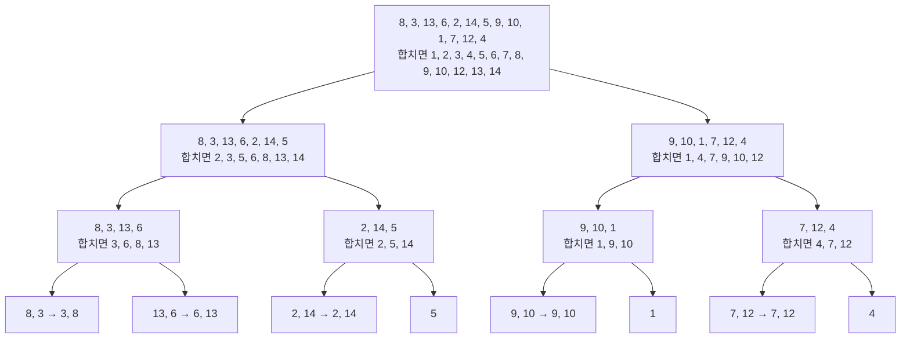


<div class="callout callout-summary" markdown="1">
<div class="callout-title callout-title--default" markdown="span">요약</div>

시험지 더미를 반으로 나눠 두 사람이 각자 번호 순으로 정리한 뒤, 두 더미의 맨 위 장만 견주어 가며 하나로 합치는 방식이다. 자료가 어떻게 놓여 있든 늘 같은 빠르기를 내서, 운이 나쁜 입력이 없다. 대신 합칠 때 종이를 옮겨 놓을 빈 책상이 하나 더 필요하다. 곧 자료만큼의 덤 공간이 든다.

</div>


## 예시로 보기

[퀵 정렬](/Hongs_Blog/studies/data-structures/quick-sort/)은 조각이 한쪽으로 몰리면 $$n^2$$에 비례해 느려진다. 조각을 값이 아니라 **자리**로 반씩 자르면 몰릴 일이 없다. 그 대신 자른 두 조각을 다시 하나로 합치는 일이 생긴다. 이 합치기가 병합 정렬의 알맹이다.

정렬된 두 줄 A = (2, 5, 6), B = (1, 3, 8, 9, 10)을 C로 합친다. 두 줄의 맨 앞끼리 견주어 작은 쪽을 C의 끝에 옮긴다.

| 견주는 두 값 | 옮기는 값 | A | B | C |
|---|---|---|---|---|
| 처음 | | (2, 5, 6) | (1, 3, 8, 9, 10) | () |
| 2와 1 | 1 | (2, 5, 6) | (3, 8, 9, 10) | (1) |
| 2와 3 | 2 | (5, 6) | (3, 8, 9, 10) | (1, 2) |
| 5와 3 | 3 | (5, 6) | (8, 9, 10) | (1, 2, 3) |
| 5와 8 | 5 | (6) | (8, 9, 10) | (1, 2, 3, 5) |
| 6과 8 | 6 | () | (8, 9, 10) | (1, 2, 3, 5, 6) |
| A가 비었다 | 8, 9, 10 | () | () | (1, 2, 3, 5, 6, 8, 9, 10) |

한 줄이 비면 남은 줄을 그대로 C 뒤에 붙인다. 비교는 5번, 옮기기는 8번이다. 두 줄이 이미 정렬되어 있어서 맨 앞만 보면 된다는 점이 핵심이다.

<div class="callout callout-check" markdown="1">
<div class="callout-title" markdown="span">검증: 위 합치기와 13개짜리 예의 합친 결과 12개, 재귀 판·재귀 없는 판·표준 `qsort`가 무작위 2,000개에서 같은 결과, 빈 배열·1개·모두 같은 값·정렬됨·역순을 컴파일해 실행(ASan·UBSan, 잡은 메모리를 모두 풀어 줌) — [43_merge-sort_impl.c](/Hongs_Blog/studies/data-structures/code/43_merge-sort_impl/). 합치기의 단계별 상태와 비교 횟수 범위(무작위 3,000쌍), 점화식의 답($$n \le 5{,}000$$) — [43_merge-sort_verify.py](/Hongs_Blog/studies/data-structures/code/43_merge-sort_verify/)</div>

</div>


## 정의

입력은 정수 $$n$$개가 든 배열이다. 끝나면 같은 값들이 작은 것부터 놓인다. 방법은 이렇다.

- 값이 한 개 이하면 이미 정렬되어 있다.
- $$n > 1$$이면 두 조각으로 나눈다. 앞의 $$\lceil n/2 \rceil$$개(반을 올림한 수)가 한 조각, 남은 $$\lfloor n/2 \rfloor$$개(반을 내림한 수)가 다른 조각이다. $$n = 13$$이면 7개와 6개다.
- 두 조각을 각각 같은 방법으로 정렬한다.
- 정렬된 두 조각을 합친다. 이 합치기를 병합(merge)이라 부른다.

### 두 줄 합치기

```c
/* 정렬된 a[0..na-1]과 b[0..nb-1]을 c에 합친다. */
void merge(const int a[], int na, const int b[], int nb, int c[])
{
    int i = 0, j = 0, k = 0;
    while (i < na && j < nb) {
        if (b[j] < a[i])
            c[k++] = b[j++];          /* b의 맨 앞이 더 작을 때만 b에서 옮긴다 */
        else
            c[k++] = a[i++];
    }
    while (i < na)                    /* 한 줄이 비면 남은 줄을 그대로 붙인다 */
        c[k++] = a[i++];
    while (j < nb)
        c[k++] = b[j++];
}
```

값 하나를 C로 옮기는 데 $$O(1)$$ 시간이 든다. 처음에 A에 $$n$$개, B에 $$m$$개가 있었다면 모두 $$n + m$$번 옮기므로 합치기는 $$O(n + m)$$이다. 비교는 한 번 할 때마다 값 하나가 옮겨지고 마지막 값은 비교 없이 옮겨지므로, 많아야 $$n + m - 1$$번이다[^s1].

### 정렬 전체

```c
/* a[lo..hi-1]을 정렬한다. tmp는 a와 같은 크기의 덤 배열. */
void msort(int a[], int tmp[], int lo, int hi)
{
    int n = hi - lo;
    if (n <= 1)
        return;
    int mid = lo + (n + 1) / 2;       /* 앞 조각이 반을 올림한 개수 */
    msort(a, tmp, lo, mid);
    msort(a, tmp, mid, hi);
    merge(a + lo, mid - lo, a + mid, hi - mid, tmp + lo);
    memcpy(a + lo, tmp + lo, n * sizeof(int));    /* 합친 결과를 제자리로 되옮긴다 */
}
```

`a + lo`는 `a[lo]`의 주소다. 배열의 한가운데를 가리키는 포인터를 넘기면, 받는 쪽은 그 칸을 0번 칸으로 여긴다. 구현 파일에서는 `merge_sort`가 `malloc`으로 `tmp`를 잡아 `msort`를 부르고, 끝나면 `free`로 풀어 준다[^s1].

13개짜리 예를 끝까지 나누고 다시 합치면 이렇게 된다.



위에서 아래로 내려가며 나누고, 아래에서 위로 올라오며 합친다. 칸마다 첫 줄이 나누기 전의 조각이고, "합치면" 뒤가 그 칸에서 합친 결과다. 맨 아래의 두 개짜리 조각은 한 개씩으로 한 번 더 나뉜다(그림에서는 줄였다). 합치기는 모두 12번, 곧 $$n - 1$$번이다.

### 재귀 없이 하기

병합 정렬도 보통은 재귀 없이 짠다. 이때는 두 단계로 나눈다.

1. 처음에 짧은 정렬된 조각들을 만든다. 이미 차례대로 놓인 구간을 그대로 조각으로 쓰거나, 몇 개씩 끊어 삽입 정렬로 정렬한다.
2. 이웃한 조각을 둘씩 합친다. 배열을 처음부터 끝까지 한 번 훑으며 합치는 일을 병합 패스(merge pass)라 부르고, 조각이 하나 남을 때까지 패스를 되풀이한다.

구현 파일의 `merge_sort_bottom_up`은 길이 1짜리 조각에서 시작해 패스마다 조각 길이를 두 배로 늘린다. 이 "조각 만들기 → 패스마다 둘씩 합치기"가 디스크의 자료를 정렬하는 [외부 병합 정렬](/Hongs_Blog/studies/data-structures/external-merge-sort/)의 뼈대다.

### 복잡도

$$n$$개를 정렬하는 시간을 $$t(n)$$이라 하면

$$t(0) = t(1) = c, \qquad t(n) = t\left(\left\lceil \tfrac n2 \right\rceil\right) + t\left(\left\lfloor \tfrac n2 \right\rfloor\right) + dn \quad (n > 1)$$


이다. $$c$$, $$d$$는 상수다. 말로 읽으면 "앞 조각을 정렬하는 시간, 뒤 조각을 정렬하는 시간, 둘을 합치는 시간 $$dn$$을 더한다"이다. 답은 $$t(n) = O(n \log n)$$이다.

<details class="callout callout-note" markdown="1">
<summary class="callout-title" markdown="span">점화식을 푸는 과정</summary>

계산을 쉽게 하려고 $$n$$이 2의 거듭제곱($$n = 2^k$$)이라고 두고, 식을 자기 자신에 되풀이해 넣는다. 그러면 올림과 내림이 사라져 $$t(n) = 2t(n/2) + dn$$이다.

$$t(n) = 2t\left(\frac n2\right) + dn = 4t\left(\frac n4\right) + 2dn = 8t\left(\frac n8\right) + 3dn = \cdots = 2^k\,t(1) + k\,dn = cn + dn\lg n$$

한 번 넣을 때마다 조각의 크기는 반이 되고 $$dn$$이 하나 늘어난다. $$k = \lg n$$번 넣으면 조각의 크기가 1이 된다. 예: $$c = d = 1$$, $$n = 8$$이면 $$8 + 8 \times 3 = 32$$다.

$$n$$이 2의 거듭제곱이 아니어도 $$t(n) \le cn + dn\lceil \lg n \rceil$$이다. $$c = 3$$, $$d = 5$$로 점화식을 직접 계산해 $$n \le 5{,}000$$에서 모두 확인했다. 이것은 확인이고 증명은 아니다[^s1].

</details>


퀵 정렬과 달리 이 식에는 "조각이 어떻게 갈리느냐"가 없다. 늘 반반이다. 그래서 가장 좋을 때, 평균, 가장 나쁠 때가 모두 $$O(n \log n)$$이다. 1,000개를 정렬하며 세어 보면 비교가 무작위 입력에서 평균 8,708번, 정렬된 입력에서 5,044번, 역순에서 4,932번이고, 어느 것도 $$1{,}000 \times \lceil \lg 1{,}000 \rceil = 10{,}000$$번을 넘지 않는다[^s1].

덤 공간은 덤 배열 `tmp`의 $$O(n)$$과 재귀 깊이 $$\lceil \lg n \rceil$$이다. `merge`가 값이 같을 때 앞 조각의 것을 먼저 옮기므로 같은 값끼리의 처음 순서도 지켜진다(안정 정렬)[^s1].

## 활용

- 구현: [43_merge-sort_impl.c](/Hongs_Blog/studies/data-structures/code/43_merge-sort_impl/). 연습: [정렬 추적 연습](/Hongs_Blog/studies/data-structures/sort-tracing-practice/)
- 가장 나쁜 경우의 실행 시간이 가장 좋은 정렬로 꼽힌다. 무엇을 고를지는 [퀵 정렬과 병합 정렬 비교](/Hongs_Blog/studies/data-structures/quick-vs-merge-sort/)에 있다.
- 합치기는 두 줄을 앞에서부터 차례로만 읽는다. 아무 칸이나 바로 읽을 수 없는 디스크 파일에 알맞아서 [외부 병합 정렬](/Hongs_Blog/studies/data-structures/external-merge-sort/)이 이 방법을 쓴다.
- 흔한 실수: 합친 결과를 덤 배열에 둔 채 되옮기지 않는 것, `if (b[j] <= a[i])`로 써서 같은 값의 순서를 뒤집는 것.

## 연결

- 선수: [삽입 정렬](/Hongs_Blog/studies/data-structures/insertion-sort/)(처음 조각 만들기), [동적 메모리 할당](/Hongs_Blog/studies/data-structures/dynamic-memory-allocation/)(덤 배열), [점근 표기](/Hongs_Blog/studies/discrete-math/asymptotic-notation/)
- 반으로 나눠 합친다는 생각과 파이썬의 `sorted`: [정렬과 정렬 기준](/Hongs_Blog/studies/algorithms/sorting/). 이 문서는 그 생각을 C 배열로 짜고 점화식으로 푸는 데 집중한다.
- 같은 점화식을 한 번에 푸는 정리: [분할 정복 점화식과 마스터 정리](/Hongs_Blog/studies/discrete-math/master-theorem/)
- 둘씩이 아니라 여러 줄을 한꺼번에 합치기: [k-way 병합과 선택 트리](/Hongs_Blog/studies/data-structures/k-way-merge/)

## 확인 문제

<details class="callout callout-question" markdown="1">
<summary class="callout-title" markdown="span">**C1** A = (1, 4, 7), B = (2, 3, 9, 10)을 합친다. 값 네 개를 옮긴 직후의 A, B, C를 쓰라. 끝까지 비교는 몇 번 하는가?</summary>

**답:** A = (7), B = (9, 10), C = (1, 2, 3, 4). 비교는 5번이다.<br>
**이유:** 1과 2를 견주어 1, 4와 2를 견주어 2, 4와 3을 견주어 3, 4와 9를 견주어 4를 옮긴다(4번). 7과 9를 견주어 7을 옮기면(5번) A가 비고, 남은 9, 10은 비교 없이 붙인다.

</details>


<details class="callout callout-question" markdown="1">
<summary class="callout-title" markdown="span">**C2** `merge`의 첫 `while`이 하는 일을 한 문장으로 쓰라.</summary>

**답:** 두 줄에 모두 값이 남아 있는 동안, 두 줄의 맨 앞끼리 견주어 작은 쪽을 결과의 끝에 옮긴다.

</details>


<details class="callout callout-question" markdown="1">
<summary class="callout-title" markdown="span">**C3** 퀵 정렬은 가장 나쁠 때 $$O(n^2)$$인데 병합 정렬은 늘 $$O(n \log n)$$인 까닭을 두 점화식의 차이로 설명하라.</summary>

**답:** 퀵 정렬의 점화식은 $$t(\vert \text{left}\vert ) + t(\vert \text{right}\vert ) + dn$$이라 조각의 크기가 피벗에 달려 있고, 한쪽이 0개면 $$t(n - 1) + dn$$이 되어 $$dn$$을 $$n$$번쯤 더한다. 병합 정렬은 자리로 반을 자르므로 늘 $$t(\lceil n/2 \rceil) + t(\lfloor n/2 \rfloor) + dn$$이고, 크기가 반씩 줄어 $$dn$$을 $$\lg n$$번쯤만 더한다.<br>
**이유:** 두 정렬 모두 한 층에서 하는 일은 $$dn$$으로 같다. 다른 것은 층의 수다. $$n = 8$$, $$c = d = 1$$이면 병합 정렬은 $$8 + 8 \times 3 = 32$$다.

</details>


[^s1]: `merge`와 `msort`의 C 코드, 추적 표의 "견주는 두 값" 칸, 비교 횟수의 한계 $$n + m - 1$$, 점화식을 푸는 과정, 2의 거듭제곱이 아닌 $$n$$의 한계, 1,000개의 비교 횟수, 덤 공간, 안정 정렬, 카드 C1~C3은 그 설명에 맞춰 보탰다. 수치는 위 두 코드로 확인했다.

