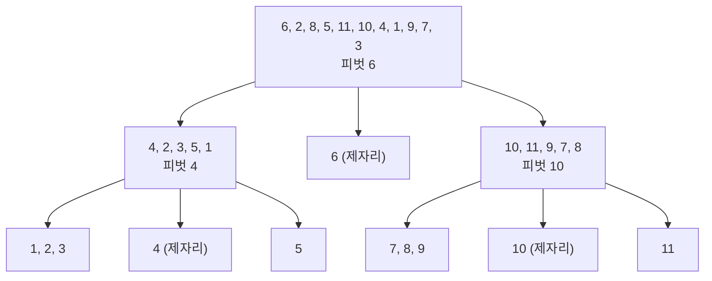


<div class="callout callout-summary" markdown="1">
<div class="callout-title callout-title--default" markdown="span">요약</div>

책장을 정리할 때 기준이 될 책 한 권을 고르고, 그보다 앞에 올 책은 왼쪽 더미로, 뒤에 올 책은 오른쪽 더미로 가른 다음, 두 더미를 같은 방법으로 다시 정리하는 방식이다. 더미가 번번이 반반쯤으로 갈리면 아주 빠르고, 책을 놓아 둘 덤 자리도 거의 필요 없다. 그러나 기준을 잘못 고르면 한쪽 더미가 텅 빈다. 이미 정리된 책장에서 늘 맨 앞 책을 기준으로 삼는 것이 그런 경우이고, 그때는 가장 단순한 정렬만큼 느려진다.

</div>


## 예시로 보기

[삽입 정렬](/Hongs_Blog/studies/data-structures/insertion-sort/)은 값 하나를 제자리로 보내려고 한 칸씩 민다. 멀리 가야 하는 값이 많으면 $$n^2$$에 비례하는 일을 한다. 값을 한 번에 멀리 보낼 수 있으면 훨씬 빠르다.

6, 2, 8, 5, 11, 10, 4, 1, 9, 7, 3에서 맨 앞의 6을 기준으로 고른다. 6보다 작은 값은 왼쪽에, 큰 값은 오른쪽에 모은다.

```
처음:   6  2  8  5 11 10  4  1  9  7  3
가른 뒤: 2  5  4  1  3 [6] 7  9 10 11  8
        └─ 6 이하 ──┘      └── 6 이상 ──┘
```

6은 이제 정렬이 끝났을 때의 제자리(5번 칸)에 있다. 왼쪽 다섯 개와 오른쪽 다섯 개는 서로 섞일 일이 없으니 따로 정렬하면 된다. 기준으로 고른 값을 피벗이라 부르고, 이렇게 가르는 일을 분할이라 부른다.



아래의 제자리 분할로 두 층까지 나눈 모습이다. 조각 안의 순서는 분할 방법에 따라 위 그림과 다를 수 있다.

<div class="callout callout-check" markdown="1">
<div class="callout-title" markdown="span">검증: 덤 배열 분할과 제자리 분할의 예(맞바꾼 쌍과 끝 상태), 분할의 불변식을 바퀴마다 검사(무작위 20,000개), 가운데 값 규칙의 세 예, 정렬 네 판을 표준 `qsort`와 무작위 2,000개 비교, 빈 구간·1개·모두 같은 값·정렬됨·역순을 컴파일해 실행(ASan·UBSan) — [42_quick-sort_impl.c](/Hongs_Blog/studies/data-structures/code/42_quick-sort_impl/). 비교 횟수와 재귀 깊이 세기(정렬된 입력 $$n \le 300$$ 전부, 무작위 1,000개 200번 등) — [42_quick-sort_verify.py](/Hongs_Blog/studies/data-structures/code/42_quick-sort_verify/)</div>

</div>


## 정의

입력은 배열의 한 구간 `a[left]`부터 `a[right]`까지다. 끝나면 그 구간의 값들이 작은 것부터 놓인다. 값의 수를 $$n$$이라 하면 방법은 이렇다.

- $$n \le 1$$이면 이미 정렬되어 있다.
- $$n > 1$$이면 값 가운데 하나를 피벗으로 고른다.
- 값들을 왼쪽, 가운데, 오른쪽 세 조각으로 가른다. 가운데 조각에는 피벗 하나만 있다. 왼쪽 조각의 값은 모두 피벗 이하이고, 오른쪽 조각의 값은 모두 피벗 이상이다.
- 왼쪽 조각과 오른쪽 조각을 같은 방법으로 정렬한다.
- 정렬된 왼쪽 조각, 피벗, 정렬된 오른쪽 조각을 이어 놓은 것이 답이다.

```c
void quick_sort(int a[], int left, int right)
{
    if (left >= right)
        return;                       /* 값이 한 개 이하면 이미 정렬되어 있다 */
    int p = partition(a, left, right);    /* 피벗이 놓인 자리 */
    quick_sort(a, left, p - 1);       /* 왼쪽 조각 */
    quick_sort(a, p + 1, right);      /* 오른쪽 조각 */
}
```

일은 거의 다 `partition`이 한다. 가르는 방법은 두 가지다.

### 덤 배열로 가르기

같은 크기의 배열 `b`를 하나 더 둔다. 피벗 다음 값부터 차례로 보면서, 피벗 이하인 값은 `b`의 왼쪽 끝부터, 큰 값은 `b`의 오른쪽 끝부터 채운다. 마지막에 남는 한 칸에 피벗을 놓는다.

```c
int partition_extra(const int a[], int b[], int left, int right)
{
    int pivot = a[left];
    int lo = left, hi = right;
    for (int i = left + 1; i <= right; i++) {
        if (a[i] <= pivot)
            b[lo++] = a[i];           /* 작은 값은 왼쪽 끝부터 */
        else
            b[hi--] = a[i];           /* 큰 값은 오른쪽 끝부터 */
    }
    b[lo] = pivot;
    return lo;
}
```

예시의 "가른 뒤" 줄이 이 방법의 결과다. 큰 값 8, 11, 10, 9, 7이 오른쪽 끝부터 채워져서 7, 9, 10, 11, 8로 뒤집혀 보인다. 이해하기는 쉽지만 배열 하나만큼의 자리가 더 든다[^s1].

### 제자리에서 가르기

덤 배열 없이 같은 배열 안에서 맞바꾸기만으로 가른다.

1. 피벗은 맨 왼쪽 값이다.
2. 왼쪽에서 오른쪽으로 가며 피벗 이상인 첫 값을 찾는다. 이 값을 `bigElement`라 부른다.
3. 오른쪽에서 왼쪽으로 가며 피벗 이하인 첫 값을 찾는다. `smallElement`다.
4. `bigElement`가 `smallElement`보다 왼쪽에 있으면 둘을 맞바꾸고 2로 돌아간다.
5. 그렇지 않으면 피벗과 `smallElement`를 맞바꾸고 끝낸다.

| 바퀴 | 배열 | big | small | 한 일 |
|---|---|---|---|---|
| 1 | [6, 2, **8**, 5, 11, 10, 4, 1, 9, 7, **3**] | 8 (2번 칸) | 3 (10번 칸) | 맞바꾼다 |
| 2 | [6, 2, 3, 5, **11**, 10, 4, **1**, 9, 7, 8] | 11 (4번 칸) | 1 (7번 칸) | 맞바꾼다 |
| 3 | [6, 2, 3, 5, 1, **10**, **4**, 11, 9, 7, 8] | 10 (5번 칸) | 4 (6번 칸) | 맞바꾼다 |
| 4 | [6, 2, 3, 5, 1, **4**, **10**, 11, 9, 7, 8] | 10 (6번 칸) | 4 (5번 칸) | big이 small의 왼쪽이 아니다. 피벗 6과 small 4를 맞바꾸고 끝 |
| 끝 | [4, 2, 3, 5, 1, 6, 10, 11, 9, 7, 8] | | | 피벗이 5번 칸에 놓였다 |

```c
int partition(int a[], int left, int right)
{
    int pivot = a[left];
    int i = left, j = right + 1;
    for (;;) {
        do {
            i++;
        } while (i <= right && a[i] < pivot);   /* 피벗 이상인 첫 값에서 멈춘다 */
        do {
            j--;
        } while (a[j] > pivot);                 /* 피벗 이하인 첫 값에서 멈춘다 */
        if (i >= j)
            break;
        int t = a[i]; a[i] = a[j]; a[j] = t;    /* big과 small을 맞바꾼다 */
    }
    a[left] = a[j];                             /* 피벗과 small을 맞바꾼다 */
    a[j] = pivot;
    return j;
}
```

`i`는 big을 찾는 손가락이고 `j`는 small을 찾는 손가락이다. 두 손가락이 서로 지나치면 가르기가 끝난다[^s1].

### 정확성

**주장.** `partition`이 `p`를 돌려주면 `a[p]`는 피벗이고, `a[left]`부터 `a[p-1]`까지는 모두 피벗 이하, `a[p+1]`부터 `a[right]`까지는 모두 피벗 이상이다. 그래서 `quick_sort`는 구간을 정렬한다[^s1].

증명은 반복문 내내 맞는 말(루프 불변식) 하나를 붙잡고 간다. 바깥 `for`가 한 바퀴를 시작할 때마다 **`i` 이하의 칸(피벗 칸 제외)은 모두 피벗 이하이고, `j` 이상의 칸은 모두 피벗 이상이다.**

<details class="callout callout-proof" markdown="1">
<summary class="callout-title" markdown="span">증명 펼치기</summary>

1. **처음.** `i = left`, `j = right + 1`이라 두 범위에 든 칸이 하나도 없다. 불변식이 맞다. — 빈 범위
2. **`i`의 움직임.** 첫 `do`는 피벗보다 작은 값만 지나치고, 피벗 이상인 값을 만나거나 오른쪽 끝을 넘으면 멈춘다. 지나친 칸은 모두 피벗 미만이다. — `do`의 조건
3. **`j`의 움직임.** 둘째 `do`는 피벗보다 큰 값만 지나치고, 피벗 이하인 값에서 멈춘다. `a[left]`가 피벗 자신이므로 늦어도 `left`에서 멈춘다. — `do`의 조건
4. **맞바꾸기.** `i < j`이면 `a[i]`는 피벗 이상, `a[j]`는 피벗 이하다. 둘을 맞바꾸면 `a[i]`가 피벗 이하, `a[j]`가 피벗 이상이 되어 불변식이 다시 맞다. — 2, 3
5. **끝날 때.** `i >= j`다. `j`보다 오른쪽 칸은 모두 피벗 이상이다(불변식과 3). `j`보다 왼쪽 칸은 `i`보다도 왼쪽이라 모두 피벗 이하다(불변식과 2). `a[j]` 자신도 피벗 이하다(3). — 범위 합치기
6. **피벗 놓기.** `a[left]`(피벗)와 `a[j]`를 맞바꾸면 피벗이 `j`번 칸에 오고, 그 왼쪽은 모두 피벗 이하, 오른쪽은 모두 피벗 이상이다. — 5
7. **반드시 끝난다.** 한 바퀴마다 `i`는 1 이상 늘고 `j`는 1 이상 준다. 구간의 칸 수만큼 바퀴를 돌기 전에 `i >= j`가 된다. — 정수의 증가와 감소
8. **정렬 전체.** 구간의 길이에 대한 강한 귀납법을 쓴다. 길이가 1 이하면 그대로 정렬된 것이다. 길이가 2 이상이면 두 조각은 피벗이 빠진 만큼 더 짧으므로 귀납 가정에 따라 정렬되어 돌아온다. 왼쪽 조각의 값은 모두 피벗 이하, 오른쪽 조각의 값은 모두 피벗 이상이므로, 이어 놓으면 구간 전체가 정렬된다. ∎ — 강한 귀납법

</details>


### 스스로 설명해 보기

<details class="callout callout-question" markdown="1">
<summary class="callout-title" markdown="span">1. 둘째 `do`에는 `j >= left` 검사가 없다. 왜 `j`가 구간 밖으로 나가지 않는가?</summary>

`a[left]`가 피벗 자신이라 `a[left] > pivot`이 거짓이다. `j`가 `left`까지 내려오면 거기서 반드시 멈춘다. 피벗이 보초 노릇을 한다.

</details>


<details class="callout callout-question" markdown="1">
<summary class="callout-title" markdown="span">2. 첫 `do`에는 왜 `i <= right` 검사가 있어야 하는가?</summary>

오른쪽 끝에는 보초가 없다. 피벗이 구간에서 가장 큰 값이면 피벗 이상인 값이 하나도 없어 `i`가 구간을 넘어간다. `[9, 1, 2]`에서 `i`는 3이 되어서야 멈춘다. 검사가 없으면 배열 밖 `a[3]`을 읽는다.

</details>


<details class="callout callout-question" markdown="1">
<summary class="callout-title" markdown="span">3. 5단계에서 "`j`보다 왼쪽 칸은 `i`보다도 왼쪽"이라는 말은 어디서 나오는가?</summary>

끝나는 조건이 `i >= j`다. `j`보다 왼쪽이면 `j` 미만이고, `j` 미만이면 `i` 미만이다.

</details>


<details class="callout callout-question" markdown="1">
<summary class="callout-title" markdown="span">4. 마지막에 피벗을 `a[i]`가 아니라 `a[j]`와 맞바꾸는 까닭은?</summary>

맨 왼쪽 칸으로 갈 값은 피벗 이하여야 한다. `a[j]`는 피벗 이하인 값에서 멈춘 것이라 괜찮다. `a[i]`는 피벗 이상이라, 이것을 맨 왼쪽에 놓으면 왼쪽 조각에 피벗보다 큰 값이 들어갈 수 있다. 추적 표의 마지막 바퀴에서 `a[i]`는 10, `a[j]`는 4였다.

</details>


<details class="callout callout-question" markdown="1">
<summary class="callout-title" markdown="span">이 증명의 핵심 아이디어는?</summary>

두 손가락이 지나온 칸에 대해 "왼쪽은 작고 오른쪽은 크다"는 말이 계속 맞게 하는 것이다. 손가락이 멈춘 두 값만 이 말을 깨므로, 그 둘을 맞바꾸면 다시 맞는다.

</details>


<details class="callout callout-question" markdown="1">
<summary class="callout-title" markdown="span">이 방법을 쓸 수 있는 다른 상황은?</summary>

정렬하지 않고 $$k$$번째로 작은 값만 찾을 때다. 분할을 한 번 하고, 피벗 자리가 $$k$$보다 크면 왼쪽 조각만, 작으면 오른쪽 조각만 다시 가른다. 값을 조건에 맞는 것과 아닌 것으로 한 번에 가르는 일(짝수와 홀수, 음수와 양수)에도 같은 두 손가락을 쓴다[^s1].

</details>


### 피벗 고르기

피벗을 고르는 방법은 세 가지가 있다. `a[6]`부터 `a[20]`까지를 정렬하는 경우로 적는다.

| 방법 | 고르는 값 | 예 |
|---|---|---|
| 맨 왼쪽 | 구간의 첫 값 | `a[6]` |
| 무작위 | 6부터 20까지에서 수 `r`을 아무렇게나 뽑아 `a[r]` | |
| 가운데 값 규칙(median-of-three) | 맨 왼쪽, 가운데, 맨 오른쪽 세 값 가운데 크기가 중간인 값 | `a[6]`, `a[13]`, `a[20]`을 본다. 13은 $$(6 + 20) / 2$$다 |

가운데 값 규칙의 예는 셋이다.

| `a[6]` | `a[13]` | `a[20]` | 피벗 |
|---|---|---|---|
| 30 | 2 | 10 | `a[20]` (10) |
| 3 | 2 | 10 | `a[6]` (3) |
| 30 | 25 | 10 | `a[13]` (25) |

무작위나 가운데 값 규칙으로 고른 피벗이 맨 왼쪽에 있지 않아도 코드를 새로 짤 필요는 없다. 고른 피벗을 맨 왼쪽 값과 먼저 맞바꾸면 위의 `partition`을 그대로 쓸 수 있다.

### 복잡도

값 $$n$$개를 가르는 데는 $$O(n)$$ 시간이 든다. 두 손가락이 합쳐서 구간을 한 번 훑기 때문이다. $$n$$개를 정렬하는 시간을 $$t(n)$$이라 하면

$$t(0) = t(1) = c, \qquad t(n) = t(\vert \text{left}\vert ) + t(\vert \text{right}\vert ) + dn \quad (n > 1)$$


이다. $$c$$, $$d$$는 상수이고, $$\vert \text{left}\vert $$와 $$\vert \text{right}\vert $$는 왼쪽 조각과 오른쪽 조각에 든 값의 수다. 말로 읽으면 "두 조각을 정렬하는 시간에, 가르는 시간 $$dn$$을 더한다"이다.


| 경우 | 조각이 갈리는 모양 | 점화식 | 결과 |
|---|---|---|---|
| 가장 나쁠 때 | 번번이 한쪽이 0개 | $$t(n) = t(n - 1) + dn$$ | $$O(n^2)$$ |
| 가장 좋을 때 | 번번이 반반(또는 1개 차이) | $$t(n) = 2t(n/2) + dn$$ | $$O(n \log n)$$ |
| 평균 | | | $$O(n \log n)$$ [증명 생략: Cormen 외, *Introduction to Algorithms* 3판 7.4절] |

가장 나쁜 경우는 예를 들어 피벗이 늘 가장 작은 값일 때다. 이미 정렬된 배열에서 맨 왼쪽 값을 피벗으로 삼으면 바로 그렇게 된다.

<details class="callout callout-note" markdown="1">
<summary class="callout-title" markdown="span">두 점화식을 푸는 과정</summary>

**가장 나쁠 때.** 식을 자기 자신에 되풀이해 넣는다(되풀이 대입, repeated substitution).

$$t(n) = t(n-1) + dn = t(n-2) + d(n-1) + dn = \cdots = t(1) + d(2 + 3 + \cdots + n) = c + d\left(\frac{n(n+1)}{2} - 1\right)$$

$$2$$부터 $$n$$까지의 합은 $$1$$부터 $$n$$까지의 합 $$\frac{n(n+1)}{2}$$에서 1을 뺀 것이다. $$n^2$$ 항이 가장 크므로 $$O(n^2)$$이다. 한쪽 조각이 0개일 때 정확히는 $$t(0) = c$$가 한 번씩 더 붙지만, $$dn$$에 견주면 상수라서 $$d$$를 조금 키운 것으로 보면 된다.

**가장 좋을 때.** $$n = 2^k$$라고 하자.

$$t(n) = 2t\left(\frac n2\right) + dn = 4t\left(\frac n4\right) + 2dn = \cdots = 2^k\, t(1) + k\,dn = cn + dn \lg n$$

한 번 넣을 때마다 $$dn$$이 하나씩 늘고, $$k = \lg n$$번 넣으면 조각의 크기가 1이 된다. 그래서 $$O(n \log n)$$이다.

두 닫힌 꼴은 $$c = 3$$, $$d = 5$$를 넣어 점화식을 직접 계산한 값과 견주었다($$n \le 200$$, $$n = 2^k \le 2^{20}$$)[^s1].

</details>


이 문서의 코드로 비교 횟수를 실제로 세면 다음과 같다[^s1].

| 입력 1,000개 | 피벗 | 비교 횟수 | 재귀 깊이 |
|---|---|---|---|
| 무작위(200번 평균) | 맨 왼쪽 | 약 12,100 | 많아야 28 |
| 이미 정렬됨 | 맨 왼쪽 | 501,498 | 999 |
| 이미 정렬됨 | 가운데 값 규칙 | 9,009 | 9 |
| 역순 | 가운데 값 규칙 | 126,748 | 251 |

정렬된 입력에 맨 왼쪽 피벗을 쓰면 비교가 정확히 $$\frac{(n - 1)(n + 4)}{2}$$번이다. 가운데 값 규칙은 정렬된 입력을 잘 넘기지만, 이 코드에서는 역순 입력에서 다시 $$n^2$$에 비례한다(2,000개면 503,498번으로 약 네 배). 피벗 규칙을 바꾸면 나쁜 입력이 다른 입력으로 옮겨 갈 뿐, 가장 나쁜 경우가 없어지지는 않는다.

**공간.** 덤 배열은 필요 없지만 재귀 호출이 쌓인다. 조각이 번번이 한쪽으로 몰리면 재귀가 $$n$$겹까지 쌓여 $$O(n)$$ 공간이 든다. 이것은 $$O(\log n)$$으로 줄일 수 있다. 작은 조각만 재귀로 부르고 큰 조각은 같은 함수 안에서 반복문으로 이어 가면, 재귀로 부르는 조각이 매번 절반 이하라서 깊이가 $$\lg n$$을 넘지 않는다[^s1].

## 예제

**같은 값이 많을 때의 규칙.** 조각을 고르게 가르려면 제자리 분할의 규칙을 이렇게 쓴다. big은 피벗 **이상**인 가장 왼쪽 값, small은 피벗 **이하**인 가장 오른쪽 값이다. 위 코드가 이 규칙이다. 등호를 빼고 "피벗보다 큰 값", "피벗보다 작은 값"으로 찾으면 값이 모두 다를 때는 결과가 같다. 값이 모두 같을 때 차이가 난다[^s1].

| 값이 모두 같은 9개 | 첫 분할 뒤 조각 크기 | 1,000개일 때 비교 횟수 |
|---|---|---|
| 등호 있는 규칙(이상, 이하) | 4개와 4개 | 8,898 |
| 등호 없는 규칙(초과, 미만) | 0개와 8개 | 999,000 |

등호가 있으면 두 손가락이 같은 값에서도 멈춰 서로 맞바꾸며 가운데에서 만난다. 등호가 없으면 big을 찾는 손가락이 멈출 곳이 없어 끝까지 가 버리고, 조각이 한쪽으로 몰린다.

## 활용

- 구현: [42_quick-sort_impl.c](/Hongs_Blog/studies/data-structures/code/42_quick-sort_impl/). 연습: [퀵 정렬 분할 예제 사다리](/Hongs_Blog/studies/data-structures/quick-partition-ladder/)
- 조각이 작아지면 재귀를 멈춘다. 조각의 크기가 15쯤 이하가 되면 그 조각은 [삽입 정렬](/Hongs_Blog/studies/data-structures/insertion-sort/)로 정렬한다. 작은 조각에서는 함수를 부르고 돌아오는 비용이 삽입 정렬의 비교 몇 번보다 크기 때문이다[^s1]. 구현 파일의 `quick_sort_tuned`가 가운데 값 규칙, 작은 조각 넘기기, 작은 조각 먼저 부르기를 모두 넣은 판이다. 정렬된 4,096개에서 재귀 깊이가 9다.
- 평균 실행 시간이 가장 좋은 정렬로 꼽힌다. 가장 나쁜 경우까지 보장해야 하면 [병합 정렬](/Hongs_Blog/studies/data-structures/merge-sort/)을 쓴다: [퀵 정렬과 병합 정렬 비교](/Hongs_Blog/studies/data-structures/quick-vs-merge-sort/).
- 흔한 실수: 재귀 호출에 피벗 칸을 다시 넣는 것(`quick_sort(a, left, p)`). 조각이 줄지 않아 끝나지 않을 수 있다.

## 연결

- 선수: [삽입 정렬](/Hongs_Blog/studies/data-structures/insertion-sort/), [점근 표기](/Hongs_Blog/studies/discrete-math/asymptotic-notation/), [수학적 귀납법](/Hongs_Blog/studies/discrete-math/induction/)(정확성 증명의 8단계)
- 점화식을 푸는 다른 방법: [분할 정복 점화식과 마스터 정리](/Hongs_Blog/studies/discrete-math/master-theorem/)
- 피벗을 무작위로 고를 때 평균 비교 횟수가 약 $$2n \ln n$$이라는 증명: [해싱과 무작위 알고리즘의 확률](/Hongs_Blog/studies/probability-statistics/randomized-analysis/)
- 재귀 호출이 쌓이는 모양: [재귀와 백트래킹](/Hongs_Blog/studies/algorithms/recursion-backtracking/)

## 자주 하는 오해

<div class="callout callout-misconception" markdown="1">
<div class="callout-title" markdown="span">"퀵 정렬은 늘 $$n \log n$$이다"</div>

틀렸다. $$n \log n$$은 가장 좋을 때와 평균의 이야기다. 이름이 '퀵'이고 실제로 대부분의 입력에서 빠르다 보니 늘 그런 것처럼 들린다. 그러나 조각이 번번이 0개와 나머지로 갈리면 $$t(n) = t(n - 1) + dn$$이 되어 $$n^2$$에 비례한다. 이미 정렬된 1,000개를 맨 왼쪽 피벗으로 정렬하면 비교가 501,498번으로, 무작위 입력 평균(약 12,100번)의 41배다. 확인하는 법은 정렬된 입력의 크기를 두 배로 늘려 보는 것이다. 2,000개에서 2,002,998번으로 네 배가 된다. 피벗을 가운데 값 규칙이나 무작위로 골라도 가장 나쁜 경우의 $$O(n^2)$$은 그대로이고, 그런 입력을 만날 일이 드물어질 뿐이다.

</div>


## 확인 문제

<details class="callout callout-question" markdown="1">
<summary class="callout-title" markdown="span">**C1** `[5, 9, 1, 7, 3, 8, 2]`를 맨 왼쪽 피벗으로 제자리 분할한다. 맞바꾸는 big과 small의 쌍을 차례로 쓰고, 끝난 뒤의 배열과 피벗의 자리를 쓰라.</summary>

**답:** (9, 2), (7, 3)을 차례로 맞바꾼다. 끝난 뒤 `[3, 2, 1, 5, 7, 8, 9]`, 피벗 5는 3번 칸이다.<br>
**이유:** 첫 바퀴에서 big은 9(1번 칸), small은 2(6번 칸)다. 맞바꾸면 `[5, 2, 1, 7, 3, 8, 9]`. 둘째 바퀴에서 big은 7(3번 칸), small은 3(4번 칸)이다. 맞바꾸면 `[5, 2, 1, 3, 7, 8, 9]`. 셋째 바퀴에서 big은 7(4번 칸), small은 3(3번 칸)으로 서로 지나쳤으니, 피벗 5와 small 3을 맞바꾼다.

</details>


<details class="callout callout-question" markdown="1">
<summary class="callout-title" markdown="span">**C2** `partition(a, left, right)`가 하는 일과 돌려주는 값을 한 문장으로 쓰라.</summary>

**답:** 맨 왼쪽 값을 피벗으로 삼아 피벗 이하인 값은 왼쪽에, 피벗 이상인 값은 오른쪽에 모으고, 그 사이에 놓인 피벗의 칸 번호를 돌려준다.

</details>


<details class="callout callout-question" markdown="1">
<summary class="callout-title" markdown="span">**C3** 맨 왼쪽 값을 피벗으로 쓰는 퀵 정렬이 가장 느려지는 길이 5짜리 입력을 하나 만들고, 분할할 때마다 조각의 크기가 어떻게 되는지 쓰라.</summary>

**답:** `[1, 2, 3, 4, 5]`. 조각 크기는 (0, 4), (0, 3), (0, 2), (0, 1)이다.<br>
**이유:** 피벗이 번번이 구간에서 가장 작은 값이라 왼쪽 조각이 비고, 오른쪽 조각은 한 개씩만 준다. 분할을 네 번 하고 비교는 18번이다. 역순 `[5, 4, 3, 2, 1]`도 같은 식으로 한쪽으로 몰린다.

</details>


<details class="callout callout-question" markdown="1">
<summary class="callout-title" markdown="span">**C4** 제자리 분할이 끝났을 때 "`a[j]`보다 오른쪽 칸은 모두 피벗 이상"이라는 말은 증명의 어느 줄들에서 나오는가?</summary>

**답:** 불변식(`j` 이상의 칸은 모두 피벗 이상)과 3단계(`j`는 피벗보다 큰 값만 지나친다)에서 나온다.<br>
**이유:** 마지막 바퀴를 시작할 때 `j` 이상의 칸은 불변식에 따라 피벗 이상이다. 그 바퀴에서 `j`가 왼쪽으로 가며 지나친 칸은 모두 피벗보다 크다. 그래서 멈춘 자리의 오른쪽 전체가 피벗 이상이다.

</details>


<details class="callout callout-question" markdown="1">
<summary class="callout-title" markdown="span">**C5** `a[0]`부터 `a[8]`까지를 가운데 값 규칙으로 정렬한다. (가) `a[0] = 12`, `a[4] = 40`, `a[8] = 7`일 때와 (나) `a[0] = 12`, `a[4] = 9`, `a[8] = 7`일 때, 피벗은 각각 무엇이고 분할 전에 무엇을 하는가?</summary>

**답:** (가) 12(`a[0]`). 이미 맨 왼쪽이라 그대로 분할한다. (나) 9(`a[4]`). `a[0]`과 `a[4]`를 맞바꾼 뒤 분할한다.<br>
**이유:** 세 값을 크기 순으로 놓으면 (가) 7, 12, 40, (나) 7, 9, 12다. 가운데 칸은 $$(0 + 8) / 2 = 4$$다.

</details>


<details class="callout callout-question" markdown="1">
<summary class="callout-title" markdown="span">**C6** 값이 모두 같은 배열을 정렬할 때, big과 small을 "피벗 이상", "피벗 이하"로 찾는 규칙이 "피벗 초과", "피벗 미만"으로 찾는 규칙보다 빠른 까닭은?</summary>

**답:** 등호가 있으면 두 손가락이 같은 값에서도 멈춰 서로 맞바꾸며 가운데에서 만나므로 조각이 반반으로 갈린다. 등호가 없으면 big을 찾는 손가락이 멈출 값이 없어 끝까지 가고, 조각이 0개와 $$n - 1$$개로 갈려 가장 나쁜 경우가 된다.<br>
**이유:** 1,000개에서 세면 8,898번 대 999,000번이다. 같은 값을 맞바꾸는 일은 쓸모없어 보이지만, 그 덕에 피벗이 가운데에 놓인다.

</details>


[^s1]: 두 `partition`과 `quick_sort`의 C 코드, 추적 표의 칸 번호, 불변식과 증명, 스스로 설명해 보기, 점화식을 푸는 과정, 비교 횟수와 재귀 깊이의 표, 같은 값이 많을 때의 비교, 작은 조각을 먼저 부르는 방법, 작은 조각에서 삽입 정렬이 나은 까닭, 카드 C1~C6은 그 설명에 맞춰 보탰다. 분할의 정확성 논증은 Hoare의 분할(C. A. R. Hoare, "Quicksort", *The Computer Journal* 5(1), 1962)을 이 코드에 맞춰 쓴 것이다. 수치는 위 두 코드로 확인했고, 실험으로 확인한 값은 증명이 아니다.

