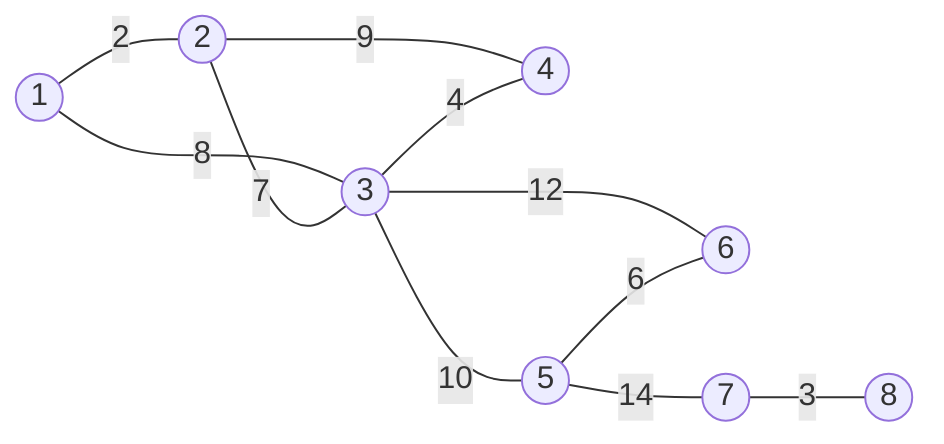


<div class="callout callout-summary" markdown="1">
<div class="callout-title callout-title--default" markdown="span">요약</div>

마을마다 이웃 마을로 가는 가장 싼 길 하나씩을 한꺼번에 고르고, 그 길로 이어진 마을들을 한 덩어리로 묶는다. 다음에는 덩어리마다 다른 덩어리로 가는 가장 싼 길을 하나씩 골라, 덩어리가 하나 남을 때까지 되풀이한다. 그러면 모든 마을을 가장 싸게 잇는 길 모음이 되고, 한 바퀴마다 덩어리 수가 절반 이하로 줄어 몇 바퀴면 끝난다. 다만 값이 같은 길이 있으면 덩어리들이 제각각 골라 고리가 생길 수 있어서, 고르는 규칙을 하나로 정해 두어야 한다.

</div>


## 예시로 보기

모든 점을 가장 싸게 잇는 나무(최소 비용 신장 트리)를 구하는 방법으로 크루스칼과 프림이 있다([최소 신장 트리](/Hongs_Blog/studies/algorithms/mst/)). 둘 다 간선을 한 번에 하나씩 고른다. 솔린의 방법은 한 바퀴에 여러 개를 고른다.

점 8개, 간선 10개로 된 그래프를 보자.



선 위의 수가 비용이다.

**1바퀴.** 처음에는 점 하나하나가 덩어리다. 덩어리마다 자기에게 붙은 간선 가운데 가장 싼 것을 고른다.

| 덩어리 | 밖으로 나가는 간선 | 고른 간선 |
|---|---|---|
| {1} | 1–2(2), 1–3(8) | 1–2 |
| {2} | 1–2(2), 2–3(7), 2–4(9) | 1–2 |
| {3} | 1–3(8), 2–3(7), 3–4(4), 3–5(10), 3–6(12) | 3–4 |
| {4} | 2–4(9), 3–4(4) | 3–4 |
| {5} | 3–5(10), 5–6(6), 5–7(14) | 5–6 |
| {6} | 3–6(12), 5–6(6) | 5–6 |
| {7} | 5–7(14), 7–8(3) | 7–8 |
| {8} | 7–8(3) | 7–8 |

여덟 덩어리가 고른 것은 겹치는 것을 한 번씩만 세면 1–2, 3–4, 5–6, 7–8의 넷이다. 이 넷을 넣으면 덩어리가 {1, 2}, {3, 4}, {5, 6}, {7, 8}의 넷으로 준다.

**2바퀴.** 남은 덩어리마다 다른 덩어리로 가는 가장 싼 간선을 고른다.

| 덩어리 | 밖으로 나가는 간선 | 고른 간선 |
|---|---|---|
| {1, 2} | 1–3(8), 2–3(7), 2–4(9) | 2–3 |
| {3, 4} | 1–3(8), 2–3(7), 2–4(9), 3–5(10), 3–6(12) | 2–3 |
| {5, 6} | 3–5(10), 3–6(12), 5–7(14) | 3–5 |
| {7, 8} | 5–7(14) | 5–7 |

겹치는 2–3을 한 번만 세면 2–3, 3–5, 5–7의 셋이다. 이 셋을 넣으면 덩어리가 하나가 되어 끝난다. 고른 간선은 모두 $$4 + 3 = 7$$개($$n - 1$$개)이고 비용 합은 $$2 + 4 + 6 + 3 + 7 + 10 + 14 = 46$$이다. 크루스칼과 프림이 같은 그래프에서 내는 46과 같다.

<div class="callout callout-check" markdown="1">
<div class="callout-title" markdown="span">검증: 파이썬으로 위 두 표와 합 46을 다시 만들었고, 같은 비용이 많은 무작위 연결 그래프 1,500개(점 2 ~ 8개, 비용 1 ~ 4)에서 솔린의 합 = 크루스칼의 합, 고른 간선 $$n - 1$$개, 바퀴 수 ≤ ⌈lg n⌉을, 비용이 모두 다른 300개에서 두 방법이 같은 간선을 고르는 것을 확인했다 — [37_sollin-algorithm_verify.py](/Hongs_Blog/studies/data-structures/code/37_sollin-algorithm_verify/)</div>

</div>


## 정의

<div class="callout callout-definition" markdown="1">
<div class="callout-title" markdown="span">입력과 출력</div>

- **입력:** 간선마다 비용이 있고, 모든 점이 이어진, 방향 없는 그래프. 점은 $$n$$개, 간선은 $$m$$개다(간선 수를 $$e$$로 적는 책도 있다).
- **출력:** 모든 점을 잇고 고리가 없는 간선 $$n - 1$$개(신장 트리) 가운데 비용 합이 가장 작은 것.

</div>


방법은 이렇다. 간선이 없는 점 $$n$$개의 숲에서 시작한다. 덩어리(나무)마다 다른 덩어리와 이어 줄 가장 싼 간선을 하나 고른다. 겹쳐 고른 것과 생길 수 있는 고리를 없앤다. 덩어리가 하나 남을 때까지 되풀이한다.

```
T = 빈 간선 모음. 처음에는 점 하나하나가 덩어리다
덩어리가 둘 이상인 동안:
    덩어리마다, 한쪽 끝만 그 덩어리에 든 간선 가운데 가장 싼 것을 하나 고른다
        (비용이 같으면 번호가 앞선 간선)
    두 덩어리가 같은 간선을 골랐으면 한 번만 남긴다
    남은 간선을 T에 넣고, 그 간선으로 이어진 덩어리들을 합친다
T를 돌려준다
```

"두 점이 같은 덩어리인가"와 "두 덩어리를 합친다"는 [유니온 파인드](/Hongs_Blog/studies/algorithms/union-find/)로 한다[^s1].

### 맞는 까닭

덩어리 하나와 나머지 점들로 두 편을 가르면, 그 덩어리가 고른 간선은 두 편을 잇는 간선 가운데 가장 싼 것이다. [최소 신장 트리](/Hongs_Blog/studies/algorithms/mst/)의 자르기 성질에 따라 그런 간선은 어떤 최소 비용 신장 트리에 들어 있다. 그래서 덩어리마다 고른 간선은 넣어도 안전하다[^s1].

### 같은 비용의 간선과 고리

비용이 같은 간선이 있으면 고리가 생길 수 있다. 그래서 겹쳐 고른 간선과 고리를 조심해야 한다. 점 셋이 삼각형으로 이어져 있고 세 간선의 비용이 모두 1이라고 하자.

- 덩어리 {1}은 1–2를, {2}는 2–3을, {3}은 1–3을 골랐다. 저마다 "가장 싼 간선"이 맞다.
- 셋이 모두 다른 간선이라 겹치는 것이 없다. 다 넣으면 간선 3개로 점 3개가 고리를 이룬다. 나무가 아니다.

비용이 모두 다르면 이런 일이 없다. 그래서 비용이 같을 때 "번호가 앞선 간선을 고른다"처럼 순서를 하나로 정해 둔다. 위 삼각형에서 간선 번호를 1–2, 2–3, 1–3 순으로 매기면 {1}과 {2}는 1–2를, {3}은 2–3을 골라 간선 2개로 끝난다. 간선을 넣기 직전에 두 끝이 이미 같은 덩어리인지 한 번 더 확인하는 방법도 있다[^s1].

### 복잡도

한 바퀴에서 덩어리는 저마다 간선 하나를 골라 다른 덩어리와 붙는다. 그래서 덩어리 수는 한 바퀴마다 절반 이하로 준다. 점이 $$n$$개면 바퀴는 많아야 $$\lceil \lg n \rceil$$번이다($$\lceil\ \rceil$$는 올림, $$\lg$$는 밑이 2인 로그). 한 바퀴에 간선 $$m$$개를 한 번씩 보므로 전체는 $$O(m \log n)$$이다[^s1]. 위 그래프는 8 → 4 → 1로 두 바퀴에 끝났고, 가장 오래 걸리는 모양이면 8 → 4 → 2 → 1로 세 바퀴다.

## 활용

- **세 방법 견주기.** 모두 가장 싼 것을 고르고 되돌리지 않는 [그리디](/Hongs_Blog/studies/algorithms/greedy/)다.

| | 크루스칼 | 프림 | 솔린 |
|---|---|---|---|
| 시작 | 점 $$n$$개의 숲 | 점 하나짜리 나무 | 점 $$n$$개의 숲 |
| 한 번에 | 전체에서 가장 싼 간선 하나 | 나무에 붙일 가장 싼 간선 하나 | 덩어리마다 가장 싼 간선 하나씩 |
| 자라는 것 | 여러 덩어리가 따로 자란다 | 나무 하나가 자란다 | 모든 덩어리가 같이 자란다 |

- **성질.** 한 바퀴 안에서는 어느 덩어리부터 고르든 결과가 같다. 덩어리마다 고르는 일이 서로 얽히지 않아서, 일을 여럿이 나눠 맡기 쉬운 모양이다[^s1].
- **흔한 실수.** 덩어리 안쪽 간선(두 끝이 같은 덩어리)을 후보에 넣는다. 겹쳐 고른 간선을 두 번 넣는다. 비용이 같은 간선을 덩어리마다 다른 기준으로 골라 고리를 만든다.
- 연습: [그래프 탐색과 신장 트리 연습](/Hongs_Blog/studies/data-structures/graph-spanning-practice/)

## 연결

- 선수: [최소 신장 트리](/Hongs_Blog/studies/algorithms/mst/)(크루스칼, 프림, 자르기 성질), [유니온 파인드](/Hongs_Blog/studies/algorithms/union-find/), [트리](/Hongs_Blog/studies/discrete-math/trees/)
- 덩어리는 "서로 닿는 점끼리의 묶음"이다: [경로와 연결성](/Hongs_Blog/studies/discrete-math/connectivity/)의 연결 성분
- 그래프를 담는 법: [연결 인접 리스트와 배열 인접 리스트](/Hongs_Blog/studies/data-structures/linked-adjacency-list/)

## 확인 문제

<details class="callout callout-question" markdown="1">
<summary class="callout-title" markdown="span">**C1** 점 1 ~ 8과 간선 1–2(1), 3–4(1), 5–6(1), 7–8(1), 2–3(2), 6–7(2), 4–5(3)에 솔린의 방법을 쓴다. 바퀴마다 넣는 간선과 덩어리 수, 비용 합을 쓰라.</summary>

**답:** 1바퀴: 1–2, 3–4, 5–6, 7–8을 넣어 덩어리 8 → 4. 2바퀴: 2–3, 6–7을 넣어 4 → 2. 3바퀴: 4–5를 넣어 2 → 1. 합은 $$4 \times 1 + 2 \times 2 + 3 = 11$$이다.<br>
**이유:** 1바퀴에서 점마다 비용 1짜리 간선을 고르고, 둘씩 같은 간선을 골라 넷이 된다. 2바퀴에서 {1, 2}와 {3, 4}는 2–3을, {5, 6}과 {7, 8}은 6–7을 고른다. 바퀴마다 덩어리가 꼭 절반이 되어 $$\lg 8 = 3$$바퀴가 걸린다.

</details>


<details class="callout callout-question" markdown="1">
<summary class="callout-title" markdown="span">**C2** 의사코드의 "두 덩어리가 같은 간선을 골랐으면 한 번만 남긴다"가 하는 일을 한 문장으로 쓰라. 이 줄이 없으면 위 예시 그래프의 1바퀴에서 무슨 일이 생기는가?</summary>

**답:** 한 간선의 양 끝 덩어리가 서로를 고른 경우 그 간선이 두 번 세어지는 것을 막는다. 없으면 1바퀴에서 1–2, 3–4, 5–6, 7–8이 두 번씩, 여덟 번 들어가 간선 수와 비용 합이 틀린다.<br>
**이유:** 간선 하나는 덩어리 둘을 잇는다. 그 간선이 양쪽 모두에게 가장 싼 간선이면 둘 다 그것을 고른다.

</details>


<details class="callout callout-question" markdown="1">
<summary class="callout-title" markdown="span">**C3** "덩어리마다 가장 싼 간선을 아무거나 하나 고른다"고만 하면 틀리는 그래프를 하나 만들어라. 어떻게 고치는가?</summary>

**답:** 점 1, 2, 3과 간선 1–2, 2–3, 1–3, 비용은 모두 1. {1}이 1–2, {2}가 2–3, {3}이 1–3을 고르면 겹치는 것이 없어 간선 3개가 다 들어가고, 점 3개에 간선 3개라 고리가 된다. 비용이 같을 때는 번호가 앞선 간선을 고르기로 정하거나, 넣기 전에 두 끝이 이미 같은 덩어리인지 확인한다.<br>
**이유:** 비용이 모두 다르면 덩어리들이 고른 간선으로는 고리가 생기지 않는다. 고리가 생기려면 고리 위의 덩어리들이 돌아가며 서로 다른 간선을 골라야 하는데, 그 간선들의 비용이 모두 같을 때만 그럴 수 있다.

</details>


[^s1]: 표의 값, 반례, 바퀴 수는 검증 코드로 확인했다. 이 방법은 보루프카(Borůvka)의 알고리즘이라고도 부른다. $$O(m \log n)$$은 "바퀴 수 ≤ ⌈lg n⌉"과 "한 바퀴에 간선을 한 번씩 본다"에서 바로 나오는 값이고, 유니온 파인드의 비용은 거의 상수로 보았다.

