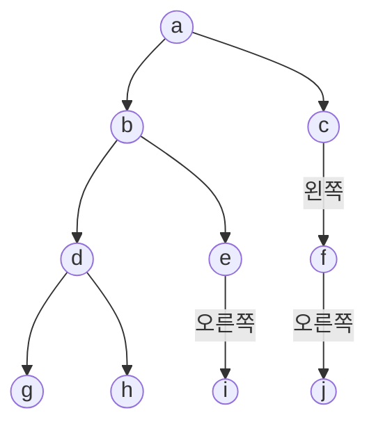


<div class="callout callout-summary" markdown="1">
<div class="callout-title callout-title--default" markdown="span">요약</div>

순회 결과는 트리의 칸들을 한 줄로 늘어놓은 것이라, 한 줄만 보고는 원래 모양을 알 수 없다. 두 줄이 있어도 아무 두 줄이나 되는 것이 아니라, "왼쪽을 다 본 뒤 뿌리, 그다음 오른쪽" 순서로 적은 줄이 꼭 끼어 있어야 한다. 그 줄에서 뿌리의 자리를 찾으면 왼쪽 식구와 오른쪽 식구가 갈리기 때문이다. 칸의 이름이 서로 다를 때만 통하는 방법이다.

</div>


## 예시로 보기

순회 결과 한 줄을 받았다. 이 줄이 나온 트리를 다시 그릴 수 있을까? 노드가 둘만 되어도 안 된다.

```
전위 = a b          a            a
                   /              \
                  b                b

중위 = a b          b            a
                   /              \
                  a                b

후위 = a b          b            b
                   /              \
                  a                a

레벨 순서 = a b      a            a
                   /              \
                  b                b
```

네 가지 순회 모두, 같은 줄을 내는 트리가 둘씩 있다. 전위와 레벨 순서는 "a가 뿌리"까지는 알려 주지만 b가 왼쪽인지 오른쪽인지는 알려 주지 않는다.

두 줄을 주면 어떨까. 어느 두 줄이냐에 달렸다. 전위 `a b`와 후위 `b a`를 함께 줘도 위 첫 줄의 두 트리가 모두 맞는다. 전위와 레벨 순서, 후위와 레벨 순서도 같은 예에서 막힌다.

중위가 끼면 풀린다. 예를 하나 본다.

- 중위 = g d h b e i a f j c
- 전위 = a b d g h e i c f j

전위의 맨 앞 a가 뿌리다. 중위에서 a를 찾으면, a의 왼쪽에 적힌 g d h b e i가 왼쪽 부분 트리의 노드들이고 오른쪽에 적힌 f j c가 오른쪽 부분 트리의 노드들이다. 왼쪽 부분 트리에 같은 일을 되풀이한다. 전위에서 a 다음인 b가 왼쪽 부분 트리의 뿌리이고, 중위 g d h b e i에서 b의 왼쪽은 g d h, 오른쪽은 e i다.

| 차례 | 뿌리 | 왼쪽 부분 트리의 노드 (중위) | 오른쪽 부분 트리의 노드 (중위) |
|---|---|---|---|
| 1 | a | g d h b e i | f j c |
| 2 | b | g d h | e i |
| 3 | d | g | h |
| 4 | g | (없음) | (없음) |
| 5 | h | (없음) | (없음) |
| 6 | e | (없음) | i |
| 7 | i | (없음) | (없음) |
| 8 | c | f j | (없음) |
| 9 | f | (없음) | j |
| 10 | j | (없음) | (없음) |

뿌리 칸을 위에서 아래로 읽으면 전위 순서 그대로다. 6번째 줄에서 e의 왼쪽이 비고 오른쪽에 i가 있으니, i는 e의 오른쪽 자식이다. 이것은 전위만으로는 알 수 없던 정보다.



## 어떤 조합이 되는가

노드의 값이 모두 다른 이진 트리에 대해서다.

| 주어진 것 | 트리가 하나로 정해지는가 | 근거 |
|---|---|---|
| 순회 결과 하나 (노드 둘 이상) | 아니다 | 위의 노드 둘짜리 예 |
| 전위 + 후위 | 아니다 | 전위 a b, 후위 b a인 두 트리 |
| 전위 + 레벨 순서 | 아니다 | 같은 예 |
| 후위 + 레벨 순서 | 아니다 | 같은 예 |
| 중위 + 전위 | 정해진다 | 전위를 왼쪽부터 읽으며 뿌리를 정한다 |
| 중위 + 후위 | 정해진다 | 후위를 오른쪽부터 읽으며 뿌리를 정한다 |
| 중위 + 레벨 순서 | 정해진다 | 레벨 순서를 왼쪽부터 읽으며 뿌리를 정한다 |

<div class="callout callout-theorem" markdown="1">
<div class="callout-title callout-title--default" markdown="span">정리</div>

노드의 값이 모두 다른 이진 트리는 중위 순회 결과와 전위 순회 결과로 하나로 정해진다. 전위 대신 후위나 레벨 순서를 써도 같다.

</div>


### 되살리는 방법

중위 결과 `in`과 전위 결과 `pre`가 길이 $$n$$의 배열로 주어진다.

1. *뿌리 찾기.* $$n = 0$$이면 빈 트리다. 아니면 `pre[0]`이 뿌리다.
2. *가르기.* `in`에서 뿌리의 자리 $$k$$를 찾는다. `in[0..k-1]`이 왼쪽 부분 트리의 중위 결과이고, `in[k+1..n-1]`이 오른쪽 것이다. 왼쪽 부분 트리의 노드는 $$k$$개다.
3. *전위도 가르기.* 전위는 "뿌리, 왼쪽 전부, 오른쪽 전부" 순서다. 그래서 `pre[1..k]`가 왼쪽 부분 트리의 전위 결과이고 `pre[k+1..n-1]`이 오른쪽 것이다.
4. *되풀이.* 왼쪽 쌍과 오른쪽 쌍에 같은 일을 해서 두 부분 트리를 만들고 뿌리에 단다.

```c
/* in[0..n-1]: 중위 결과, pre[0..n-1]: 전위 결과. 값은 서로 달라야 한다 */
treePointer fromInPre(const char *in, const char *pre, int n)
{
    if (n == 0) return NULL;
    char root = pre[0];
    int k = findIn(in, n, root);            /* 중위에서 뿌리의 자리 = 왼쪽 노드 수 */
    treePointer left  = fromInPre(in,         pre + 1,     k);
    treePointer right = fromInPre(in + k + 1, pre + 1 + k, n - 1 - k);
    return makeNode(root, left, right);
}
```

`in + k + 1`은 배열의 $$k + 1$$번 칸에서 시작하는 부분 배열을 넘기는 C의 쓰임이다([배열과 포인터](/Hongs_Blog/studies/data-structures/array-pointer/)). `findIn`은 `in`을 앞에서부터 훑어 `root`가 있는 칸 번호를 돌려준다.

나머지 두 조합은 뿌리를 찾는 곳과 둘째 줄을 가르는 법만 다르다[^s1].

| 조합 | 뿌리 | 둘째 줄을 가르는 법 |
|---|---|---|
| 중위 + 전위 | `pre[0]` | 뿌리 다음 $$k$$개가 왼쪽, 나머지가 오른쪽 |
| 중위 + 후위 | `post[n-1]` | 앞의 $$k$$개가 왼쪽, 그다음 $$n - 1 - k$$개가 오른쪽 |
| 중위 + 레벨 순서 | `level[0]` | 나머지 글자를 차례는 그대로 둔 채, 중위에서 뿌리 왼쪽에 있던 것과 오른쪽에 있던 것으로 나눈다 |

레벨 순서는 왼쪽 노드와 오른쪽 노드가 섞여 나온다. 본문 예의 레벨 순서 a b c d e f g h i j에서 a를 떼고 왼쪽 식구 {g, d, h, b, e, i}만 골라내면 b d e g h i다. 이것이 왼쪽 부분 트리의 레벨 순서다.

### 왜 하나로 정해지는가

노드 수에 대한 귀납법으로 보인다. 뿌리가 정해지고, 두 부분 트리의 순회 결과 쌍이 정해지면, 더 작은 같은 문제 둘이 남는다.

<details class="callout callout-proof" markdown="1">
<summary class="callout-title" markdown="span">증명 펼치기</summary>

주장: 값이 모두 다른 노드 $$n$$개의 이진 트리 $$T$$와 $$T'$$의 중위 결과가 같고 전위 결과도 같으면 $$T = T'$$이다. $$n$$에 대한 강한 귀납법을 쓴다.
1. **$$n = 0$$.** 노드가 0개인 이진 트리는 빈 트리 하나뿐이다.
2. **뿌리가 같다.** $$n \ge 1$$이면 전위 결과의 첫 값이 뿌리다. 전위 결과가 같으니 두 트리의 뿌리 값 $$r$$이 같다. — 전위 순회의 정의
3. **왼쪽 식구가 같다.** 중위 결과에서 $$r$$은 한 번만 나온다(값이 모두 다르다). 중위 순회는 왼쪽 부분 트리를 다 적은 뒤 $$r$$을 적으므로, $$r$$ 앞의 $$k$$개가 왼쪽 부분 트리의 중위 결과다. 두 트리에서 이 줄이 같다. 오른쪽도 같다. — 중위 순회의 정의, 값이 서로 다름
4. **부분 트리의 전위 결과가 같다.** 전위 결과는 $$r$$, 왼쪽 부분 트리의 전위 결과($$k$$개), 오른쪽 부분 트리의 전위 결과 순서다. $$k$$가 같으니 두 트리에서 자르는 자리가 같다. — 전위 순회의 정의
5. **귀납 가정.** 왼쪽 부분 트리끼리는 중위와 전위가 같고 노드 수가 $$k < n$$이다. 그래서 같은 트리다. 오른쪽 부분 트리끼리도 같다. 뿌리와 두 부분 트리가 같으니 $$T = T'$$이다. ∎

후위는 2단계의 "첫 값"을 "마지막 값"으로, 4단계의 순서를 "왼쪽, 오른쪽, $$r$$"로 바꾸면 된다. 레벨 순서는 4단계가 다르다. 레벨 순서는 노드를 (층, 그 층에서의 왼쪽부터의 차례) 순으로 적는다. 왼쪽 부분 트리 안의 두 노드는 전체 트리에서의 층 차례와 좌우 차례가 부분 트리 안에서와 같다. 그래서 전체 레벨 순서에서 왼쪽 식구만 골라낸 줄이 왼쪽 부분 트리의 레벨 순서다.

</details>


### 스스로 설명해 보기

<details class="callout callout-question" markdown="1">
<summary class="callout-title" markdown="span">1. 3단계에서 "값이 모두 다르다"는 어디에 쓰였는가?</summary>

중위 결과에서 뿌리의 자리를 하나로 정하는 데 쓰였다. 같은 값이 둘이면 어느 것이 뿌리인지 알 수 없어 왼쪽 식구의 수 $$k$$가 정해지지 않는다. 값이 a인 노드 둘로 된 트리는 a 아래 왼쪽에 a가 달린 것과 오른쪽에 달린 것이 모두 중위 a a, 전위 a a를 낸다.

</details>


<details class="callout callout-question" markdown="1">
<summary class="callout-title" markdown="span">2. 4단계에서 전위 결과를 자르는 자리가 왜 $$k$$로 정해지는가?</summary>

전위 순회는 뿌리를 적고 나서 왼쪽 부분 트리를 끝까지 다 적은 뒤에야 오른쪽으로 넘어간다. 왼쪽 부분 트리의 노드가 $$k$$개라는 것을 중위에서 알았으니, 뿌리 다음의 $$k$$개가 왼쪽 것이다.

</details>


<details class="callout callout-question" markdown="1">
<summary class="callout-title" markdown="span">3. 전위 + 후위로는 같은 증명이 어디서 막히는가?</summary>

3단계다. 전위와 후위는 둘 다 "뿌리가 누구인가"는 알려 주지만, 뿌리 아닌 노드가 왼쪽 식구인지 오른쪽 식구인지는 알려 주지 않는다. 자식이 하나뿐인 노드에서 그 자식을 반대쪽으로 옮겨 달아도 전위와 후위가 그대로다.

</details>


<details class="callout callout-question" markdown="1">
<summary class="callout-title" markdown="span">이 증명의 핵심 생각은?</summary>

한 줄은 뿌리를 알려 주고(전위·후위·레벨 순서), 다른 한 줄은 좌우를 갈라 준다(중위). 두 가지가 다 있어야 문제를 더 작은 같은 문제 둘로 쪼갤 수 있다.

</details>


<details class="callout callout-question" markdown="1">
<summary class="callout-title" markdown="span">같은 방법을 쓸 수 있는 다른 상황은?</summary>

이진 탐색 트리는 전위 결과 한 줄만으로 되살아난다. 값을 크기 순으로 늘어놓으면 그것이 중위 결과라서, 중위를 따로 받지 않아도 알고 있는 셈이다([이진 탐색 트리의 탐색과 삽입](/Hongs_Blog/studies/data-structures/bst-search-insert/)). [수식 트리](/Hongs_Blog/studies/data-structures/expression-tree/)도 전위 표기 한 줄로 되살아난다. 거기서는 연산자의 자식이 꼭 둘이라는 것을 미리 안다.

</details>


<div class="callout callout-check" markdown="1">
<div class="callout-title" markdown="span">검증: 컴파일해 실행(ASan·UBSan). 위 예를 세 조합으로 되살려 같은 트리가 나오고 위 표의 차례와 같음, 노드 둘짜리 예의 네 순회, 값이 겹치는 예, 카드의 값을 확인했다. 값이 서로 다른 노드 1 ~ 6개짜리 이진 트리 100,451개 모두에서 세 방법이 처음 트리를 그대로 되살렸다. 잡은 메모리는 모두 풀었다(`leaks` 도구로 확인) — [26_tree-from-traversals_impl.c](/Hongs_Blog/studies/data-structures/code/26_tree-from-traversals_impl/)</div>

</div>


<div class="callout callout-check" markdown="1">
<div class="callout-title" markdown="span">검증: 같은 100,451개를 순회 결과별로 묶어 세었다. 순회 결과 하나로는 묶음마다 트리가 카탈란 수만큼(노드 3개면 5개씩) 있고, 중위가 낀 세 조합은 묶음이 모두 1개짜리이고, 중위가 없는 세 조합은 노드 2개부터 겹치는 트리가 있다. 전위와 후위가 같은 트리는 정확히 $$2^{\text{자식이 하나인 노드 수}}$$개였다 — [26_tree-from-traversals_verify.py](/Hongs_Blog/studies/data-structures/code/26_tree-from-traversals_verify/)</div>

</div>


## 예제

### 중위 + 후위로 되살리기

중위 = g d h b e i a f j c, 후위 = g h d i e b j f c a.

1. *뿌리 찾기.* 후위의 맨 뒤 a가 뿌리다.
2. *가르기.* 중위에서 a의 왼쪽은 g d h b e i(6개), 오른쪽은 f j c(3개)다.
3. *후위도 가르기.* 후위는 "왼쪽 전부, 오른쪽 전부, 뿌리" 순서다. 앞의 6개 g h d i e b가 왼쪽 부분 트리의 후위, 그다음 3개 j f c가 오른쪽 것이다.
4. *되풀이.* 왼쪽: 후위의 맨 뒤 b가 뿌리이고 중위 g d h b e i에서 g d h와 e i로 갈린다. 오른쪽: 후위 j f c의 맨 뒤 c가 뿌리이고 중위 f j c에서 왼쪽이 f j, 오른쪽이 없다.

끝까지 하면 위 그림과 같은 트리가 나온다.

### 전위 + 후위만 있을 때 가능한 트리 세기

전위 = a b c, 후위 = c b a인 이진 트리는 몇 개인가?

1. *뿌리.* 전위의 첫 값이자 후위의 마지막 값인 a다.
2. *a의 자식.* 전위에서 a 다음이 b이고 후위에서 a 바로 앞도 b다. a의 자식이 둘이었다면 전위의 둘째 값(왼쪽 자식)과 후위의 뒤에서 둘째 값(오른쪽 자식)이 달랐을 것이다. 그래서 a의 자식은 b 하나다. 왼쪽인지 오른쪽인지는 알 수 없다. 2가지.
3. *b의 자식.* 같은 이유로 c 하나다. 다시 2가지.
4. *세기.* $$2 \times 2 = 4$$개다. 노드 셋이 한 줄로 늘어선 네 모양(왼왼, 왼오, 오왼, 오오)이다.

자식이 하나뿐인 노드마다 선택이 둘씩 생긴다. 자식이 하나뿐인 노드가 $$s$$개인 트리와 전위·후위가 같은 트리는 모두 $$2^s$$개다(노드 6개까지 모든 트리에서 세어 확인했다)[^s2].

## 활용

- **쓸 수 있는 조건.** 노드의 값이 서로 달라야 한다. 중위 결과가 꼭 있어야 한다.
- **이 기법을 떠올리는 신호.** 순회 결과 두 줄을 주고 트리를 그리라고 하거나 나머지 순회 결과를 묻는다.
- **비용.** 위 코드는 뿌리마다 중위 배열을 앞에서부터 훑는다. 한 줄로 늘어선 트리에서는 훑는 길이가 $$n, n - 1, \dots, 1$$이라 모두 $$O(n^2)$$이다. 값마다 중위에서의 자리를 미리 표로 만들어 두면 뿌리 찾기가 한 번에 끝나 중위 + 전위와 중위 + 후위는 $$O(n)$$이 된다[^s1].
- **흔한 실수.** 전위의 둘째 값을 무조건 뿌리의 왼쪽 자식으로 단다. 왼쪽 부분 트리가 비었으면($$k = 0$$) 그 값은 오른쪽 자식이다. 중위에서 가른 개수를 꼭 본다.
- 연습: [이진 트리 순회 예제 사다리](/Hongs_Blog/studies/data-structures/tree-traversal-ladder/)

## 연결

- 선수: [트리 순회와 이진 탐색 트리](/Hongs_Blog/studies/algorithms/tree-traversal-bst/)(전위·중위·후위), [레벨 순서 순회](/Hongs_Blog/studies/data-structures/level-order-traversal/), [이진 트리](/Hongs_Blog/studies/data-structures/binary-tree/)
- 증명의 틀: [수학적 귀납법](/Hongs_Blog/studies/discrete-math/induction/)
- "서로 다른 것이 같은 결과를 내는가"라는 물음: [함수의 성질과 집합의 크기](/Hongs_Blog/studies/discrete-math/function-properties/). 트리에서 순회 결과로 가는 대응이 일대일인지를 묻는 것이다.
- 한 줄로도 되살아나는 특별한 트리: [수식 트리와 전위·중위·후위 표기](/Hongs_Blog/studies/data-structures/expression-tree/)

## 자주 하는 오해

<div class="callout callout-misconception" markdown="1">
<div class="callout-title" markdown="span">"순회 결과가 두 개 있으면 트리가 하나로 정해진다"</div>

틀렸다. 중위가 낀 두 개일 때만 정해진다. 줄이 둘이면 정보도 두 배라서 충분할 것 같지만, 전위·후위·레벨 순서는 모두 "누가 뿌리인가"라는 같은 종류의 정보만 준다. 좌우를 갈라 주는 것은 중위뿐이다. 전위 a b c와 후위 c b a를 내는 트리는 네 개이고, 전위와 레벨 순서가 둘 다 a b c인 트리는 다섯 개다. 확인하는 법: 노드 둘짜리 트리 두 개(b가 왼쪽 자식인 것과 오른쪽 자식인 것)의 네 순회를 직접 써 본다. 중위만 다르다.

</div>


## 확인 문제

<details class="callout callout-question" markdown="1">
<summary class="callout-title" markdown="span">**C1** 중위 = d b e a c, 전위 = a b d e c인 이진 트리를 그리고 후위 순회 결과를 쓰라.</summary>

**답:** 뿌리는 a다. 중위에서 a의 왼쪽이 d b e, 오른쪽이 c다. 왼쪽 부분 트리의 전위는 b d e라 뿌리가 b이고, 중위 d b e에서 d가 왼쪽 자식, e가 오른쪽 자식이다. c는 a의 오른쪽 자식이다. 후위는 d e b c a다.<br>
**이유:** 레벨 순서로 읽으면 a b c d e가 되어 검산할 수 있다.

</details>


<details class="callout callout-question" markdown="1">
<summary class="callout-title" markdown="span">**C2** 전위 순회 결과와 후위 순회 결과가 모두 같은, 서로 다른 노드 셋짜리 이진 트리를 둘 이상 들어라.</summary>

**답:** 전위 a b c, 후위 c b a인 트리. a의 왼쪽 자식이 b, b의 왼쪽 자식이 c인 트리와, a의 오른쪽 자식이 b, b의 오른쪽 자식이 c인 트리가 그렇다. 좌우를 섞은 두 개까지 모두 네 개다. 네 트리의 중위는 c b a, b c a, a c b, a b c로 모두 다르다.

</details>


<details class="callout callout-question" markdown="1">
<summary class="callout-title" markdown="span">**C3** 트리를 되살리는 데 중위 순회 결과가 꼭 필요한 까닭은?</summary>

**답:** 전위·후위·레벨 순서는 뿌리가 누구인지는 알려 주지만, 나머지 노드가 뿌리의 왼쪽에 속하는지 오른쪽에 속하는지는 알려 주지 않는다. 중위는 뿌리를 두 부분 트리 사이에 적기 때문에, 뿌리의 자리만 알면 왼쪽 식구와 오른쪽 식구가 갈린다.<br>
**이유:** 자식이 하나뿐인 노드에서 그 자식을 반대쪽으로 옮기면 전위·후위·레벨 순서는 그대로이고 중위만 바뀐다.

</details>


<details class="callout callout-question" markdown="1">
<summary class="callout-title" markdown="span">**C4** 중위 + 레벨 순서로 되살릴 때, 레벨 순서에서 왼쪽 식구만 골라낸 줄을 왼쪽 부분 트리의 레벨 순서로 써도 되는 근거는?</summary>

**답:** 레벨 순서는 노드를 (층, 그 층에서 왼쪽부터의 차례) 순으로 적는다. 왼쪽 부분 트리의 두 노드를 놓고 보면, 전체 트리에서 더 위층이면 부분 트리 안에서도 더 위층이고(둘 다 층이 하나씩 줄 뿐이다), 같은 층에서 더 왼쪽이면 부분 트리 안에서도 더 왼쪽이다. 그래서 골라내도 서로의 앞뒤가 바뀌지 않는다.<br>
**이유:** 전위나 후위에서는 왼쪽 식구가 한 덩어리로 붙어 나와 "앞의 $$k$$개"로 자르면 되지만, 레벨 순서에서는 왼쪽과 오른쪽이 섞여 나와서 이 근거가 따로 필요하다.

</details>


[^s1]: 구현 코드로 본문의 예와 노드 6개까지의 모든 트리에서 확인했다.
[^s2]: 검증 코드로 노드 6개까지의 모든 트리를 묶어 세었다. 일반적인 $$n$$에 대한 증명은 싣지 않았다.

