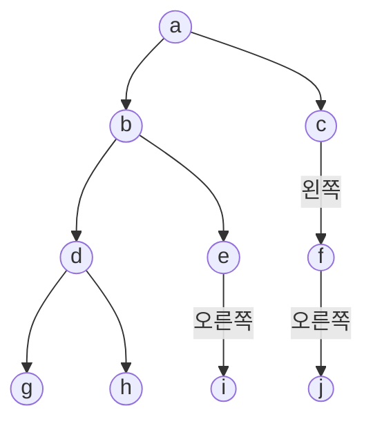


사용 개념: [전위·중위·후위 순회](/Hongs_Blog/studies/algorithms/tree-traversal-bst/), [레벨 순서 순회](/Hongs_Blog/studies/data-structures/level-order-traversal/), [순회 결과로 이진 트리 되살리기](/Hongs_Blog/studies/data-structures/tree-from-traversals/).

"트리를 주고 순회 결과를 쓰라", "순회 결과를 주고 트리를 그리라"는 문제는 같은 하위목표의 되풀이다. ① 전위: 뿌리 → 왼쪽 → 오른쪽 ② 중위: 왼쪽 → 뿌리 → 오른쪽 ③ 후위: 왼쪽 → 오른쪽 → 뿌리 ④ 레벨 순서: 위층부터, 같은 층은 왼쪽부터 ⑤ 되살리기: 두 줄만 보고 트리를 다시 그려 처음 트리와 견준다.

전위·중위·후위를 손으로 쓸 때는 부분 트리를 괄호로 묶어 두면 빠뜨리지 않는다. 뿌리가 r이고 왼쪽 부분 트리가 L, 오른쪽이 R이면 전위는 r (L) (R), 중위는 (L) r (R), 후위는 (L) (R) r이고, 괄호 안을 같은 규칙으로 다시 편다[^s1].

## 문제 1 · 완전한 풀이

슬라이드의 트리다[^1]. a의 자식은 b와 c다. b의 자식은 d와 e다. d의 자식은 g와 h다. e는 오른쪽 자식 i만 있다. c는 왼쪽 자식 f만 있고, f는 오른쪽 자식 j만 있다.

1. *전위:* a (b의 트리) (c의 트리) = a (b (d g h) (e i)) (c (f j)) → a b d g h e i c f j.
2. *중위:* (b의 트리) a (c의 트리). b의 트리는 (g d h) b (e i)다. e는 왼쪽이 없어 e가 먼저, i가 다음이다. c의 트리는 (f j) c다. f는 왼쪽이 없어 f, j 순서다. → g d h b e i a f j c.
3. *후위:* (b의 트리) (c의 트리) a = ((g h d) (i e) b) ((j f) c) a → g h d i e b j f c a.
4. *레벨 순서:* 1층 a, 2층 b c, 3층 d e f, 4층 g h i j → a b c d e f g h i j.
5. *되살리기(중위 + 후위):* 후위의 맨 뒤 a가 뿌리다. 중위에서 a의 왼쪽 g d h b e i(6개)가 왼쪽 부분 트리, 오른쪽 f j c(3개)가 오른쪽 부분 트리다. 후위도 앞의 6개 g h d i e b와 그다음 3개 j f c로 갈린다. 왼쪽: 후위의 맨 뒤 b가 뿌리, 중위에서 g d h와 e i로 갈린다. g d h의 후위 g h d에서 d가 뿌리이고 g가 왼쪽, h가 오른쪽이다. e i의 후위 i e에서 e가 뿌리이고, 중위에서 i가 e 뒤에 있으니 오른쪽 자식이다. 오른쪽: 후위 j f c에서 c가 뿌리, 중위 f j c에서 f j가 모두 c의 왼쪽이다. 후위 j f에서 f가 뿌리이고 중위에서 j가 f 뒤에 있으니 오른쪽 자식이다. 처음 트리와 같다.

검증 — [26_tree-traversal-ladder_p4.c](/Hongs_Blog/studies/data-structures/code/26_tree-traversal-ladder_p4/)

## 문제 2 · 마지막 하위목표만 빈칸

a의 자식은 b와 c다. b의 자식은 d와 e다. e는 왼쪽 자식 g만 있다. c는 오른쪽 자식 f만 있다.

1. *전위:* a (b d (e g)) (c f) → a b d e g c f.
2. *중위:* (d b (g e)) a (c f). e는 왼쪽 자식 g가 먼저다. c는 왼쪽이 없어 c가 먼저다. → d b g e a c f.
3. *후위:* (d (g e) b) (f c) a → d g e b f c a.
4. *레벨 순서:* a / b c / d e f / g → a b c d e f g.
5. *되살리기(중위 + 후위):* 중위 d b g e a c f와 후위 d g e b f c a만 보고 트리를 다시 그려라. ______

답

후위의 맨 뒤 a가 뿌리다. 중위에서 a의 왼쪽이 d b g e(4개), 오른쪽이 c f(2개)다. 후위는 앞의 4개 d g e b와 그다음 2개 f c로 갈린다. 
왼쪽: 후위 d g e b의 맨 뒤 b가 뿌리다. 중위 d b g e에서 d가 왼쪽, g e가 오른쪽이다. g e의 후위 g e에서 e가 뿌리이고, 중위에서 g가 e 앞에 있으니 g는 e의 왼쪽 자식이다. 
오른쪽: 후위 f c의 맨 뒤 c가 뿌리다. 중위 c f에서 f가 c 뒤에 있으니 f는 c의 오른쪽 자식이다. 
처음 트리와 같다.

## 문제 3 · 하위목표 절반이 빈칸

p의 자식은 q와 r이다. q는 오른쪽 자식 s만 있고, s의 자식은 u와 v다. r은 왼쪽 자식 t만 있고, t는 오른쪽 자식 w만 있다.

1. *전위:* ______
2. *중위:* (q (u s v)) p ((t w) r) → q u s v p t w r.
3. *후위:* ______
4. *레벨 순서:* p / q r / s t / u v w → p q r s t u v w.
5. *되살리기(중위 + 전위):* 1번에서 쓴 전위와 2번의 중위만 보고, 뿌리와 왼쪽·오른쪽 부분 트리의 노드를 차례로 갈라 적어라. ______

답

1. 전위: p (q (s u v)) (r (t w)) → p q s u v r t w.
3. 후위: ((u v s) q) ((w t) r) p → u v s q w t r p.
5. 전위의 맨 앞 p가 뿌리다. 중위에서 p의 왼쪽 q u s v가 왼쪽 부분 트리(4개), 오른쪽 t w r이 오른쪽 부분 트리(3개)다. 전위는 p 다음의 4개 q s u v와 그다음 3개 r t w로 갈린다. 
   왼쪽: q가 뿌리다. 중위 q u s v에서 q 앞에는 아무것도 없으니 왼쪽이 비고, u s v가 오른쪽이다. 전위 s u v에서 s가 뿌리이고 u가 왼쪽, v가 오른쪽이다. 
   오른쪽: r이 뿌리다. 중위 t w r에서 t w가 모두 r의 왼쪽이다. 전위 t w에서 t가 뿌리이고, 중위에서 w가 t 뒤에 있으니 오른쪽 자식이다.

흔한 실수는 전위에서 p 다음에 오는 q를 보고 "s는 q의 왼쪽 자식"이라고 그리는 것이다. 중위에서 q 앞이 비었으니 s는 오른쪽 자식이다.

검증 — [26_tree-traversal-ladder_p4.c](/Hongs_Blog/studies/data-structures/code/26_tree-traversal-ladder_p4/)

## 문제 4 · 독립 문제

어떤 이진 트리의 중위 순회 결과가 d g b a h e c f이고 레벨 순서 순회 결과가 a b c d e f g h다.

(가) 트리를 그리고 전위 순회 결과와 후위 순회 결과를 쓰라.
(나) (가)에서 구한 전위와 후위만 주어졌다면, 그 두 줄을 내는 이진 트리는 모두 몇 개인가?

답

(가) 레벨 순서의 맨 앞 a가 뿌리다. 중위에서 a의 왼쪽은 d g b, 오른쪽은 h e c f다. 레벨 순서에서 왼쪽 식구만 차례대로 고르면 b d g, 오른쪽 식구만 고르면 c e f h다. 
왼쪽: b가 뿌리다. 중위 d g b에서 d g가 모두 b의 왼쪽이다. 레벨 순서 d g에서 d가 뿌리이고, 중위에서 g가 d 뒤에 있으니 g는 d의 오른쪽 자식이다. 
오른쪽: c가 뿌리다. 중위 h e c f에서 h e가 왼쪽, f가 오른쪽이다. h e의 레벨 순서는 e h라 e가 뿌리이고, 중위에서 h가 e 앞에 있으니 h는 e의 왼쪽 자식이다. 
트리: a의 자식은 b와 c. b는 왼쪽 자식 d만, d는 오른쪽 자식 g만 있다. c의 자식은 e와 f. e는 왼쪽 자식 h만 있다. 
전위: a b d g c e h f. 후위: g d b h e f c a.

(나) 8개다. 자식이 하나뿐인 노드가 b, d, e 셋이다. 이런 노드의 자식을 반대쪽으로 옮겨 달아도 전위와 후위는 그대로라서, 노드마다 2가지씩 $$2^3 = 8$$개의 트리가 같은 전위와 후위를 낸다. 중위까지 같은 것은 처음 트리 하나뿐이다.

검증: 전위가 a b d g c e h f인 노드 8개짜리 모양 1,430가지를 모두 만들어 후위가 같은 것을 세었다 — [26_tree-traversal-ladder_p4.c](/Hongs_Blog/studies/data-structures/code/26_tree-traversal-ladder_p4/)

[^1]: 자료구조 6회 강의 자료 「DS_Week6_Lecture_2024」, p.33 (전위 a b d g h e i c f j), p.37 (중위 g d h b e i a f j c), p.42 (후위 g h d i e b j f c a), p.46 (레벨 순서 a b c d e f g h i j), p.53 (중위와 후위로 되살리기)
[^s1]: 보충 괄호로 묶어 펴는 요령, 문제 2 ~ 4의 트리와 답, 문제 1의 되살리기 풀이의 뒷부분(슬라이드는 첫 가르기까지만 보인다)은 원본에 없다. 모든 답은 문제 코드로 확인했다.

