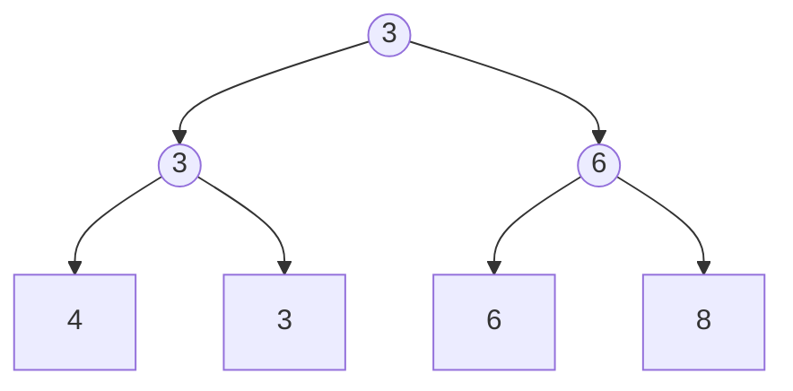


<div class="callout callout-summary" markdown="1">
<div class="callout-title callout-title--default" markdown="span">요약</div>

토너먼트 대진표를 나무로 그린 것이다. 맨 아래에 선수를 세우고, 둘씩 겨뤄 이긴 쪽을 위 칸에 적으며 올라가면 맨 위에 우승자가 남는다. 선수 한 명의 값이 바뀌어도 그 선수가 올라가는 길의 경기만 다시 치르면 되어서, "가장 작은 것을 꺼내고 새 값을 넣기"를 되풀이할 때 쓴다. 대신 경기 결과를 적을 칸이 선수 수만큼 더 든다.

</div>


## 예시로 보기

수 16개에서 가장 작은 것을 찾으려면 15번 견주면 된다. 그런데 그 수를 빼고 다음으로 작은 것을 찾을 때 또 처음부터 견주면 아깝다. 앞에서 견준 결과는 대부분 그대로이기 때문이다. 승자 트리는 견준 결과를 모두 적어 두고, 바뀐 곳만 다시 견준다[^s1].

선수 넷(4, 3, 6, 8)이면 이렇게 생겼다. 작은 수가 이긴다.



네모가 선수이고 동그라미가 경기다. 동그라미 안의 수는 그 경기에서 이긴 선수의 값이다. 4와 3이 겨뤄 3이, 6과 8이 겨뤄 6이 올라가고, 결승에서 3이 이긴다[^s2].

슬라이드의 16명은 4, 3, 6, 8, 1, 5, 7, 3, 2, 6, 9, 4, 5, 2, 5, 8이다[^1]. 층마다 한 줄씩 적으면 다음과 같다. 맨 왼쪽은 그 줄의 노드 번호다(번호 붙이는 법은 아래 정의에 있다).

```
노드 1                             1
노드 2~3               1                       2
노드 4~7         3           1           2           2
노드 8~15     3     6     1     3     2     4     2     5
선수         4  3  6  8  1  5  7  3  2  6  9  4  5  2  5  8
칸 번호     16 17 18 19 20 21 22 23 24 25 26 27 28 29 30 31
```

우승자는 다섯째 선수의 1이다.

**우승자를 6으로 바꾸고 다시 겨루기.** 다섯째 선수(20번 칸)의 값을 1에서 6으로 바꾼다. 이 선수가 올라가는 길은 10번, 5번, 2번, 1번 노드다. 이 네 경기만 다시 치른다[^2].

| 노드 | 겨루는 두 값 | 이긴 값 | 전에 적혀 있던 값 |
|---|---|---|---|
| 10 | 6(바뀐 선수) 대 5(옆 선수) | 5 | 1 |
| 5 | 5(10번 노드) 대 3(11번 노드) | 3 | 1 |
| 2 | 3(4번 노드) 대 3(5번 노드) | 3 | 1 |
| 1 | 3(2번 노드) 대 2(3번 노드) | 2 | 1 |

새 우승자는 2다. 나머지 11개 경기 칸은 건드리지 않았다. 경기마다 상대는 옆 가지에서 올라와 있던 승자다. 슬라이드는 "상대는 이 노드에서 지난번에 진 선수"라고 적는다[^2]. 이 말이 [패자 트리](/Hongs_Blog/studies/data-structures/loser-tree/)로 이어진다.

<div class="callout callout-check" markdown="1">
<div class="callout-title" markdown="span">검증: 컴파일해 실행(ASan·UBSan). 16명의 층별 승자, 만들 때 경기 15번, 위 표(경기 4번), 정렬의 처음 네 걸음과 전체 결과(경기 79번), 무작위 2,000묶음(선수 1 ~ 40명)에서 승자 트리 정렬 = `qsort`, 아무 선수나 바꾸고 다시 겨룬 우승자 = 직접 찾은 최솟값을 확인했다 — [34_winner-tree_impl.c](/Hongs_Blog/studies/data-structures/code/34_winner-tree_impl/)</div>

</div>


## 정의

승자 트리는 선수 $$n$$명에 대해 바깥 노드 $$n$$개와 안쪽 노드 $$n - 1$$개로 된 완전 이진 트리다[^3].

- 바깥 노드(잎)는 토너먼트의 선수다.
- 안쪽 노드는 두 자식이 겨룬 경기이고, 그 경기의 승자를 적어 둔다.
- 뿌리에는 전체 우승자가 있다.

작은 값이 이기게 하면 최소 승자 트리, 큰 값이 이기게 하면 최대 승자 트리다. 이 문서는 슬라이드처럼 최소 승자 트리를 쓴다[^1].

경기 노드만 세면 층이 $$\log_2 n$$개다. 16명이면 4층이다. 슬라이드는 이것을 "높이는 $$\log_2 n$$(선수 층은 뺀다)"이라고 적는다[^1]. 볼트 표기로 선수 층까지 넣은 나무의 높이(뿌리에서 가장 먼 잎까지의 간선 수)를 세어도 같은 4다. 선수 수가 2의 거듭제곱이 아니면 $$\lceil \lg n \rceil$$로 올림한다. $$\lceil\ \rceil$$는 올림 표시다.

**배열에 담기.** 완전 이진 트리라서 포인터 없이 배열에 담는다([포화 이진 트리와 완전 이진 트리](/Hongs_Blog/studies/data-structures/full-complete-binary-tree/)의 번호 규칙). 노드에 위에서 아래로, 왼쪽에서 오른쪽으로 1번부터 번호를 붙이면 다음이 맞다[^s1].

- 1번부터 $$n - 1$$번까지가 경기 노드, $$n$$번부터 $$2n - 1$$번까지가 선수다. 선수 $$p$$(0부터 센다)는 $$n + p$$번이다.
- $$i$$번 노드의 부모는 $$\lfloor i/2 \rfloor$$번, 자식은 $$2i$$번과 $$2i + 1$$번이다.

16명이면 다섯째 선수($$p = 4$$)가 $$16 + 4 = 20$$번이고, 2로 나누어 가면 10, 5, 2, 1번이 나온다. 위 표의 길이 이것이다.

```c
typedef struct {
    int n;        /* 선수 수 */
    int *player;  /* player[0 .. n-1]: 선수의 값 */
    int *tree;    /* tree[1 .. n-1]: 그 경기에서 이긴 선수의 번호 */
} winnerTree;

/* i번 노드에 있는 선수 번호. 선수 칸이면 자기 자신, 경기 노드면 거기 적힌 승자 */
static int who(const winnerTree *t, int i)
{
    return (i >= t->n) ? i - t->n : t->tree[i];
}

/* 선수 a와 b가 겨뤄 이긴 쪽의 번호. 작은 값이 이기고, 같으면 번호가 앞선 선수가 이긴다 */
static int play(const winnerTree *t, int a, int b)
{
    if (t->player[a] != t->player[b]) return (t->player[a] < t->player[b]) ? a : b;
    return (a < b) ? a : b;
}

/* 만들기: 아래 층 경기부터 n - 1번 */
void initialize(winnerTree *t)
{
    for (int i = t->n - 1; i >= 1; i--)
        t->tree[i] = play(t, who(t, 2 * i), who(t, 2 * i + 1));
}

/* 선수 p의 값을 바꾸고, p에서 뿌리까지 길 위의 경기만 다시 치른다 */
void changeAndReplay(winnerTree *t, int p, int value)
{
    t->player[p] = value;
    for (int i = (p + t->n) / 2; i >= 1; i /= 2)
        t->tree[i] = play(t, who(t, 2 * i), who(t, 2 * i + 1));
}
```

경기 칸에는 값이 아니라 선수 번호를 적는다. 그래야 우승자가 어느 선수 칸에 있는지 바로 알고 그 칸의 값을 바꿀 수 있다. 우승자는 `tree[1]`이다. 구현 파일에서는 `initialize`가 메모리를 잡는 `createWinnerTree` 안에 들어 있다.

**연산과 비용.** $$n$$은 선수 수다[^4].

| 연산 | 하는 일 | 시간 |
|---|---|---|
| 만들기 | 경기 $$n - 1$$번, 한 번에 $$O(1)$$ | $$O(n)$$ |
| 우승자 보기 | 뿌리 한 칸 | $$O(1)$$ |
| 우승자를 빼거나 바꾸고 다시 겨루기 | 층마다 경기 한 번 | $$O(\log n)$$, 더 정확히는 $$\Theta(\log n)$$ |

$$\Theta$$는 "늘 그만큼"이라는 뜻이다. 다시 겨루기는 운이 좋아도 뿌리까지 올라가야 해서 줄지 않는다([점근 표기](/Hongs_Blog/studies/discrete-math/asymptotic-notation/)).

## 승자 트리로 정렬하기

정렬할 값을 선수로 넣어 트리를 만든다. 그다음 "우승자를 꺼내 적고, 그 선수 자리를 아주 큰 값으로 바꾸고, 다시 겨루기"를 $$n$$번 한다[^5]. 큰 값으로 바뀐 선수는 다시는 이기지 못한다.

16명으로 처음 네 번을 따라가면 다음과 같다[^6].

| 꺼낸 값 | 그 선수의 칸 | 다시 겨룬 노드 | 그 노드들의 새 값 | 새 우승자 |
|---|---|---|---|---|
| 1 | 20 | 10, 5, 2, 1 | 5, 3, 3, 2 | 2 |
| 2 | 24 | 12, 6, 3, 1 | 6, 4, 2, 2 | 2 |
| 2 | 29 | 14, 7, 3, 1 | 5, 5, 4, 3 | 3 |
| 3 | 17 | 8, 4, 2, 1 | 4, 4, 3, 3 | 3 |

같은 2가 둘이면 번호가 앞선(왼쪽) 선수가 먼저 나온다. 넷째로 나오는 3도 둘째 선수와 여덟째 선수 가운데 앞선 쪽이고, 그다음 우승자가 여덟째 선수의 3이다.

걸리는 시간은 만들기 $$O(n)$$에 "꺼내고 다시 겨루기" $$n$$번을 더한 $$O(n \log n)$$이고, 더 정확히는 $$\Theta(n \log n)$$이다[^5]. 16명이면 경기가 $$15 + 16 \times 4 = 79$$번이다.

## 활용

- **정렬된 줄 여러 개 합치기.** 줄마다 맨 앞 값을 선수로 세우고, 우승자를 내보낸 뒤 같은 줄의 다음 값을 그 자리에 넣고 다시 겨룬다. 줄이 $$k$$개면 값 하나를 내보내는 데 $$\log_2 k$$번만 견준다. [k-way 병합과 선택 트리](/Hongs_Blog/studies/data-structures/k-way-merge/)와 [외부 병합 정렬](/Hongs_Blog/studies/data-structures/external-merge-sort/)에서 쓴다.
- **힙과 견주기.** [힙](/Hongs_Blog/studies/data-structures/max-heap/)도 가장 작은 것을 꺼내고 넣는 데 $$O(\log n)$$이다. 힙은 칸이 $$n$$개면 되지만 원소가 넣고 꺼낼 때마다 자리를 옮긴다. 승자 트리는 칸이 $$2n - 1$$개 들지만 선수가 제자리에 있어, "몇째 줄에서 온 값인가"를 자리로 바로 안다[^s1].
- **흔한 실수.** 경기 칸에 값만 적어 우승자의 자리를 잃는다. 다시 겨룰 때 바뀐 선수의 값을 그대로 올려 적는다(옆 가지의 승자와 견줘야 한다). 다시 겨루기를 중간에서 멈춘다. 위 표의 2번 노드처럼 값이 그대로 3이어도 이긴 선수는 바뀔 수 있다.
- 연습: [승자 트리와 패자 트리 재경기 예제 사다리](/Hongs_Blog/studies/data-structures/selection-tree-ladder/)

## 연결

- 선수: [포화 이진 트리와 완전 이진 트리](/Hongs_Blog/studies/data-structures/full-complete-binary-tree/), [이진 트리의 배열 표현과 연결 표현](/Hongs_Blog/studies/data-structures/binary-tree-representation/)
- 다시 겨룰 때 옆 가지를 안 보게 고친 것: [패자 트리](/Hongs_Blog/studies/data-structures/loser-tree/)
- 같은 일을 하는 다른 구조: [최대 힙과 최소 힙](/Hongs_Blog/studies/data-structures/max-heap/), [우선순위 큐 정렬과 힙 정렬](/Hongs_Blog/studies/data-structures/heap-sort/)
- 칸 번호를 2로 나누며 올라가는 것은 번호를 2진수로 적고 끝자리를 하나씩 떼는 일이다: [트리 칸 번호 ↔ 2진법 자릿수](/Hongs_Blog/studies/algorithms/tree-index-binary/)

## 확인 문제

<details class="callout callout-question" markdown="1">
<summary class="callout-title" markdown="span">**C1** 위 16명 승자 트리(처음 상태)에서 아홉째 선수의 값 2를 7로 바꾼다. 다시 겨루는 노드 번호와 그 노드들의 새 값, 새 우승자를 쓰라.</summary>

**답:** 아홉째 선수는 24번 칸이고 길은 12, 6, 3, 1번 노드다. 새 값은 차례로 6, 4, 2, 1이다. 우승자는 그대로 1이다.<br>
**이유:** 12번은 7 대 6이라 6, 6번은 6 대 4(13번 노드)라 4, 3번은 4 대 2(7번 노드)라 2, 1번은 1(2번 노드) 대 2라 1이다. 우승자가 아닌 선수가 바뀌어도 방법은 같다.

</details>


<details class="callout callout-question" markdown="1">
<summary class="callout-title" markdown="span">**C2** 선수 $$n$$명의 승자 트리를 만들 때 경기가 꼭 $$n - 1$$번인 까닭은?</summary>

**답:** 경기 한 번에 한 명이 진다. 우승자 한 명만 남으려면 $$n - 1$$명이 져야 하니 경기는 $$n - 1$$번이다. 경기 노드가 $$n - 1$$개인 것도 같은 이유다.<br>
**이유:** 경기 한 번이 $$O(1)$$이라 만들기는 $$O(n)$$이다. 16명이면 $$8 + 4 + 2 + 1 = 15$$번이다.

</details>


<details class="callout callout-question" markdown="1">
<summary class="callout-title" markdown="span">**C3** 선수가 8명인 승자 트리를 배열에 담았다. 여섯째 선수의 칸 번호와, 그 선수의 값이 바뀌었을 때 다시 겨루는 경기 노드 번호를 차례로 쓰라.</summary>

**답:** 여섯째 선수는 0부터 세면 5번이므로 칸 번호는 $$8 + 5 = 13$$이다. 다시 겨루는 노드는 6, 3, 1번이다.<br>
**이유:** 선수 $$p$$는 $$n + p$$번 칸이고, 부모는 번호를 2로 나눈 몫이다. $$13 \to 6 \to 3 \to 1$$. 경기는 $$\log_2 8 = 3$$번이다.

</details>


[^1]: 자료구조 9회 강의 자료 「DS_Week9_Lecture_BST_2024」, p.28~30 (16명의 승자 트리 그림, "Smaller element wins => min winner tree", "height is log2 n (excludes player level)")
[^2]: 같은 자료, p.53~56 (우승자를 6으로 바꾸고 길 위의 경기를 다시 치르기, "Opponent is player who lost last match played at this node.")
[^3]: 같은 자료, p.27 (승자 트리의 정의)
[^4]: 같은 자료, p.31, p.52 (만들기 O(n), 우승자 보기 O(1), 다시 겨루기 O(log n), 더 정확히 Theta(log n))
[^5]: 같은 자료, p.32, p.51 (정렬에 쓰기, 걸리는 시간)
[^6]: 같은 자료, p.33~50 (16개 정렬의 그림 18장)
[^s1]: <span class="fn-tag" title="수업 자료에 없고 따로 보탠 내용">보충</span> 도입의 "앞에서 견준 결과가 그대로다", 배열 번호 규칙과 C 코드, 다시 겨루기 표의 "겨루는 두 값" 칸, 정렬 표, 경기 수 79, 힙과 견준 설명, 흔한 실수, 카드 셋은 원본에 없다. 슬라이드는 그림과 복잡도만 준다. p.54~56의 그림은 다시 겨룬 노드를 노랗게 칠하기만 하고 값을 적지 않아, 표의 5, 3, 3, 2는 구현 코드로 구했다. 같은 값일 때 번호가 앞선 선수가 이긴다는 규칙은 슬라이드의 정렬 그림(p.40, 45, 50에서 까맣게 칠해지는 선수의 순서)에 맞춘 것이다.
[^s2]: <span class="fn-tag" title="수업 자료에 없고 따로 보탠 내용">보충</span> 선수 넷짜리 다이어그램은 원본에 없다. 16명 그림의 맨 왼쪽 네 선수(4, 3, 6, 8)만 떼어 그렸다. 네모와 동그라미의 뜻은 슬라이드 p.28의 범례와 같다.

