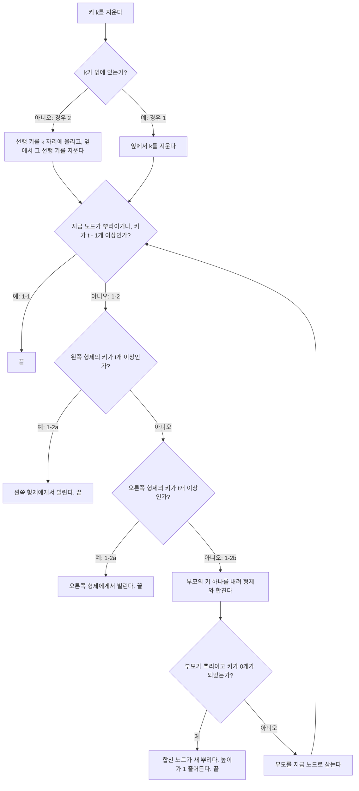


<div class="callout callout-summary" markdown="1">
<div class="callout-title callout-title--default" markdown="span">요약</div>

지우는 일을 늘 맨 아래 칸에서 하는 방식이다. 중간 칸의 값을 지워야 하면 바로 앞 순서의 값을 맨 아래에서 올려 그 자리를 메우고, 맨 아래에서 그 값을 뺀다. 값을 빼서 칸이 너무 비면 옆 칸에서 하나 빌리고, 옆 칸도 빠듯하면 위 칸의 값 하나를 내려 두 칸을 하나로 합친다. 합치면 위 칸의 값이 하나 줄어 같은 일이 위로 번질 수 있고, 맨 위 칸이 비면 나무가 한 층 낮아진다.

</div>


## 예시로 보기

삽입은 늘 잎에 넣는다. 삭제는 아무 노드의 키나 지울 수 있어서 더 까다롭다. 내부 노드의 키를 그냥 빼면 그 키가 가르던 두 자식을 다시 엮어야 한다. 그래서 이 수업은 한 가지 요령을 쓴다. **모든 삭제를 잎에서 한다**[^1].

먼저 잎의 키를 지우는 세 경우를 본다. 최소 차수 $$t = 2$$인 트리다. 뿌리가 아닌 노드는 키가 적어도 1개 있어야 한다[^2].

```
                   [20 40]
   +-----------------+-------------------+
 [10]             [30 33]             [50 60]
 +----+       +-------+------+      +----+----+
[5] [15]   [25 28] [31 32] [35]   [45] [55] [65]
```

**32를 지운다.** 32가 든 잎 [31 32]는 키가 2개다. 하나를 지워도 1개가 남아 아래 한계를 지킨다. 그냥 지우고 끝난다[^2].

**31을 지운다.** 이제 그 잎은 [31]이다. 31을 지우면 키가 0개가 되어 아래 한계를 어긴다. 옆 노드(형제)를 본다. 왼쪽 형제 [25 28]은 키가 2개라 하나를 내줄 수 있다. 왼쪽 형제의 가장 큰 키 28이 부모로 올라가고, 부모에 있던 30이 빈 잎으로 내려온다[^3].

```
                [20 40]
   +--------------+----------------+
 [10]          [28 33]          [50 60]
 +----+      +----+----+      +----+----+
[5] [15]   [25] [30] [35]   [45] [55] [65]
```

**30을 지운다.** 잎 [30]이 또 비게 된다. 이번에는 왼쪽 형제 [25]도 오른쪽 형제 [35]도 키가 1개뿐이라 빌릴 수 없다. 부모의 키 28을 내려 왼쪽 형제와 한 노드 [25 28]로 합친다. 부모는 키가 하나 줄어 [33]이 된다[^4].

```
               [20 40]
   +-------------+---------------+
 [10]          [33]           [50 60]
 +----+       +------+      +----+----+
[5] [15]   [25 28] [35]   [45] [55] [65]
```

<div class="callout callout-warning" markdown="1">
<div class="callout-title" markdown="span">원본 오류 의심</div>

원문: 04.4-1_B-tree-deletion.pdf p.17의 마지막 그림은 [33] 밑의 잎을 [25 28], [45]로 그렸다. / 문제점: 그 자리의 잎은 [35]다. 45는 이미 [50 60] 밑에 있어 두 번 나오고 35가 사라진다. 45는 뿌리의 40보다 커서 그 자리에 있을 수도 없다. / 수정안: [33] 밑의 잎은 [25 28], [35]다. / 근거: 같은 쪽의 앞 그림들에는 [35]가 있다. 구현 코드의 결과도 [35]이고, 그려진 그림은 성질 검사에서 걸린다([17_b-tree-delete_impl.py](/Hongs_Blog/studies/database-design/code/17_b-tree-delete_impl/)).

</div>


<div class="callout callout-check" markdown="1">
<div class="callout-title" markdown="span">검증: 슬라이드의 여섯 장면(32, 31, 30, 33, 30, 10 삭제), 연습 4를 왼쪽 형제 먼저와 오른쪽 형제 먼저로 푼 결과, 무작위 삭제 43,680번에서 B-트리 성질을 지키고 정렬된 목록과 같으며 높이는 뿌리가 빌 때만 1 줄어듦, 교재식 삭제와의 차이, 카드 C1·C2·C5 — [17_b-tree-delete_impl.py](/Hongs_Blog/studies/database-design/code/17_b-tree-delete_impl/)</div>

</div>


## 정의

<div class="callout callout-definition" markdown="1">
<div class="callout-title" markdown="span">입력과 출력</div>

- **입력:** 최소 차수 $$t$$인 B-트리와, 그 안에 들어 있는 키 $$k$$.
- **출력:** $$k$$가 빠진 B-트리. 나머지 키는 그대로다.

</div>


### 경우 나누기

| 경우 | 언제 | 하는 일 |
|---|---|---|
| 1-1 | $$k$$가 잎에 있고, 그 잎의 키가 $$t$$개 이상이다 | 그냥 지운다. 지운 뒤에도 $$t - 1$$개 이상이다[^2] |
| 1-2a | $$k$$가 잎에 있고, 그 잎의 키가 딱 $$t - 1$$개다. 형제 가운데 키가 $$t$$개 이상인 노드가 있다 | 그 형제에게서 키 하나를 빌린다. **왼쪽 형제를 먼저** 보고, 왼쪽이 안 되면 오른쪽 형제를 본다[^3] |
| 1-2b | 위와 같은데 두 형제 모두 키가 $$t - 1$$개뿐이다 | 부모의 키 하나를 내려 형제와 한 노드로 합친다. 부모의 키가 하나 줄었으니 부모의 키 수를 확인하고, 모자라면 부모에서 1-2a와 1-2b를 다시 본다[^4] |
| 2 | $$k$$가 내부 노드에 있다 | $$k$$ 바로 앞 순서의 키(선행 키)를 찾아 $$k$$ 자리에 넣는다. 그 키는 잎에 있으니, 잎에서 그 키를 지우고 경우 1을 본다[^5] |

**빌리기.** 형제의 키가 내 노드로 곧장 오지 않는다. 부모를 거쳐 한 칸씩 돈다. 왼쪽 형제에게서 빌리면 형제의 가장 큰 키가 부모로 올라가고, 부모에서 두 노드를 가르던 키가 내 노드의 맨 앞으로 내려온다. 오른쪽 형제면 형제의 가장 작은 키가 올라가고, 부모의 키가 내 노드의 맨 뒤로 내려온다[^3].

**합치기.** 부모에서 두 노드를 가르던 키를 가운데에 놓고 두 노드를 이어 붙인다. 노드 쪼개기를 거꾸로 한 것이다. 슬라이드의 그림은 왼쪽 형제가 있으면 왼쪽과, 없으면 오른쪽과 합친다[^s1].

**내부 노드에서 빌리고 합칠 때.** 고치는 일이 부모로 올라가면 내부 노드끼리 빌리거나 합친다. 이때는 자식도 따라 움직인다. 왼쪽 형제에게서 빌리면 형제의 마지막 자식이 내 첫 자식이 되고, 합치면 두 노드의 자식을 그대로 이어 붙인다[^s1].



슬라이드에는 삭제의 의사코드가 없다. 위 흐름은 슬라이드의 경우 설명을 한 장으로 이은 것이다[^s2].

### 경우 2: 내부 노드의 키

$$k$$의 선행 키는 $$k$$의 왼쪽 자식 밑에서 가장 큰 키다. 왼쪽 자식에서 시작해 가장 오른쪽 자식으로만 내려가면 잎에 닿고, 그 잎의 마지막 키가 선행 키다. 슬라이드는 "선행 키나 후속 키를 찾는다"고 적고, 바꿔 넣는 키로는 선행 키를 쓴다[^5]. 후속 키는 $$k$$ 바로 뒤 순서의 키, 곧 오른쪽 자식 밑에서 가장 작은 키다. 이 문서와 구현 코드는 선행 키를 쓴다.

처음 트리에서 **33을 지운다.** 33은 내부 노드 [30 33]에 있다. 33의 왼쪽 자식은 잎 [31 32]이고 가장 큰 키는 32다. 32를 33 자리에 올리고 잎에서 32를 지운다. 잎에 31이 남으니 경우 1-1로 끝난다[^5].

```
                 [20 40]
   +----------------+-----------------+
 [10]            [30 32]           [50 60]
 +----+       +------+----+      +----+----+
[5] [15]   [25 28] [31] [35]   [45] [55] [65]
```

다음 트리에서 **30을 지운다.** 이번에는 선행 키가 든 잎이 비게 된다[^6].

```
                [20 40]
   +--------------+----------------+
 [10]          [30 32]          [50 60]
 +----+      +----+----+      +----+----+
[5] [15]   [25] [31] [35]   [45] [55] [65]
```

30의 왼쪽 자식은 잎 [25]이고 선행 키는 25다. 25를 30 자리에 올리면 그 잎이 빈다. 이 잎은 맨 왼쪽이라 왼쪽 형제가 없고, 오른쪽 형제 [31]은 키가 1개뿐이다. 경우 1-2b다. 부모로 올라간 25를 다시 내려 [31]과 합친다.

```
               [20 40]
   +-------------+---------------+
 [10]          [32]           [50 60]
 +----+       +------+      +----+----+
[5] [15]   [25 31] [35]   [45] [55] [65]
```

### 높이가 줄어드는 때

합치기가 부모로 번져 뿌리의 키가 하나도 남지 않으면, 합친 노드가 새 뿌리가 되고 트리의 높이가 1 줄어든다[^7].

```
       [20]
   +-----------+
 [10]        [35]
 +----+      +----+
[5] [15]   [30] [70]
```

**10을 지운다.** 10은 내부 노드에 있다. 선행 키 5를 올리면 잎 [5]가 빈다. 형제 [15]는 키가 1개뿐이라 합친다(1-2b). 5가 다시 내려와 [5 15]가 되고, 부모는 키가 0개가 된다. 부모도 모자라니 부모에서 다시 본다. 부모의 형제 [35]도 키가 1개뿐이라 또 합친다(1-2b). 뿌리의 20이 내려와 [20 35]가 되고 뿌리가 빈다. [20 35]가 새 뿌리다.

```
     [20 35]
   +-----+----+
[5 15] [30] [70]
```

<div class="callout callout-warning" markdown="1">
<div class="callout-title" markdown="span">원본 오류 의심</div>

원문: 04.4-1_B-tree-deletion.pdf p.20의 마지막 그림은 새 뿌리 [20 35]의 첫 잎을 "5 35"로 그렸다. 같은 쪽의 글은 "if the parent is the root node and it has no child node"다. / 문제점: 첫 잎은 5와 15를 합친 [5 15]다. 그림대로면 15가 사라지고 35가 두 번 나온다. 글의 "no child node"도 맞지 않는다. 그 순간 뿌리에는 자식이 하나 남아 있고, 없는 것은 키다. / 수정안: 첫 잎은 [5 15], 글은 "뿌리에 키가 하나도 남지 않으면"으로 읽는다. / 근거: 같은 쪽 가운데 그림에 합친 잎 [5 15]가 그려져 있다. 구현 코드의 결과도 `[20 35] / [5 15] [30] [70]`이다.

</div>


<div class="callout callout-warning" markdown="1">
<div class="callout-title" markdown="span">원본 오류 의심</div>

원문: 04.4-1_B-tree-deletion.pdf p.14 "if the node has more than t-1 children (x.n>=t)", p.15 "exactly t-1 children", p.21과 04.4_B-tree-solutions.pdf p.4 "minimum degree t=3 (i.e., the minimum nuber of keys t=2)". / 문제점: 잎에는 자식이 없다. 세는 것은 키다. 또 $$t = 3$$일 때 키의 최소 개수는 $$t$$가 아니라 $$t - 1 = 2$$다. / 수정안: "children"을 "keys"로, "the minimum number of keys t=2"를 "$$t - 1 = 2$$"로 읽는다. / 근거: 괄호 안의 $$x.n \ge t$$가 키 수를 가리키고, 03.3_B-tree.pdf p.17의 정의가 "뿌리가 아닌 노드는 키가 $$t - 1$$개 이상"이다.

</div>


### 형제를 보는 순서

빌릴 때 슬라이드 본문은 왼쪽 형제를 먼저 보라고 적는다[^3]. 그런데 연습 4의 풀이는 오른쪽 형제를 먼저 쓴 결과다. 어느 쪽을 먼저 보든 결과는 올바른 B-트리이고 담긴 키도 같다. 모양만 다르다. 이 문서와 구현 코드는 본문의 규칙(왼쪽 먼저)을 따르고, 두 결과는 [B-트리 연습](/Hongs_Blog/studies/database-design/b-tree-practice/)의 p6에 나란히 실었다.

## 왜 맞는가

지키는 약속은 이것이다. **고치는 동안 B-트리의 성질을 어기는 노드는 "지금 노드" 하나뿐이고, 그 노드는 키가 딱 하나 모자라다**[^s3].

<details class="callout callout-proof" markdown="1">
<summary class="callout-title" markdown="span">증명 펼치기</summary>

1. *선행 키는 잎에 있다.* $$k$$의 왼쪽 자식에서 가장 오른쪽 자식으로만 내려간다. 내부 노드에서는 마지막 키보다 그 오른쪽 자식 밑의 키가 더 크므로, 가장 큰 키는 더 내려가야 나온다. 잎에 닿으면 그 잎의 마지막 키가 가장 크다. — 키가 범위를 가른다
2. *선행 키로 바꿔도 범위가 맞다.* 선행 키 $$p$$는 $$k$$의 왼쪽 서브트리에서 가장 크고, $$k$$보다 크지 않다. $$p$$를 잎에서 빼고 $$k$$ 자리에 놓으면 왼쪽 서브트리의 남은 키는 모두 $$p$$ 이하, 오른쪽 서브트리의 키는 모두 $$k$$ 이상이라 $$p$$ 이상이다. — 선행 키의 뜻
3. *빌리면 끝난다.* 지금 노드는 키가 $$t - 2$$개였다가 $$t - 1$$개가 된다. 형제는 $$t$$개 이상이었으니 하나를 내주고도 $$t - 1$$개 이상이다. 부모의 키 수는 그대로다. 올라간 키는 형제에서 가장 큰(또는 가장 작은) 키이고 내려온 키는 두 노드를 가르던 키라서 범위도 맞다. 어기는 노드가 없어진다. — 1-2a
4. *합친 노드는 넘치지 않는다.* 형제의 키 $$t - 1$$개, 부모에서 내려온 키 1개, 지금 노드의 키 $$t - 2$$개를 더하면 $$2t - 2$$개다. 위 한계 $$2t - 1$$보다 적고 아래 한계 $$t - 1$$보다 많다. — 1-2b
5. *합치면 문제가 한 층 올라간다.* 부모는 키 하나와 자식 하나를 잃는다. 자식 수는 여전히 키 수 + 1이다. 부모의 키가 $$t - 1$$개 이상 남으면 끝이고, 모자라면 이제 부모가 "하나 모자란 지금 노드"다. — 1-2b
6. *끝난다.* 합칠 때마다 지금 노드가 한 층 위로 간다. 뿌리에 닿으면 뿌리는 아래 한계가 없으니 키가 1개 이상 남는 한 끝이다. 키가 0개면 자식이 하나뿐이고, 그 자식을 뿌리로 삼으면 모든 잎이 똑같이 한 칸 얕아진다. ∎

</details>


### 스스로 설명해 보기

<details class="callout callout-question" markdown="1">
<summary class="callout-title" markdown="span">1. 경우 2에서 왜 하필 선행 키로 바꾸는가? 아무 잎의 키나 가져오면 안 되는가?</summary>

$$k$$ 자리에 들어갈 키는 왼쪽 서브트리의 모든 키보다 크거나 같고 오른쪽 서브트리의 모든 키보다 작거나 같아야 한다. 왼쪽에서 가장 큰 키(선행 키)나 오른쪽에서 가장 작은 키(후속 키)만 이 조건을 지킨다. 다른 키를 가져오면 "키가 범위를 가른다"가 깨진다.

</details>


<details class="callout callout-question" markdown="1">
<summary class="callout-title" markdown="span">2. 3단계에서 형제의 키가 부모를 거쳐 도는 까닭은?</summary>

부모의 키는 두 노드의 범위를 가른다. 형제의 키를 내 노드로 곧장 옮기면 그 키가 부모의 가름 키보다 작은 쪽에서 큰 쪽으로 넘어와 범위가 틀어진다. 형제의 끝 키를 부모로 올리고 부모의 키를 내리면, 세 키의 크기 순서가 그대로다.

</details>


<details class="callout callout-question" markdown="1">
<summary class="callout-title" markdown="span">3. 4단계에서 지금 노드의 키가 왜 $$t - 2$$개인가?</summary>

뿌리가 아닌 노드의 아래 한계는 $$t - 1$$개다. 한계를 어긴 까닭은 키 하나를 지웠거나(잎), 합치기로 키 하나를 아래로 내줬기(내부 노드) 때문이다. 어느 쪽이든 한계에서 딱 하나 모자란 $$t - 2$$개다.

</details>


<details class="callout callout-question" markdown="1">
<summary class="callout-title" markdown="span">4. 6단계에서 뿌리의 키가 0개일 때 자식이 하나뿐인 까닭은?</summary>

자식 수는 키 수 + 1이다. 키가 0개면 자식은 1개다. 그 자식이 방금 합친 노드다.

</details>


<details class="callout callout-question" markdown="1">
<summary class="callout-title" markdown="span">이 절차의 핵심 아이디어는?</summary>

어려운 경우를 쉬운 경우로 바꾼다. 내부 노드의 삭제를 잎의 삭제로 바꾸고, 잎에서 생긴 "키 하나 모자람"을 빌리기로 그 자리에서 없애거나 합치기로 한 층 위에 넘긴다. 문제가 늘 노드 하나에만 있어서 그 노드만 따라 올라가면 된다.

</details>


<details class="callout callout-question" markdown="1">
<summary class="callout-title" markdown="span">같은 생각을 쓰는 다른 상황은?</summary>

이진 탐색 트리에서 자식이 둘인 노드를 지울 때도 왼쪽 서브트리에서 가장 큰 키를 그 자리에 올리고, 아래쪽의 쉬운 자리에서 그 키를 지운다([이진 탐색 트리의 삭제](/Hongs_Blog/studies/data-structures/bst-delete/)).

</details>


### 걸리는 시간

지울 키를 찾아 내려가는 길과 고치며 올라오는 길이 각각 높이만큼이다. 노드 하나에서 키를 찾거나, 빌리거나, 합치는 일은 $$O(t)$$다. 그래서 $$O(t \log_t n)$$이고 디스크를 읽고 쓰는 횟수는 높이에 비례한다. 가장 쉬울 때는 잎에서 키 하나만 빼고 끝난다(경우 1-1). 가장 나쁠 때는 잎에서 뿌리 바로 아래까지 층마다 합쳐서, 삭제 한 번에 합치기가 $$h$$번 일어난다. 새 노드는 만들지 않고, 합칠 때마다 노드가 하나씩 준다[^s3].

## 교재의 삭제와 다른 점

교재(CLRS)의 B-트리 삭제는 순서가 반대다. 내려가는 길에, 지나갈 노드의 키가 $$t$$개 이상이 되도록 미리 빌리거나 합쳐 두고 한 번 내려가며 지운다. 이 수업의 방식은 잎에서 먼저 지우고 모자라면 올라가며 고친다. 같은 키를 지워도 결과의 모양이 다를 수 있다[^s4].

$$t = 2$$인 <code>[40] / [20] [60] / [10 15] [30] &#124; [50] [70]</code>에서 15를 지운다. 수업의 방식은 잎 [10 15]에서 15만 빼고 끝난다(경우 1-1). 높이는 2 그대로다. 교재의 방식은 내려가는 길에 키가 1개뿐인 [20]을 [60]과 미리 합쳐서 `[20 40 60] / [10] [30] [50] [70]`이 되고 높이가 1로 줄어든다. 둘 다 올바른 B-트리다. 이 문서와 연습은 수업의 방식으로 답한다.

## 활용

- 구현: [17_b-tree-delete_impl.py](/Hongs_Blog/studies/database-design/code/17_b-tree-delete_impl/)
- 연습: [B-트리 삭제 예제 사다리](/Hongs_Blog/studies/database-design/b-tree-delete-ladder/), [B-트리 연습](/Hongs_Blog/studies/database-design/b-tree-practice/)의 p6
- B-트리의 두 한계와 두 연산이 짝을 이룬다. 삽입은 노드가 너무 커지지 않게 쪼개고, 삭제는 노드가 너무 작아지지 않게 빌리거나 합친다[^8].
- 흔한 실수 세 가지.
    - 빌릴 수 있는데 합친다. 형제에 키가 $$t$$개 이상 있으면 먼저 빌린다. 합치기는 두 형제 모두 $$t - 1$$개뿐일 때만 한다.
    - 합친 뒤 부모를 확인하지 않는다. 부모의 키가 하나 줄었으니 부모가 모자랄 수 있다.
    - 내부 노드의 키를 지울 때 선행 키를 올리기만 하고 잎에서 지우지 않는다. 그러면 같은 키가 두 번 남는다.

## 연결

- 선수: [B-트리 검색](/Hongs_Blog/studies/database-design/b-tree-search/), [B-트리 삽입](/Hongs_Blog/studies/database-design/b-tree-insert/)
- 합치기의 반대 동작: [B-트리 노드 쪼개기](/Hongs_Blog/studies/database-design/b-tree-split-child/)
- 선행 키로 바꿔 아래에서 지우는 같은 요령: [이진 탐색 트리의 삭제](/Hongs_Blog/studies/data-structures/bst-delete/)

## 자주 하는 오해

<div class="callout callout-misconception" markdown="1">
<div class="callout-title" markdown="span">"빌린다는 것은 형제의 키 하나를 내 노드로 옮기는 것이다"</div>

틀렸다. 형제의 키는 부모로 올라가고, 내 노드로 내려오는 것은 부모에 있던 키다. "형제에게서 빌린다"는 말 때문에 형제의 키가 곧장 건너온다고 생각하기 쉽다. 예시에서 31을 지울 때 왼쪽 형제의 28을 빈 잎에 곧장 넣으면 부모 [30 33] 밑에 잎 [25], [28], [35]가 놓인다. 가운데 잎은 30과 33 사이의 키만 담아야 하는데 28은 30보다 작다. 올바른 결과는 28이 부모로 올라가 [28 33]이 되고 30이 내려와 잎 [30]이 되는 것이다. 확인하는 법: 고친 뒤 부모의 키와 양쪽 자식의 키를 왼쪽부터 읽어 크기 순서대로인지 본다.

</div>


## 확인 문제

<details class="callout callout-question" markdown="1">
<summary class="callout-title" markdown="span">**C1** 예시의 처음 트리($$t = 2$$)에서 45를 지운 결과를 적어라. 어느 경우인가?</summary>

**답:** 경우 1-2b다. 결과는 <code>[20 40] / [10] [30 33] [60] / [5] [15] &#124; [25 28] [31 32] [35] &#124; [50 55] [65]</code>.<br>
**이유:** 잎 [45]가 빈다. 맨 왼쪽 자식이라 왼쪽 형제가 없고, 오른쪽 형제 [55]는 키가 1개뿐이라 빌릴 수 없다. 부모의 50을 내려 [55]와 합쳐 [50 55]가 된다. 부모는 [60]으로 키가 1개 남아 아래 한계를 지키니 거기서 끝난다.

</details>


<details class="callout callout-question" markdown="1">
<summary class="callout-title" markdown="span">**C2** 예시의 처음 트리에서 뿌리의 40을 지운 결과를 적어라. 거치는 경우를 차례로 쓰라.</summary>

**답:** 경우 2 → 1-2a(왼쪽). 결과는 <code>[20 35] / [10] [30 32] [50 60] / [5] [15] &#124; [25 28] [31] [33] &#124; [45] [55] [65]</code>.<br>
**이유:** 40의 왼쪽 자식은 [30 33]이고, 거기서 가장 오른쪽으로 내려가면 잎 [35]다. 선행 키는 35다. 35를 뿌리에 올리면 그 잎이 빈다. 왼쪽 형제 [31 32]는 키가 2개라 빌릴 수 있다. 32가 부모로 올라가고 부모의 33이 내려와 잎 [33]이 된다.

</details>


<details class="callout callout-question" markdown="1">
<summary class="callout-title" markdown="span">**C3** 경우 2의 세 걸음(선행 키 찾기, 그 키로 바꾸기, 잎에서 지우기)이 하는 일을 한 문장으로 쓰라.</summary>

**답:** 내부 노드에서 지울 키의 자리를 바로 앞 순서의 키로 메우고, 지우는 일 자체는 그 키가 원래 있던 잎으로 옮긴다.<br>
**이유:** 이렇게 하면 내부 노드의 키 수와 자식 수는 그대로이고, 키가 하나 줄어드는 곳은 잎뿐이다.

</details>


<details class="callout callout-question" markdown="1">
<summary class="callout-title" markdown="span">**C4** $$t = 3$$이다. 잎에서 키 하나를 지우려 한다. 다음 각각은 어느 경우인가? (가) 그 잎의 키가 3개다. (나) 그 잎의 키가 2개, 왼쪽 형제 3개, 오른쪽 형제 4개다. (다) 그 잎의 키가 2개, 왼쪽 형제 2개, 오른쪽 형제 4개다. (라) 그 잎의 키가 2개, 두 형제 모두 2개다.</summary>

**답:** (가) 1-1. (나) 1-2a, 왼쪽에서 빌린다. (다) 1-2a, 오른쪽에서 빌린다. (라) 1-2b, 합친다.<br>
**이유:** $$t = 3$$이면 아래 한계는 2개, 빌려줄 수 있는 형제는 3개 이상이다. (나)는 두 형제 모두 빌려줄 수 있지만 왼쪽을 먼저 본다. 오른쪽 형제의 키가 더 많다는 것은 기준이 아니다.

</details>


<details class="callout callout-question" markdown="1">
<summary class="callout-title" markdown="span">**C5** 예시의 처음 트리에서 15를 지운 결과를 적어라. 고치는 일이 어디까지 올라가는가?</summary>

**답:** 경우 1-2b(잎) → 1-2a(부모). 결과는 <code>[30 40] / [20] [33] [50 60] / [5 10] [25 28] &#124; [31 32] [35] &#124; [45] [55] [65]</code>.<br>
**이유:** 잎 [15]가 비고 형제 [5]는 키가 1개뿐이라 부모의 10을 내려 [5 10]으로 합친다. 부모는 키가 0개가 된다. 부모는 뿌리의 맨 왼쪽 자식이라 왼쪽 형제가 없고, 오른쪽 형제 [30 33]은 키가 2개라 빌릴 수 있다. 30이 뿌리로 올라가고 뿌리의 20이 내려와 부모가 [20]이 된다. 내부 노드끼리 빌렸으니 형제의 첫 자식 [25 28]도 따라와 [20]의 둘째 자식이 된다.

</details>


<details class="callout callout-question" markdown="1">
<summary class="callout-title" markdown="span">**C6** 합친 노드의 키 수가 위 한계 $$2t - 1$$을 넘지 않는 근거를 대라.</summary>

**답:** 합치는 것은 키가 하나 모자란 노드($$t - 2$$개), 키가 $$t - 1$$개뿐인 형제, 부모에서 내려온 키 1개다. 더하면 $$(t - 2) + (t - 1) + 1 = 2t - 2$$개라 $$2t - 1$$보다 적다.<br>
**이유:** 형제의 키가 $$t$$개 이상이면 합치지 않고 빌리므로, 합칠 때 형제는 늘 $$t - 1$$개다.

</details>


[^1]: 데이터베이스 설계 4회 강의 자료 「4-1_B-tree-deletion」, p.13 ("Simple trick: Perform all deletion operations in leaf nodes!")
[^2]: 같은 자료, p.14 (Case 1-1, 32 삭제)
[^3]: 같은 자료, p.15~16 (Case 1-2, Case 1-2a: 왼쪽 형제를 먼저 보고 다음에 오른쪽 형제, 31 삭제)
[^4]: 같은 자료, p.17 (Case 1-2b, 30 삭제)
[^5]: 같은 자료, p.18 (Case 2, 33 삭제 → Case 1-1)
[^6]: 같은 자료, p.19 (Case 2, 30 삭제 → Case 1-2b)
[^7]: 같은 자료, p.20 (Decrease of the height of a B-Tree, 10 삭제)
[^8]: 같은 자료, p.22 (Summary: 삽입 때 너무 커지지 않고 삭제 때 너무 작아지지 않는다)
[^s1]: <span class="fn-tag" title="수업 자료에 없고 따로 보탠 내용">보충</span> 합칠 형제를 고르는 순서와 내부 노드에서 자식이 따라 움직이는 규칙은 슬라이드에 글로 없다. 합치는 쪽은 p.17(왼쪽 형제와 합침), p.19와 p.20(왼쪽 형제가 없어 오른쪽과 합침)의 그림에서 읽었고, 자식의 움직임은 p.20 그림(합친 [20 35]가 세 자식을 가진다)에서 읽었다. 무작위 삭제에서 성질이 늘 지켜지는 것으로 확인했다.
[^s2]: <span class="fn-tag" title="수업 자료에 없고 따로 보탠 내용">보충</span> 다이어그램 1개는 원본에 없다. 슬라이드 p.13~20의 경우 설명을 근거로 그렸다.
[^s3]: <span class="fn-tag" title="수업 자료에 없고 따로 보탠 내용">보충</span> 증명의 여섯 단계, 스스로 설명해 보기, 시간 $$O(t \log_t n)$$과 합치기 횟수의 한계, 흔한 실수, 오해 항목, 카드 C1~C6은 슬라이드에 없다. 슬라이드의 경우 설명과 그림에서 끌어냈고, 카드의 트리와 "합치기는 많아야 $$h$$번"은 구현 코드로 확인했다.
[^s4]: <span class="fn-tag" title="수업 자료에 없고 따로 보탠 내용">보충</span> 교재의 삭제와 견준 단락은 슬라이드에 없다. Cormen 외, *Introduction to Algorithms* 3판, 18.3절의 방식을 구현 코드에 함께 넣어 돌린 결과다. 무작위 삭제 13,635번에서 두 방식이 남긴 키는 늘 같았고, 트리의 모양은 절반 넘게 서로 달랐다.

