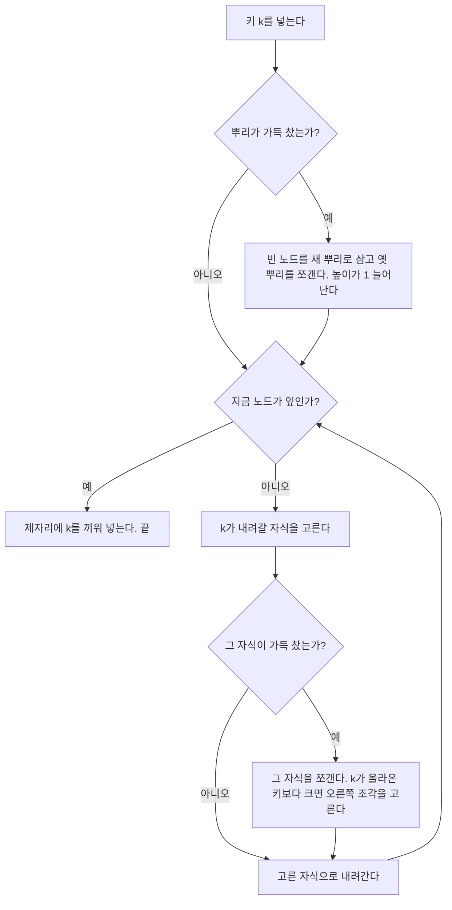


<div class="callout callout-summary" markdown="1">
<div class="callout-title callout-title--default" markdown="span">요약</div>

꽉 찬 서랍에는 물건을 더 넣을 수 없으니, 넣으러 내려가는 길에 꽉 찬 서랍을 만나면 그 자리에서 둘로 나눠 놓고 지나간다는 생각이다. 새 값은 늘 맨 아래 칸에 들어가고, 내려가는 길을 미리 비워 두었으니 한 번 내려가기만 하면 되고 되돌아 올라올 일이 없다. 나무는 맨 위 칸이 꽉 차서 쪼개질 때만 한 층 높아진다. 그래서 아래로 자라는 보통의 탐색 나무와 달리 위로 자라고, 맨 아래 칸들의 깊이가 늘 같다.

</div>


## 예시로 보기

이진 탐색 트리는 새 키가 갈 자리를 찾아 내려간 뒤 거기에 새 잎을 만들어 단다. B-트리에서 그렇게 하면 새 잎만 한 칸 더 깊어져 "모든 잎의 깊이가 같다"가 깨진다. 그래서 B-트리는 새 잎을 만들지 않고 이미 있는 잎에 키를 넣는다. 그 잎이 가득 차 있으면 넣기 전에 쪼갠다.

최소 차수 $$t = 3$$인 트리로 네 가지 경우를 본다. 노드 하나에 키가 5개까지 들어간다.

```
                [G M P X]
    +-------+-----+--------+--------+
[A C D E] [J K] [N O] [R S T U V] [Y Z]
```

**B를 넣는다.** B가 갈 잎 [A C D E]는 키가 4개라 가득 차지 않았다. 그대로 넣어 [A B C D E]가 된다.

**Q를 넣는다.** Q가 갈 잎 [R S T U V]는 키가 5개로 가득 찼다. 넣기 전에 쪼갠다. 가운데 키 T가 뿌리로 올라가고 [R S]와 [U V]로 갈린다. Q는 T보다 작으니 왼쪽 조각에 들어가 [Q R S]가 된다.

```
                 [G M P T X]
     +--------+-----+------+------+-----+
[A B C D E] [J K] [N O] [Q R S] [U V] [Y Z]
```

**L을 넣는다.** 이번에는 뿌리 [G M P T X]가 가득 찼다. 내려가기 전에 뿌리부터 쪼갠다. 가운데 키 P가 새 뿌리가 되고 트리가 한 층 높아진다. 그다음 L은 P보다 작아 [G M]으로, G와 M 사이라 [J K]로 내려가 [J K L]이 된다.

```
                        [P]
             +-----------------------+
           [G M]                   [T X]
     +---------+------+        +------+-----+
[A B C D E] [J K L] [N O]   [Q R S] [U V] [Y Z]
```

**F를 넣는다.** 뿌리 [P]와 그 아래 [G M]은 가득 차지 않았다. F가 갈 잎 [A B C D E]가 가득 찼으니 쪼갠다. 가운데 키 C가 [G M]으로 올라가 [C G M]이 되고 [A B]와 [D E]로 갈린다. F는 C보다 크니 오른쪽 조각에 들어가 [D E F]가 된다.

```
                         [P]
             +-------------------------+
          [C G M]                    [T X]
  +------+-------+------+        +------+-----+
[A B] [D E F] [J K L] [N O]   [Q R S] [U V] [Y Z]
```

<div class="callout callout-check" markdown="1">
<div class="callout-title" markdown="span">검증: 위 네 번의 삽입 결과, 뿌리 쪼개기($$t = 4$$, [A D F H L N P]에서 H가 올라감), 아래 실행 추적 표, 키 21개를 넣는 연습(B-트리 연습 p5)의 답, 무작위 삽입 35,940번에서 B-트리 성질을 지키고 정렬된 목록과 같으며 높이는 뿌리를 쪼갤 때만 1 늘어남, 카드 C1·C5 — [15_b-tree-insert_impl.py](/Hongs_Blog/studies/database-design/code/15_b-tree-insert_impl/)</div>

</div>


## 정의

<div class="callout callout-definition" markdown="1">
<div class="callout-title" markdown="span">입력과 출력</div>

- **입력:** B-트리 $$T$$와 넣을 키 $$k$$.
- **출력:** 돌려주는 값은 없다. $$T$$에 $$k$$가 더 들어 있고, $$T$$는 여전히 B-트리다.

</div>


절차는 셋이다. 빈 트리를 만드는 B-Tree-Create, 뿌리를 살피는 B-Tree-Insert, 가득 차지 않은 노드에서 아래로 내려가는 B-Tree-Insert-Nonfull이다. 의사코드는 자리를 1부터 센다.

### 빈 트리 만들기

B-트리를 지으려면 먼저 빈 뿌리를 만들고 키를 하나씩 넣는다. 빈 뿌리는 디스크 페이지 하나를 받아 만든 키 없는 잎이다. 처음에는 뿌리가 곧 잎이다. $$O(1)$$이다.

```
B-TREE-CREATE(T)
1  x = ALLOCATE-NODE()
2  x.leaf = TRUE
3  x.n = 0
4  DISK-WRITE(x)
5  T.root = x
```

### 뿌리 살피기

```
B-TREE-INSERT(T, k)
1   r = T.root
2   if r.n == 2t - 1
3       s = ALLOCATE-NODE()
4       T.root = s
5       s.leaf = FALSE
6       s.n = 0
7       s.c_1 = r
8       B-TREE-SPLIT-CHILD(s, 1)
9       B-TREE-INSERT-NONFULL(s, k)
10  else B-TREE-INSERT-NONFULL(r, k)
```

- **뿌리가 가득 찼으면(2~9행).** 키가 없는 새 노드 $$s$$를 뿌리로 삼고 옛 뿌리 $$r$$을 그 자식으로 단다. 그리고 $$r$$을 쪼갠다. 가운데 키가 $$s$$로 올라가 $$s$$는 키 1개와 자식 2개를 갖는다. 트리의 높이가 1 늘어난다.
- **뿌리가 가득 차지 않았으면(10행).** 그대로 뿌리에서 내려가기 시작한다.

### 가득 차지 않은 노드에서 내려가기

```
B-TREE-INSERT-NONFULL(x, k)
1   i = x.n
2   if x.leaf
3       while i ≥ 1 and k < x.key_i
4           x.key_(i+1) = x.key_i
5           i = i - 1
6       x.key_(i+1) = k
7       x.n = x.n + 1
8       DISK-WRITE(x)
9   else while i ≥ 1 and k < x.key_i
10          i = i - 1
11      i = i + 1
12      DISK-READ(x.c_i)
13      if x.c_i.n == 2t - 1
14          B-TREE-SPLIT-CHILD(x, i)
15          if k > x.key_i
16              i = i + 1
17      B-TREE-INSERT-NONFULL(x.c_i, k)
```

| 행 | 하는 일 |
|---|---|
| 2~8 | **$$x$$가 잎이면.** $$k$$보다 큰 키를 뒤에서부터 한 칸씩 밀어 자리를 내고 $$k$$를 넣는다. 키 수를 1 늘리고 디스크에 쓴다 |
| 9~11 | **$$x$$가 내부 노드면.** $$k$$가 내려갈 자식의 번호 $$i$$를 찾는다 |
| 12 | 그 자식을 디스크에서 읽는다 |
| 13~14 | 그 자식이 가득 찼으면 내려가기 전에 쪼갠다 |
| 15~16 | 쪼개면 가운데 키가 올라와 $$x.key_i$$가 되고 자식이 두 조각으로 갈린다. $$k$$가 그 키보다 크면 오른쪽 조각으로 가야 하니 $$i$$를 1 늘린다 |
| 17 | 고른 자식으로 내려가 같은 일을 한다 |

15~16행이 하는 일은 위 예에서 보인다. Q를 넣을 때는 올라온 T보다 Q가 작아 $$i$$가 그대로였고, F를 넣을 때는 올라온 C보다 F가 커서 $$i$$가 1 늘었다[^s1].



고리를 한 바퀴 돌 때마다 한 층 내려간다. 위층으로 되돌아가는 걸음은 없다.

### 실행 추적

$$t = 2$$인 빈 트리에 F, S, Q, K, C, L, H를 차례로 넣는다. 노드 하나에 키가 3개까지 들어간다.

| 넣는 키 | 쪼개기 | 넣은 뒤의 트리 |
|---|---|---|
| F | 없음 | `[F]` |
| S | 없음 | `[F S]` |
| Q | 없음 | `[F Q S]` |
| K | 뿌리 [F Q S]가 가득 찼다. Q가 새 뿌리로 올라간다 | `[Q] / [F K] [S]` |
| C | 없음 | `[Q] / [C F K] [S]` |
| L | L이 갈 잎 [C F K]가 가득 찼다. F가 뿌리로 올라간다 | `[F Q] / [C] [K L] [S]` |
| H | 없음 | `[F Q] / [C] [H K L] [S]` |

L을 넣을 때 [C F K]가 [C]와 [K]로 갈리고, L은 올라온 F보다 크니 오른쪽 조각 [K]에 들어갔다.

## 왜 맞는가

지키는 약속은 하나다. **B-Tree-Insert-Nonfull이 불려 내려가는 노드는 늘 가득 차 있지 않다**.

<details class="callout callout-proof" markdown="1">
<summary class="callout-title" markdown="span">증명 펼치기</summary>

1. *처음.* 뿌리가 가득 차 있지 않으면 그 뿌리로 시작한다. 가득 차 있으면 쪼갠 뒤의 새 뿌리 $$s$$로 시작하는데, $$s$$의 키는 1개다. $$t \ge 2$$라 $$2t - 1 \ge 3$$이므로 $$s$$는 가득 차 있지 않다. — B-Tree-Insert 2~10행
2. *내려갈 때.* 지금 노드 $$x$$가 가득 차 있지 않다고 하자. 내려갈 자식이 가득 차 있으면 쪼갠다. 부모 $$x$$가 가득 차 있지 않으니 쪼갤 수 있고, 쪼갠 두 조각의 키는 $$t - 1$$개씩이라 가득 차 있지 않다. 자식이 가득 차 있지 않았으면 그대로다. 어느 쪽이든 다음에 내려가는 노드는 가득 차 있지 않다. — 13~17행, 쪼개기의 조건
3. *끝.* 한 번 내려갈 때마다 깊이가 1 늘고 트리의 높이는 유한하니 언젠가 잎에 닿는다. 그 잎도 가득 차 있지 않으므로 키가 많아야 $$2t - 2$$개이고, $$k$$를 넣어도 $$2t - 1$$개를 넘지 않는다. — 2~8행
4. *결과가 B-트리다.* 쪼개기는 B-트리의 성질을 깨지 않는다([B-트리 노드 쪼개기](/Hongs_Blog/studies/database-design/b-tree-split-child/)). 잎에서는 $$k$$를 정렬된 자리에 넣는다. 내려온 길이 "이 잎의 범위 안에 $$k$$가 있다"를 지켰으니 범위도 맞다. 새 노드는 쪼갤 때만 생기고 늘 옆자리에 놓이므로 잎의 깊이는 모두 같다. ∎

</details>


### 뿌리를 쪼갤 때만 높아진다

트리의 높이를 늘리는 길은 뿌리 쪼개기 하나뿐이다. 다른 쪼개기는 노드를 옆으로 하나 늘릴 뿐 깊이를 바꾸지 않는다. 뿌리를 쪼개면 새 뿌리가 맨 위에 얹히므로 모든 잎이 한꺼번에 한 칸씩 깊어진다. 이진 탐색 트리는 아래쪽에 잎이 달리며 자라고, B-트리는 맨 위에서 자란다.

### 스스로 설명해 보기

<details class="callout callout-question" markdown="1">
<summary class="callout-title" markdown="span">1. 가득 찬 뿌리를 쪼갤 때 왜 빈 노드 $$s$$를 먼저 만드는가?</summary>

쪼개기는 가운데 키를 부모로 올리는데 뿌리에는 부모가 없다. 키가 0개인 $$s$$를 부모로 달아 주면 $$s$$는 가득 차 있지 않은 부모라서 쪼개기의 조건이 맞고, 올라온 가운데 키 하나가 $$s$$의 키가 된다.

</details>


<details class="callout callout-question" markdown="1">
<summary class="callout-title" markdown="span">2. 2단계에서 "부모 $$x$$가 가득 차 있지 않으니 쪼갤 수 있다"는 어디서 오는가?</summary>

지키는 약속 자체다. $$x$$는 B-Tree-Insert-Nonfull이 불려 내려온 노드이므로 가득 차 있지 않다. 쪼개기는 부모의 키를 하나 늘리는데, 가득 차 있지 않은 부모는 하나를 더 받을 수 있다.

</details>


<details class="callout callout-question" markdown="1">
<summary class="callout-title" markdown="span">3. 3단계에서 잎의 키가 "많아야 $$2t - 2$$개"인 까닭은?</summary>

가득 찬 노드는 키가 $$2t - 1$$개다. 가득 차 있지 않다는 것은 그보다 적다는 것이니 많아야 $$2t - 2$$개다.

</details>


<details class="callout callout-question" markdown="1">
<summary class="callout-title" markdown="span">4. 4단계에서 뿌리 쪼개기가 잎의 깊이를 서로 다르게 만들지 않는 까닭은?</summary>

새 뿌리가 트리 전체의 위에 얹힌다. 모든 잎이 뿌리에서 한 칸씩 똑같이 멀어지므로 깊이가 다 같이 1 늘어난다.

</details>


<details class="callout callout-question" markdown="1">
<summary class="callout-title" markdown="span">이 절차의 핵심 아이디어는?</summary>

문제가 생긴 뒤에 고치지 않고, 생기기 전에 길을 비워 둔다. 내려가는 길의 가득 찬 노드를 미리 쪼개 두면 잎에 넣을 때 넘칠 일이 없고, 쪼갠 키가 올라갈 부모에도 늘 자리가 있다. 그래서 뿌리에서 잎까지 한 번만 내려간다.

</details>


<details class="callout callout-question" markdown="1">
<summary class="callout-title" markdown="span">같은 생각을 쓰는 다른 상황은?</summary>

교재(CLRS)의 B-트리 삭제가 같은 생각을 쓴다. 내려가는 길에 키가 모자랄 노드를 미리 채워 두고 한 번에 내려간다. 이 문서 모음의 삭제는 반대로, 잎에서 지운 뒤 모자라면 위로 올라가며 고친다([B-트리 삭제](/Hongs_Blog/studies/database-design/b-tree-delete/)).

</details>


### 걸리는 시간

삽입의 시간은 검색과 같은 $$O(t \log_t n)$$이다.

- 뿌리에서 잎까지 내려가는 노드의 수는 $$O(h) = O(\log_t n)$$이다.
- 노드 하나에서 자리를 찾는 데 $$O(t)$$, 쪼개기 한 번에 $$O(t)$$가 든다.

쪼개기가 한 번도 없어도 뿌리에서 잎까지는 내려가야 한다. 쪼개기는 삽입 한 번에 많아야 $$h + 1$$번이다. $$h$$는 넣기 전의 높이이고, 뿌리부터 잎까지 지나는 노드 $$h + 1$$개가 모두 가득 차 있을 때 그렇게 된다. 디스크를 읽고 쓰는 횟수도 높이에 비례한다. 새 노드는 쪼갤 때만 생긴다. 자식을 쪼갤 때 1개, 뿌리를 쪼갤 때는 새 뿌리까지 2개다[^s4].

## 활용

- 구현: [15_b-tree-insert_impl.py](/Hongs_Blog/studies/database-design/code/15_b-tree-insert_impl/)
- 연습: [B-트리 삽입 예제 사다리](/Hongs_Blog/studies/database-design/b-tree-insert-ladder/), [B-트리 연습](/Hongs_Blog/studies/database-design/b-tree-practice/)의 p4·p5
- 흔한 실수 세 가지.
    - 쪼갠 뒤 어느 조각으로 내려갈지 다시 고르지 않는다(15~16행).
    - 가운데 키를 조각에 남긴다. 가운데 키는 부모로 올라가고 어느 조각에도 남지 않는다.
    - 가득 찬 뿌리를 그냥 지나친다. 그 아래에서 쪼개기가 일어나면 올라올 키를 뿌리가 받지 못한다.

## 연결

- 선수: [B-트리 검색](/Hongs_Blog/studies/database-design/b-tree-search/)(자리를 찾아 내려가기), [B-트리 노드 쪼개기](/Hongs_Blog/studies/database-design/b-tree-split-child/)
- 새 잎을 달아 넣는 방식: [이진 탐색 트리의 탐색과 삽입](/Hongs_Blog/studies/data-structures/bst-search-insert/). 견준 것은 [B-트리와 이진 탐색 트리 비교](/Hongs_Blog/studies/database-design/b-tree-vs-bst/)
- 반대 방향의 연산: [B-트리 삭제](/Hongs_Blog/studies/database-design/b-tree-delete/)

## 자주 하는 오해

<div class="callout callout-misconception" markdown="1">
<div class="callout-title" markdown="span">"키가 들어갈 잎이 가득 찼을 때만 쪼갠다"</div>

틀렸다. 이 절차는 내려가는 길에서 만나는 가득 찬 노드를 모두, 잎에 닿기 전에 쪼갠다. 넘친 노드를 쪼개는 것이 자연스러워 보여서, 넘칠 일이 없는 잎으로 갈 때는 아무것도 안 쪼갠다고 생각하기 쉽다. 위 예에서 L을 넣을 때 L이 갈 잎 [J K]는 키가 2개뿐이었다. 그런데도 가득 찬 뿌리 [G M P T X]를 쪼갰고 트리가 한 층 높아졌다. 미리 쪼개 두지 않으면 나중에 아래에서 올라오는 키를 받을 자리가 없어 위로 되돌아가야 한다. 확인하는 법: $$t = 2$$인 `[10 20 30] / [5] [15] [25] [35]`에 1을 넣어 본다. 잎 [5]에 자리가 있지만 뿌리가 먼저 쪼개진다(카드 C5).

</div>


## 확인 문제

<details class="callout callout-question" markdown="1">
<summary class="callout-title" markdown="span">**C1** $$t = 2$$이다. `[F Q] / [C] [H K L] [S]`에 M을 넣은 결과를 적어라. 쪼개기는 어디서 일어나는가?</summary>

**답:** `[F K Q] / [C] [H] [L M] [S]`. M이 갈 잎 [H K L]이 가득 차 있어 넣기 전에 쪼갠다. K가 뿌리로 올라가고 [H]와 [L]로 갈린다. M은 K보다 크니 오른쪽 조각에 들어가 [L M]이 된다.<br>
**이유:** 뿌리 [F Q]는 키가 2개라 가득 차지 않았다. 그래서 뿌리는 쪼개지 않고 높이도 그대로다.

</details>


<details class="callout callout-question" markdown="1">
<summary class="callout-title" markdown="span">**C2** B-Tree-Insert-Nonfull의 13~16행이 하는 일을 한 문장으로 쓰라.</summary>

**답:** 내려갈 자식이 가득 차 있으면 내려가기 전에 쪼개고, 올라온 가운데 키와 $$k$$를 견주어 두 조각 가운데 $$k$$가 속하는 쪽을 다시 고른다.

</details>


<details class="callout callout-question" markdown="1">
<summary class="callout-title" markdown="span">**C3** B-트리에 키를 아무리 넣어도 잎들의 깊이가 서로 달라지지 않는 까닭은?</summary>

**답:** 새 노드는 쪼갤 때만 생기고, 쪼갠 조각은 원래 노드와 같은 깊이에 놓인다. 깊이가 바뀌는 때는 뿌리를 쪼갤 때뿐인데, 그때는 새 뿌리가 맨 위에 얹혀 모든 잎이 똑같이 한 칸 깊어진다.<br>
**이유:** 이진 탐색 트리는 잎 밑에 새 잎을 달아서 그 길만 길어진다. B-트리는 새 잎을 달지 않는다.

</details>


<details class="callout callout-question" markdown="1">
<summary class="callout-title" markdown="span">**C4** 노드 쪼개기는 "부모가 가득 차 있지 않다"를 조건으로 둔다. 삽입 절차에서 이 조건이 늘 맞는 근거를 대라.</summary>

**답:** B-Tree-Insert-Nonfull이 내려가는 노드는 늘 가득 차 있지 않다. 처음에는 가득 차지 않은 뿌리(또는 키 1개짜리 새 뿌리)에서 시작하고, 내려갈 자식이 가득 차 있으면 내려가기 전에 쪼개 키 $$t - 1$$개짜리로 만든다. 쪼개기를 부르는 곳은 이 노드 안이므로, 쪼갤 자식의 부모는 가득 차 있지 않다.

</details>


<details class="callout callout-question" markdown="1">
<summary class="callout-title" markdown="span">**C5** $$t = 2$$이다. `[10 20 30] / [5] [15] [25] [35]`에 1을 넣은 결과를 적어라. 1이 들어갈 잎 [5]에는 자리가 있다. 그래도 쪼개기가 일어나는가?</summary>

**답:** 일어난다. 뿌리 [10 20 30]이 가득 차 있어 먼저 쪼갠다. 20이 새 뿌리가 되고, 결과는 <code>[20] / [10] [30] / [1 5] [15] &#124; [25] [35]</code>다. 높이가 1에서 2로 늘어난다.<br>
**이유:** 쪼개는 기준은 "지나가는 노드가 가득 찼는가"이지 "키가 들어갈 잎이 가득 찼는가"가 아니다.

</details>


[^s1]: 쪼갠 뒤 $$x.key_i$$가 올라온 가운데 키라는 데서 나오고, Q와 F의 삽입을 구현 코드로 따라가 확인했다.
[^s4]: 쪼개기 횟수와 카드의 트리는 구현 코드로 확인했다.

