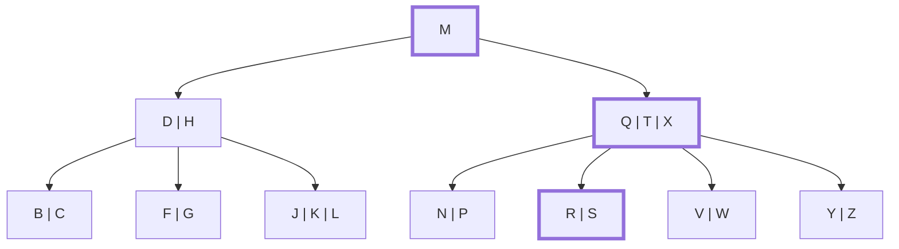


<div class="callout callout-summary" markdown="1">
<div class="callout-title callout-title--default" markdown="span">요약</div>

두꺼운 사전의 옆면에 붙은 색인 딱지를 보고 펼칠 곳을 고르듯, 한 칸에 적힌 기준 값들과 견주어 어느 사잇길로 내려갈지 정하고 아래 칸에서 같은 일을 되풀이한다. 한 칸 내려갈 때마다 디스크를 한 번 읽으므로, 디스크를 읽는 횟수는 나무의 높이를 넘지 않는다. 칸 안의 값을 앞에서부터 하나씩 견주면 칸이 클수록 그만큼 오래 걸린다. 칸 안의 값은 정렬되어 있으니 반씩 좁혀 찾으면 칸의 크기와 거의 상관없이 빨라진다.

</div>


## 예시로 보기

이진 탐색 트리에서는 노드마다 "작으면 왼쪽, 크면 오른쪽" 두 갈래 가운데 하나를 고른다. B-트리의 노드에는 키가 $$x.n$$개 있어서 $$x.n + 1$$갈래 가운데 하나를 골라야 한다. 고르는 법만 정하면 나머지는 이진 탐색 트리와 같다.

아래 트리에서 R을 찾는다. 굵은 테두리가 지나가는 노드다.



| 차례 | 지금 노드 | 노드 안에서 한 일 | 다음 |
|---|---|---|---|
| 1 | [M] | R은 M보다 크다. 더 견줄 키가 없다 | 뿌리에 R이 없다. M 오른쪽 자식을 디스크에서 읽는다 |
| 2 | [Q T X] | R은 Q보다 크고 T보다 크지 않다. T에서 멈춘다. T는 R이 아니다 | Q와 T 사이의 자식을 디스크에서 읽는다 |
| 3 | [R S] | R은 첫 키 R보다 크지 않다. 거기서 멈춘다. 그 키가 R이다 | 이 노드와 자리 1을 돌려준다 |

노드 셋을 지났고 디스크는 2번 읽었다. 뿌리는 주기억장치에 있다고 본다.

없는 키 U를 찾으면 [M] → [Q T X]까지는 같고, U가 T보다 크고 X보다 크지 않으니 T와 X 사이의 자식 [V W]로 내려간다. [V W]에서 U는 V보다 크지 않아 첫 자리에서 멈추는데 V는 U가 아니다. [V W]는 잎이라 더 내려갈 곳이 없다. 트리에 U가 없다는 답이 나온다.

<div class="callout callout-check" markdown="1">
<div class="callout-title" markdown="span">검증: R과 U를 찾을 때 지나는 노드와 디스크 읽기 횟수, 무작위 검색 24,000번에서 답이 "그 키가 들어 있는가"와 같음, 노드 안 이분 탐색 판이 같은 자리를 돌려줌, 아래 비교 횟수 표, 카드 C1·C4 — [13_b-tree-search_impl.py](/Hongs_Blog/studies/database-design/code/13_b-tree-search_impl/)</div>

</div>


## 정의

<div class="callout callout-definition" markdown="1">
<div class="callout-title" markdown="span">입력과 출력</div>

- **입력:** 서브트리의 뿌리 노드를 가리키는 포인터 $$x$$와, 그 서브트리에서 찾을 키 $$k$$.
- **출력:** $$k$$가 있으면 순서쌍 $$(y, i)$$. $$y$$는 노드이고 $$i$$는 $$y.key_i = k$$인 자리다. 없으면 NIL(찾지 못했다는 표시).

맨 처음에는 B-Tree-Search($$T.root$$, $$k$$)로 부른다. $$T.root$$는 트리 $$T$$의 뿌리다.

</div>


의사코드는 자리를 1부터 센다. 구현 코드는 0부터 세므로 자리가 하나씩 작다.

```
B-TREE-SEARCH(x, k)
1  i = 1
2  while i ≤ x.n and k > x.key_i
3      i = i + 1
4  if i ≤ x.n and k == x.key_i
5      return (x, i)
6  elseif x.leaf
7      return NIL
8  else DISK-READ(x.c_i)
9      return B-TREE-SEARCH(x.c_i, k)
```

네 덩어리로 읽는다.

| 행 | 하는 일 |
|---|---|
| 1~3 | **찾기.** $$k \le x.key_i$$인 가장 작은 자리 $$i$$를 찾는다. 그런 키가 없으면 $$i = x.n + 1$$이 된다 |
| 4~5 | **확인.** 그 자리의 키가 $$k$$면 찾았다. $$(x, i)$$를 돌려준다 |
| 6~7 | **끝내기.** $$x$$가 잎이면 내려갈 자식이 없다. $$k$$는 트리에 없으니 NIL을 돌려준다 |
| 8~9 | **내려가기.** 자식 $$x.c_i$$를 디스크에서 읽어 와 그 서브트리에서 같은 일을 한다 |

### 왜 그 자식만 보면 되는가

1~3행이 끝나면 $$i$$의 왼쪽 키는 모두 $$k$$보다 작고, $$x.key_i$$는 $$k$$ 이상이다. $$k$$가 이 노드에 없다면 $$x.key_{i-1} < k < x.key_i$$다(양 끝 자리에서는 한쪽 경계만 있다). B-트리의 키는 서브트리의 범위를 가르므로, 이 사이의 키가 있을 수 있는 곳은 자식 $$x.c_i$$ 밑뿐이다. 다른 자식 밑은 볼 필요가 없다. $$x$$가 잎이면 자식이 없으니 $$k$$는 트리 어디에도 없다[^s2].

### 걸리는 시간

검색 시간은 "내려가는 노드의 수 × 노드 하나에서 견주는 키의 수"다.

- 내려가는 노드의 수는 높이를 따라가서 $$O(h) = O(\log_t n)$$이다. $$n$$은 트리의 키 수, $$t$$는 최소 차수다.
- 노드 하나에는 키가 많아야 $$2t - 1$$개 있고, 2~3행은 앞에서부터 하나씩 견주므로 $$O(t)$$다.
- 곱하면 $$O(t \log_t n)$$이다. 디스크를 읽는 횟수는 $$O(h)$$다.

**노드 안에서 이분 탐색을 쓰면.** 노드 안의 키는 정렬되어 있으니 2~3행을 [이분 탐색](/Hongs_Blog/studies/algorithms/binary-search/)으로 바꿀 수 있다. 그러면 노드 하나에서 $$O(\lg t)$$번만 견준다. 전체 시간은 다음과 같다.

$$O(\lg t \cdot \log_t n) = O\!\left(\lg t \cdot \frac{\lg n}{\lg t}\right) = O(\lg n)$$


$$\lg$$는 밑이 2인 로그다. 가운데 등호는 로그의 밑을 바꾸는 식 $$\log_t n = \frac{\lg n}{\lg t}$$을 쓴 것이다. $$\lg t$$가 약분되어 $$t$$가 식에서 사라진다. $$t$$를 얼마로 잡든 $$O(\lg n)$$이라는 뜻이다.

키 20,000개($$\lg n \approx 14.3$$)를 넣은 트리에서, 가장 많이 견준 검색의 비교 횟수를 세면 이렇다[^s3].

| $$t$$ | 높이 | 앞에서부터 하나씩 | 이분 탐색 |
|---|---|---|---|
| 2 | 10 | 19 | 19 |
| 8 | 4 | 43 | 17 |
| 32 | 2 | 86 | 15 |
| 128 | 1 | 277 | 15 |
| 512 | 1 | 651 | 15 |

$$t$$가 커지면 높이는 낮아지는데, 하나씩 견주는 쪽은 노드 안에서 쓰는 시간이 불어난다. 이분 탐색 쪽은 $$\lg n$$ 언저리에 머문다. 두 쪽 모두 지나는 노드는 같으므로 디스크를 읽는 횟수는 같다. 이분 탐색이 줄이는 것은 주기억장치 안에서 견주는 횟수다.


## 활용

- 구현: [13_b-tree-search_impl.py](/Hongs_Blog/studies/database-design/code/13_b-tree-search_impl/). 의사코드 그대로인 판과 노드 안에서 이분 탐색을 쓰는 판이 함께 있다.
- 삽입과 삭제도 이 검색처럼 뿌리에서 한 줄기로 내려가며 자리를 찾는다: [B-트리 삽입](/Hongs_Blog/studies/database-design/b-tree-insert/), [B-트리 삭제](/Hongs_Blog/studies/database-design/b-tree-delete/).
- 흔한 실수: 키가 내부 노드에 있을 때도 잎까지 내려간다고 생각한다. 4~5행은 어느 노드에서든 찾자마자 돌려준다. 위 트리에서 T를 찾으면 [Q T X]에서 끝난다.
- 연습: [B-트리 연습](/Hongs_Blog/studies/database-design/b-tree-practice/)의 p3

## 연결

- 선수: [B-트리](/Hongs_Blog/studies/database-design/b-tree/), [B-트리의 높이](/Hongs_Blog/studies/database-design/b-tree-height/)
- 노드 안에서 반씩 좁혀 찾기: [이분 탐색](/Hongs_Blog/studies/algorithms/binary-search/)
- 두 갈래로 내려가는 검색: [이진 탐색 트리의 탐색과 삽입](/Hongs_Blog/studies/data-structures/bst-search-insert/). 무엇이 다른지는 [B-트리와 이진 탐색 트리 비교](/Hongs_Blog/studies/database-design/b-tree-vs-bst/)

## 확인 문제

<details class="callout callout-question" markdown="1">
<summary class="callout-title" markdown="span">**C1** 위 트리에서 K를 찾을 때 지나는 노드, 돌려주는 값, 디스크를 읽는 횟수를 적어라. A를 찾으면 어떻게 되는가?</summary>

**답:** K는 [M] → [D H] → [J K L]을 지나 ([J K L], 2)를 돌려준다. 디스크는 2번 읽는다. A는 [M] → [D H] → [B C]로 내려가고, [B C]의 첫 자리 B에서 멈추는데 B는 A가 아니고 [B C]는 잎이라 NIL을 돌려준다.<br>
**이유:** K는 M보다 작아 첫째 자식으로, H보다 커서 셋째 자식으로 간다. [J K L]에서 J를 지나 K에서 멈춘다. 의사코드는 자리를 1부터 세므로 K의 자리는 2다.

</details>


<details class="callout callout-question" markdown="1">
<summary class="callout-title" markdown="span">**C2** 의사코드의 2~3행이 하는 일을 한 문장으로 쓰라.</summary>

**답:** 노드의 키를 작은 것부터 훑어 $$k$$보다 작지 않은 첫 키의 자리 $$i$$를 찾는다(그런 키가 없으면 $$i$$는 마지막 키 다음이 된다).<br>
**이유:** 이 $$i$$가 "찾았는지 확인할 키의 자리"이면서 "못 찾았을 때 내려갈 자식의 번호"다. 한 번 구해서 4행과 8~9행에 다 쓴다.

</details>


<details class="callout callout-question" markdown="1">
<summary class="callout-title" markdown="span">**C3** 노드 안에서 하나씩 견주는 대신 이분 탐색을 쓰면 검색 시간이 $$O(t \log_t n)$$에서 $$O(\lg n)$$이 된다. 왜 $$t$$가 식에서 사라지는가? 디스크를 읽는 횟수도 줄어드는가?</summary>

**답:** 노드 하나에서 $$O(\lg t)$$번 견주고 노드를 $$O(\log_t n)$$개 지난다. $$\log_t n = \frac{\lg n}{\lg t}$$이므로 곱하면 $$\lg t$$가 약분되어 $$O(\lg n)$$이 남는다. 디스크를 읽는 횟수는 줄지 않는다. 지나는 노드가 그대로이기 때문이다.<br>
**이유:** $$t$$를 키우면 노드 하나에서 견줄 일은 늘지만 지나는 노드가 그만큼 줄어, 둘을 곱한 값은 그대로다.

</details>


<details class="callout callout-question" markdown="1">
<summary class="callout-title" markdown="span">**C4** 같은 트리에서 T를 찾으면 어느 노드에서 끝나는가? 디스크는 몇 번 읽는가?</summary>

**답:** [M] → [Q T X]에서 끝나고 ([Q T X], 2)를 돌려준다. 디스크는 1번 읽는다.<br>
**이유:** 4~5행은 잎이 아니어도 키를 찾으면 바로 돌려준다. 잎까지 내려가는 것은 그 길에서 키를 못 찾았을 때뿐이다.

</details>


[^s2]: B-트리의 성질 1(키가 서브트리의 범위를 가른다)에서 바로 나온다.
[^s3]: 0부터 19,999까지의 키를 뒤섞어 넣은 트리에서, 들어 있는 키를 7개 건너 하나씩 찾으며 구현 코드로 센 값이다. 수는 넣는 순서에 따라 조금 달라진다.

