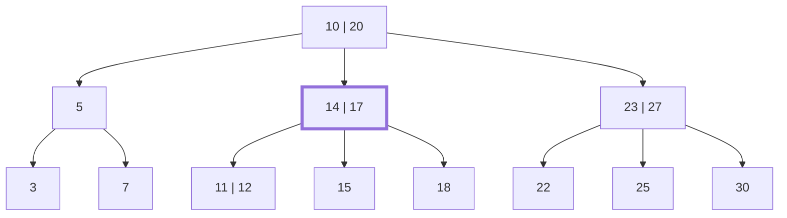


<div class="callout callout-summary" markdown="1">
<div class="callout-title callout-title--default" markdown="span">요약</div>

도서관 서가 끝의 안내판처럼, 한 칸에 기준 값을 여러 개 적어 두고 그 사이사이로 길을 가르는 나무 모양 찾아보기다. 디스크는 한 번 읽는 데 오래 걸리지만 한 번에 많이 읽을 수 있다. 그래서 칸 하나에 값을 많이 담아 두면 디스크를 두세 번만 읽고도 수억 개 가운데 하나를 찾는다. 대신 어느 칸도 너무 비거나 넘치면 안 되고 맨 아래 칸들이 모두 같은 깊이에 있어야 해서, 값을 넣고 뺄 때마다 칸을 쪼개거나 합쳐 모양을 맞춰야 한다.

</div>


## 예시로 보기

실제 데이터베이스는 주기억장치에 다 올라가지 않는다. 예를 들어 주기억장치는 64~256GB인데 하드 디스크나 SSD 같은 보조기억장치는 2~24TB다. 그래서 데이터베이스 전체는 디스크에 두고, 필요한 조각만 주기억장치로 읽어 와서(Disk-Read) 고친 뒤 다시 디스크에 쓴다(Disk-Write).

문제는 디스크가 느리다는 것이다. 하드 디스크는 원판을 돌리고 팔을 움직여야 원하는 자리를 읽는다. 이 기계 움직임 때문에 주기억장치를 읽을 때보다 10만 배쯤 오래 걸린다. 주기억장치에서 1초 걸릴 일이 하루를 넘기는 셈이다. 그래서 데이터베이스 연산이 얼마나 걸리는지는 디스크를 몇 번 읽고 쓰느냐로 거의 정해지고, 한 번 읽을 때 되도록 많이 읽어 오는 편이 낫다.

찾아보기를 이진 탐색 트리로 만들면 노드 하나에 값이 하나뿐이다. 노드를 하나 내려갈 때마다 디스크를 한 번 읽어야 한다. 균형 잡힌 이진 탐색 트리(레드-블랙 트리)로 만든 한 예에서는 맨 아래 값 하나를 찾느라 디스크를 5번 읽는다. 같은 값들을 노드 하나에 여러 개씩 담으면 같은 일을 2번에 한다. 두 경우 모두 맨 위 노드는 주기억장치에 올라와 있다고 보고 센 수다.

노드마다 값을 1,000개씩 담으면 차이가 더 커진다.

| 깊이 | 노드 수 | 담긴 값의 수 |
|---|---|---|
| 0 (맨 위) | 1 | 1,000 |
| 1 | 1,001 | 1,001,000 |
| 2 | 1,002,001 | 1,002,001,000 |

디스크를 두 번만 읽고도 10억 개가 넘는 값(모두 1,003,003,000개) 가운데 하나를 찾는다.

이렇게 노드 하나에 값을 여러 개 담는 균형 탐색 트리가 B-트리다. 찾을 때 기준으로 삼는 값을 키라고 부른다. 아래는 작은 예다.



세로줄은 한 노드 안의 키를 가르는 칸막이다. 굵은 테두리의 노드 [14 17]을 본다. 키가 2개이고 자식이 3개다. 첫째 자식 [11 12]에는 14보다 작은 키, 둘째 자식 [15]에는 14와 17 사이의 키, 셋째 자식 [18]에는 17보다 큰 키가 있다. 키 2개가 범위를 셋으로 가른다. 맨 위 노드도 같다. 5는 10보다 작고, 14와 17은 10과 20 사이에 있고, 23과 27은 20보다 크다.

맨 아래 노드 여덟 개는 모두 맨 위에서 두 칸 아래에 있다. 맨 위 노드를 뿌리(루트), 자식이 없는 맨 아래 노드를 잎(리프), 잎이 아닌 노드를 내부 노드라 부른다. 뿌리에서 잎까지 내려가는 칸 수가 이 트리의 높이이고, 여기서는 2다.

<div class="callout callout-check" markdown="1">
<div class="callout-title" markdown="span">검증: 위 예가 성질을 모두 지키고 높이가 2인 것, 성질을 하나씩 어긴 트리 6개를 걸러 내는 것, 키 수의 범위, 노드마다 키 1,000개일 때의 수, 카드 C2·C5 — [11_b-tree_verify.py](/Hongs_Blog/studies/database-design/code/11_b-tree_verify/)</div>

</div>


## 정의

B-트리는 디스크처럼 원하는 자리를 바로 읽을 수 있는 저장 장치에서 잘 돌도록 만든 균형 탐색 트리다. 이진 탐색 트리를 넓힌 것이라, 내부 노드 $$x$$에 키가 $$x.n$$개 있으면 자식은 $$x.n + 1$$개다. 이진 탐색 트리의 내부 노드는 키가 하나라 자식이 많아야 둘이다.

### 노드가 가진 것

노드 $$x$$마다 다음 네 가지를 적어 둔다.

| 기호 | 읽는 법과 뜻 |
|---|---|
| $$x.n$$ | 엑스 점 엔. 노드 $$x$$에 지금 들어 있는 키의 수 |
| $$x.key_1, \dots, x.key_{x.n}$$ | 키 $$x.n$$개. 작은 것부터 놓는다: $$x.key_1 \le x.key_2 \le \cdots \le x.key_{x.n}$$ |
| $$x.leaf$$ | $$x$$가 잎이면 참, 내부 노드면 거짓 |
| $$x.c_1, \dots, x.c_{x.n+1}$$ | 자식을 가리키는 포인터 $$x.n + 1$$개. 잎은 자식이 없어 이 값이 정해져 있지 않다 |

예의 [14 17]은 $$x.n = 2$$, $$x.key_1 = 14$$, $$x.key_2 = 17$$, $$x.leaf$$는 거짓이고 자식 포인터가 3개다.

### 지켜야 하는 성질

B-트리는 아래 세 가지를 모두 지켜야 한다.

1. **키가 범위를 가른다.** 노드의 키는 그 아래 서브트리에 담긴 키의 범위를 나눈다. $$k_i$$를 자식 $$x.c_i$$ 밑(그 자식이 뿌리인 서브트리)에 있는 아무 키라고 하면 다음과 같다.

   $$k_1 \le x.key_1 \le k_2 \le x.key_2 \le \cdots \le x.key_{x.n} \le k_{x.n+1}$$


   예의 뿌리에서는 $$5 \le 10 \le 14, 17 \le 20 \le 23, 27$$이다.

2. **모든 잎의 깊이가 같다.** 그 깊이가 트리의 높이 $$h$$다.

3. **키 수에 아래·위 한계가 있다.** 2 이상인 정수 $$t$$를 하나 정해 두고 최소 차수(minimum degree)라 부른다.
   - 뿌리가 아닌 노드는 키가 $$t - 1$$개 이상이다. 그래서 뿌리가 아닌 내부 노드는 자식이 $$t$$개 이상이다.
   - 트리가 비어 있지 않으면 뿌리는 키가 1개 이상이다.
   - 모든 노드는 키가 $$2t - 1$$개 이하다. 그래서 내부 노드의 자식은 $$2t$$개 이하다.
   - 키가 딱 $$2t - 1$$개인 노드를 가득 찼다(full)고 한다.

**기호로 쓰면.** 뿌리가 아닌 노드 $$x$$는 $$t - 1 \le x.n \le 2t - 1$$, 비어 있지 않은 트리의 뿌리는 $$1 \le x.n \le 2t - 1$$이다.

| $$t$$ | 뿌리가 아닌 노드의 키 수 | 뿌리가 아닌 내부 노드의 자식 수 | 가득 찬 노드 |
|---|---|---|---|
| 2 | 1~3 | 2~4 | 키 3개 |
| 3 | 2~5 | 3~6 | 키 5개 |
| 4 | 3~7 | 4~8 | 키 7개 |

위 예는 $$t = 2$$인 B-트리다. 키가 1개인 노드가 있으니 $$t = 3$$으로는 올바르지 않다.

### 한 줄로 적기

이 문서 모음에서는 트리를 한 줄로 적을 때 노드를 대괄호로 싸고, 층은 `/`로, 부모가 다른 묶음은 <code>&#124;</code>로 가른다[^s2]. 위 예는 이렇게 적는다.

```
[10 20] / [5] [14 17] [23 27] / [3] [7] | [11 12] [15] [18] | [22] [25] [30]
```

### 성질을 어기는 예

$$t = 2$$로 본다. 셋 다 B-트리가 아니다.

- 노드 [23 27 28 29]: 키가 4개라 위 한계 $$2t - 1 = 3$$을 넘는다.
- 잎 [30] 밑에 새 잎을 하나 더 매단 트리: 그 잎만 깊이가 3이라 성질 2를 어긴다. 이진 탐색 트리는 이렇게 새 잎을 달아 자라지만 B-트리는 그럴 수 없다.
- 잎 [15]에서 15를 그냥 지운 트리: 그 잎의 키가 0개라 아래 한계 $$t - 1 = 1$$에 못 미친다.

### 연산

| 연산 | 하는 일 | 시간 | 문서 |
|---|---|---|---|
| 검색 (B-Tree-Search) | 키가 있는 노드와 자리를 찾는다 | $$O(t \log_t n)$$ | [B-트리 검색](/Hongs_Blog/studies/database-design/b-tree-search/) |
| 만들기 (B-Tree-Create) | 키가 없는 잎 하나를 뿌리로 둔다 | $$O(1)$$ | [B-트리 삽입](/Hongs_Blog/studies/database-design/b-tree-insert/) |
| 삽입 (B-Tree-Insert) | 가득 찬 노드를 쪼개며 내려가 잎에 넣는다 | $$O(t \log_t n)$$ | [B-트리 노드 쪼개기](/Hongs_Blog/studies/database-design/b-tree-split-child/), [B-트리 삽입](/Hongs_Blog/studies/database-design/b-tree-insert/) |
| 삭제 | 잎에서 지우고, 모자라면 빌리거나 합친다 | $$O(t \log_t n)$$[^s3] | [B-트리 삭제](/Hongs_Blog/studies/database-design/b-tree-delete/) |

$$n$$은 트리에 담긴 키의 수다. 검색·삽입·삭제는 모두 뿌리에서 잎까지 한 줄기만 오가므로 디스크를 읽고 쓰는 횟수는 높이 $$h$$에 비례한다. 높이가 얼마나 낮은지는 [B-트리의 높이](/Hongs_Blog/studies/database-design/b-tree-height/)에 있다.

## 설계 이유

성질 3의 한계는 "노드가 너무 커지지도, 너무 작아지지도 않게" 하려는 것이다.

- **아래 한계 $$t - 1$$.** 노드가 텅텅 비어도 되면 같은 수의 키를 담는 데 노드가 많이 들고 트리가 높아진다. 노드마다 키가 $$t - 1$$개 이상이면 내부 노드마다 길이 $$t$$갈래 이상으로 갈려서, 한 층 내려갈 때마다 노드 수가 $$t$$배 이상 늘어난다. 그래서 트리가 낮다.
- **위 한계 $$2t - 1$$.** 가득 찬 노드는 가운데 키 하나를 빼면 양쪽에 $$t - 1$$개씩 남는다. $$2t - 1 = (t - 1) + 1 + (t - 1)$$이기 때문이다. 그래서 가득 찬 노드를 둘로 쪼개면 두 조각이 모두 아래 한계를 딱 지킨다.
- **뿌리는 예외.** 빈 트리에 첫 키를 넣으면 키가 1개뿐인 트리가 된다. 뿌리를 쪼갠 직후의 새 뿌리도 키가 1개다. 뿌리까지 $$t - 1$$개를 채우라고 하면 이런 트리를 만들 수 없다.

### 스스로 설명해 보기

<details class="callout callout-question" markdown="1">
<summary class="callout-title" markdown="span">1. "뿌리가 아닌 내부 노드는 자식이 $$t$$개 이상이다"는 어디서 나오는가?</summary>

뿌리가 아닌 노드는 키가 $$t - 1$$개 이상이고, 내부 노드의 자식 수는 늘 키 수보다 하나 많다. 그래서 자식은 $$(t - 1) + 1 = t$$개 이상이다.

</details>


<details class="callout callout-question" markdown="1">
<summary class="callout-title" markdown="span">2. "내부 노드의 자식은 $$2t$$개 이하다"는 어디서 나오는가?</summary>

모든 노드의 키가 $$2t - 1$$개 이하이고 자식 수는 키 수 + 1이다. 그래서 $$(2t - 1) + 1 = 2t$$개 이하다.

</details>


<details class="callout callout-question" markdown="1">
<summary class="callout-title" markdown="span">3. 가득 찬 노드를 쪼갠 두 조각이 왜 둘 다 올바른 노드인가?</summary>

가득 찬 노드의 키는 $$2t - 1$$개다. 가운데 키 하나를 부모로 올리면 $$2t - 2$$개가 남고, 이것을 반으로 나누면 $$t - 1$$개씩이다. 아래 한계가 $$t - 1$$이니 둘 다 한계를 지킨다. 위 한계 $$2t - 1$$보다도 적다.

</details>


<details class="callout callout-question" markdown="1">
<summary class="callout-title" markdown="span">이 설계의 핵심 아이디어는?</summary>

노드의 크기를 "절반 이상 차 있고, 넘치지는 않게"로 묶어 둔다. 절반 이상 차 있으니 트리가 낮고, 넘치면 정확히 절반짜리 둘로 쪼갤 수 있으니 한계를 계속 지킬 수 있다.

</details>


<details class="callout callout-question" markdown="1">
<summary class="callout-title" markdown="span">같은 생각을 쓰는 다른 상황은?</summary>

꽉 차면 크기를 두 배로 늘리는 배열도 "늘 절반 이상 차 있다"를 지킨다. 덩어리를 절반 이상 채워 두면 공간을 버리는 양이 많아야 절반이라는 점이 같다.

</details>


## 활용

- **노드 하나가 디스크 페이지 하나다.** 새 노드를 만들 때 디스크 공간, 곧 디스크 페이지 하나를 받아 노드로 쓴다. 한 번의 디스크 읽기로 노드 하나의 키를 모두 가져오므로, $$x.n$$개의 키와 견주어 $$x.n + 1$$갈래 가운데 한 길을 고른다.
- **뿌리는 주기억장치에 둔다.** 위에서 센 디스크 읽기 횟수는 뿌리가 이미 주기억장치에 있다고 보고 센 것이다.
- **쓰이는 곳.** 많은 데이터베이스 시스템이 B-트리나 그 변형을 쓴다. 변형으로 B+-트리와 B*-트리가 있다.
- **3단계 스키마와의 자리.** 데이터를 디스크에 어떻게 놓고 어떤 길로 찾아갈지 적는 것이 내부 스키마이고, 그 목표가 디스크 읽고 쓰기를 줄이는 것이다. B-트리가 그 답 가운데 하나다: [3단계 스키마 구조](/Hongs_Blog/studies/database-design/three-schema-architecture/).
- **다른 구조와 견주면.** 이진 탐색 트리는 노드가 작고 절차가 간단하지만 디스크에서는 노드를 여럿 읽어야 한다. B-트리는 디스크를 덜 읽는 대신, 넣고 뺄 때 노드를 쪼개고 합치는 절차가 더 복잡하다: [B-트리와 이진 탐색 트리 비교](/Hongs_Blog/studies/database-design/b-tree-vs-bst/)
- **흔한 실수.** 최소 차수 $$t$$를 키 수의 아래 한계로 읽는다(아래 한계는 $$t - 1$$이다). 높이를 층의 수로 센다(세 층짜리 예의 높이는 2다).
- 연습: [B-트리 연습](/Hongs_Blog/studies/database-design/b-tree-practice/)

## 연결

- 선수: [트리](/Hongs_Blog/studies/discrete-math/trees/)(뿌리, 잎, 깊이, 높이), [트리 순회와 이진 탐색 트리](/Hongs_Blog/studies/algorithms/tree-traversal-bst/)(왼쪽은 작고 오른쪽은 크다는 규칙)
- 이진 탐색 트리와 무엇이 다른가: [B-트리와 이진 탐색 트리 비교](/Hongs_Blog/studies/database-design/b-tree-vs-bst/)
- 디스크가 느린 까닭: [디스크 스케줄링](/Hongs_Blog/studies/operating-systems/disk-scheduling/). 파일의 레코드를 찾는 색인: [파일 조직](/Hongs_Blog/studies/operating-systems/file-organization/). 레코드를 블록에 담기: [레코드 블로킹](/Hongs_Blog/studies/operating-systems/record-blocking/)
- 같은 낱말, 다른 뜻: 표에서 행을 가려내는 "키"는 [슈퍼키·후보 키·기본 키](/Hongs_Blog/studies/database-design/relational-keys/)에 있다.

## 자주 하는 오해

<div class="callout callout-misconception" markdown="1">
<div class="callout-title" markdown="span">"최소 차수 $$t$$는 노드 하나에 들어가는 키의 최소 개수다"</div>

틀렸다. $$t$$는 뿌리가 아닌 내부 노드가 가져야 하는 자식 수의 아래 한계다. 키 수의 아래 한계는 그보다 하나 적은 $$t - 1$$이다. 이름에 "최소"가 붙어 있고 노드 그림에는 키만 보여서 키 수로 읽기 쉽다. $$t = 3$$이면 키는 2~5개, 자식은 3~6개다. 확인하는 법: 키가 $$n$$개인 내부 노드는 범위를 $$n + 1$$개로 가르므로 자식이 $$n + 1$$개다. 자식이 적어도 $$t$$개이려면 키는 $$t - 1$$개면 된다.

</div>


## 확인 문제

<details class="callout callout-question" markdown="1">
<summary class="callout-title" markdown="span">**C1** 최소 차수가 $$t$$인 B-트리가 지켜야 하는 성질 세 가지를 쓰라. 키 수의 한계는 뿌리와 뿌리가 아닌 노드를 나눠 적는다.</summary>

**답:** ① 노드의 키는 정렬되어 있고, 자식 서브트리에 담긴 키의 범위를 가른다($$k_1 \le x.key_1 \le k_2 \le \cdots \le x.key_{x.n} \le k_{x.n+1}$$). ② 모든 잎의 깊이가 같다. ③ 뿌리가 아닌 노드는 키가 $$t - 1$$개 이상 $$2t - 1$$개 이하, 비어 있지 않은 트리의 뿌리는 1개 이상 $$2t - 1$$개 이하다.<br>
**이유:** 흔한 오답은 아래 한계를 $$t$$로 적는 것이다. $$t$$는 자식 수의 아래 한계다.

</details>


<details class="callout callout-question" markdown="1">
<summary class="callout-title" markdown="span">**C2** $$t = 2$$일 때 다음 가운데 B-트리가 아닌 것을 고르고 이유를 대라. (가) `[10 20] / [5] [12 15 17 18] [25]` (나) 뿌리 [10]의 왼쪽 자식이 잎 [5]이고, 오른쪽 자식 [20]이 다시 잎 [15]와 [25]를 자식으로 둔 트리 (다) `[10 20] / [5] [15] [25 30 35]`</summary>

**답:** (가)와 (나)가 아니다. (가)는 잎 하나에 키가 4개라 위 한계 3을 넘는다. (나)는 잎의 깊이가 1과 2로 다르다. (다)는 올바르다.<br>
**이유:** (다)의 잎 [25 30 35]는 키가 3개라 가득 찼지만 한계 안이다. 가득 찬 것과 넘친 것은 다르다.

</details>


<details class="callout callout-question" markdown="1">
<summary class="callout-title" markdown="span">**C3** 키 수의 아래 한계에서 뿌리만 빼 주는 까닭은?</summary>

**답:** 뿌리까지 $$t - 1$$개 이상을 채우라고 하면 키가 그보다 적은 트리를 만들 수 없다. 빈 트리에 첫 키를 넣은 직후에는 키가 1개뿐이고, 가득 찬 뿌리를 쪼갠 직후의 새 뿌리도 키가 1개다.<br>
**이유:** 뿌리는 하나뿐이라 뿌리 하나가 덜 차 있어도 트리 높이에는 거의 영향이 없다.

</details>


<details class="callout callout-question" markdown="1">
<summary class="callout-title" markdown="span">**C4** "B-트리의 키"와 "릴레이션의 키"는 같은 것인가?</summary>

**답:** 다르다. B-트리의 키는 노드에 들어 있는, 찾을 때 크기를 견주는 값이다. 릴레이션의 키는 표의 행 하나를 다른 행과 가려내는 열의 묶음이다([슈퍼키·후보 키·기본 키](/Hongs_Blog/studies/database-design/relational-keys/)).<br>
**이유:** 한쪽은 "값", 다른 쪽은 "열의 묶음"이다. 기본 키의 값을 B-트리의 키로 넣어 색인을 만들 수는 있지만 두 낱말이 같은 것을 가리키지는 않는다.

</details>


<details class="callout callout-question" markdown="1">
<summary class="callout-title" markdown="span">**C5** 예시 트리에 16이 들어 있다면 어느 잎에 있어야 하는가? 뿌리부터 지나는 노드를 차례로 적어라.</summary>

**답:** [10 20] → [14 17] → [15]. 16은 10과 20 사이라 뿌리의 둘째 자식으로, 다시 14와 17 사이라 그 노드의 둘째 자식 [15]로 간다.<br>
**이유:** 키가 범위를 가른다는 성질 1을 위에서부터 두 번 쓴 것이다.

</details>


<details class="callout callout-question" markdown="1">
<summary class="callout-title" markdown="span">**C6** $$t = 3$$인 B-트리에서 뿌리가 아닌 내부 노드의 키 수와 자식 수는 각각 몇 개부터 몇 개까지인가? 키가 4개인 잎은 가득 찼는가?</summary>

**답:** 키 2~5개, 자식 3~6개. 키 4개는 가득 차지 않았다. 가득 찬 노드는 키가 $$2t - 1 = 5$$개다.

</details>


[^s2]: 층마다 노드를 왼쪽부터 적으면 키 수 + 1이 자식 수라서 트리의 모양이 하나로 정해진다.
[^s3]: 지울 키를 찾아 내려가는 길과 고치며 올라오는 길이 각각 노드 $$h + 1$$개 이하이고 노드 하나에서 하는 일이 $$O(t)$$라는 데서 나온다.

