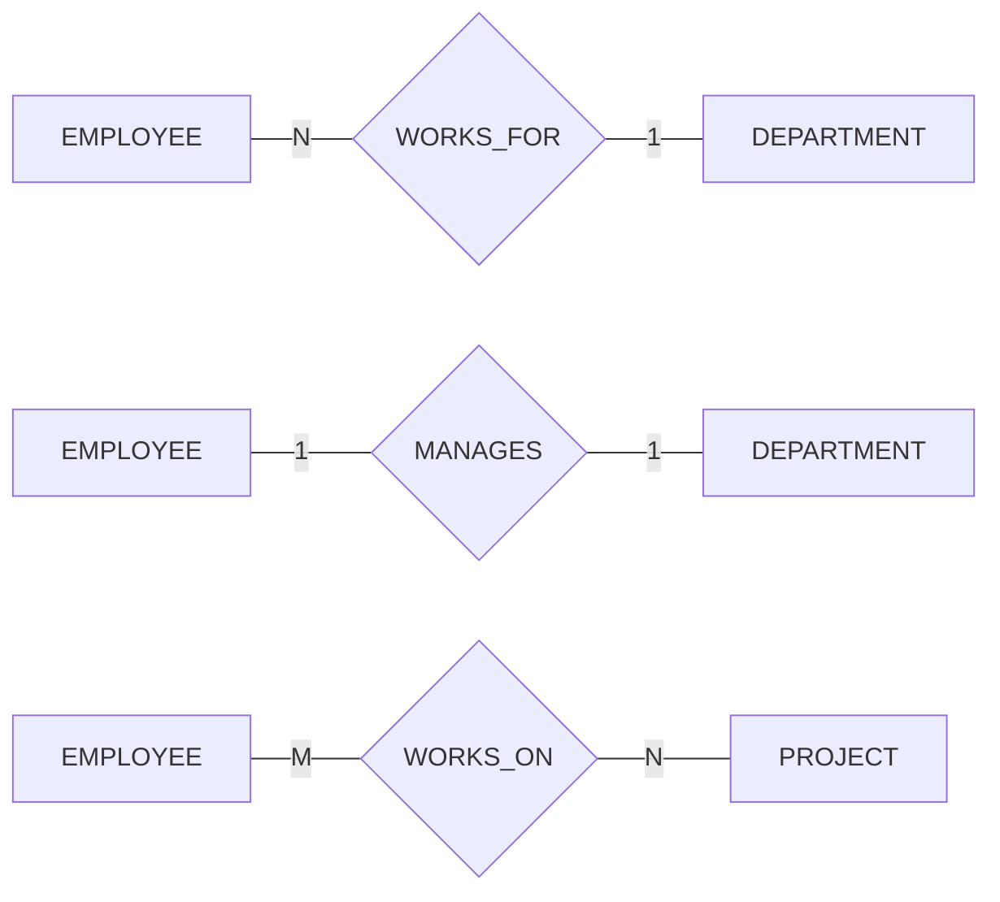



요약

한 대상이 동시에 몇 곳에 이어질 수 있는지를 정하는 규칙이다. 반 배정은 학생 한 명이 한 반에만 들어가고, 수강 신청은 학생도 과목을 여럿 듣고 과목에도 학생이 여럿이다. 이 차이에 따라 나중에 표를 만드는 방법이 통째로 달라진다. 이 규칙은 "많아야 몇"만 정하고 "적어도 하나"는 정하지 않으며, 지금 자료를 보고 알아내는 것이 아니라 현실에서 무엇이 허용되는지를 묻고 정한다.

## 예시로 보기

"직원과 부서를 잇는다"는 것만 정해서는 부족하다. 직원이 두 부서에 동시에 속해도 되는지를 정해 두지 않으면, 한 직원에 부서 둘이 적힌 자료가 들어와도 막을 근거가 없다.

세 관계 타입의 인스턴스를 개체와 개체 사이의 선으로 그린 뒤, 개체 하나가 선 몇 개에 닿는지 세면 이렇다.

| 관계 타입 | 왼쪽 개체 | 오른쪽 개체 | 비율 |
|---|---|---|---|
| WORKS_FOR | 직원은 모두 선이 하나씩이다 | $$d_1$$에는 선이 셋이다($$e_1, e_3, e_6$$) | 부서 1 : 직원 N |
| MANAGES | 직원은 선이 많아야 하나다($$e_3, e_5, e_6$$만 닿는다) | 부서도 선이 하나씩이다 | 1 : 1 |
| WORKS_ON | $$e_2$$는 선이 둘이다($$p_1, p_4$$) | $$p_1$$에도 선이 둘이다($$e_1, e_2$$) | M : N |

ER 다이어그램에는 마름모 양쪽 선에 숫자를 적는다[^s1].

검증: 세 관계에서 개체가 닿는 선의 수, WORKS_ON이 어느 쪽을 1로 잡아도 1:N 규칙에 어긋나는 것, 1:1에 맞는 자료는 1:N·M:N 규칙에도 맞는 것, COMPANY 자료의 WORKS_ON 16줄(한 직원 최대 4개, 한 프로젝트 최대 3명) — [24_cardinality-ratio_verify.py](/Hongs_Blog/studies/database-design/code/24_cardinality-ratio_verify/)

## 정의

관계 타입에는 참여하는 개체에 대한 제약이 붙는다. 예를 들어 "직원은 꼭 한 부서에서만 일한다"는 회사 규칙이 그렇다. 제약은 두 가지이고, 카디널리티 비율이 그 첫째다. 둘째는 [참여 제약](/Hongs_Blog/studies/database-design/participation-constraint/)이다.

이항 관계 타입의 카디널리티 비율은 개체 하나가 참여할 수 있는 관계 인스턴스의 최대 개수를 정한다. 종류는 셋이다.

| 비율 | 뜻 | 예 |
|---|---|---|
| 1:1 | 양쪽 개체 모두 인스턴스 하나에만 낄 수 있다 | MANAGES. 직원은 부서를 많아야 하나 관리하고, 부서의 관리자는 많아야 한 명이다 |
| 1:N | 1쪽 개체 하나에 N쪽 개체가 몇 개든 이어진다. N쪽 개체는 1쪽 개체 하나에만 이어진다 | WORKS_FOR. 부서에는 직원이 몇 명이든 있고, 직원은 많아야 한 부서에서 일한다 |
| M:N | 양쪽 개체 모두 인스턴스 여러 개에 낄 수 있다 | WORKS_ON. 직원은 프로젝트를 몇 개든 맡고, 프로젝트에도 직원이 몇 명이든 있다 |

1:N을 뒤집어 적으면 N:1이다. 같은 규칙이고 쓰는 순서만 다르다.

**어느 쪽이 N인가.** WORKS_FOR에서는 EMPLOYEE를 N쪽 개체(N-side entity), DEPARTMENT를 1쪽 개체(1-side entity)라고 부른다. 읽는 법은 이렇다.

- N쪽은 여럿이 모이는 쪽이다. 한 부서에 직원 N명이 모인다. 그래서 EMPLOYEE가 N쪽이다.
- N쪽 개체 하나를 붙잡고 보면 상대는 많아야 하나다. 직원 한 명의 부서는 하나다.
- 그림에서 EMPLOYEE 옆에 N, DEPARTMENT 옆에 1을 적는다. 어떤 개체 타입 옆의 글자는 "상대편 개체 하나에 이쪽 개체가 몇 개까지 붙는가"다.

## 활용

- 비율은 현실의 규칙(real-world constraints)에서 나온다. MANAGES를 1:1로 정하는 근거는 직원은 부서를 많아야 하나 관리하고, 부서의 관리자는 많아야 한 명이라는 두 규칙이다.
- 자료만 보고는 비율을 정하지 못한다. 위 표의 MANAGES 인스턴스 세 개는 1:1 규칙에도, 1:N 규칙에도, M:N 규칙에도 어긋나지 않는다. 자료가 알려 주는 것은 "이 규칙은 아니다"뿐이다. WORKS_ON에서는 $$e_2$$가 프로젝트 둘에 닿아 "직원 한 명에 프로젝트 하나" 규칙이 아님을 보인다[^s2].
- 흔한 실수: N을 적는 쪽을 뒤집는 것. "부서 하나에 직원 여럿이니 부서 옆에 N"이라고 적으면 틀린다. N은 여럿이 모이는 쪽인 EMPLOYEE 옆에 적는다.
- 표로 옮기는 법이 비율마다 다르다. 1:N이면 N쪽 표에 1쪽을 가리키는 열을 넣고, M:N이면 표를 따로 만든다: [일대일 관계 타입의 사상](/Hongs_Blog/studies/database-design/mapping-one-to-one-relationship/), [일대다 관계 타입의 사상](/Hongs_Blog/studies/database-design/mapping-one-to-many-relationship/), [다대다·n항 관계 타입의 사상](/Hongs_Blog/studies/database-design/mapping-many-to-many-relationship/)

## 연결

- 비율은 "많아야 몇"만 정한다. "적어도 하나"는 [참여 제약](/Hongs_Blog/studies/database-design/participation-constraint/)이 정한다. 둘을 합쳐 관계 타입의 구조 제약이라 부른다.
- 같은 내용을 숫자 두 개로 더 자세히 적는 표기: [(min, max) 표기](/Hongs_Blog/studies/database-design/min-max-notation/). 숫자가 놓이는 쪽이 여기와 반대다.
- 1:N 관계에서 N쪽 개체마다 상대가 많아야 하나라는 것은, N쪽에서 1쪽으로 가는 함수의 모양이다. 1:1이면 서로 다른 개체가 같은 상대로 가지 않는다(단사): [함수의 성질과 집합의 크기](/Hongs_Blog/studies/discrete-math/function-properties/)[^s2]
- 상식으로 비율을 정해 보는 연습: [ER 모델 연습](/Hongs_Blog/studies/database-design/er-model-practice/)

## 확인 문제

**C1** "부서 하나는 프로젝트를 여러 개 관리할 수 있다. 프로젝트 하나는 한 부서만 관리한다." CONTROLS의 비율을 쓰고, ER 다이어그램에서 1과 N을 어느 개체 타입 옆에 적는지 쓰라.

**답:** DEPARTMENT : PROJECT = 1 : N이다. DEPARTMENT 옆에 1, PROJECT 옆에 N을 적는다. 
**이유:** 여럿이 모이는 쪽이 N쪽이다. 한 부서 아래에 프로젝트 여럿이 모이므로 PROJECT가 N쪽이다. PROJECT 하나를 붙잡고 보면 상대(부서)는 하나뿐이다. 흔한 오답은 "부서가 여러 개를 관리하니 부서 옆에 N"이다.

**C2** WORKS_ON의 인스턴스가 $$(e_1, p_1)$$, $$(e_2, p_1)$$, $$(e_2, p_4)$$, $$(e_3, p_2)$$, $$(e_3, p_3)$$, $$(e_3, p_4)$$, $$(e_4, p_3)$$의 일곱 개다. WORKS_ON을 "직원 N : 프로젝트 1"(직원은 프로젝트 하나만)이라고 정했다고 하자. 이 인스턴스들에서 규칙을 어기는 개체를 찾으라. 거꾸로 "직원 1 : 프로젝트 N"(프로젝트에는 직원 한 명만)이라고 정하면 무엇이 어기는가?

**답:** 앞의 규칙은 $$e_2$$가 어긴다($$p_1$$, $$p_4$$ 두 프로젝트). $$e_3$$도 어긴다($$p_2$$, $$p_3$$, $$p_4$$). 뒤의 규칙은 $$p_1$$이 어긴다(직원 $$e_1$$, $$e_2$$). $$p_3$$, $$p_4$$도 직원이 둘씩이다. 
**이유:** 어느 쪽을 1로 잡아도 어기는 개체가 있으므로 이 자료는 M:N 규칙에만 맞는다. 자료는 이렇게 "이 비율은 아니다"의 증거가 된다.

**C3** "직원은 정확히 한 부서에서 일한다"를 두 문장으로 쪼개라. 어느 문장이 카디널리티 비율이고 어느 문장이 아닌가?

**답:** ① 직원은 많아야 한 부서에서 일한다. ② 직원은 적어도 한 부서에서 일한다. ①이 카디널리티 비율(부서 1 : 직원 N)이다. ②는 참여 제약(EMPLOYEE의 전체 참여)이다. 
**이유:** 비율은 위 한계만 정한다. 1:N이라고만 해서는 부서가 없는 직원을 막지 못한다. 흔한 오답은 "1:N의 1이 '정확히 하나'를 뜻한다"고 읽는 것이다.

[^s1]: 겹선(전체 참여)과 속성은 뺐다.
[^s2]: 그림에서 읽은 선과 "어긋난다, 맞는다"의 판정은 검증 코드로 확인했다.

