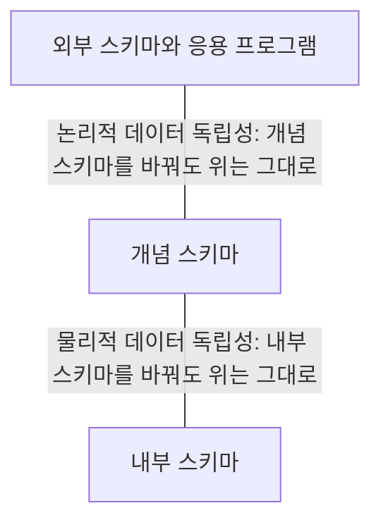


<div class="callout callout-summary" markdown="1">
<div class="callout-title callout-title--default" markdown="span">요약</div>

건물의 배관을 새로 깔아도 방 안의 수도꼭지는 그대로 쓰는 것과 같다. 데이터베이스를 세 층으로 갈라 두면 아래층의 설명을 바꿔도 위층의 설명과 그 위에서 도는 프로그램을 안 고쳐도 된다. 표를 늘리거나 칸을 더하는 변화를 견디는 것과, 찾는 길을 새로 내는 것처럼 저장 방법만 바꾸는 변화를 견디는 것 두 가지가 있다. 다만 프로그램이 쓰던 데이터를 아예 빼 버리는 변화까지 막아 주지는 않고, 층과 층을 잇는 설명은 고쳐 적어야 한다.

</div>


## 예시로 보기

대학 데이터베이스 하나를 성적표 프로그램, 수강신청 프로그램, 통계 프로그램이 함께 쓴다. 찾기를 빠르게 하려고 색인을 하나 달 때마다, 학생 표에 칸을 하나 더할 때마다 이 프로그램들을 모두 고쳐야 한다면 아무도 데이터베이스에 손을 대지 못한다.

성적표 프로그램이 DBMS에 보내는 요청은 이 한 문장이다.

```sql
SELECT Course_number, Grade, Semester, Year, Section_id
FROM TRANSCRIPT
WHERE Student_name = 'Smith'
ORDER BY Section_id;
```

"TRANSCRIPT에서 Smith의 줄을 분반 번호 순으로 달라"는 뜻이다. SQL이라는 언어의 문법은 [SELECT-FROM-WHERE](/Hongs_Blog/studies/database-design/select-from-where/)에서 배운다. 지금 볼 것은 프로그램이 TRANSCRIPT라는 이름과 그 칸 이름만 안다는 점이다. TRANSCRIPT는 저장된 표가 아니라 STUDENT, GRADE_REPORT, SECTION을 이어 보여 주는 뷰다. 3단계로 말하면 성적표 프로그램의 외부 스키마다.

이 문장을 한 글자도 고치지 않은 채 데이터베이스를 다섯 번 바꿨다[^s1].

| 차례 | 데이터베이스에 한 일 | 바뀐 스키마 | 사람이 고친 것 | 성적표 프로그램 |
|---|---|---|---|---|
| 1 | SECTION에 학기와 연도로 찾는 색인을 단다 | 내부 | 없음 | 그대로 |
| 2 | STUDENT에 Date_of_birth 칸을 더한다 | 개념 | 없음 | 그대로 |
| 3 | 새 표 DEPARTMENT를 더한다 | 개념 | 없음 | 그대로 |
| 4 | GRADE_REPORT에 이름과 과목 번호 칸을 넣어 표의 모양을 바꾼다 | 개념 | TRANSCRIPT의 정의 | 그대로 |
| 5 | 성적표가 쓰지 않는 Instructor 칸을 SECTION에서 뺀다 | 개념 | 없음 | 그대로 |

다섯 번 모두 Smith의 성적표는 (MATH2410, B, Fall, 08, 112)와 (CS1310, C, Fall, 08, 119) 두 줄이다.

1번에서 달라진 것은 DBMS가 일하는 방법뿐이다. "2008년 가을에 열린 분반"을 찾는 질의를 색인을 달기 전에는 SECTION의 여섯 행을 모두 훑어서 처리했다. 색인을 단 뒤에는 색인으로 바로 찾아간다. 답은 두 번 다 112, 119, 135다[^s1].

4번에서는 고친 것이 하나 있다. TRANSCRIPT가 이름과 과목 번호를 어느 표에서 가져오는지 적은 정의다. 프로그램이 보낸 문장은 그대로다.

<div class="callout callout-check" markdown="1">
<div class="callout-title" markdown="span">검증: 위 다섯 변화마다 성적표 프로그램의 문장과 결과가 그대로임, 색인 전후의 실행 계획(전부 훑기 → 색인 찾기)과 답 112·119·135, 프로그램이 쓰는 표를 없애면 오류, 칸 수에 기대는 프로그램은 칸 하나에 깨짐, 카드 C2 — [08_data-independence_verify.py](/Hongs_Blog/studies/database-design/code/08_data-independence_verify/)</div>

</div>


## 정의

데이터 독립성은 데이터베이스 시스템의 어느 한 단계에서 스키마를 바꿔도 바로 위 단계의 스키마를 바꾸지 않아도 되는 능력이다. 단계가 셋이라 경계가 둘이고, 독립성도 둘이다.



<div class="callout callout-definition" markdown="1">
<div class="callout-title" markdown="span">논리적 데이터 독립성 (logical data independence)</div>

외부 스키마나 응용 프로그램을 바꾸지 않고 개념 스키마를 바꿀 수 있는 능력이다. 외부 스키마를 쓰는 기존 응용 프로그램을 다시 짤 필요가 없다.

</div>


<div class="callout callout-definition" markdown="1">
<div class="callout-title" markdown="span">물리적 데이터 독립성 (physical data independence)</div>

개념 스키마를 바꾸지 않고 내부 스키마를 바꿀 수 있는 능력이다. 개념 스키마가 그대로이니 외부 스키마도 그대로다. 외부 스키마를 쓰는 기존 응용 프로그램을 다시 짤 필요가 없다.

</div>


| | 논리적 데이터 독립성 | 물리적 데이터 독립성 |
|---|---|---|
| 바뀌는 스키마 | 개념 스키마 | 내부 스키마 |
| 그대로인 것 | 외부 스키마, 응용 프로그램 | 개념 스키마, 외부 스키마, 응용 프로그램 |
| 바꾸는 까닭 | 레코드 종류나 데이터 항목을 더해 데이터베이스를 넓힌다. 제약을 바꾼다. 레코드 종류나 데이터 항목을 빼서 데이터베이스를 줄인다 | 찾기나 고치기의 성능을 높이려고 색인 같은 접근 구조를 더 만든다 |
| 고쳐야 하는 것 | 뷰의 정의와 외부/개념 사상 | 개념/내부 사상[^s2] |
| 예시의 차례 | 2, 3, 4, 5 | 1 |

같은 내용을 한 줄로 묶으면, 개념 스키마나 내부 스키마를 바꾸는 일은 넷이다. 레코드 종류나 데이터를 더한다, 제약을 고친다, 레코드 종류나 데이터를 뺀다, 새 접근 경로를 만든다. 앞의 셋은 개념 스키마의 변화이고 넷째는 내부 스키마의 변화다.

### 왜 프로그램을 안 고쳐도 되는가

1. 프로그램은 자기 단계의 이름만 쓴다. 성적표 프로그램의 문장에는 TRANSCRIPT와 그 칸 이름만 있고, GRADE_REPORT도 색인도 나오지 않는다.
2. DBMS는 요청을 받을 때마다 사상을 보고 그 요청을 아래 단계의 요청으로 옮긴다. 사상은 프로그램이 아니라 DBMS의 카탈로그에 적혀 있다[^s2].
3. 아래 단계의 스키마를 바꾸면 사상을 새 스키마에 맞게 고친다. 위 단계의 스키마는 그대로 둔다.
4. 그래서 프로그램이 보낸 문장은 그대로이고, DBMS가 그 문장을 옮긴 결과만 달라진다.

### 스스로 설명해 보기

<details class="callout callout-question" markdown="1">
<summary class="callout-title" markdown="span">1. 예시의 4번에서 GRADE_REPORT의 모양이 바뀌었는데 성적표 프로그램은 왜 깨지지 않았는가? 위 네 줄 가운데 어느 줄이 받쳐 주는가?</summary>

1번 줄과 3번 줄이다. 프로그램의 문장에는 GRADE_REPORT가 없다. TRANSCRIPT의 정의가 "이름은 STUDENT에서, 과목 번호는 SECTION에서"에서 "둘 다 GRADE_REPORT에서"로 고쳐졌고, TRANSCRIPT가 내놓는 칸 여섯 개는 전과 같다.

</details>


<details class="callout callout-question" markdown="1">
<summary class="callout-title" markdown="span">2. 예시의 1번에서는 사람이 고친 것이 아예 없다. 색인을 쓰라고 아무도 말하지 않았는데 DBMS는 어떻게 색인으로 찾았는가?</summary>

2번 줄이다. 색인을 만들면 DBMS가 그 사실을 카탈로그에 적어 둔다. 요청을 아래 단계로 옮길 때마다 카탈로그를 보므로, 다음 요청부터는 색인이 있는 것을 알고 그 길을 고른다. 어느 길로 찾을지는 프로그램이 아니라 DBMS가 정한다[^s2].

</details>


<details class="callout callout-question" markdown="1">
<summary class="callout-title" markdown="span">3. 이 논증의 핵심 아이디어는 무엇인가?</summary>

한 다리 건너기다. 프로그램과 저장 구조 사이에 이름과 사상을 끼워 두면, 아래에서 생긴 변화가 사상 한곳에 갇힌다. 사상만 고치면 그 위는 변화가 있었는지도 모른다.

</details>


<details class="callout callout-question" markdown="1">
<summary class="callout-title" markdown="span">4. 같은 생각을 쓰는 다른 상황은?</summary>

[데이터베이스 방식의 네 가지 특징](/Hongs_Blog/studies/database-design/database-approach-characteristics/)의 자리표가 같은 생각이다. 자리 번호를 프로그램 밖에 두면 레코드 모양이 바뀌어도 프로그램은 그대로다. 프로그래밍에서 함수의 이름과 매개변수는 그대로 두고 안쪽 구현만 바꾸는 것도 같다.

</details>


### 데이터 독립성인 것과 아닌 것

데이터 독립성이 지켜 주는 변화[^s1].

- 색인을 달거나 뗀다. 내부 스키마가 바뀌고, 개념 스키마와 프로그램은 그대로다(물리적).
- 표에 칸을 더하거나 새 표를 더한다. 개념 스키마가 넓어지고, 외부 스키마와 프로그램은 그대로다(논리적).
- 표의 모양을 바꾸고 뷰의 정의를 거기에 맞춘다. 외부 스키마와 프로그램은 그대로다(논리적).

지켜 주지 못하는 변화[^s1].

- **프로그램이 쓰는 데이터를 뺀다.** 선수 과목을 보여 주는 프로그램이 쓰는 PREREQUISITE 표를 없애면 그 프로그램은 "그런 표가 없다"는 오류를 낸다. 데이터베이스를 줄일 때 영향을 받지 않는 것은 남아 있는 데이터만 쓰는 외부 스키마뿐이다[^s3].
- **프로그램이 자기 단계의 이름으로 묻지 않는다.** STUDENT의 모든 칸을 통째로 받아 "칸이 넷"이라고 믿고 나눠 쓰는 프로그램은 Date_of_birth 칸 하나를 더하자 깨진다. 위 논증의 1번 줄을 어겼기 때문이다.

두 독립성 가운데 논리적 데이터 독립성이 더 이루기 어렵다. 저장 방법만 바뀌는 것과 달리, 구조와 제약이 바뀌는데도 프로그램이 멀쩡해야 하기 때문이다[^s3].

## 활용

- 데이터 독립성은 DBMS의 가장 중요한 특징 가운데 하나다. 기존 응용 프로그램을 유지하는 부담을 크게 줄여 준다. 응용 프로그램이 여럿이어도 다시 짤 필요가 없다.
- 찾기가 느릴 때 색인을 다는 일은 프로그램을 고치지 않고 한다. 예시의 1번이 그 일이다. 색인으로 쓰는 구조가 [B-트리](/Hongs_Blog/studies/database-design/b-tree/)다.
- 칸을 더하는 SQL 문장은 [ALTER TABLE](/Hongs_Blog/studies/database-design/sql-alter-table/), 외부 스키마를 만드는 SQL 문장은 [뷰](/Hongs_Blog/studies/database-design/sql-view/)에서 다룬다.
- 흔한 실수: 프로그램에서 표의 모든 칸을 통째로 받아 칸의 수와 순서에 기대는 것. 필요한 칸을 이름으로 적어야 칸이 늘어도 버틴다[^s1].

## 연결

- 선수: [3단계 스키마 구조](/Hongs_Blog/studies/database-design/three-schema-architecture/). 독립성이 생기는 두 경계가 이 구조의 두 사상이다.
- 같은 성질을 단계 구분 없이 말한 것: [데이터베이스 방식의 네 가지 특징](/Hongs_Blog/studies/database-design/database-approach-characteristics/)의 프로그램-데이터 독립성
- 바뀌는 것과 그대로인 것의 구분: [스키마와 인스턴스](/Hongs_Blog/studies/database-design/schema-and-instance/)

## 자주 하는 오해

<div class="callout callout-misconception" markdown="1">
<div class="callout-title" markdown="span">"논리적 데이터 독립성은 개념 스키마를 지켜 주는 성질이고, 물리적 데이터 독립성은 내부 스키마를 지켜 주는 성질이다"</div>

틀렸다. 이름에 붙은 낱말은 지켜지는 쪽이 아니라 바뀌는 쪽을 가리킨다. 논리적 데이터 독립성은 논리 구조를 적은 개념 스키마를 바꾸는 능력이고, 물리적 데이터 독립성은 물리 구조를 적은 내부 스키마를 바꾸는 능력이다. 지켜지는 쪽은 늘 그 한 단계 위다. 그럴듯해 보이는 까닭은 "독립"이라는 말에서 이름 붙은 것이 보호받는다고 읽기 쉽기 때문이다. 그렇게 읽으면 두 정의가 서로 뒤바뀐다. "내부 스키마를 바꿔도 개념 스키마는 그대로"는 물리적 데이터 독립성인데 이것을 논리적이라 답하게 된다. 확인하는 법: 변화 하나를 놓고 "무엇의 설명이 바뀌었나"를 먼저 묻는다. 색인을 달았으면 저장 방법의 설명(내부 스키마)이 바뀐 것이니 물리적이다. 칸을 더했으면 표의 설명(개념 스키마)이 바뀐 것이니 논리적이다.

</div>


## 확인 문제

<details class="callout callout-question" markdown="1">
<summary class="callout-title" markdown="span">**C1** 데이터 독립성의 정의를 쓰고, 두 종류가 각각 어느 스키마를 바꾸고 무엇을 그대로 두는지 말하라.</summary>

**답:** 한 단계의 스키마를 바꿔도 바로 위 단계의 스키마를 바꾸지 않아도 되는 능력이다. 논리적 데이터 독립성은 개념 스키마를 바꾸되 외부 스키마와 응용 프로그램을 그대로 둔다. 물리적 데이터 독립성은 내부 스키마를 바꾸되 개념 스키마(따라서 외부 스키마와 응용 프로그램도)를 그대로 둔다.<br>
**흔한 오답:** 두 이름을 서로 바꿔 답하는 것. 이름의 낱말은 바뀌는 쪽이다.

</details>


<details class="callout callout-question" markdown="1">
<summary class="callout-title" markdown="span">**C2** 다음 네 변화가 있어도 응용 프로그램을 안 고친다면 각각 어느 데이터 독립성인가? (a) 새 레코드 종류나 데이터 항목을 더한다 (b) 제약을 고친다 (c) 레코드 종류나 데이터 항목을 뺀다 (d) 새 접근 경로를 만든다</summary>

**답:** (a), (b), (c)는 논리적 데이터 독립성, (d)는 물리적 데이터 독립성.<br>
**이유:** (a)~(c)는 무엇을 어떤 구조와 규칙으로 담는지, 곧 개념 스키마를 바꾼다. (d)는 같은 데이터를 찾아가는 길, 곧 내부 스키마만 바꾼다.

</details>


<details class="callout callout-question" markdown="1">
<summary class="callout-title" markdown="span">**C3** 개념 스키마를 바꿨을 때 "뷰의 정의와 사상만 고치면 된다"고 한다. 응용 프로그램은 왜 안 고쳐도 되는가?</summary>

**답:** 응용 프로그램은 외부 스키마의 이름으로만 요청하고, DBMS가 요청을 받을 때마다 사상을 보고 개념 스키마에 대한 요청으로 옮기기 때문이다. 개념 스키마가 바뀌면 옮기는 규칙(사상)을 새 스키마에 맞추면 되고, 외부 스키마의 이름과 칸은 그대로라서 프로그램이 보낸 문장도 그대로 통한다.<br>
**이유:** 예시의 4번에서 GRADE_REPORT의 모양이 바뀌었지만 TRANSCRIPT의 정의만 고쳤고, 성적표 프로그램의 문장과 결과는 같았다.

</details>


<details class="callout callout-question" markdown="1">
<summary class="callout-title" markdown="span">**C4** 데이터 독립성을 지원하는 DBMS인데도 스키마를 바꾸자 응용 프로그램이 깨지는 예를 하나 만들고, 왜 정의에 어긋나지 않는지 말하라.</summary>

**답:** 선수 과목 프로그램이 쓰는 PREREQUISITE 표를 없앤다. 프로그램은 "그런 표가 없다"는 오류를 낸다.<br>
**이유:** 데이터 독립성은 프로그램이 쓰는 데이터가 남아 있을 때의 약속이다. 없어진 데이터를 사상으로 만들어 낼 수는 없다. 같은 변화에도 남은 데이터만 쓰는 성적표 프로그램은 멀쩡하다. 다른 예로, 표의 모든 칸을 통째로 받아 칸의 수에 기대는 프로그램은 칸 하나를 더하면 깨진다. 이 프로그램은 외부 스키마의 이름으로 묻지 않았다[^s1].

</details>


[^s1]: 4번 변화는 Elmasri & Navathe, *Fundamentals of Database Systems* 7판 2.2.2절이 논리적 데이터 독립성의 예로 드는 것과 같다. 색인을 다는 문장 CREATE INDEX는 제품마다 있지만 표준 SQL에는 없다. 실행 계획의 글귀는 SQLite 3.50.4에서 `SCAN SECTION`과 `SEARCH SECTION USING INDEX SECTION_SEM_YEAR (Semester=? AND Year=?)`였다.
[^s2]: 같은 교재 2.2.2절을 따랐다. 교재는 어느 단계의 스키마가 바뀌든 그 단계와 위 단계 사이의 사상만 바뀐다고 적는다. 색인이 생기자 SQLite가 스스로 색인을 쓰는 계획으로 바꾼 것은 검증 코드로 확인했다.
[^s3]: 같은 교재 2.2.2절을 따랐다.

